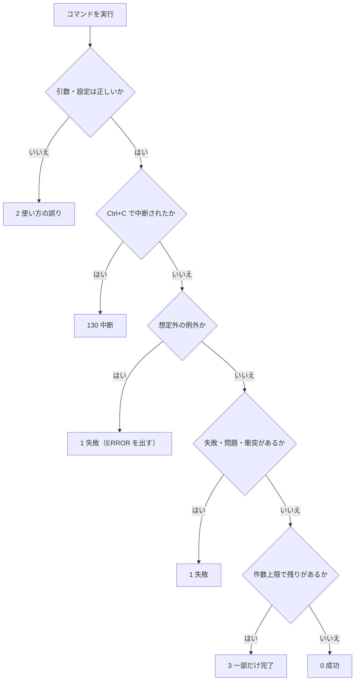
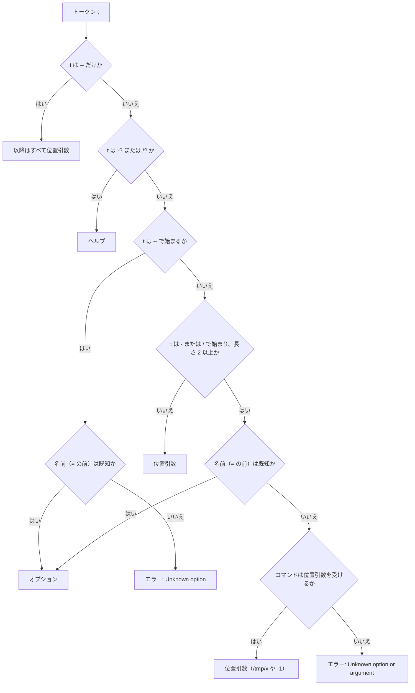
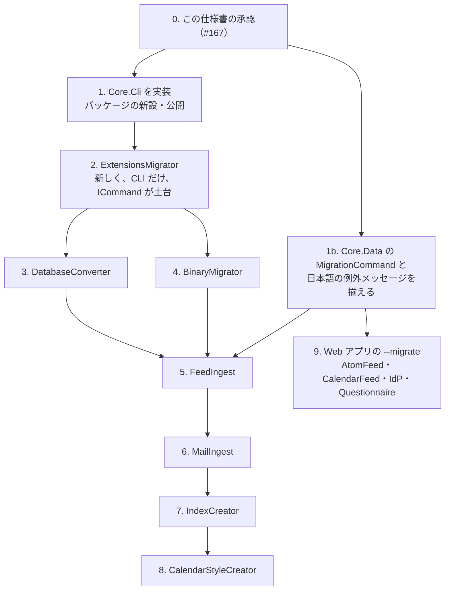

# CLI の共通仕様書

VehicleVision.PleasanterTools の**コマンドラインツール（CLI）が共通で従う動き**の仕様。
出力・`--json`・終了コード・引数の解析・環境変数を定め、Core の共通部品（案）の形まで書く。
実装は、この仕様の承認後に別の Issue で行う（Issue #167 の範囲外）。

**ユーザーが決めたこと（2026-11-08）と、その具体化の提案と、まだ決まっていないことを区別して書く。**

| 表記 | 意味 |
|---|---|
| **決定** | ユーザーが 2026-11-08 に決めたこと（Q1〜Q7 と引数の書式）。この文書で覆さない |
| **提案** | 決定を具体化するために、この文書で足した案。レビューで確定する |
| **未決** | 決めていない。9 章に質問として集める |
| **未確認** | 実機・実コードで確かめていない |

決定の内容を変えたい点は、変えずに 9 章へ質問として書いた。

## 1. 範囲と前提

### 1.1 対象

| 対象 | 内容 |
|---|---|
| CLI を持つツール | BinaryMigrator・DatabaseConverter・ExtensionsMigrator・FeedIngest・MailIngest・IndexCreator・CalendarStyleCreator |
| Web アプリの `--migrate` | AtomFeed・CalendarFeed・IdentityProvider・Questionnaire が、Core.Data の `MigrationCommand` で持つ起動引数 |
| 対象外 | Dealer、Pleasanter.Manual（横断作業の対象外）。DotNetClient（ライブラリで CLI を持たない）。McpOAuthWrapper（Web で CLI を持たない） |

この文書は、**コンソールへ出す文字列を英語・ASCII にする**規約（`.github/copilot-instructions.md`）の拡張でもある。
コメント・ドキュメント・ログの文書は、従来どおり日本語で書く。

### 1.2 根拠の書き方

- 現状の記述は、各リポジトリの `develop`（2026-11-09 に取得）を `git show origin/develop:パス` で読んだ実物による
- パスは、次の `{P}` を使って短く書く。`{P}` は各リポジトリの `src/VehicleVision.PleasanterTools.<名前>` で、
  `.Cli`・`.Core` などの接尾辞は表に書く。行番号は、その時点のファイルのもの
- IndexCreator・CalendarStyleCreator は `src/IndexCreator/`・`src/CalendarStyleCreator/` 直下に置いてある

| リポジトリ | 取得したコミット（`origin/develop`） |
|---|---|
| BinaryMigrator | `dcac5ff` |
| DatabaseConverter | `cab7e41` |
| ExtensionsMigrator | `e0d3ffe` |
| FeedIngest | `cb8a40d` |
| MailIngest | `1e7d18d` |
| IndexCreator | `2538a27` |
| CalendarStyleCreator | `91dcaeb` |
| IdentityProvider | `ead57a8` |
| DotNetClient | `3f61361` |
| McpOAuthWrapper | `1e4a2a8` |
| Core（この文書の基点） | `0b15b3c` |

### 1.3 決定の一覧

| 番号 | 決定の内容 | この文書の章 |
|---|---|---|
| Q1 | ターミナルでは、`NO_COLOR` が未設定のときだけ ANSI の色を出す。`[OK]`・`[WARN]`・`[ERROR]` の接頭辞は、色の有無によらず常に付ける | 2 |
| Q2 | 色は自動判定だけ。出力先が端末（TTY）で `NO_COLOR` が未設定のときだけ出す。`--color` は設けない。Kudu の Debug console が端末に見えるかは**未確認**で、見える場合は `--color auto\|always\|never` を足す案へ切り替える | 2、9 |
| Q3 | 結果は stdout、診断（進行表示・警告・エラー・確認の質問）は stderr。`validate` で見つかった問題は結果なので stdout、コマンド自体の失敗は stderr | 2 |
| Q4 | 結果を出すコマンドは、すべて `--json` に対応する。1 コマンドにつき 1 つの JSON オブジェクト。共通の枠にコマンド固有の項目を足す。`--json` のときの stdout は JSON だけ | 3 |
| Q5 | 終了コード 0 / 1 / 2 / 3 / 130。想定外の例外は 1 にして `[ERROR]` を出す。`validate`・`plan` の終了コードが変わるツールがあり、適用の Issue で影響を書く | 4 |
| Q6 | 引数の解析は Core の自作の共通部品。`System.CommandLine` は使わない。`/名前` を `--名前` へ正規化する。3 重実装を置き換える。ヘルプ・エラーの文言（ASCII）・補完は自作 | 5 |
| 書式 | `--名前`・`-名前`・`/名前` の 3 つ。既知の名前のときだけオプション。1 文字の短縮形は定義したものだけで `-abc` の結合なし。`名前 値` と `--名前=値`。ヘルプは `--help`・`-h`・`-?`・`/?`。大文字小文字は区別しない案 | 5 |
| Q7 | 環境変数は `ツール名_` の接頭辞、ツール間で共通のものは `PLEASANTER_`。既存も一斉に移行し、**旧名は受け付けない**（破壊的変更）。適用の Issue ごとに対応表・移行手順・リリースノートを書く | 6 |

### 1.4 公開範囲についての注意

Core は Public、決定の元になった記録は組織内部（internal）のリポジトリにある。
**この文書は、決定の内容を自分の言葉で書いたもので、internal の文書へのリンクも文面の転記も含まない。**
公開範囲の扱いは、PR でユーザーに確認する。

## 2. 出力の基本

### 2.1 文字・言語・秘密

| 項目 | 規則 | 状態 |
|---|---|---|
| 文字 | **ASCII だけ。** 日本語・`✓`・`✗` などを出さない（Kudu の Debug console で化けるため） | 決定（Q1 の前提） |
| 言語 | 英語。日本語の説明は README・運用手順に書く | 決定 |
| ASCII 以外の入力 | ファイル名などを出すときは `?` に置き換える。制御文字も同じ。1 行にする | 提案（BinaryMigrator の `ToAscii` と同じ。`{P}.Core/Commands/ReportFormatter.cs`） |
| 秘密 | パスワード・トークン・接続文字列・API キーを出さない。例外のメッセージも同じ。例外の文言は、そのまま出さない | 提案（既存の各ツールが守っている規則を共通にする） |
| 使い方の誤りで入力を示すとき | オプションの**名前だけ**を示す。`=` の後ろの値は示さない（秘密が混ざり得るため） | 提案 |

### 2.2 stdout と stderr

| 出力 | 先 | 例 |
|---|---|---|
| コマンドの結果 | stdout | 一覧・状態・検査の結果・`--json` の本体・`--help`・`--version`・最後の `[OK]` |
| 検査の失敗（`validate` で見つかった問題、`plan` の衝突） | stdout | 結果なので stdout。終了コードは 1 |
| 進行表示 | stderr | 「n 件目をコピーした」「待機中」 |
| 警告 `[WARN]` | stderr | |
| エラー `[ERROR]` | stderr | コマンド自体の失敗 |
| 確認の質問 | stderr | `Apply the listed changes? Type yes:` |

`ツール > result.txt` で結果だけが取れ、`--json` の出力へ警告が混ざらない。以上が決定（Q3）。

### 2.3 接頭辞

状態を表す行は、接頭辞で始める。**接頭辞は、色の有無によらず常に付ける。**
色が出ない環境（Kudu・CI のログ・リダイレクト）でも読めるようにするためで、色は補助にすぎない。

| 接頭辞 | 意味 | 出力先 | 色（ANSI の前景） | 状態 |
|---|---|---|---|---|
| `[OK]` | 成功 | stdout | 緑（32） | 決定 |
| `[WARN]` | 警告。処理は続く | stderr | 黄（33） | 決定 |
| `[ERROR]` | 失敗 | stderr | 赤（31） | 決定 |
| `[INFO]` | 補足 | stdout | なし | 提案 |

- 書式は `[OK] message`、`[WARN] message`、`[ERROR] message`（提案）。メッセージは英語・ASCII の 1 行
- 接頭辞のない行は、結果（一覧・表・要約）か、進行表示として扱う
- `[INFO]` の採否と、進行表示の書式は未決（9 章）

### 2.4 色

**自動判定だけ**にする（決定、`--color` は設けない）。次の**すべて**を満たすときだけ、その行の出力先に色を付ける。

1. 色を付ける行の出力先（stdout または stderr）が端末（TTY）につながっている
2. 環境変数 `NO_COLOR` が未設定、または空

提案の細部:

- 判定は出力先ごと。`ツール > result.txt` では stdout は色なし、stderr は端末なら色あり
- 色は**接頭辞の部分だけ**に付け、メッセージは既定の色のままにする。標準の 16 色の前景（31〜33）だけを使い、
  行の最後に `ESC[0m` でリセットする。256 色・24 ビット・太字・背景色は使わない
- `[INFO]` は色なし。鉄紺のような暗い色は暗い背景で読めなくなるため
- 色だけで意味を伝えない。接頭辞を常に付けるのはそのため
- `--json` のときも stdout は JSON だけで、色のコードを混ぜない（stderr は上の判定に従う）

**未確認:** Kudu の Debug console が端末として見えるかは、実機で確かめていない。
端末に見えて ANSI がそのまま表示される場合は、`--color auto|always|never` を足す案へ切り替える。
Windows のコンソールが ANSI を解釈するか（仮想端末の処理の有効化）も、実機で確認が要る。

### 2.5 現状との差

2 章の規則に合わない現状の主なものは 7.3 にまとめた。
要点は、結果と診断の分け方が 7 つのツールすべてで違うこと、接頭辞が `[OK]` 系を使うツールが無いこと、
日本語のメッセージをコンソールへ出している箇所があること。

## 3. `--json`

### 3.1 規則

**結果を出すコマンドは、すべて `--json` に対応する**（決定、Q4）。`check`・`validate`・`status` 系・`plan`・`run`・
`migrate` など。`--help`・`--version` は対象外。

- 1 コマンドにつき、**1 つの JSON オブジェクト**を stdout に出す。`--json` のときの stdout は JSON だけにする。
  進行・警告・エラーは stderr へ出す（Q3）
- 共通の枠に、コマンド固有の項目を足す

| 項目 | 型 | 内容 | 状態 |
|---|---|---|---|
| `command` | 文字列 | コマンド名（`validate` など） | 決定 |
| `ok` | 真偽値 | 終了コードが 0 のとき `true` | 決定 |
| `errors` | 配列 | 失敗・問題の一覧。要素は `code`（固定の文字列）と `message`（英語・秘密を含めない） | 決定 |
| `warnings` | 配列 | `errors` と同じ形 | 提案 |

### 3.2 提案の細部

| 項目 | 提案 |
|---|---|
| 固有の項目の足し方 | 枠と**同じ階層**に足す（`result` などへ入れ子にしない）。名前は camelCase。枠の 4 項目の名前は、固有の項目に使わない |
| 並び順 | 枠（`command`、`ok`、`errors`、`warnings`）を先に、固有の項目を後に書く |
| `errors` / `warnings` の要素 | `code`（PascalCase の固定の文字列）と `message` のほか、場所を示す `path`（任意）を持てる。`code` は、ツールごとの文書で一覧にする |
| ASCII | JSON も ASCII だけ。非 ASCII の文字は `\uXXXX` にエスケープする（サロゲートペアは 2 つの `\uXXXX`） |
| 形 | 1 行（改行は最後の 1 つだけ）。列挙は名前の文字列、日時は UTC の ISO 8601（`Z` 付き） |
| `ok` と終了コード | `ok` は終了コード 0 のときだけ `true`。3（一部だけ完了）でも `false` で、`errors` は空のことがある（9 章に質問） |
| `--json` の失敗 | 実行時の失敗（終了コード 1）は、枠の `errors` に入れて stdout へ出し、同じ内容を stderr に `[ERROR]` でも出す |
| `--json` の使い方の誤り | `--json` が解釈できていれば、`ok: false` と `code: "Usage"` の枠を出す。解釈できなかったときは stderr だけ（9 章に質問） |
| ファイル出力との違い | `--out` などのファイルへ書く JSON（棚卸し・plan の本体）は、この枠の対象外。stdout の `--json` は、結果の要約を出す |

### 3.3 例

検査の失敗（`validate`。終了コード 1。固有の項目は `checked`）:

```json
{"command":"validate","ok":false,"errors":[{"code":"ConfigInvalid","message":"sourceId is duplicated.","path":"sources[1].id"}],"warnings":[],"checked":{"sources":2}}
```

`plan`（衝突あり。終了コード 1。固有の項目は `planId` と `actions`。値は説明のための例）:

```json
{"command":"plan","ok":false,"errors":[{"code":"Conflict","message":"2 settings conflict with the target."}],"warnings":[],"planId":"3f9a0c1d2b7e","actions":{"Create":3,"Update":1,"Conflict":2}}
```

成功（`check`。終了コード 0）:

```json
{"command":"check","ok":true,"errors":[],"warnings":[]}
```

非 ASCII はエスケープする（例: `"message":"日本"`）。.NET の `System.Text.Json` の既定のエンコーダーは非 ASCII を
エスケープするが、**実装でテストして固定する**（未確認。既定の挙動に頼らず、`JavaScriptEncoder` を明示する）。

### 3.4 現状

`--json` を持つのは MailIngest の `run` だけで、枠（`command`・`ok`・`errors`）を持たない。整形あり・camelCase で、
集計の要約をそのまま出す（`{P}.Core/Ingest/IngestRunner.cs:71-76,118`、`{P}.Cli/RunCommand.cs:164`）。
共通の枠へ寄せると、出力を読んでいる側（スクリプトなど）に影響する。適用の Issue で影響を書く。

## 4. 終了コード

| コード | 意味 | 状態 |
|---|---|---|
| 0 | 成功。`validate` で問題なし、`plan` で衝突なし | 決定 |
| 1 | 処理の失敗。実行時のエラー、`validate` で問題あり、`plan` で衝突あり | 決定 |
| 2 | 使い方の誤り。引数や設定の不正。何も実行していない | 決定 |
| 3 | 一部だけ完了（件数上限で、残りがある） | 決定 |
| 130 | Ctrl+C などの中断 | 決定 |

- 想定外の例外は、すべて 1 にして `[ERROR]` を出す。例外の文言をそのまま出さず、秘密を含めない（決定）
- 提案: 複数に当てはまるときの優先は、130（中断）> 1（失敗）> 3（残りあり）> 0。MailIngest は、エラーがあれば 1、
  無くて残りがあれば 3 にしており（`{P}.Core/Ingest/IngestRunner.cs:57`）、これを共通の規則にする
- 提案: 2 は、**始める前に分かる誤り**（引数・設定ファイルの形・環境変数の欠落・読めないファイル）。
  実行を始めてから分かった問題は 1。`validate` は、検査の対象の**中身**の問題を 1、検査を始められないことを 2 にする
- 提案: 130 は、1 回目の Ctrl+C で取り消しの合図を出し、実行中の処理を安全な所で止めたあとに返す。
  `e.Cancel = true` で既定の強制終了を止める（現状の全ツールが同じ）
- 提案: 終了コードの定数は Core に置き、各ツールは数字を直書きしない（5.6）

終了コードの決定フロー（提案）:



### 4.1 終了コードが変わるツール（適用の Issue に書く）

決定（Q5）の注記に沿って、現状との差を挙げる。いずれも、適用の Issue で影響を書く。

| ツール | 現状 | 共通仕様 |
|---|---|---|
| ExtensionsMigrator `plan` | 衝突・ブロックがあっても 0（`{P}.Cli/PlanCommand.cs:98-101,109`） | 衝突ありは 1 |
| MailIngest `validate` | 設定に問題があれば 2（`{P}.Cli/Program.cs:127-130`） | 中身の問題は 1。ファイルが読めないときは 2 |
| IndexCreator | DB の失敗が 3（`src/IndexCreator/Program.cs:192`）、確認で `yes` と入力しないと 2（同 184） | DB の失敗は 1（3 は「一部だけ完了」）。確認の拒否は未決 |
| 中断（BinaryMigrator・DatabaseConverter・ExtensionsMigrator・MailIngest） | 1 | 130 |
| Core の `MigrationCommand` | DB の待機期限切れが 2（`MigrationCommand.cs:42`） | 実行時の失敗なので 1 |

## 5. 引数の解析（Core の自作の共通部品）

`System.CommandLine` は使わない（依存を増やさない）。BCL だけで書く（決定、Q6）。

### 5.1 書式

| 規則 | 内容 | 状態 |
|---|---|---|
| 3 つの接頭辞 | `--名前`・`-名前`・`/名前`。長い名前は 3 つで同じ（`--dry-run` = `-dry-run` = `/dry-run`） | 決定 |
| 既知の名前だけ | **既知のオプション名のときだけ**オプションとして扱う。絶対パス（`/tmp/x`）や負の数（`-1`）は、位置引数・値として扱う | 決定 |
| 値 | `名前 値` と `名前=値`（`--名前=値` を含む）の両方 | 決定 |
| 短縮形 | 1 文字の短縮形（`-h`・`-y` など）は、定義したものだけ。`-abc` のような結合は初版では受け付けない（`-abc` が既知の長い名前のときを除く） | 決定 |
| 大文字小文字 | 区別しない案（`/` と `-` は Windows の流儀） | 案（設計で確定） |
| ヘルプ | `--help`・`-h`・`-?`・`/?` | 決定 |
| 名前の形 | 小文字の英数字とハイフン（`[a-z][a-z0-9-]*`）。1 文字の短縮形は英小文字 1 文字 | 提案 |
| 重複 | 同じオプションを 2 回指定したらエラー | 提案（DatabaseConverter・ExtensionsMigrator が既にそう） |
| 必須 | 定義に `Required` を持ち、欠けたらエラー | 提案 |
| 位置引数 | 最初の位置引数はコマンド名（任意）。コマンドが位置引数を受けないとき、余った引数はエラー | 提案 |
| 終端 | `--` 以降は、すべて位置引数 | 提案 |
| 環境変数 | 定義に環境変数の名前を持てる。**引数 > 環境変数 > 既定値**の順（BinaryMigrator の `Value()` と同じ） | 提案 |

### 5.2 トークンの判定

1 つのトークン `t` を、次の順で判定する（提案。決定の「既知の名前のときだけ」を、`--` の扱いまで具体化したもの）。



- `--` で始まる未知の名前は、パスにも数にもならないのでエラーにする。打ち間違い（`--dry-rn`）を黙って位置引数にしない
- `-` と `/` で始まる未知のトークンは、位置引数の候補として扱う。**位置引数を受けないコマンドでは、結果としてエラーになる**
  ので、現状のすべてのツール（位置引数を使わない）では、打ち間違いが黙って通ることはない
- 位置引数を受けるコマンドで、`/名前` の打ち間違いが「パス」として通る危険は残る。`--` と `--名前` を勧める（9 章）
- 値を取るオプションの次のトークンは、**常に値として取る**（`--out /tmp/x`、`--offset -1`）。例外は、次が
  `--` で始まる既知の名前のとき（`--out --dry-run`）で、値の書き忘れとして `requires a value` にする

### 5.3 ヘルプ

- 生成する。ツールの定義（コマンド・オプション・説明・環境変数名・終了コード）から組み立て、手書きの `HelpText` をやめる
- `--help`・`-h`・`-?`・`/?` は、**どの位置にあっても**ヘルプを出して 0 で終わる（エラーより先に判定する）。
  コマンドの後ろにあれば、そのコマンドのヘルプ（提案）
- ヘルプは**結果なので stdout**。引数なしでコマンドが必要なときは、短い使い方を stderr に出して 2（ExtensionsMigrator と同じ）
- 既存の `help` という語（BinaryMigrator・DatabaseConverter・ExtensionsMigrator・IndexCreator・CalendarStyleCreator が受ける）
  も、先頭のときだけ受け付ける（互換。提案）
- 表示は `--名前` の形で書き、冒頭に「`-名前` と `/名前` も使える」と 1 行添える（提案）
- `--version` は、`ツール名 バージョン` の 1 行を stdout へ出して 0（BinaryMigrator・DatabaseConverter・ExtensionsMigrator
  が既に持つ。共通化は提案）

ヘルプの形（提案。内容は説明のための例）:

```text
binary-migrator - move Pleasanter binaries between storages.

Usage:
  binary-migrator migrate --from <KIND> --to <KIND> [options]
  binary-migrator --help | --version

Commands:
  migrate    Copy binaries from one storage to another.

Options for 'migrate':
      --from <KIND>     Source storage: rds | local | azure. (required)
      --dry-run         Show what would be done; write nothing.
  -y, --yes             Confirm --delete-source.
      --parallel <N>    Concurrent copies, 1-16. (default: 1)
      --rds-dbms <NAME> Database kind. [env BINARY_MIGRATOR_RDS_DBMS]

Common options:
  -h, --help, -?, /?    Show this help.
      --version         Show the version.
      --json            Write the result as one JSON object to stdout.

Options can also be written as -name or /name.

Exit codes:
  0 success, 1 failure, 2 usage error, 3 partially done, 130 interrupted.
```

### 5.4 エラーの文言

すべて英語・ASCII。`[ERROR] メッセージ` を stderr へ出し、続けて 1 行 `Run '<tool> --help' for usage.` を出して、終了コード 2
（提案。BinaryMigrator は `Error:`・DatabaseConverter は `ERROR:`・ExtensionsMigrator は接頭辞なしと、3 つとも違う）。

| 状況 | 文言（提案） |
|---|---|
| 未知のオプション（`--` 始まり） | `Unknown option: --foo` |
| 未知の引数（位置引数を受けない） | `Unknown option or argument: -foo` |
| 値が無い | `Option --from requires a value.` |
| フラグに値を付けた | `Option --dry-run does not take a value.` |
| 重複 | `Option --from was specified more than once.` |
| 必須が無い | `Option --from is required.` |
| 数の範囲 | `Option --parallel must be an integer from 1 to 16.` |
| 未知のコマンド | `Unknown command: foo` |
| コマンドが無い | `No command was given.` |
| 排他の指定 | `Use only one of --a and --b.` |

- 入力を示すときは、名前だけを示し（2.1）、ASCII 以外は `?` にする
- 数・範囲・一覧（`--tables a,b`）の検査は、部品の取得メソッドが行う（3 つの既存実装が同じ検査を書いている）

### 5.5 補完

**初版には入れない案。** シェルごと（bash・zsh・PowerShell）に生成物が違い、Kudu の Debug console では使えない。
後から `completion` コマンドを足しても、既存の引数の互換は壊れない。決定（Q6）は「初版に入れるかは設計で決める」で、
9 章に質問として残す。

### 5.6 公開 API の案

**新しいパッケージ `VehicleVision.PleasanterTools.Core.Cli` に置く**案。BCL だけに依存し、ほかの Core のパッケージを参照しない
（`Core.Data` に置くと、DB を使わない BinaryMigrator・ExtensionsMigrator などが Dapper などを引き連れる）。
Core の規則（アプリ名を書かない・値は引数で受ける）に従い、ツール名・環境変数の名前・説明はすべて定義として受け取る。

```csharp
namespace VehicleVision.PleasanterTools.Core.Cli;

/// <summary>オプションの種類。</summary>
public enum OptionKind { Flag, Value }

/// <summary>オプションの定義。名前は接頭辞なし・小文字・ハイフン区切り。</summary>
public sealed record OptionSpec
{
    public required string Name { get; init; }              // "dry-run"
    public required string Description { get; init; }       // ASCII の英語 1 行
    public OptionKind Kind { get; init; } = OptionKind.Flag;
    public string? ShortName { get; init; }                 // "y"。定義したものだけ
    public string? ValueName { get; init; }                 // ヘルプの "<N>"
    public bool Required { get; init; }
    public string? EnvironmentVariable { get; init; }       // 呼び出し側が決めた名前
}

/// <summary>コマンドの定義。</summary>
public sealed record CommandSpec(
    string Name,
    string Summary,
    IReadOnlyList<OptionSpec> Options,
    bool AcceptsPositionals = false);

/// <summary>ツールの定義。ツール名・説明・版は呼び出し側が渡す。</summary>
public sealed record ToolSpec(
    string Name,
    string Description,
    string Version,
    IReadOnlyList<CommandSpec> Commands,
    IReadOnlyList<OptionSpec>? CommonOptions = null);   // --json などをここへ

public enum ParseOutcome { Run, Help, Version, Error }

/// <summary>解析の結果。例外にしない（引数の誤りは普通の入力）。</summary>
public sealed class ParseResult
{
    public ParseOutcome Outcome { get; }
    public string? CommandName { get; }
    public ParsedOptions Options { get; }     // Outcome == Run のとき
    public string? Text { get; }              // Help: ヘルプ全文 / Error: ASCII のエラー文
}

public sealed class ParsedOptions
{
    public bool Has(string name);
    public bool Flag(string name);
    public string? Value(string name);                          // 引数 > 環境変数
    public int Int32(string name, int min, int max, int defaultValue);   // 範囲外は UsageException
    public IReadOnlyList<string> List(string name);             // 空白除去・空要素なし
    public IReadOnlyList<string> Positionals { get; }
}

public static class CommandLineParser
{
    /// <param name="getEnvironmentVariable">省略時は環境から読む。試験では差し替える。</param>
    public static ParseResult Parse(
        ToolSpec tool,
        IReadOnlyList<string> args,
        Func<string, string?>? getEnvironmentVariable = null);
}

/// <summary>使い方の誤り。終了コード 2。メッセージは ASCII。</summary>
public sealed class UsageException(string message) : Exception(message);

public static class ExitCodes
{
    public const int Success = 0;
    public const int Failure = 1;
    public const int UsageError = 2;
    public const int Partial = 3;
    public const int Interrupted = 130;
}
```

出力・JSON・実行の入口の案（細部は実装の Issue で詰める）:

```csharp
/// <summary>stdout と stderr の書き分け、接頭辞、色、ASCII 化、秘密の伏せ。複数の処理から呼ばれても行が混ざらない。</summary>
public sealed class CliOutput
{
    public CliOutput(
        TextWriter stdout,
        TextWriter stderr,
        Func<string, string?> getEnvironmentVariable,
        bool stdoutIsTerminal,
        bool stderrIsTerminal,
        Func<string, string>? redact = null);

    public static CliOutput ForConsole(Func<string, string?>? getEnvironmentVariable = null, Func<string, string>? redact = null);

    public void Ok(string message);          // stdout: [OK] ...
    public void Warn(string message);        // stderr: [WARN] ...
    public void Error(string message);       // stderr: [ERROR] ...
    public void Info(string message);        // stdout: [INFO] ...（採用する場合）
    public void Result(string line);         // stdout: 接頭辞なし
    public void Progress(string line);       // stderr: 接頭辞なし

    public static bool UseColor(bool isTerminal, Func<string, string?> getEnvironmentVariable);
    public static string ToAscii(string text);
}

public sealed record CliIssue(string Code, string Message, string? Path = null);

public static class JsonResult
{
    /// <summary>枠と固有の項目を、ASCII の 1 行の JSON にする。</summary>
    public static string Serialize(
        string command,
        bool ok,
        IReadOnlyList<CliIssue> errors,
        IReadOnlyList<CliIssue> warnings,
        Action<Utf8JsonWriter>? writeFields = null);
}

/// <summary>コマンドの実行に渡す文脈。ExtensionsMigrator の CommandContext と同じ考え方。</summary>
public sealed record CommandContext(
    ParsedOptions Options,
    CliOutput Output,
    TextReader Input,
    Func<string, string?> GetEnvironmentVariable);

public delegate Task<int> CommandHandler(CommandContext context, CancellationToken cancellationToken);

public static class CliApplication
{
    /// <summary>
    /// 解析 → ヘルプ・版・使い方の誤り → ハンドラーの実行までを行い、終了コードを返す。
    /// Ctrl+C は取り消しの合図にして 130、UsageException は 2、そのほかの例外は [ERROR] を出して 1。
    /// </summary>
    public static Task<int> RunAsync(
        ToolSpec tool,
        IReadOnlyDictionary<string, CommandHandler> handlers,
        IReadOnlyList<string> args,
        CliOutput output,
        TextReader input,
        Func<string, string?> getEnvironmentVariable,
        CancellationToken cancellationToken);
}
```

- 設計の土台は、ExtensionsMigrator の `CommandContext`・`ICommand`（`{P}.Cli/ICommand.cs:8-31`）と、DatabaseConverter の
  `ConverterApplication`（入出力・環境変数・DB を差し替えられる。`{P}.Core/CommandLine/ConverterApplication.cs:29-43`）。
  どちらも「入出力と環境変数を差し替えられる」ので、DB なし・実プロセスなしでテストできる
- 環境変数の接頭辞を、ツール ID から導く補助 `EnvironmentNames.Prefix(string toolId)`（`binary-migrator` → `BINARY_MIGRATOR_`）を
  Core に置く案。Core.Data の `AppDatabase` が同じ規則で `<ID>_` を導いている
  （`AppDatabase.cs:81-89`、`appId.ToUpperInvariant().Replace('-', '_')`）
- **後続の候補**（初版に入れない）: 接続文字列を「ファイル・標準入力・環境変数」から読む部品
  （BinaryMigrator の `SecretResolver` と DatabaseConverter の `ResolveConnectionString` が二重）、秘密を伏せる部品
  （BinaryMigrator の `SecretRedactor`、DatabaseConverter の静的な `SecretRedactor`）、`--yes` の確認の質問
- 配置の注意: 新しいパッケージを足すと、nuget.org の Trusted Publishing のポリシーと `release.yml`・リリース手順書の
  パッケージ一覧の更新が要る（`_documents/リリース手順書.md`）。リリースの dry-run は、2 つのワークフローとも先に回す。
  また「パッケージは互いに参照しない」（`_documents/コア化の方針.md`）ので、`Core.Data` の `MigrationCommand` は
  `Core.Cli` を参照できない。参照してよいか、出力だけ `TextWriter` で受けて文言を揃えるかは 9 章に質問として残す

### 5.7 テスト方針

新しいテストプロジェクト `tests/VehicleVision.PleasanterTools.Core.Cli.Tests`（xUnit。ほかの Core のテストと同じ）に置く。
入出力と環境変数は差し替えられるので、プロセスを起動しない。

| 区分 | 確かめること |
|---|---|
| 書式 | 3 つの接頭辞が同じ結果になる。`名前=値` と `名前 値` が同じ。短縮形。`-abc` は結合として解釈しない。大文字小文字（案の確定後） |
| 既知の名前だけ | `/tmp/x`・`-1`・`/y`（未定義）が位置引数になる。位置引数を受けないコマンドでは `Unknown option or argument`。`--` 始まりの未知は常にエラー。`--` の終端 |
| 値 | 値の欠落・フラグへの値・重複・必須の欠落。範囲外の数。一覧の空要素。値が `/` や `-` で始まっても取れる |
| 環境変数 | 引数 > 環境変数 > 既定値。空の環境変数は未設定として扱う |
| ヘルプ | 4 つの形がどの位置でも効く。エラーより先に判定。ヘルプ全文とエラー文がすべて ASCII |
| 定義の検査 | 名前の重複・大文字小文字だけが違う名前・予約語（`help`・`version`）・形の違反は、定義の時点で例外にする |
| 出力 | stdout と stderr への振り分け。接頭辞。色は「端末か」×「`NO_COLOR` が未設定・空・設定」の組み合わせ。`ToAscii`。秘密を伏せる |
| JSON | 枠の項目と順序。非 ASCII が `\uXXXX`。1 行。固有の項目。stdout に JSON 以外が混ざらない |
| 実行の入口 | UsageException → 2、想定外の例外 → 1 で文言が出ない、取り消し → 130、ハンドラーの戻り値がそのまま返る |
| 互換 | 既存 3 ツールのテスト（引数の誤りの一覧）を、共通部品の上で通す（置き換えの PR で行う） |

契約テスト（各ツールが自分のテストで回す、ヘルプ・エラーが ASCII か、結果が stdout か、終了コード表を守るか）を、
`Core.Web.Testing` のように別パッケージで出すかは未決（9 章）。

## 6. 環境変数

### 6.1 規則

| 規則 | 内容 | 状態 |
|---|---|---|
| ツール固有 | `ツール名_` を接頭辞にする（例: `MAILINGEST_`） | 決定 |
| 共通 | ツール間で共通のもの（Pleasanter の接続など）は `PLEASANTER_` | 決定 |
| 移行 | 既存の変数も一斉に新しい名前へ移し、**旧名は受け付けない**。破壊的変更 | 決定 |
| 告知 | 適用の Issue ごとに、旧名と新名の対応表・移行手順・リリースノートでの告知を書く | 決定 |
| 接頭辞の導き方 | ツール ID（小文字・ハイフン区切り）を大文字にし、`-` を `_` にして `_` を付ける。Core.Data の `AppDatabase` と同じ規則 | 提案 |
| 型 | 真偽は `true`（大文字小文字を問わない）だけを真とする（現状の `*_ALLOW_INSECURE*` と同じ） | 提案 |
| 秘密の置き場 | 接続文字列・API キーは、コマンドラインの引数に直書きさせない。環境変数・ファイル・標準入力から受ける | 提案（現状の BinaryMigrator・DatabaseConverter が守っている） |
| ツール側の名前 | 呼び出し側が引数で渡す（Core にアプリ名・接頭辞を書かない） | 決定（Core の規約） |

### 6.2 現状の一覧

実コードで確認した環境変数。接頭辞が規則（`ツール名_`・`PLEASANTER_`）に合うかも併せて示す。

| ツール | 変数 | 根拠 | 規則との関係 |
|---|---|---|---|
| BinaryMigrator | `BINARY_MIGRATOR_RDS_DBMS`・`_RDS_CONNECTION_STRING`・`_RDS_WRITE_CONNECTION_STRING`・`_LOCAL_PATH`・`_AZURE_ACCOUNT_URI`・`_AZURE_CONTAINER`・`_AZURE_CONNECTION_STRING` | `{P}.Core/Commands/MigrateCommandOptions.cs:20-28` | ツール ID `binary-migrator` から導く名前と一致。変更不要（案） |
| DatabaseConverter | `DBCONV_SOURCE_CONNECTION`・`DBCONV_TARGET_CONNECTION`（`--source-connection-env` で名前を変えられる） | `{P}.Core/CommandLine/ArgumentParser.cs:22,24` | `DBCONV_` は略称。`DATABASE_CONVERTER_` へ改名か（9 章） |
| ExtensionsMigrator | `PLEASANTER_BASE_URL`・`PLEASANTER_API_KEY` | `{P}.Engine/PleasanterEnvironment.cs:21-22` | 共通の `PLEASANTER_`。変更不要 |
| FeedIngest | `PLEASANTER_BASE_URL`・`PLEASANTER_API_KEY`・`PLEASANTER_API_KEY_FILE`、または `FEEDINGEST_PLEASANTER_*`（3 つ。併用は不可）。`FEEDINGEST_DB_PROVIDER`・`_DB_CONNECTIONSTRING`・`_DB_ALLOW_INSECURE`。設定ファイルが指す秘密の名前（利用者が決める） | `{P}.Pleasanter/PleasanterEnvironment.cs:17-29`、`{P}.Cli/DatabaseSetup.cs:8-9` | `FEEDINGEST_PLEASANTER_*` は「ツール用の上書き」で、残すか決める必要がある（9 章） |
| MailIngest | `PLEASANTER_BASE_URL`・`PLEASANTER_API_KEY`（`check` だけ。`run` は設定ファイルが指す名前の変数から API キーを読む）。`MAILINGEST_DB_PROVIDER`・`_DB_CONNECTIONSTRING`・`_DB_ALLOW_INSECURE`。メールの資格情報も設定ファイルが指す名前 | `{P}.Core/PleasanterEnvironment.cs:22-23`、`{P}.Cli/RunCommand.cs:87`、`{P}.Cli/Program.cs:11` | 規則に合う。変更不要 |
| IndexCreator | `INDEXCREATOR_DBMS`・`INDEXCREATOR_CONNECTION_STRING`・`INDEXCREATOR_SCHEMA`。ほかに **Pleasanter 本体の名前**（`<EnvironmentName>_OwnerConnectionString`、`<サービス名>_Rds_<DBMS>_OwnerConnectionString` など） | `src/IndexCreator/Options.cs:198,206-212,220` | `INDEXCREATOR_` は `INDEX_CREATOR_` へ改名か（9 章）。**Pleasanter 本体の名前は本体が決めるので改名しない** |
| CalendarStyleCreator | `CALENDARSTYLE_ICAL_BEARER_TOKEN`・`_ICAL_BASIC_USER`・`_ICAL_BASIC_PASSWORD`・`_PLEASANTER_API_KEY`、`PLEASANTER_ALLOW_INSECURE_HTTP` | `src/CalendarStyleCreator/Options.cs:11-17` | `CALENDARSTYLE_` はツール名の略。`CALENDAR_STYLE_CREATOR_` へ改名か（9 章）。API キーは共通の `PLEASANTER_API_KEY` へ寄せられる |
| DotNetClient（ライブラリ） | `PLEASANTER_BASE_URL`・`PLEASANTER_API_KEY`・`PLEASANTER_SERVER_VERSION`・`PLEASANTER_ALLOW_INSECURE_HTTP` | `src/VehicleVision.PleasanterTools.DotNetClient/PleasanterOptions.cs:166-171` | 共通の `PLEASANTER_` の元。変更不要 |
| Web アプリ全般 | `<アプリ ID>_DB_PROVIDER`・`_DB_CONNECTIONSTRING`・`_DB_ALLOW_INSECURE` | Core の `AppDatabase.cs:81-89` | 規則に合う |
| McpOAuthWrapper（参考） | `MCP_GENERAL_*`・`MCP_RDS_*`（設定の接頭辞） | `Program.cs:16`、`Bridge/BridgeSetup.cs:23` | Web で CLI ではない。範囲外。確認のみ |

**共通の `PLEASANTER_` は、`BASE_URL`・`API_KEY`・`ALLOW_INSECURE_HTTP`・`SERVER_VERSION` を想定する。**
`API_KEY_FILE` は FeedIngest だけが持つ。共通にするかは 9 章に質問として残す。

### 6.3 対応表の作り方（適用の Issue に書くこと）

各ツールの適用 Issue に、次を書く。

1. **旧名→新名の対応表**。変数ごとに 1 行。次の書式（提案）:

    | 旧名 | 新名 | 変更の種類 | 備考 |
    |---|---|---|---|
    | `DBCONV_SOURCE_CONNECTION` | `DATABASE_CONVERTER_SOURCE_CONNECTION` | 接頭辞の改名 | 旧名は受け付けない |

   変更の種類は「接頭辞の改名」「共通へ統合」「変更なし」のいずれか。変更なしの変数も、確かめた印に 1 行ずつ書く
2. **旧名を検出して案内する扱いにするか**。旧名は受け付けない（決定）ので、旧名だけが設定されているときに、
   無言で未設定扱いにするか、`[ERROR] Environment variable X is no longer supported. Use Y.`（終了コード 2）で止めるかを決める。
   案は後者（運用中の設定の直し忘れに気づける）。これは決定を覆さない（旧名を値として使わない）が、**9 章に質問として残す**
3. **移行手順**。運用中の環境の設定（Azure App Service の構成・タスクスケジューラ・systemd・CI の秘密など）を、
   どの順で直すか。直すまで動かなくなることを明記する
4. **リリースノートでの告知**。破壊的変更として、版・旧名・新名・直し方を書く
5. **同じ実行ファイルを参照している手順書・README・スクリプト**の洗い出し
6. 設定ファイルが指す環境変数の名前（FeedIngest・MailIngest。利用者が決める）は、この規則の対象外で、改名しない

## 7. 現状の調査結果

### 7.1 ツール × 引数の書式・終了コード・`--json`・環境変数

| ツール | コマンドと引数の書式 | 終了コード | `--json` | 環境変数 | 根拠 |
|---|---|---|---|---|---|
| BinaryMigrator | `migrate`。`--名前`、`--名前=値`。短縮形は `-y`・`-h` | 0 / 1 / 2。中断は 1 | なし | `BINARY_MIGRATOR_*`（7 つ） | `{P}.Core/Commands/CommandLine.cs:59-142`、`{P}.Cli/Program.cs:6` |
| DatabaseConverter | `convert`。`--名前`、`--名前=値`。短縮形は `-h` | 0 / 1 / 2。中断は 1 | なし | `DBCONV_*`（2 つ） | `{P}.Core/CommandLine/ArgumentParser.cs:91-199` |
| ExtensionsMigrator | `check`・`inventory`・`validate`・`plan`。`--名前`、`--名前=値`。短縮形は `-h` | 0 / 1 / 2。中断は 1 | なし（`--out` はファイル出力） | `PLEASANTER_*`（2 つ） | `{P}.Cli/ParsedArguments.cs:25-79`、`{P}.Cli/ExitCodes.cs:4-14` |
| FeedIngest | `check`・`ingest`・`migrate`・`migrate-status`・`unlock`。位置固定の手書き。`--config 値`、`--dry-run` | 0 / 1 / 2 / 130 | なし | `PLEASANTER_*` か `FEEDINGEST_PLEASANTER_*`、`FEEDINGEST_DB_*` | `{P}.Cli/CliApp.cs:12,37-62,138-158` |
| MailIngest | `check`・`validate`・`run`・`migrate`・`migrate-status`。配列パターンの一致。`--config 値`、`--json` | 0 / 1 / 2 / 3。中断は 1 | `run` だけ。枠なし | `PLEASANTER_*`、`MAILINGEST_DB_*` | `{P}.Cli/Program.cs:9,15-41` |
| IndexCreator | 先頭が操作（`plan`・`_rds`・`views`・`_views`・`choice-lists`・`_choice-lists`）。`/名前 値`。パスは `/` 始まりの値も取る | 0 / 1 / 2 / 3（DB の失敗）/ 130 | なし | `INDEXCREATOR_*`（3 つ）と Pleasanter 本体の名前 | `src/IndexCreator/Options.cs:10-49`、`Program.cs:190-194` |
| CalendarStyleCreator | `generate`・`register`。`/名前 値`。パスは `/` 始まりの値も取る | 0 / 2 / 130。**想定外の例外を捕まえていない** | なし | `CALENDARSTYLE_*`（4 つ）、`PLEASANTER_ALLOW_INSECURE_HTTP` | `src/CalendarStyleCreator/Options.cs:37-75`、`Program.cs:58-67` |
| Web アプリの `--migrate`（Core.Data） | `--migrate`・`--migrate-status`・`--wait-for-db=N`（`=` の形だけ） | 0 / 1（未適用あり）/ 2（DB の待機期限切れ） | なし | `<アプリ ID>_DB_*` | `MigrationCommand.cs:6-12,33-44,57-59,68-75` |

#### 7.1.1 出力（stdout と stderr、接頭辞、言語）

| ツール | 結果・進行 | 警告 | エラー | 接頭辞・形式 | 日本語のメッセージ |
|---|---|---|---|---|---|
| BinaryMigrator | すべて stdout（`{P}.Cli/ConsoleOutput.cs:16-23`）。秘密を伏せ、ASCII 以外は `?` | 無し | stderr に `Error: …`、続けて `Use --help for usage.`（`{P}.Cli/Program.cs:21-22`） | `[n] COPIED …` | なし |
| DatabaseConverter | stdout（`Info`） | **stdout に `WARNING: …`**（`{P}.Core/Engine/ConversionReport.cs:29`） | stderr に `ERROR: …`（同 31） | `ERROR:`・`WARNING:` | なし |
| ExtensionsMigrator | stdout。検査の行は `error: code: key: message`（`{P}.Cli/InventoryCommands.cs:135`） | stdout の `warning:` | stderr に接頭辞なし | 小文字の `error:`・`warning:` | なし |
| FeedIngest | stdout（`stopped reason=…`、`source=… not-processed`。`{P}.Cli/Ingest/IngestRunner.cs:92,147,402`） | 無し | stderr に接頭辞なし（`{P}.Cli/CliApp.cs:81,98,115`） | `key=value` 形式 | **あり**（`{P}.Pleasanter/PleasanterEnvironment.cs:26,35`）。`check` が表示する |
| MailIngest | stdout にサマリー、stderr に `error [Code] path: message`・`warning […]`・`log level=… event=…`（`{P}.Cli/Program.cs:119-125`、`{P}.Cli/RunCommand.cs:213`） | stderr | stderr | `error [Code]`・`warning [Code]` | **あり**（`{P}.Cli/Program.cs:93,101`、`{P}.Core/PleasanterEnvironment.cs:31`） |
| IndexCreator | すべて stdout（`RuntimeLog.WriteLine`。ファイルの NLog にも書く。`src/IndexCreator/RuntimeLog.cs:27-42`） | **stdout に `WARNING:`・`INFO:`**（`Program.cs:68,76`）。確認の質問も stdout（同 183） | stderr に `ERROR: …` | `ERROR:`・`WARNING:`・`INFO:` | なし |
| CalendarStyleCreator | stdout（`src/CalendarStyleCreator/RuntimeLog.cs:6-7`） | 無し | stderr に `ERROR: …`、`Canceled.` | `ERROR:` | なし |
| Web アプリの `--migrate` | stdout（`MigrationCommand.cs:35,49,52-55,64`） | 無し | 待機期限切れだけ stderr（同 40） | 接頭辞なし | メッセージはなし。ただし **Core.Data が投げる例外のメッセージが日本語**（下の注） |

日本語のメッセージの注: Core.Data の `AppDatabase.ParseProvider`（`AppDatabase.cs:131-133`）と `ConnectionSecurity.EnsureSecure`
（`ConnectionSecurity.cs:170-172`）は、**日本語の例外メッセージ**を投げる。FeedIngest・MailIngest の `migrate`・`run`・`unlock` は、
その `ex.Message` をそのまま stderr へ出す（`{P}.Cli/CliApp.cs:81`、`{P}.Cli/Program.cs:63`、`{P}.Cli/RunCommand.cs:126`）。
Kudu で化ける。**Core 側の直しが要る**（例外メッセージを英語にするか、コンソール向けに別の文言を返す）。

### 7.2 3 重実装の比較（BinaryMigrator・DatabaseConverter・ExtensionsMigrator）

Q6 が置き換えを求めている 3 つの引数解析は、同じことを少しずつ違う形で書いている。

| 観点 | BinaryMigrator | DatabaseConverter | ExtensionsMigrator |
|---|---|---|---|
| 根拠 | `{P}.Core/Commands/CommandLine.cs` | `{P}.Core/CommandLine/ArgumentParser.cs` | `{P}.Cli/ParsedArguments.cs` |
| 定義の持ち方 | `Flags`・`ValueOptions` の 2 つの集合（59-71）。コマンドは `migrate` だけ | 同じ 2 つの集合（91-116）。コマンドは `convert` だけ | コマンドごとに `ValueOptions`・`FlagOptions` を持つ（`ICommand`）。複数コマンド |
| `--名前=値` | 受ける（102-110） | 受ける（149-154） | 受ける（41-43） |
| 短縮形 | `-y`・`-h` | `-h` | `-h` |
| 重複の指定 | **黙って後勝ち**（`values[name] = …`、136） | エラー（168-170、190-193） | エラー（72-75） |
| 余った位置引数 | エラー（140） | エラー（197） | **集めるだけで、どのコマンドも使わない**（35-38）。余計な引数が黙って通る。テストが期待している（`tests/…Cli.Tests/CommandLineAppTests.cs:125`） |
| ヘルプ | 任意の位置の `--help`・`-h`、または先頭の `help`（82） | 先頭の `--help`・`-h`・`help`、またはコマンドの走査中の `--help`・`-h`（127,163-166） | 先頭の `--help`・`-h`・`help`（`{P}.Cli/CommandLineApp.cs:16`）。引数なしは stderr に出して 2 |
| `--version` | 引数がそれだけのときだけ（86） | 先頭の `--version`・`version`（132） | 先頭の `--version`（`CommandLineApp.cs:22`） |
| エラーの形 | `Error: …`＋`Use --help for usage.`（`{P}.Cli/Program.cs:21-22`） | `ERROR: …`＋`Run 'database-converter --help' for usage.`（`ConverterApplication.cs:58-59`） | 接頭辞なしの 1 行（`CommandLineApp.cs:39`） |
| 数の検査 | `NumberStyles.None` と範囲（169,175） | 同じ（245,252,259） | `--tenant-id` だけ（`PlanCommand.cs:36`） |
| 一覧（`a,b`） | `--types`（`BinaryGroups.TryParse`） | `--tables`・`--exclude-tables`（332-350） | なし |
| 接続文字列の読み方 | ファイル→標準入力→環境変数（`{P}.Core/Commands/Secrets.cs:7-44`）。全体を `Trim` | 環境変数名・ファイル（最初の空でない行）・標準入力（`ConverterApplication.cs:173-221`） | 無し（API キーは環境変数だけ） |
| 秘密を伏せる | `SecretRedactor`（インスタンス。`Secrets.cs:50-110`） | `SecretRedactor`（静的。`ConverterApplication.cs:76-77`） | 無し |

IndexCreator と CalendarStyleCreator は、さらに別の 4 つ目・5 つ目の実装で、`/名前 値` だけを受ける
（`src/IndexCreator/Options.cs:16-50`、`src/CalendarStyleCreator/Options.cs:42-75`）。
FeedIngest と MailIngest は引数解析と呼べるものを持たず、位置固定・配列パターンの一致で書いている。
IdentityProvider は、Core の `MigrationCommand` と**ほぼ同じ内容の複製**を自分のリポジトリに持つ
（`src/VehicleVision.PleasanterTools.IdentityProvider.Web/MigrationCommand.cs:25-91`）。

### 7.3 食い違いの要点

| 観点 | 食い違い | 共通仕様での扱い |
|---|---|---|
| 引数の書式 | `--名前`（5 つ）と `/名前 値`（2 つ）に割れ、FeedIngest・MailIngest は `--名前=値` を受けない | 3 つの書式すべてを受ける（5.1） |
| 結果と診断 | 全部 stdout のツール（BinaryMigrator・IndexCreator・CalendarStyleCreator）、警告を stdout に出すツール（DatabaseConverter・IndexCreator）、エラーに接頭辞のないツール（ExtensionsMigrator・FeedIngest） | 結果は stdout、診断は stderr（2.2） |
| 接頭辞 | `Error:`・`ERROR:`・`error [Code]`・`error:`・接頭辞なしの 5 通り。`[OK]` は無し | `[OK]`・`[WARN]`・`[ERROR]`（2.3） |
| 終了コード | 中断が 130（FeedIngest・IndexCreator・CalendarStyleCreator）と 1（ほか 4 つ）。3 の意味が「残りあり」（MailIngest）と「DB の失敗」（IndexCreator）。`validate` の問題が 1（ExtensionsMigrator）と 2（MailIngest）。`plan` の衝突が 0 | 表のとおり（4 章） |
| 想定外の例外 | MailIngest は 1＋文言を出さない。CalendarStyleCreator は**捕まえない**（未処理のときの終了コードは実行環境による。未確認） | すべて 1＋`[ERROR]`（4 章） |
| `--json` | MailIngest の `run` だけ。枠なし・整形あり | すべての結果を出すコマンドで、枠つき（3 章） |
| 日本語の出力 | FeedIngest・MailIngest に直書き。Core.Data の例外メッセージも日本語 | ASCII・英語（2.1） |
| 環境変数 | `BINARY_MIGRATOR_`・`DBCONV_`・`CALENDARSTYLE_`・`INDEXCREATOR_`・`FEEDINGEST_PLEASANTER_` など、接頭辞の作り方がばらばら | `ツール名_`・`PLEASANTER_`（6 章） |
| 位置引数 | ExtensionsMigrator だけが余計な引数を黙って通す | エラーにする（5.1） |
| 重複の指定 | BinaryMigrator だけが後勝ち | エラーにする（5.1） |

## 8. 置き換えの順序案

**案。** 順序は、依存と、終了コードなどの破壊的変更の大きさで決める。1 ツールにつき 1 つの Issue と PR（先に Issue を起こす）。



| 順 | 対象 | 理由 | 適用 Issue に書く主な影響 |
|---|---|---|---|
| 1 | Core.Cli の実装 | 部品が無いと始まらない。新パッケージは、nuget.org のポリシー・`release.yml`・リリース手順書の更新が要る | 公開 API の追加。各ツールの追随は Issue に残す |
| 1b | Core.Data の `MigrationCommand`・例外メッセージ | FeedIngest・MailIngest・Web アプリが共通で使う。Core 側の直しなので先に | DB の待機期限切れ 2→1。`--wait-for-db N` の形。例外メッセージの英語化（公開 API の挙動の変更） |
| 2 | ExtensionsMigrator | 最も新しく、CLI のみ（GUI は作らない）。コマンドが複数あり、`CommandContext`・`ICommand` が既に土台になるので、部品の形を試せる | `plan` の衝突 0→1。余計な引数がエラーに。中断 130。`--json` の追加 |
| 3 | DatabaseConverter | 3 重実装のうち 1 つ。環境変数の改名がある | `WARNING:` が stderr の `[WARN]` へ。`DBCONV_*` の改名。中断 130 |
| 4 | BinaryMigrator | 3 重実装のうち 1 つ。出力の量が多い（1 件ごとの行を stderr へ移す） | 進行が stderr へ。重複指定がエラーに。中断 130。`--json` |
| 5 | FeedIngest | 位置固定の手書きを置き換え。日本語のメッセージを英語に。`FEEDINGEST_PLEASANTER_*` の扱いが未決 | 環境変数。`--名前=値`・`/名前` が使える。`--json`。メッセージ |
| 6 | MailIngest | `validate` の終了コード、`run --json` の形が変わる（出力を読む側に影響） | `validate` 2→1。`--json` の枠。日本語メッセージの英語化。中断 130 |
| 7 | IndexCreator | `/名前` の既存の書式は保てる。3 の意味が変わる | DB の失敗 3→1。警告・質問が stderr へ。環境変数の改名 |
| 8 | CalendarStyleCreator | 想定外の例外を 1 にする。環境変数の改名 | 環境変数 4 つの改名。`[OK]`・`[ERROR]` |
| 9 | Web アプリ（AtomFeed・CalendarFeed・IdentityProvider・Questionnaire） | 1b のあと。IdentityProvider は自前の複製を Core の版へ寄せる | `--migrate` の出力と終了コード |

置き換えのたびに、旧名と新名の対応表・移行手順・リリースノート（6.3）を書く。リリースは、Core・各ツールとも
`release.yml` の dry-run を先に回し、タグは付け直せないことに注意する。

## 9. 未決・要確認

決定（Q1〜Q7）は覆さない。変えたい点は、次の質問として書く。

### 9.1 未確認（実機・実コード）

| 項目 | 状態 |
|---|---|
| Kudu の Debug console が端末（TTY）として見えるか | **未確認。** 見えて ANSI がそのまま表示される場合は、`--color auto\|always\|never` を足す案へ切り替える（Q2） |
| Windows のコンソール・Windows Terminal・Linux で、ANSI の色（31〜33）が読めるか | 未確認。仮想端末の処理が有効かも含む |
| `System.Text.Json` の既定のエンコーダーが非 ASCII を `\uXXXX` にするか | 実装でテストして固定する。既定の挙動に頼らない |
| CalendarStyleCreator で想定外の例外が起きたときの終了コード | 未確認（`src/CalendarStyleCreator/Program.cs:58-67` は捕まえない） |

### 9.2 提案の段階で、レビューで確定するもの

| 項目 | 現在の案 |
|---|---|
| `[INFO]` | 設ける（補足。色なし、stdout）。進行表示の書式（接頭辞なし・stderr）とあわせて確定する |
| `warnings` | 枠に入れる（`errors` と同じ形） |
| ANSI の色の対応 | 標準の 16 色の前景 31〜33 |
| ヘルプの `-?`・`/?` | 受ける |
| 大文字小文字 | オプション名とコマンド名は区別しない。値は区別する。2 つの名前が大文字小文字だけで違う定義は、定義の時点で例外にする |

### 9.3 質問（決定を変えずに、決める必要があること）

| 番号 | 質問 | 案・影響 |
|---|---|---|
| U1 | 補完（シェルのタブ補完）を初版に入れるか | 入れない案。理由は 5.5 |
| U2 | 大文字小文字を区別しない案で確定してよいか | 値は区別しない。`-H` と `-h` のように大文字小文字だけが違う短縮形は作れなくなる |
| U3 | `--json` の枠に、`exitCode`（整数）や `schemaVersion` を足すか | 終了コード 3（一部だけ完了）で `ok: false` かつ `errors` が空になり、結果を読む側が区別できない。MailIngest の要約は `exitCode` を持つ |
| U4 | `--json` のときの使い方の誤り（終了コード 2）を、JSON の枠でも出すか | `--json` が解釈できたときだけ出す案（3.2） |
| U5 | `validate` で「検査を始められない」（設定ファイルが無い・読めない）を 2 にしてよいか | 決定の「引数や設定の不正が 2」と、「問題あり 1」の境目。MailIngest `validate` の現状は、ファイルが無いのも中身の問題も 2 |
| U6 | IndexCreator の `plan` で、未適用の変更があるときの終了コードは | 現状は 0（`Program.cs:171-173`）。決定の「plan で衝突あり 1」は、衝突の無いツールにどう当てはめるか |
| U7 | IndexCreator の確認の質問（`yes` と入力）で拒否されたときの終了コードは | 現状は 2。案は 1。`--yes`・`-y`（BinaryMigrator）との共通化も含めて決める |
| U8 | 環境変数の接頭辞の綴り: `DBCONV_`→`DATABASE_CONVERTER_`、`CALENDARSTYLE_`→`CALENDAR_STYLE_CREATOR_`、`INDEXCREATOR_`→`INDEX_CREATOR_` でよいか | `BINARY_MIGRATOR_` はハイフン区切りのツール ID と一致する。一方、状態 DB を持つ `feedingest`・`mailingest` は、ID にハイフンが無く `FEEDINGEST_`・`MAILINGEST_`（SQLite のファイル名・ロック名も同じ ID）。ID の綴りの規則を揃えるか |
| U9 | FeedIngest の `FEEDINGEST_PLEASANTER_*`（ツール用の上書き）を残すか、共通の `PLEASANTER_*` に統合するか | 残すなら「`ツール名_` ＋ 共通の名前」という第 3 の形が規則に加わる。統合なら旧名は受け付けない |
| U10 | `PLEASANTER_API_KEY_FILE` を共通の変数にするか | 現状は FeedIngest だけ。ExtensionsMigrator・MailIngest・CalendarStyleCreator にも広げる意味があるか |
| U11 | 旧名だけが設定されているとき、無言で未設定にするか、`[ERROR]` で 2 を返して案内するか | 旧名は受け付けない（決定）。案内の有無は、決定の範囲の外 |
| U12 | `Core.Data` の `MigrationCommand` が `Core.Cli` を参照してよいか | 「パッケージは互いに参照しない」の例外になる。参照しない案は、`TextWriter` を受けて文言だけを揃える |
| U13 | 位置引数を受けるコマンドで、未知の `/名前`・`-名前` を位置引数にしてよいか | 決定の「既知の名前だけ」に沿う。打ち間違いがパスとして通る危険は、`--` 始まりの未知をエラーにすることと、位置引数を使うコマンドを作らないことで抑える |
| U14 | `--名前:値`（Windows の `/名前:値`）を受けるか | 初版は受けない案 |
| U15 | `--version` を共通の出力にするか | 3 つのツールが既に持つ。形は `ツール名 バージョン`（案） |
| U16 | 契約テスト（ヘルプ・エラーが ASCII、結果が stdout、終了コード表）を、別パッケージ（`Core.Cli.Testing`）として出すか | 先例は `Core.Web.Testing` |
| U17 | IndexCreator の内部の操作名（`_rds`・`_views`・`_choice-lists`）を残すか | 現状は Pleasanter の `CodeDefiner` の流儀に合わせた名前。共通仕様の対象は「引数の書式」で、操作名の見直しは含めない案 |
| U18 | DatabaseConverter の「Ctrl+C を 2 回で強制終了」を共通の動きにするか | 現状は DatabaseConverter だけ（`{P}.Cli/Program.cs:8-17`） |

### 9.4 公開範囲の確認

Core は Public、決定の元になった記録は internal。この文書は決定の内容を書いたもので、リンクと文面の転記は含まない。
公開範囲の判断は、PR でユーザーに確認する。

## 10. この仕様書の範囲外

- 実装（Core.Cli の作成、各ツールへの適用）。それぞれ別の Issue で行う
- 各ツールの環境変数の改名の実施。対応表・移行手順・リリースノートは各ツールの Issue に書く（6.3）
- 見た目の決まり（色の値・トークン）の管理。この文書は、動きと実装が従う仕様を定める
