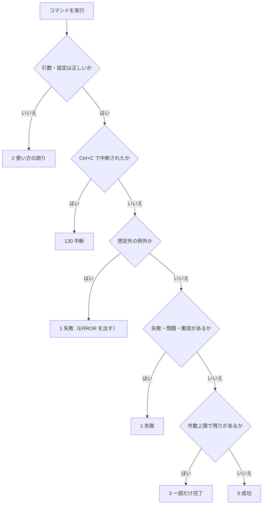
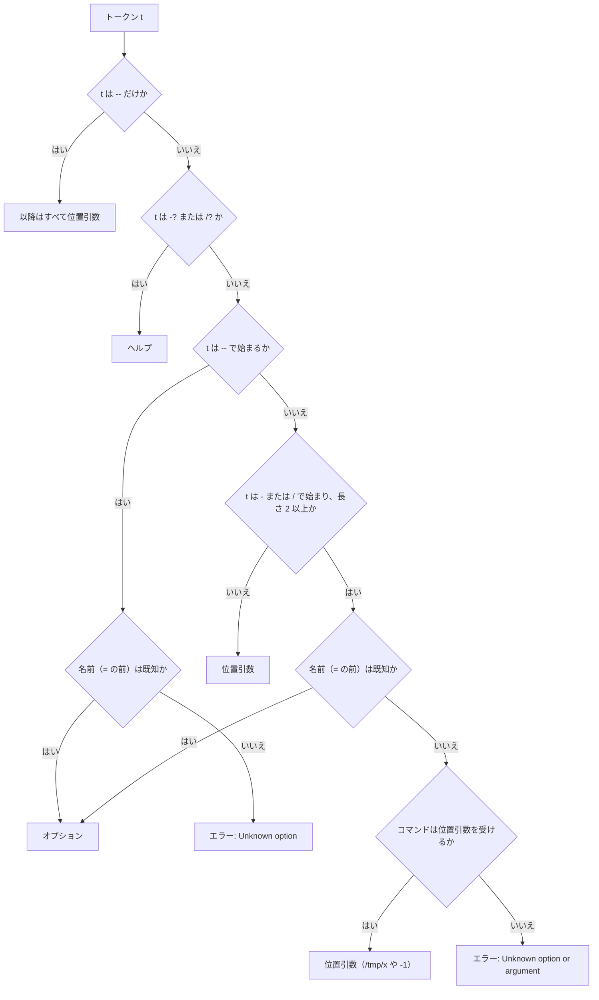
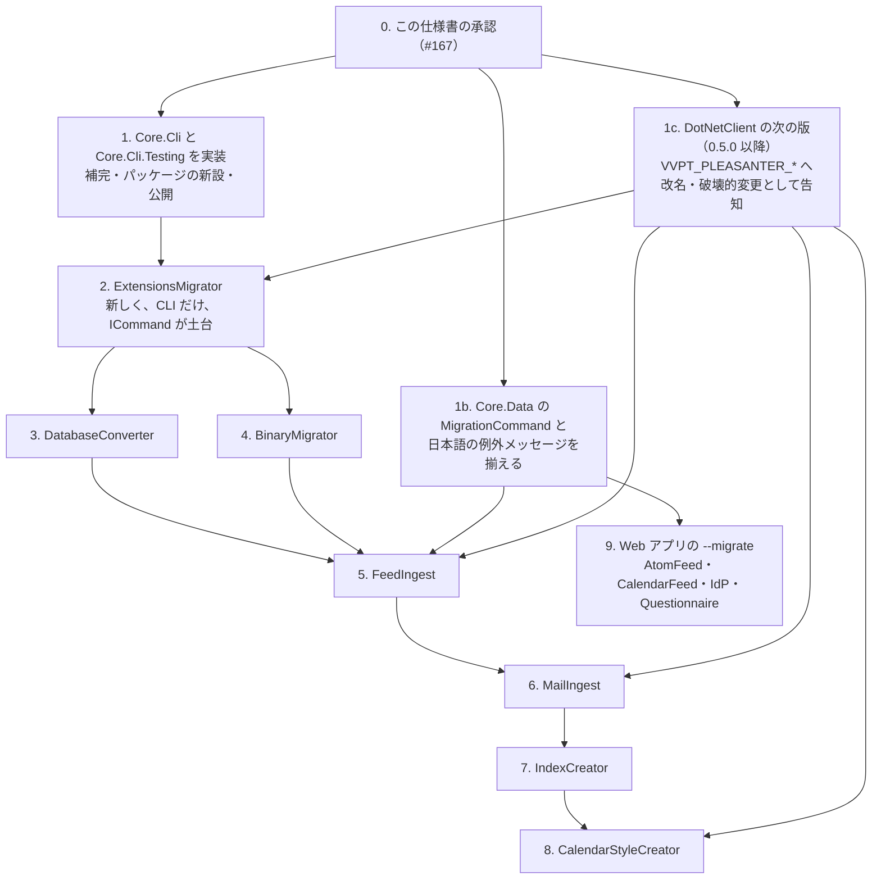

# CLI の共通仕様書

VehicleVision.PleasanterTools の**コマンドラインツール（CLI）が共通で従う動き**の仕様。
出力・`--json`・終了コード・引数の解析・環境変数を定め、Core の共通部品（案）の形まで書く。
実装は、この仕様の承認後に別の Issue で行う（Issue #167 の範囲外）。

**ユーザーが決めたこと（2026-11-08）と、その具体化の提案と、まだ決まっていないことを区別して書く。**

| 表記 | 意味 |
|---|---|
| **決定** | ユーザーが 2026-11-08 に決めたこと（Q1〜Q7 と引数の書式）。この文書で覆さない |
| **提案** | 決定を具体化するために、この文書で足した案。レビューで確定する |
| **未決** | 決めていない。9 章に質問として集める |
| **未確認** | 実機・実コードで確かめていない |

決定の内容を変えたい点は、変えずに 9 章へ質問として書く。
**2026-11-09 に、未決だった U1〜U18 と、そこから出た N1〜N6 へユーザーが回答した。回答を「決定」として本文へ移し、9.3 に一覧を残した。質問としての未決は残っていない（9 章）。**
共通の環境変数の接頭辞は、Q7 の「共通は `PLEASANTER_`」を、ユーザーが `VVPT_PLEASANTER_*` へ変更した（6 章）。

## 1. 範囲と前提

### 1.1 対象

| 対象 | 内容 |
|---|---|
| CLI を持つツール | BinaryMigrator・DatabaseConverter・ExtensionsMigrator・FeedIngest・MailIngest・IndexCreator・CalendarStyleCreator |
| Web アプリの `--migrate` | AtomFeed・CalendarFeed・IdentityProvider・Questionnaire が、Core.Data の `MigrationCommand` で持つ起動引数 |
| 対象外 | Dealer、Pleasanter.Manual（横断作業の対象外）。DotNetClient は CLI を持たないが、環境変数の名前だけ共通の接頭辞の改名の対象（6 章）。McpOAuthWrapper（Web で CLI を持たない） |

この文書は、**コンソールへ出す文字列を英語・ASCII にする**規約（`.github/copilot-instructions.md`）の拡張でもある。
コメント・ドキュメント・ログの文書は、従来どおり日本語で書く。

### 1.2 根拠の書き方

- 現状の記述は、各リポジトリの `develop`（2026-11-09 に取得）を `git show origin/develop:パス` で読んだ実物による
- パスは、次の `{P}` を使って短く書く。`{P}` は各リポジトリの `src/VehicleVision.PleasanterTools.<名前>` で、
  `.Cli`・`.Core` などの接尾辞は表に書く。行番号は、その時点のファイルのもの
- IndexCreator・CalendarStyleCreator は `src/IndexCreator/`・`src/CalendarStyleCreator/` 直下に置いてある

| リポジトリ | 取得したコミット（`origin/develop`） |
|---|---|
| BinaryMigrator | `dcac5ff` |
| DatabaseConverter | `cab7e41` |
| ExtensionsMigrator | `e0d3ffe` |
| FeedIngest | `cb8a40d` |
| MailIngest | `1e7d18d` |
| IndexCreator | `2538a27` |
| CalendarStyleCreator | `91dcaeb` |
| IdentityProvider | `ead57a8` |
| DotNetClient | `3f61361` |
| McpOAuthWrapper | `1e4a2a8` |
| Core（この文書の基点） | `0b15b3c` |

### 1.3 決定の一覧

| 番号 | 決定の内容 | この文書の章 |
|---|---|---|
| Q1 | ターミナルでは、`NO_COLOR` が未設定のときだけ ANSI の色を出す。`[OK]`・`[WARN]`・`[ERROR]` の接頭辞は、色の有無によらず常に付ける | 2 |
| Q2 | 色は自動判定だけ。出力先が端末（TTY）で `NO_COLOR` が未設定のときだけ出す。`--color` は設けない。Kudu の Debug console が端末に見えるかは**未確認**で、見える場合は `--color auto\|always\|never` を足す案へ切り替える | 2、9 |
| Q3 | 結果は stdout、診断（進行表示・警告・エラー・確認の質問）は stderr。`validate` で見つかった問題は結果なので stdout、コマンド自体の失敗は stderr | 2 |
| Q4 | 結果を出すコマンドは、すべて `--json` に対応する。1 コマンドにつき 1 つの JSON オブジェクト。共通の枠にコマンド固有の項目を足す。`--json` のときの stdout は JSON だけ | 3 |
| Q5 | 終了コード 0 / 1 / 2 / 3 / 130。想定外の例外は 1 にして `[ERROR]` を出す。`validate`・`plan` の終了コードが変わるツールがあり、適用の Issue で影響を書く | 4 |
| Q6 | 引数の解析は Core の自作の共通部品。`System.CommandLine` は使わない。`/名前` を `--名前` へ正規化する。3 重実装を置き換える。ヘルプ・エラーの文言（ASCII）・補完は自作 | 5 |
| 書式 | `--名前`・`-名前`・`/名前` の 3 つ。既知の名前のときだけオプション。1 文字の短縮形は定義したものだけで `-abc` の結合なし。`名前 値` と `--名前=値`。ヘルプは `--help`・`-h`・`-?`・`/?`。大文字小文字は区別しない（U2） | 5 |
| Q7 | 環境変数は `ツール名_` の接頭辞。既存も一斉に移行し、**旧名は受け付けない**（破壊的変更）。適用の Issue ごとに対応表・移行手順・リリースノートを書く。**ツール間で共通のものは、当初 `PLEASANTER_` だったが、2026-11-09 にユーザーが `VVPT_PLEASANTER_*` へ変更した** | 6 |

### 1.3.1 Core の規約と、製品群で共通の値

Core の規約は「**アプリ固有の値**（アプリ名・環境変数の接頭辞・ファイル名・ロック名など）を Core に書かない」で、
呼び出し側が引数で渡す。**製品群で共通の値は、この規約の対象外**で、新しいパッケージ `Core.Contracts` に置く（決定、N6。置き場は Core#181）。
`Core.Contracts` は、定数と読み取り専用の対応表だけを持ち、処理を持たない。
この文書では、共通の環境変数 `VVPT_PLEASANTER_*` とその旧名の対応・`--json` の枠のキー名・共通のエラーコード名・終了コードの値が該当する（3 章、4 章、5.6、6 章）。
ツール名・ツール固有の接頭辞（`MAILINGEST_` など）は、従来どおりアプリ固有の値で、Core に書かない。

### 1.4 公開範囲についての注意

Core は Public、決定の元になった記録は組織内部（internal）のリポジトリにある。
**この文書は、決定の内容を自分の言葉で書いたもので、internal の文書へのリンクも文面の転記も含まない。**
公開範囲の扱いは、PR でユーザーに確認する。

## 2. 出力の基本

### 2.1 文字・言語・秘密

| 項目 | 規則 | 状態 |
|---|---|---|
| 文字 | **ASCII だけ。** 日本語・`✓`・`✗` などを出さない（Kudu の Debug console で化けるため） | 決定（Q1 の前提） |
| 言語 | 英語。日本語の説明は README・運用手順に書く | 決定 |
| ASCII 以外の入力 | ファイル名などを出すときは `?` に置き換える。制御文字も同じ。1 行にする | 提案（BinaryMigrator の `ToAscii` と同じ。`{P}.Core/Commands/ReportFormatter.cs`） |
| 秘密 | パスワード・トークン・接続文字列・API キーを出さない。例外のメッセージも同じ。例外の文言は、そのまま出さない | 提案（既存の各ツールが守っている規則を共通にする） |
| 使い方の誤りで入力を示すとき | オプションの**名前だけ**を示す。`=` の後ろの値は示さない（秘密が混ざり得るため） | 提案 |

### 2.2 stdout と stderr

| 出力 | 先 | 例 |
|---|---|---|
| コマンドの結果 | stdout | 一覧・状態・検査の結果・`--json` の本体・`--help`・`--version`・最後の `[OK]` |
| 検査の失敗（`validate` で見つかった問題、`plan` の衝突） | stdout | 結果なので stdout。終了コードは 1 |
| 進行表示 | stderr | 「n 件目をコピーした」「待機中」 |
| 警告 `[WARN]` | stderr | |
| エラー `[ERROR]` | stderr | コマンド自体の失敗 |
| 確認の質問 | stderr | `Apply the listed changes? Type yes:` |

`ツール > result.txt` で結果だけが取れ、`--json` の出力へ警告が混ざらない。以上が決定（Q3）。

### 2.3 接頭辞

状態を表す行は、接頭辞で始める。**接頭辞は、色の有無によらず常に付ける。**
色が出ない環境（Kudu・CI のログ・リダイレクト）でも読めるようにするためで、色は補助にすぎない。

| 接頭辞 | 意味 | 出力先 | 色（ANSI の前景） | 状態 |
|---|---|---|---|---|
| `[OK]` | 成功 | stdout | 緑（32） | 決定 |
| `[WARN]` | 警告。処理は続く | stderr | 黄（33） | 決定 |
| `[ERROR]` | 失敗 | stderr | 赤（31） | 決定 |
| `[INFO]` | 補足 | stdout | なし | 決定 |

- 書式は `[OK] message`、`[WARN] message`、`[ERROR] message`（提案）。メッセージは英語・ASCII の 1 行
- 接頭辞のない行は、結果（一覧・表・要約）か、進行表示として扱う
- `[INFO]` は設ける（補足。色なし、stdout）。進行表示は接頭辞なしで stderr（決定、2026-11-09。実装は #171）

### 2.4 色

**自動判定だけ**にする（決定、`--color` は設けない）。次の**すべて**を満たすときだけ、その行の出力先に色を付ける。

1. 色を付ける行の出力先（stdout または stderr）が端末（TTY）につながっている
2. 環境変数 `NO_COLOR` が未設定、または空

細部（接頭辞の色は決定。そのほかは提案）:

- 判定は出力先ごと。`ツール > result.txt` では stdout は色なし、stderr は端末なら色あり
- 色は**接頭辞の部分だけ**に付け、メッセージは既定の色のままにする。標準の 16 色の前景（31〜33）だけを使い、
  接頭辞の直後に `ESC[0m` でリセットする。256 色・24 ビット・太字・背景色は使わない
- `[INFO]` は色なし。鉄紺のような暗い色は暗い背景で読めなくなるため
- 色だけで意味を伝えない。接頭辞を常に付けるのはそのため
- `--json` のときも stdout は JSON だけで、色のコードを混ぜない（stderr は上の判定に従う）

**未確認:** Kudu の Debug console が端末として見えるかは、実機で確かめていない。
端末に見えて ANSI がそのまま表示される場合は、`--color auto|always|never` を足す案へ切り替える。
Windows のコンソールが ANSI を解釈するか（仮想端末の処理の有効化）も、実機で確認が要る。

### 2.5 現状との差

2 章の規則に合わない現状の主なものは 7.3 にまとめた。
要点は、結果と診断の分け方が 7 つのツールすべてで違うこと、接頭辞が `[OK]` 系を使うツールが無いこと、
日本語のメッセージをコンソールへ出している箇所があること。

## 3. `--json`

### 3.1 規則

**結果を出すコマンドは、すべて `--json` に対応する**（決定、Q4）。`check`・`validate`・`status` 系・`plan`・`run`・
`migrate` など。`--help`・`--version` は対象外。

- 1 コマンドにつき、**1 つの JSON オブジェクト**を stdout に出す。`--json` のときの stdout は JSON だけにする。
  進行・警告・エラーは stderr へ出す（Q3）
- 共通の枠に、コマンド固有の項目を足す

| 項目 | 型 | 内容 | 状態 |
|---|---|---|---|
| `command` | 文字列 | コマンド名（`validate` など） | 決定 |
| `ok` | 真偽値 | 終了コードが 0 のとき `true` | 決定 |
| `errors` | 配列 | 失敗・問題の一覧。要素は `code`（固定の文字列）と `message`（英語・秘密を含めない） | 決定 |
| `exitCode` | 整数 | 終了コード（0・1・2・3・130）。`ok` だけでは、3（一部だけ完了）で `errors` が空になり区別できないため | 決定（U3） |
| `warnings` | 配列 | `errors` と同じ形。無いときも空の配列 | 決定（2026-11-09） |

### 3.2 提案の細部

| 項目 | 提案 |
|---|---|
| 固有の項目の足し方 | 枠と**同じ階層**に足す（`result` などへ入れ子にしない）。名前は camelCase。枠の 4 項目の名前は、固有の項目に使わない |
| 並び順 | 枠（`command`、`ok`、`errors`、`warnings`）を先に、固有の項目を後に書く |
| `errors` / `warnings` の要素 | `code`（PascalCase の固定の文字列）と `message` のほか、場所を示す `path`（任意）を持てる。`code` は、ツールごとの文書で一覧にする |
| ASCII | JSON も ASCII だけ。非 ASCII の文字は `\uXXXX` にエスケープする（サロゲートペアは 2 つの `\uXXXX`） |
| 形 | 1 行（改行は最後の 1 つだけ）。列挙は名前の文字列、日時は UTC の ISO 8601（`Z` 付き） |
| `ok` と終了コード | `ok` は終了コード 0 のときだけ `true`。3（一部だけ完了）でも `false` で、`errors` は空のことがある。区別は `exitCode` で行う。`schemaVersion` は足さない（必要になってから。決定、U3） |
| `--json` の失敗 | 実行時の失敗（終了コード 1）は、枠の `errors` に入れて stdout へ出し、同じ内容を stderr に `[ERROR]` でも出す |
| `--json` の想定外の例外 | 想定外の例外（終了コード 1）のときも、`--json` なら枠（`ok: false`、`code` は `UnexpectedError`、文言は固定で例外の文言は出さない）を stdout へ出す。**stdout へ出力済みなら出さない**（JSON が 2 つになるため。`CliOutput.HasWrittenToStdout` で判定）。`--json` がなければ出さない（決定、2026-11-09） |
| `--json` の使い方の誤り（決定、U4） | `--json` が解釈できたときだけ、使い方の誤り（終了コード 2）も枠（`ok: false`、`errors`、`exitCode: 2`）で stdout へ出す。文章のエラーは stderr にも出す。`--json` 自体が解釈できないときは文章だけ。`code` は `Usage`（案）。コマンドが特定できないとき（コマンド名より前の誤り）は、`command` にツール名を入れる（決定、2026-11-09） |
| `--version` | `--json` のときは `command`・`ok`・`version` の枠（決定、U15）。例は 3.3 |
| ファイル出力との違い | `--out` などのファイルへ書く JSON（棚卸し・plan の本体）は、この枠の対象外。stdout の `--json` は、結果の要約を出す |

### 3.3 例

検査の失敗（`validate`。終了コード 1。固有の項目は `checked`）:

```json
{"command":"validate","ok":false,"exitCode":1,"errors":[{"code":"ConfigInvalid","message":"sourceId is duplicated.","path":"sources[1].id"}],"warnings":[],"checked":{"sources":2}}
```

`plan`（衝突あり。終了コード 1。固有の項目は `planId` と `actions`。値は説明のための例）:

```json
{"command":"plan","ok":false,"exitCode":1,"errors":[{"code":"Conflict","message":"2 settings conflict with the target."}],"warnings":[],"planId":"3f9a0c1d2b7e","actions":{"Create":3,"Update":1,"Conflict":2}}
```

成功（`check`。終了コード 0）:

```json
{"command":"check","ok":true,"exitCode":0,"errors":[],"warnings":[]}
```

`--version`（`--json` のとき。終了コード 0）と、一部だけ完了（終了コード 3。`ok: false` で `errors` が空）:

```json
{"command":"version","ok":true,"version":"0.4.0"}
{"command":"run","ok":false,"exitCode":3,"errors":[],"warnings":[{"code":"MoreMessagesRemain","message":"The message limit was reached."}]}
```

非 ASCII はエスケープする（例: `"message":"日本"`）。.NET の `System.Text.Json` の既定のエンコーダーは非 ASCII を
エスケープするが、**実装でテストして固定する**（未確認。既定の挙動に頼らず、`JavaScriptEncoder` を明示する）。

### 3.4 現状

`--json` を持つのは MailIngest の `run` だけで、枠（`command`・`ok`・`errors`）を持たない。整形あり・camelCase で、
集計の要約をそのまま出す（`{P}.Core/Ingest/IngestRunner.cs:71-76,118`、`{P}.Cli/RunCommand.cs:164`）。
共通の枠へ寄せると、出力を読んでいる側（スクリプトなど）に影響する。適用の Issue で影響を書く。

## 4. 終了コード

| コード | 意味 | 状態 |
|---|---|---|
| 0 | 成功。`validate` で問題なし、`plan` で衝突なし | 決定 |
| 1 | 処理の失敗。実行時のエラー、`validate` で問題あり、`plan` で衝突あり | 決定 |
| 2 | 使い方の誤り。引数や設定の不正。何も実行していない | 決定 |
| 3 | 一部だけ完了（件数上限で、残りがある） | 決定 |
| 130 | Ctrl+C などの中断 | 決定 |

- 想定外の例外は、すべて 1 にして `[ERROR]` を出す。例外の文言をそのまま出さず、秘密を含めない（決定）
- 提案: 複数に当てはまるときの優先は、130（中断）> 1（失敗）> 3（残りあり）> 0。MailIngest は、エラーがあれば 1、
  無くて残りがあれば 3 にしており（`{P}.Core/Ingest/IngestRunner.cs:57`）、これを共通の規則にする
- 提案: 2 は、**始める前に分かる誤り**（引数・設定ファイルの形・環境変数の欠落・読めないファイル）。
  実行を始めてから分かった問題は 1
- **決定（U5）**: `validate` で検査を始められない（設定ファイルが無い・読めない）は 2、始められて問題ありは 1
- **決定（U7）**: 確認の質問を拒否されたときは 1（2 は引数・設定の不正のため）
- **決定（U6）**: IndexCreator の `plan` は、未適用の変更があっても 0 のまま。「衝突あり 1」は、衝突を持つツール
  （ExtensionsMigrator など）にだけ当てはめる
- 提案: 130 は、1 回目の Ctrl+C で取り消しの合図を出し、実行中の処理を安全な所で止めたあとに返す。
  `e.Cancel = true` で既定の強制終了を止める（現状の全ツールが同じ）
- **決定（U18）**: DatabaseConverter の「Ctrl+C を 2 回で強制終了」を共通の動きにする。1 回目は安全に止め、
  2 回目はすぐ終了する。どちらも終了コードは 130
- **決定（2026-11-09、#178 の確認）**: 1 回目の Ctrl+C で、stderr に次の 1 行を出す（ASCII。2 回目で即終了することも案内する）。
  `[WARN] Interrupted. Stopping at a safe point. Press Ctrl+C again to exit immediately.`
  接頭辞と色は `CliOutput`（2.3）の規則に従う。2 回目は何も出さずに終了する
- 提案: 終了コードの値は `Core.Contracts` に置き（`ExitCodeValues`）、各ツールは数字を直書きしない。合成の規則（`ExitCodes.Combine`）は処理なので `Core.Cli` に置く（5.6）

終了コードの決定フロー（提案）:



### 4.1 終了コードが変わるツール（適用の Issue に書く）

決定（Q5 と U5〜U7）に沿って、現状との差を挙げる。いずれも、適用の Issue で影響を書く。

| ツール | 現状 | 共通仕様 |
|---|---|---|
| ExtensionsMigrator `plan` | 衝突・ブロックがあっても 0（`{P}.Cli/PlanCommand.cs:98-101,109`） | 衝突ありは 1 |
| MailIngest `validate` | 設定ファイルの中身の問題が 2（`{P}.Cli/Program.cs:127-130`） | **中身の問題は 1**。ファイルが無い・読めないは 2（U5）。検査の結果を終了コードで読んでいる運用に影響する |
| IndexCreator | DB の失敗が 3（`src/IndexCreator/Program.cs:192`）、確認で `yes` と入力しないと 2（同 184） | DB の失敗は 1（3 は「一部だけ完了」）。**確認の拒否は 1**（U7）。`plan` は未適用の変更があっても 0 のまま（U6） |
| 中断（BinaryMigrator・DatabaseConverter・ExtensionsMigrator・MailIngest） | 1 | 130 |
| Core の `MigrationCommand` | DB の待機期限切れが 2（`MigrationCommand.cs:42`） | 実行時の失敗なので 1 |
| 想定外の例外（CalendarStyleCreator） | 捕まえない | 1 と `[ERROR]` |

## 5. 引数の解析（Core の自作の共通部品）

`System.CommandLine` は使わない（依存を増やさない）。BCL だけで書く（決定、Q6）。

### 5.1 書式

| 規則 | 内容 | 状態 |
|---|---|---|
| 3 つの接頭辞 | `--名前`・`-名前`・`/名前`。長い名前は 3 つで同じ（`--dry-run` = `-dry-run` = `/dry-run`） | 決定 |
| 既知の名前だけ | **既知のオプション名のときだけ**オプションとして扱う。絶対パス（`/tmp/x`）や負の数（`-1`）は、位置引数・値として扱う | 決定 |
| 値 | `名前 値` と `名前=値`（`--名前=値` を含む）の両方。**`名前:値`（`--名前:値`・`/名前:値`）も受ける**（5.2 のドライブ文字の扱い） | 決定（`:` は U14） |
| 短縮形 | 1 文字の短縮形（`-h`・`-y` など）は、定義したものだけ。`-abc` のような結合は初版では受け付けない（`-abc` が既知の長い名前のときを除く） | 決定 |
| 大文字小文字 | **オプション名・コマンド名は区別しない。値は区別する。** 大文字小文字だけが違う 2 つの名前の定義は、定義の時点で例外にする | 決定（U2） |
| ヘルプ | `--help`・`-h`・`-?`・`/?` | 決定 |
| 名前の形 | 小文字の英数字とハイフン（`[a-z][a-z0-9-]*`）。**オプションの長い名前は 2 文字以上**（1 文字の `-x` は短縮形と区別できないため）。1 文字の短縮形は英小文字 1 文字（`h` は予約）。`help`・`version` はコマンド名・オプション名に使えない。説明などヘルプに出す文字列は ASCII の 1 行。違反は定義の時点で例外 | 提案（実装で詰めた。#170） |
| 重複 | 同じオプションを 2 回指定したらエラー | 提案（DatabaseConverter・ExtensionsMigrator が既にそう） |
| 必須 | 定義に `Required` を持ち、欠けたらエラー | 提案 |
| 位置引数 | **コマンド名は必須で、先頭に置く**（前に置けるのは共通のオプションだけ。引数なしは、短い使い方を stderr に出して 2。決定、2026-11-09）。コマンドが位置引数を受けないとき、余った引数はエラー。**位置引数を使うコマンドは新しく作らない方針**。位置引数を受けるコマンドでも、`--` で始まる未知の名前だけエラーにし、`/名前`・`-名前` の未知は位置引数として通す。受ける数は `CommandSpec.MaxPositionals` で制限する（超えたら `Too many arguments.`） | 決定（U13）。上限は実装で詰めた（#170） |
| 共通のオプション | `--help`・`--version`・`--json`、確認を省く **`--yes`（短縮形 `-y`）を全ツール共通**にする | 決定（U15、U7） |
| 終端 | `--` 以降は、すべて位置引数 | 提案 |
| 環境変数 | 定義に環境変数の名前を持てる。**引数 > 環境変数 > 既定値**の順（BinaryMigrator の `Value()` と同じ） | 提案 |

### 5.2 トークンの判定

1 つのトークン `t` を、次の順で判定する（提案。決定の「既知の名前のときだけ」を、`--` の扱いまで具体化したもの）。



- `--` で始まる未知の名前は、パスにも数にもならないのでエラーにする。打ち間違い（`--dry-rn`）を黙って位置引数にしない
- `-` と `/` で始まる未知のトークンは、位置引数の候補として扱う。**位置引数を受けないコマンドでは、結果としてエラーになる**
  ので、現状のすべてのツール（位置引数を使わない）では、打ち間違いが黙って通ることはない
- 位置引数を受けるコマンドで、`/名前` の打ち間違いが「パス」として通る危険は残る。`--` と `--名前` を勧める（9 章）
- **`名前:値` とドライブ文字（決定、U14。細部は設計）**: 名前と値の区切りは、トークンの**最初の `=` または `:`**。
  分けた**名前が既知のときだけ**分け、未知なら分けずに上の判定へ戻す。値に `C:\x` のような `:` が含まれても、
  最初の区切りで分けるので壊れない（`--out:C:\x` → 名前 `out`、値 `C:\x`）。`--out C:\x`・`--out=C:\x` も同じ値になる。
  `/C:\x` のようにトークン全体が絶対パスのとき、名前 `C` が未知なら分けず、位置引数・値として扱う
- 値を取るオプションの次のトークンは、**常に値として取る**（`--out /tmp/x`、`--offset -1`）。例外は、次が
  `--` で始まる既知の名前のとき（`--out --dry-run`）で、値の書き忘れとして `requires a value` にする

### 5.3 ヘルプ

- 生成する。ツールの定義（コマンド・オプション・説明・環境変数名・終了コード）から組み立て、手書きの `HelpText` をやめる
- `--help`・`-h`・`-?`・`/?` は、**どの位置にあっても**ヘルプを出して 0 で終わる（エラーより先に判定する）。
  コマンドの後ろにあれば、そのコマンドのヘルプ（提案）
- ヘルプは**結果なので stdout**。引数なしでコマンドが必要なときは、短い使い方を stderr に出して 2（ExtensionsMigrator と同じ）
- 既存の `help` という語（BinaryMigrator・DatabaseConverter・ExtensionsMigrator・IndexCreator・CalendarStyleCreator が受ける）
  も、先頭のときだけ受け付ける（互換。提案）
- 表示は `--名前` の形で書き、冒頭に「`-名前` と `/名前` も使える」と 1 行添える（提案）
- **決定（U15）**: `--version` は全ツール共通。`ツール名 バージョン` の 1 行（ASCII）を stdout へ出して 0。
  `--json` のときは `command`・`ok`・`version` の枠（3.3）。BinaryMigrator・DatabaseConverter・ExtensionsMigrator が既に持つ

ヘルプの形（提案。内容は説明のための例）:

```text
binary-migrator - move Pleasanter binaries between storages.

Usage:
  binary-migrator migrate --from <KIND> --to <KIND> [options]
  binary-migrator --help | --version

Commands:
  migrate    Copy binaries from one storage to another.

Options for 'migrate':
      --from <KIND>     Source storage: rds | local | azure. (required)
      --dry-run         Show what would be done; write nothing.
  -y, --yes             Confirm --delete-source.
      --parallel <N>    Concurrent copies, 1-16. (default: 1)
      --rds-dbms <NAME> Database kind. [env BINARY_MIGRATOR_RDS_DBMS]

Common options:
  -h, --help, -?, /?    Show this help.
      --version         Show the version.
      --json            Write the result as one JSON object to stdout.

Options can also be written as -name or /name.

Exit codes:
  0 success, 1 failure, 2 usage error, 3 partially done, 130 interrupted.
```

### 5.4 エラーの文言

すべて英語・ASCII。`[ERROR] メッセージ` を stderr へ出し、続けて 1 行 `Run '<tool> --help' for usage.` を出して、終了コード 2
（提案。BinaryMigrator は `Error:`・DatabaseConverter は `ERROR:`・ExtensionsMigrator は接頭辞なしと、3 つとも違う）。

| 状況 | 文言（提案） |
|---|---|
| 未知のオプション（`--` 始まり） | `Unknown option: --foo` |
| 未知の引数（位置引数を受けない） | `Unknown option or argument: -foo` |
| 値が無い | `Option --from requires a value.` |
| フラグに値を付けた | `Option --dry-run does not take a value.` |
| 重複 | `Option --from was specified more than once.` |
| 必須が無い | `Option --from is required.` |
| 数の範囲 | `Option --parallel must be an integer from 1 to 16.` |
| 未知のコマンド | `Unknown command: foo` |
| コマンドが無い | `No command was given.` |
| 排他の指定 | `Use only one of --a and --b.`（`ParsedOptions.EnsureAtMostOne`） |
| 位置引数が多すぎる | `Too many arguments. At most N positional argument(s) allowed.` |

- 入力を示すときは、名前だけを示し（2.1）、ASCII 以外は `?` にする
- 数・範囲・一覧（`--tables a,b`）の検査は、部品の取得メソッドが行う（3 つの既存実装が同じ検査を書いている）

### 5.5 補完

**初版に入れる**（決定、U1）。対応するシェルは **PowerShell・bash・zsh の 3 つ**（決定）。
補完は、定義済みのコマンド・オプションの一覧（5.6 の `ToolSpec`）から生成する。手書きの補完を持たない。

- **保守とテストの手間が最大になる。** シェルごとに生成物の文法・読み込みの手順・動的な補完の方式が違い、
  3 つの生成物を、定義の変更のたびに実際のシェルで確かめる必要がある。Windows・Linux・macOS、PowerShell の版の違い、
  bash の補完の仕組み（`bash-completion` の有無）と zsh の `compinit` の有無も、挙動を左右する。
  **決定（Core#173、2026-11-09）**: 生成物の文字列を固定するテストは 3 シェルとも持つ。実機での確認は、**Linux の bash と PowerShell だけ**
  CI で行う（列挙・ファイル名・オプション名・コマンド名。動的な値はツール本体の実行ファイルが要るので対象外）。
  zsh・Windows・macOS は CI に入れず、手元で確かめた結果を PR に残す
- **決定（N1）**: 利用者の入口は、各ツールの `completion <shell>` コマンドが、そのシェル用のスクリプトを stdout へ出す形
- **決定（N1）**: 補完の対象は、コマンド名・オプション名（`--名前` の形）・値が列挙のオプションの候補に加えて、
  **ファイル名と動的な値**（DB への問い合わせで得る候補など）も補完する
- **決定（Core#173、2026-11-09）動的な値は、隠しコマンドで呼び戻す方式。** コマンド名・オプション名・列挙の値・ファイル名は、
  生成したスクリプトが（ツールを起動せずに）解決する。動的な値だけが、補完のたびに `ツール名 __complete 〈オプション名〉 〈入力中の語〉` を呼び、
  本体が `ToolSpec` と `CompletionProvider`（5.6）で候補を 1 行 1 つで stdout へ返す。候補のロジックは 3 シェルで共有する。
    - 失敗したとき（接続できない・秘密が無い）・時間超過・取り消しは、**何も出さず**（stderr にも出さず）終了コード 0 で戻る。
      例外の文言は出さない。補完のために秘密（接続文字列など）を端末へ出さない（候補は `redact` で値が変わるものを出さない）
    - 時間制限は、`CompletionSettings.Timeout` で**ツールごとに決められる**（Core の既定は 2 秒）
    - 候補は、入力中の語で始まり、引用なしで 3 シェルへ渡せる ASCII の 1 語（英数字と `. _ : / @ + , = % ~ -`）だけ。
      空白・引用符・非 ASCII を含む値は出さない（文字化けと引用の事故を避ける）
    - `__complete` はツールの定義にできない名前（先頭が `_`）で、ヘルプ・補完の候補・使い方の誤りの案内に出ない
- シェルごとの差と、今の制限（Core#173）:
    - bash は説明を表示できない。PowerShell・zsh はコマンド・オプションの説明を候補の説明（ツールチップ）に使う
    - 補完するのは `--名前 値` の形（`--名前=値`・`/名前`・`-名前` の綴りは補完しない）。ファイル名は各シェルの標準の補完に任せる
    - PowerShell は、候補が無いとき（`File` の指定・動的な値が空など）、標準のファイル名補完に戻る（止める手段を、実機で確かめられなかった）。
      Windows PowerShell 5.1 は、`--` だけの入力では補完の処理が呼ばれない（`--m` のように 1 文字以上で効く）
    - zsh は `compinit` の後に読み込む。bash は `bash-completion` なしで動く（bash 3.2 でも動く書き方）
- **動的な値・ファイル名の補完は、シェルごとの差が大きい**（PowerShell・bash・zsh で、候補を返す仕組みと、
  パスの区切り・引用の扱い・説明の表示が違う）。**テストの手間は、列挙だけの補完より大きく増える**
  （DB に接続して候補を得るものは、接続先を用意した試験が要る）
- **決定（Core#173、2026-11-09）**: 生成物は ASCII（LF の改行）。ヘルプの説明文は、補完の候補の説明へ使ってよい（ASCII なので化けない）
- Kudu の Debug console では使えないが、補完は運用者が自分の端末で使うものなので、対象外にしない

### 5.6 公開 API の案

**新しいパッケージ `VehicleVision.PleasanterTools.Core.Cli` に置く**案。BCL だけに依存し、`Core.Contracts` 以外の Core のパッケージを参照しない
（`Core.Data` に置くと、DB を使わない BinaryMigrator・ExtensionsMigrator などが Dapper などを引き連れる）。
Core の規則（アプリ名を書かない・値は引数で受ける）に従い、ツール名・環境変数の名前・説明はすべて定義として受け取る。

```csharp
namespace VehicleVision.PleasanterTools.Core.Cli;

/// <summary>オプションの種類。</summary>
public enum OptionKind { Flag, Value }

/// <summary>オプションの定義。名前は接頭辞なし・小文字・ハイフン区切り。</summary>
public sealed record OptionSpec
{
    public required string Name { get; init; }              // "dry-run"
    public required string Description { get; init; }       // ASCII の英語 1 行
    public OptionKind Kind { get; init; } = OptionKind.Flag;
    public string? ShortName { get; init; }                 // "y"。定義したものだけ
    public string? ValueName { get; init; }                 // ヘルプの "<N>" の N（山括弧は部品が付ける）
    public bool Required { get; init; }
    public string? EnvironmentVariable { get; init; }       // 呼び出し側が決めた名前
    public string? DefaultValue { get; init; }              // ヘルプの "(default: x)"。Value()・List() の最後の候補
    public IReadOnlyList<string>? Values { get; init; }     // 補完の候補（列挙）。英数字で始まる ASCII の 1 語。解析は検査しない
    public OptionValueCompletion ValueCompletion { get; init; }   // None・File・Dynamic（Values とは同時に指定できない）
}

/// <summary>コマンドの定義。</summary>
public sealed record CommandSpec(
    string Name,
    string Summary,
    IReadOnlyList<OptionSpec> Options,
    bool AcceptsPositionals = false,
    int MaxPositionals = int.MaxValue,    // 位置引数の最大数
    IReadOnlyList<string>? PositionalValues = null);   // 位置引数の補完の候補（省略時はファイル名）

/// <summary>ツールの定義。ツール名・説明・版は呼び出し側が渡す。</summary>
public sealed record ToolSpec(
    string Name,
    string Description,
    string Version,
    IReadOnlyList<CommandSpec> Commands,
    IReadOnlyList<OptionSpec>? CommonOptions = null);   // --json などをここへ。作った時点で定義を検査する

public enum ParseOutcome { Run, Help, Version, Error }

/// <summary>解析の結果。例外にしない（引数の誤りは普通の入力）。</summary>
public sealed class ParseResult
{
    public ParseOutcome Outcome { get; }
    public string? CommandName { get; }
    public ParsedOptions Options { get; }     // Outcome == Run のとき
    public string? Text { get; }              // Help: ヘルプ全文 / Version: ツール名 版 / Error: ASCII のエラー文
    public bool JsonRequested { get; }        // --json が解釈できたか（Version・Error を枠で出す判定。U4）
}

public sealed class ParsedOptions
{
    public bool Has(string name);
    public bool Flag(string name);
    public string? Value(string name);                          // 引数 > 環境変数
    public int Int32(string name, int min, int max, int defaultValue);   // 範囲外は UsageException
    public IReadOnlyList<string> List(string name);             // 空白除去・空要素なし
    public void EnsureAtMostOne(params string[] names);         // 同時に指定できない組。違反は UsageException
    public IReadOnlyList<string> Positionals { get; }
}

public static class CommandLineParser
{
    /// <param name="getEnvironmentVariable">省略時は環境から読む。試験では差し替える。</param>
    public static ParseResult Parse(
        ToolSpec tool,
        IReadOnlyList<string> args,
        Func<string, string?>? getEnvironmentVariable = null);
}

/// <summary>使い方の誤り。終了コード 2。メッセージは ASCII。</summary>
public sealed class UsageException(string message) : Exception(message);

// 終了コードの値は Core.Contracts の ExitCodeValues（Success = 0・Failure = 1・UsageError = 2・Partial = 3・Interrupted = 130）
public static class ExitCodes
{
    /// <summary>優先（130 > 2 > 1 > 3 > 0）の高い方を返す。</summary>
    public static int Combine(int first, int second);
}

/// <summary>製品群で共通のオプションの定義（--help・--version は部品が常に受ける）。</summary>
public static class StandardOptions
{
    public static OptionSpec Json { get; }   // ToolSpec.CommonOptions へ
    public static OptionSpec Yes { get; }    // 確認の質問を持つコマンドの Options へ（N5）
}

/// <summary>補完のスクリプトを、定義から生成する（決定: PowerShell・bash・zsh）。</summary>
public enum CompletionShell { PowerShell, Bash, Zsh }

public static class Completion
{
    public static string Generate(ToolSpec tool, CompletionShell shell);   // ASCII・LF。ツール名は英数字と . _ - だけ
    public static bool TryParseShell(string? name, out CompletionShell shell);   // powershell・pwsh・bash・zsh
    public static Task<IReadOnlyList<string>> CompleteAsync(                      // __complete の中身。失敗・時間超過は空
        ToolSpec tool, CompletionSettings settings, string optionName, string currentWord, CancellationToken cancellationToken);
}

/// <summary>動的な値の候補を返す（決定: N1、Core#173）。例外・時間超過のときは候補を出さずに戻る。</summary>
public delegate Task<IReadOnlyList<string>> CompletionProvider(
    string optionName, string currentWord, CancellationToken cancellationToken);

/// <summary>隠しコマンド __complete の設定。CliApplication へ渡す。</summary>
public sealed record CompletionSettings
{
    public static readonly TimeSpan DefaultTimeout;   // 2 秒
    public required CompletionProvider Provider { get; init; }
    public TimeSpan Timeout { get; init; }            // ツールごとに変えられる（正の値）
}

/// <summary>値を取るオプションの値の補完。列挙は OptionSpec.Values。</summary>
public enum OptionValueCompletion { None, File, Dynamic }

/// <summary>各ツールが組み込む completion &lt;shell&gt; コマンド。Spec を Commands へ、CreateHandler(tool) をハンドラーへ足す。</summary>
public static class CompletionCommand
{
    public const string Name = "completion";
    public static CommandSpec Spec { get; }
    public static CommandHandler CreateHandler(ToolSpec tool);
}

/// <summary>
/// 製品群で共通の環境変数の名前と旧名の対応（決定: N6）。アプリ固有の値ではないので Core.Contracts が持つ。
/// </summary>
public static class PleasanterEnvironmentNames  // Core.Contracts
{
    public const string BaseUrl = "VVPT_PLEASANTER_BASE_URL";
    public const string ApiKey = "VVPT_PLEASANTER_API_KEY";
    public const string ApiKeyFile = "VVPT_PLEASANTER_API_KEY_FILE";
    public const string AllowInsecureHttp = "VVPT_PLEASANTER_ALLOW_INSECURE_HTTP";
    public const string ServerVersion = "VVPT_PLEASANTER_SERVER_VERSION";

    /// <summary>旧名 → 新名。旧名は受け付けない。検出だけに使う。</summary>
    public static IReadOnlyDictionary<string, string> Legacy { get; }
}

/// <summary>
/// 旧名の検出（決定: U11・N2）。旧名が設定されていれば（新名との併用を含む）、
/// <c>Environment variable X is no longer supported. Use Y.</c> を返す。CLI は [ERROR] と終了コード 2、
/// ライブラリ（DotNetClient）は例外にする。
/// </summary>
public static class LegacyEnvironmentCheck
{
    public static IReadOnlyList<string> Find(Func<string, string?> getEnvironmentVariable, IReadOnlyDictionary<string, string> legacy);
}
```

出力・JSON・実行の入口の案（細部は実装の Issue で詰める）:

```csharp
/// <summary>stdout と stderr の書き分け、接頭辞、色、ASCII 化、秘密の伏せ。複数の処理から呼ばれても行が混ざらない。</summary>
public sealed class CliOutput
{
    public CliOutput(
        TextWriter stdout,
        TextWriter stderr,
        Func<string, string?> getEnvironmentVariable,
        bool stdoutIsTerminal,
        bool stderrIsTerminal,
        Func<string, string>? redact = null);

    public static CliOutput ForConsole(Func<string, string?>? getEnvironmentVariable = null, Func<string, string>? redact = null);

    public void Ok(string message);          // stdout: [OK] ...
    public void Warn(string message);        // stderr: [WARN] ...
    public void Error(string message);       // stderr: [ERROR] ...
    public void Info(string message);        // stdout: [INFO] ...（色なし）
    public void Result(string line);         // stdout: 接頭辞なし
    public void Progress(string line);       // stderr: 接頭辞なし

    public static bool UseColor(bool isTerminal, Func<string, string?> getEnvironmentVariable);
    public static string ToAscii(string text);

    // --json の枠を stdout へ 1 行で書く（文言は redact を通す）
    public void WriteJson(string command, bool ok, int exitCode, IReadOnlyList<CliIssue> errors,
        IReadOnlyList<CliIssue> warnings, Action<Utf8JsonWriter>? writeFields = null);
    public void WriteVersionJson(string version);   // --version --json（command・ok・version）
}

public sealed record CliIssue(string Code, string Message, string? Path = null);

public static class JsonResult
{
    /// <summary>枠と固有の項目を、ASCII の 1 行の JSON にする。</summary>
    public static string Serialize(
        string command,
        bool ok,
        int exitCode,
        IReadOnlyList<CliIssue> errors,
        IReadOnlyList<CliIssue> warnings,
        Action<Utf8JsonWriter>? writeFields = null,
        Func<string, string>? redact = null);   // message・path に適用

    /// <summary>--version --json の枠（command・ok・version）。</summary>
    public static string SerializeVersion(string version);
}

/// <summary>
/// コマンドの実行に渡す文脈。ExtensionsMigrator の CommandContext と同じ考え方。
/// 出力は CliOutput で受ける（#171。#170 では TextWriter の Stdout・Stderr だった）。
/// </summary>
public sealed record CommandContext(
    ParsedOptions Options,
    CliOutput Output,
    TextReader Input,
    Func<string, string?> GetEnvironmentVariable);

public delegate Task<int> CommandHandler(CommandContext context, CancellationToken cancellationToken);

public static class CliApplication
{
    /// <summary>
    /// 解析 → ヘルプ・版・使い方の誤り → ハンドラーの実行までを行い、終了コードを返す。
    /// Ctrl+C は取り消しの合図にして 130、UsageException は 2、そのほかの例外は [ERROR] を出して 1。
    /// </summary>
    public static Task<int> RunAsync(
        ToolSpec tool,
        IReadOnlyDictionary<string, CommandHandler> handlers,
        IReadOnlyList<string> args,
        TextWriter stdout,
        TextWriter stderr,
        TextReader input,
        Func<string, string?> getEnvironmentVariable,
        CancellationToken cancellationToken);   // CliOutput を受ける形は、末尾に CompletionSettings? completion = null（隠しコマンド __complete を処理する）

    /// <summary>
    /// コンソールと環境変数で RunAsync を実行する。Console.CancelKeyPress を受け、
    /// 1 回目の Ctrl+C で取り消しの合図、2 回目ですぐ終了（どちらも 130。U18）。
    /// </summary>
    public static Task<int> RunWithConsoleAsync(
        ToolSpec tool,
        IReadOnlyDictionary<string, CommandHandler> handlers,
        IReadOnlyList<string> args);
}
```

- **引数解析の実装（#170）で、案から変えたところ**: ①`CliApplication.RunAsync` と `CommandContext` は、#170 では `CliOutput` ではなく `TextWriter`（stdout・stderr）を受けた
  （#171 で `CliOutput` に置き換えた。下の「出力の実装（#171）」）。
  ②`--json` の枠（`--version --json`・使い方の誤り）は #171 の担当。
  解析は `ParseResult.JsonRequested` で、`--json` が解釈できたかだけを返す。
  ③`OptionSpec.DefaultValue`・`CommandSpec.MaxPositionals`・`StandardOptions`・`ParsedOptions.EnsureAtMostOne`・`ExitCodes.Combine`・
  `CliApplication.RunWithConsoleAsync` を足した。
  ④`ToolSpec` は作った時点で定義を検査する（名前の形・重複・予約語・ASCII。5.1）。引数なしは、短い使い方を stderr に出して 2（5.3）。
  ⑤1 回目の Ctrl+C の `[WARN]` の 1 行は、4 章の決定のとおり（`CliOutput` が入ったら接頭辞と色は `CliOutput` に任せる）。
  ⑥取り消しの合図が出ていれば、ハンドラーの戻り値によらず 130（優先 130 > 1 > 3 > 0）。
- **補完の実装（#173）で、案から変えたところ**: ①列挙・ファイル・動的な値を `OptionSpec.Values`・`OptionSpec.ValueCompletion`、
  位置引数の候補を `CommandSpec.PositionalValues` で定義する（`ToolSpec` を作る時点で検査する）。②`CompletionSettings`（提供元と時間制限）、
  `CompletionCommand`（`completion <shell>` の定義とハンドラー）、`Completion.TryParseShell`・`CompleteAsync` を足した。
  ③`CliApplication.RunAsync`（`CliOutput` を受ける形）と `RunWithConsoleAsync` は、省略可能な `CompletionSettings` を受け、渡されたときだけ隠しコマンド
  `__complete` を処理する。④`CompletionProvider` の形は案のまま（コマンド名は渡さない。同じ名前のオプションは同じ候補にする）。
  ⑤`CliOutput.WriteText`（改行を変えずに書く。内部）で、スクリプトは LF のまま出す。
- **出力の実装（#171）で、案から変えたところ**: ①`CommandContext` は `Stdout`・`Stderr` をやめ、`CliOutput Output` を持つ（生の `TextWriter` へ直接書くと
  行が混ざり、接頭辞・ASCII 化・秘密の伏せを通らないため）。②`CliApplication.RunAsync` に、`CliOutput` を受けるオーバーロードを足した。
  `TextWriter` を受ける従来の形は、端末ではない（色なし）として `CliOutput` を作って委ねる。`RunWithConsoleAsync` は `CliOutput.ForConsole()` を使う。
  ③`CliOutput.WriteJson`・`WriteVersionJson`、`JsonResult.SerializeVersion`、`JsonResult.Serialize` の `redact` 引数を足した。
  ④色は、接頭辞の直後に `ESC[0m` で戻す（メッセージは既定の色。行の最後に付けるより、接頭辞だけに効かせる決まりに合う）。
  ⑤`Result`・`Progress` も、`redact` と `ToAscii` を通す（タブも `?` になる）。
  ⑥使い方の誤りの枠の `command` は、コマンドが特定できないときツール名。`code` は `Usage`。想定外の例外の枠は `UnexpectedError`（出力済みなら出さない。`CliOutput.HasWrittenToStdout`）。
  ⑦internal の `AsciiText` は `CliOutput.ToAscii` に統合した。
- 設計の土台は、ExtensionsMigrator の `CommandContext`・`ICommand`（`{P}.Cli/ICommand.cs:8-31`）と、DatabaseConverter の
  `ConverterApplication`（入出力・環境変数・DB を差し替えられる。`{P}.Core/CommandLine/ConverterApplication.cs:29-43`）。
  どちらも「入出力と環境変数を差し替えられる」ので、DB なし・実プロセスなしでテストできる
- 環境変数の接頭辞を、ツール ID から導く補助 `EnvironmentNames.Prefix(string toolId)`（`binary-migrator` → `BINARY_MIGRATOR_`）を
  Core に置く案。Core.Data の `AppDatabase` が同じ規則で `<ID>_` を導いている
  （`AppDatabase.cs:81-89`、`appId.ToUpperInvariant().Replace('-', '_')`）
- **後続の候補**（初版に入れない）: 接続文字列を「ファイル・標準入力・環境変数」から読む部品
  （BinaryMigrator の `SecretResolver` と DatabaseConverter の `ResolveConnectionString` が二重）、秘密を伏せる部品
  （BinaryMigrator の `SecretRedactor`、DatabaseConverter の静的な `SecretRedactor`）、`--yes` の確認の質問
- **決定（U12）**: `Core.Data` は `Core.Cli` を参照しない。`Core.Data` の `MigrationCommand` は `TextWriter` を受けて、
  文言・終了コードだけを揃える。ずれは契約テスト（5.7）で検出する
- **決定（U7・U15）**: `--yes`（`-y`）・`--version`・`--json` は `CommonOptions` の共通の定義として Core が持つ
- **決定（N5）**: `--yes`/`-y` は、確認の質問を持つコマンドだけが宣言する。宣言していないコマンドで指定したら、
  `Unknown option` と同じ使い方の誤り（終了コード 2）にする
- **決定（N6）**: `VVPT_PLEASANTER_*` の名前と旧名の対応は、Core が公開 API の定数として持つ（`PleasanterEnvironmentNames`）。
  置き場は `Core.Contracts`（Core#181。BCL だけに依存し、何も参照しない。定数と読み取り専用の対応表だけで、処理を持たない）。
  `--json` の枠のキー名（`JsonKeys`）・共通のエラーコード名（`ErrorCodes`）・終了コードの値（`ExitCodeValues`）も同じパッケージに置く。
  旧名の検出（`LegacyEnvironmentCheck`）・`EnvironmentNames`・`PleasanterApiKey`・`ExitCodes.Combine` は処理なので `Core.Cli` に残る。
  `Core.Cli` は `Core.Contracts` を参照する。**DotNetClient は `Core.Contracts` だけを参照し、`Core.Cli` は参照しない**
  Core の規約（アプリ固有の値を書かない）の対象は、アプリ固有の値で、**製品群で共通の値は対象外**（1.3.1）
- **決定（N4）**: `API_KEY_FILE` は DotNetClient には足さず、**ツール側が共通の部品で読む**（ファイル → 環境変数の順などの細部は、
  実装の Issue で詰める。秘密の読み方は 5.6 の「後続の候補」にある接続文字列の部品と同じ種類）
- **決定（U18）**: `CliApplication` は、1 回目の Ctrl+C で取り消しの合図、2 回目ですぐ終了する（どちらも 130）
- 配置の注意: 新しいパッケージ（`Core.Cli`、および契約テストの `Core.Cli.Testing`）を足すと、nuget.org の Trusted Publishing のポリシーと `release.yml`・リリース手順書の
  パッケージ一覧の更新が要る（`_documents/リリース手順書.md`）。リリースの dry-run は、2 つのワークフローとも先に回す。
  また「パッケージは互いに参照しない」（`_documents/コア化の方針.md`）ので、`Core.Data` は `Core.Cli` を参照しない

### 5.7 テスト方針

新しいテストプロジェクト `tests/VehicleVision.PleasanterTools.Core.Cli.Tests`（xUnit。ほかの Core のテストと同じ）に置く。
入出力と環境変数は差し替えられるので、プロセスを起動しない。

| 区分 | 確かめること |
|---|---|
| 書式 | 3 つの接頭辞が同じ結果になる。`名前=値`・`名前:値`・`名前 値` が同じ。短縮形。`-abc` は結合として解釈しない。大文字小文字（決定済み） |
| 既知の名前だけ | `/tmp/x`・`-1`・`/y`（未定義）が位置引数になる。位置引数を受けないコマンドでは `Unknown option or argument`。`--` 始まりの未知は常にエラー。`--` の終端 |
| 値 | 値の欠落・フラグへの値・重複・必須の欠落。範囲外の数。一覧の空要素。値が `/` や `-` で始まっても取れる |
| 環境変数 | 引数 > 環境変数 > 既定値。空の環境変数は未設定として扱う |
| ヘルプ | 4 つの形がどの位置でも効く。エラーより先に判定。ヘルプ全文とエラー文がすべて ASCII |
| 定義の検査 | 名前の重複・大文字小文字だけが違う名前・予約語（`help`・`version`）・形の違反は、定義の時点で例外にする |
| 出力 | stdout と stderr への振り分け。接頭辞。色は「端末か」×「`NO_COLOR` が未設定・空・設定」の組み合わせ。`ToAscii`。秘密を伏せる |
| JSON | 枠の項目と順序。非 ASCII が `\uXXXX`。1 行。固有の項目。stdout に JSON 以外が混ざらない |
| 実行の入口 | UsageException → 2、想定外の例外 → 1 で文言が出ない、取り消し → 130、ハンドラーの戻り値がそのまま返る |
| 互換 | 既存 3 ツールのテスト（引数の誤りの一覧）を、共通部品の上で通す（置き換えの PR で行う） |

**決定（U16）**: 契約テスト（各ツールが自分のテストで回す、ヘルプ・エラーが ASCII か、結果が stdout か、終了コード表を守るか）を、
別パッケージ **`Core.Cli.Testing`** として出す（先例は `Core.Web.Testing`）。`Core.Data` の `MigrationCommand` の文言・終了コードの
ずれも、この契約テストで検出する（U12）。

補完（決定、U1）のテストは、生成物の文字列を固定するテストに加え、可能なら実際のシェル（PowerShell・bash・zsh）での
候補の確認を CI で行う（手間が最大。5.5）。**決定（Core#173）**: CI は Linux の bash と PowerShell だけ（`ci.yml` の `build-test` が
`CLI_COMPLETION_REQUIRE_SHELLS=1` で、実機の試験が黙って飛ばされないようにする）。zsh・Windows・macOS は手元の確認。`名前:値` とドライブ文字（`--out:C:\x`）、`--version`、`--yes`/`-y`、
Ctrl+C の 2 回（1 回目は 130 で安全に止まる、2 回目はすぐ終了）も、表に足す。

## 6. 環境変数

### 6.1 規則

規則は **2 つだけ**（決定、U9）: **ツール固有は `ツール名_`、ツール間で共通のものは `VVPT_PLEASANTER_`。**

| 規則 | 内容 | 状態 |
|---|---|---|
| ツール固有 | `ツール名_` を接頭辞にする（例: `MAILINGEST_`）。複数の単語は `_` で区切る（`DBCONV_`→`DATABASE_CONVERTER_`、`CALENDARSTYLE_`→`CALENDAR_STYLE_CREATOR_`、`INDEXCREATOR_`→`INDEX_CREATOR_`。`BINARY_MIGRATOR_` はそのまま）。略称は使わない | 決定（Q7、U8） |
| ツール固有の例外 | `FEEDINGEST_`・`MAILINGEST_` は、運用中で ID の綴り（`feedingest`・`mailingest`）と一致するので、変えない | 決定（U8） |
| 共通 | ツール間で共通のもの（Pleasanter の接続）は **`VVPT_PLEASANTER_`**。`VVPT_PLEASANTER_BASE_URL`・`_API_KEY`・`_API_KEY_FILE`・`_ALLOW_INSECURE_HTTP`・`_SERVER_VERSION` の 5 つ | **決定（ユーザーが Q7 の `PLEASANTER_` から変更。2026-11-09）** |
| 略称の例外 | U8 は略称をやめる方針だが、**共通の接頭辞 `VVPT_` だけは略称のまま**（VehicleVision PleasanterTools の頭文字）。例外はこの 1 つだけ | 決定 |
| 統合 | FeedIngest の `FEEDINGEST_PLEASANTER_*`（ツール用の上書き）は、共通の `VVPT_PLEASANTER_*` へ統合する。第 3 の形は設けない | 決定（U9） |
| `API_KEY_FILE` | 共通の変数にする。Pleasanter に接続する各ツール（ExtensionsMigrator・MailIngest・CalendarStyleCreator など）へ、適用の Issue ごとに追加する。**DotNetClient には足さず、ツール側が共通の部品で読む** | 決定（U10、N4） |
| 移行 | 既存の変数も一斉に新しい名前へ移し、**旧名は受け付けない**（旧名を値として使わない）。破壊的変更 | 決定（Q7） |
| 旧名の検出 | 旧名の環境変数が設定されているときは、**新名が同時に設定されていても**、`[ERROR] Environment variable X is no longer supported. Use Y.` を stderr に出して終了コード 2。無言で未設定扱いにしない。旧名が残っていることを確実に直させるため。**移行の途中の環境は、旧名を消すまで動かない**（適用 Issue の移行手順と告知に明記する） | 決定（U11、N2） |
| 告知 | 適用の Issue ごとに、旧名と新名の対応表・移行手順・リリースノートでの告知を書く | 決定（Q7） |
| 接頭辞の導き方 | ツール ID（小文字・ハイフン区切り）を大文字にし、`-` を `_` にして `_` を付ける。Core.Data の `AppDatabase` と同じ規則 | 提案 |
| 型 | 真偽は `true`（大文字小文字を問わない）だけを真とする（現状の `*_ALLOW_INSECURE*` と同じ） | 提案 |
| 秘密の置き場 | 接続文字列・API キーは、コマンドラインの引数に直書きさせない。環境変数・ファイル・標準入力から受ける | 提案（現状の BinaryMigrator・DatabaseConverter が守っている） |
| ツール側の名前 | アプリ固有の値（ツール名・`ツール名_` の接頭辞）は、呼び出し側が引数で渡す（Core に書かない）。**製品群で共通の値**（`VVPT_PLEASANTER_*` の名前と旧名の対応）は、Core の規約の対象外で、`Core.Contracts` が定数として持つ（5.6） | 決定（Core の規約、N6） |
| Pleasanter 本体の変数名 | IndexCreator が読む `<EnvironmentName>_OwnerConnectionString`・`<サービス名>_Rds_<DBMS>_*` などは、本体が決めるので**改名しない** | 決定 |

### 6.2 現状の一覧と、新しい名前

実コードで確認した環境変数（現状）と、決定に沿った新しい名前。

| ツール | 現状の変数 | 根拠 | 新しい名前 |
|---|---|---|---|
| BinaryMigrator | `BINARY_MIGRATOR_RDS_DBMS`・`_RDS_CONNECTION_STRING`・`_RDS_WRITE_CONNECTION_STRING`・`_LOCAL_PATH`・`_AZURE_ACCOUNT_URI`・`_AZURE_CONTAINER`・`_AZURE_CONNECTION_STRING` | `{P}.Core/Commands/MigrateCommandOptions.cs:20-28` | 変更なし |
| DatabaseConverter | `DBCONV_SOURCE_CONNECTION`・`DBCONV_TARGET_CONNECTION`（`--source-connection-env` で名前を変えられる） | `{P}.Core/CommandLine/ArgumentParser.cs:22,24` | `DATABASE_CONVERTER_SOURCE_CONNECTION`・`DATABASE_CONVERTER_TARGET_CONNECTION` |
| ExtensionsMigrator | `PLEASANTER_BASE_URL`・`PLEASANTER_API_KEY` | `{P}.Engine/PleasanterEnvironment.cs:21-22` | `VVPT_PLEASANTER_BASE_URL`・`VVPT_PLEASANTER_API_KEY`。`VVPT_PLEASANTER_API_KEY_FILE` を追加 |
| FeedIngest | `PLEASANTER_BASE_URL`・`_API_KEY`・`_API_KEY_FILE`、または `FEEDINGEST_PLEASANTER_*`（3 つ。併用は不可）。`FEEDINGEST_DB_PROVIDER`・`_DB_CONNECTIONSTRING`・`_DB_ALLOW_INSECURE`。設定ファイルが指す秘密の名前（利用者が決める） | `{P}.Pleasanter/PleasanterEnvironment.cs:17-29`、`{P}.Cli/DatabaseSetup.cs:8-9` | `VVPT_PLEASANTER_BASE_URL`・`_API_KEY`・`_API_KEY_FILE` に統合（`FEEDINGEST_PLEASANTER_*` は廃止）。`FEEDINGEST_DB_*` は変更なし |
| MailIngest | `PLEASANTER_BASE_URL`・`PLEASANTER_API_KEY`（`check` だけ。`run` は設定ファイルが指す名前の変数から API キーを読む）。`MAILINGEST_DB_*`。メールの資格情報も設定ファイルが指す名前 | `{P}.Core/PleasanterEnvironment.cs:22-23`、`{P}.Cli/RunCommand.cs:87`、`{P}.Cli/Program.cs:11` | `VVPT_PLEASANTER_BASE_URL`・`_API_KEY`。`_API_KEY_FILE` を追加。`MAILINGEST_DB_*` は変更なし |
| IndexCreator | `INDEXCREATOR_DBMS`・`INDEXCREATOR_CONNECTION_STRING`・`INDEXCREATOR_SCHEMA`。ほかに Pleasanter 本体の名前 | `src/IndexCreator/Options.cs:198,206-212,220` | `INDEX_CREATOR_DBMS`・`INDEX_CREATOR_CONNECTION_STRING`・`INDEX_CREATOR_SCHEMA`。本体の名前は改名しない |
| CalendarStyleCreator | `CALENDARSTYLE_ICAL_BEARER_TOKEN`・`_ICAL_BASIC_USER`・`_ICAL_BASIC_PASSWORD`・`_PLEASANTER_API_KEY`、`PLEASANTER_ALLOW_INSECURE_HTTP` | `src/CalendarStyleCreator/Options.cs:11-17` | `CALENDAR_STYLE_CREATOR_ICAL_*`（3 つ）。`PLEASANTER_ALLOW_INSECURE_HTTP`→`VVPT_PLEASANTER_ALLOW_INSECURE_HTTP`。`CALENDARSTYLE_PLEASANTER_API_KEY` は共通の `VVPT_PLEASANTER_API_KEY` へ**統合**（決定、N3）。`VVPT_PLEASANTER_API_KEY_FILE` を追加。旧名は旧名の検出で案内 |
| DotNetClient（ライブラリ。公開済み 0.4.0） | `PLEASANTER_BASE_URL`・`PLEASANTER_API_KEY`・`PLEASANTER_SERVER_VERSION`・`PLEASANTER_ALLOW_INSECURE_HTTP` | `src/VehicleVision.PleasanterTools.DotNetClient/PleasanterOptions.cs:166-171` | `VVPT_PLEASANTER_*`（`BASE_URL`・`API_KEY`・`SERVER_VERSION`・`ALLOW_INSECURE_HTTP`。`API_KEY_FILE` は DotNetClient には足さない。ツール側が読む）。**旧名は受け付けず、検出して例外を投げる**（決定、N4） |
| Web アプリ全般 | `<アプリ ID>_DB_PROVIDER`・`_DB_CONNECTIONSTRING`・`_DB_ALLOW_INSECURE` | Core の `AppDatabase.cs:81-89` | 変更なし |
| McpOAuthWrapper（参考） | `MCP_GENERAL_*`・`MCP_RDS_*`（設定の接頭辞） | `Program.cs:16`、`Bridge/BridgeSetup.cs:23` | Web で CLI ではない。範囲外 |

### 6.3 共通の接頭辞の変更の影響（`PLEASANTER_*` → `VVPT_PLEASANTER_*`）

**DotNetClient の公開済みの版（0.4.0）を含む破壊的変更**。旧名は受け付けない（決定）ので、環境変数で接続を渡している運用は、
すべて設定を直すまで動かない。

| 影響を受けるもの | 内容 |
|---|---|
| DotNetClient | `PleasanterOptions.FromEnvironment()` が読む 4 つの変数（上の表）。公開 API の挙動の変更。**他のツールと同時に改名し、DotNetClient の次の版（0.5.0 以降）で行う。破壊的変更として告知する。** 例外（旧名を残す）は設けない（決定） |
| ExtensionsMigrator・FeedIngest・MailIngest・CalendarStyleCreator | それぞれの `PleasanterEnvironment` などが読む変数。各ツールが DotNetClient の次の版へ上げるのと**同時に**揃える |
| 運用中の設定 | Azure App Service の構成・タスクスケジューラ・systemd・コンテナ定義・CI の秘密など。旧名は、旧名の検出（`[ERROR]`・終了コード 2）で気づける |
| 手順書・README | この変数を書いている文書。ほかのリポジトリ・ツール（この調査の対象外のものを含む）が同じ変数を読む・設定しているかは**未確認** |

ライブラリである DotNetClient には終了コードが無い。**決定（N4）**: `PleasanterOptions.FromEnvironment()` は、旧名が設定されていれば
（新名との併用を含む。N2）検出して例外を投げる。メッセージは CLI の `[ERROR]` と同じ内容（`Environment variable X is no longer supported. Use Y.`）。
検出の定義は、`Core.Contracts` の `PleasanterEnvironmentNames.Legacy` の対応を使う（DotNetClient は `Core.Contracts` だけを参照し、`Core.Cli` は参照しない。対応表を重複して持たない）。

### 6.4 対応表の作り方（適用の Issue に書くこと）

各ツールの適用 Issue に、次を書く。

1. **旧名→新名の対応表**。変数ごとに 1 行。次の書式（提案）:

    | 旧名 | 新名 | 変更の種類 | 備考 |
    |---|---|---|---|
    | `DBCONV_SOURCE_CONNECTION` | `DATABASE_CONVERTER_SOURCE_CONNECTION` | 接頭辞の改名 | 旧名は受け付けない |

   変更の種類は「接頭辞の改名」「共通へ統合」「変更なし」のいずれか。変更なしの変数も、確かめた印に 1 行ずつ書く
2. **旧名の検出**（決定、U11・N2）。旧名が設定されていれば（新名との併用を含む）、`[ERROR] Environment variable X is no longer supported. Use Y.`
   を出して終了コード 2。この動きを、適用の Issue の受け入れ条件に入れる。**移行の途中の環境は、旧名を消すまで動かない**ことを、
   移行手順とリリースノートの告知に明記する
3. **移行手順**。運用中の環境の設定を、どの順で直すか。直すまで動かなくなることを明記する
4. **リリースノートでの告知**。破壊的変更として、版・旧名・新名・直し方を書く（DotNetClient は次の版）
5. **同じ実行ファイルを参照している手順書・README・スクリプト**の洗い出し
6. 設定ファイルが指す環境変数の名前（FeedIngest・MailIngest。利用者が決める）は、この規則の対象外で、改名しない
7. **終了コードが変わる場合の影響**（4.1。MailIngest の `validate` が 2→1、IndexCreator の確認の拒否が 2→1 など）。
   結果を終了コードで読んでいるスクリプト・監視への影響を書く

## 7. 現状の調査結果

### 7.1 ツール × 引数の書式・終了コード・`--json`・環境変数

| ツール | コマンドと引数の書式 | 終了コード | `--json` | 環境変数 | 根拠 |
|---|---|---|---|---|---|
| BinaryMigrator | `migrate`。`--名前`、`--名前=値`。短縮形は `-y`・`-h` | 0 / 1 / 2。中断は 1 | なし | `BINARY_MIGRATOR_*`（7 つ） | `{P}.Core/Commands/CommandLine.cs:59-142`、`{P}.Cli/Program.cs:6` |
| DatabaseConverter | `convert`。`--名前`、`--名前=値`。短縮形は `-h` | 0 / 1 / 2。中断は 1 | なし | `DBCONV_*`（2 つ） | `{P}.Core/CommandLine/ArgumentParser.cs:91-199` |
| ExtensionsMigrator | `check`・`inventory`・`validate`・`plan`。`--名前`、`--名前=値`。短縮形は `-h` | 0 / 1 / 2。中断は 1 | なし（`--out` はファイル出力） | `PLEASANTER_*`（2 つ） | `{P}.Cli/ParsedArguments.cs:25-79`、`{P}.Cli/ExitCodes.cs:4-14` |
| FeedIngest | `check`・`ingest`・`migrate`・`migrate-status`・`unlock`。位置固定の手書き。`--config 値`、`--dry-run` | 0 / 1 / 2 / 130 | なし | `PLEASANTER_*` か `FEEDINGEST_PLEASANTER_*`、`FEEDINGEST_DB_*` | `{P}.Cli/CliApp.cs:12,37-62,138-158` |
| MailIngest | `check`・`validate`・`run`・`migrate`・`migrate-status`。配列パターンの一致。`--config 値`、`--json` | 0 / 1 / 2 / 3。中断は 1 | `run` だけ。枠なし | `PLEASANTER_*`、`MAILINGEST_DB_*` | `{P}.Cli/Program.cs:9,15-41` |
| IndexCreator | 先頭が操作（`plan`・`_rds`・`views`・`_views`・`choice-lists`・`_choice-lists`）。`/名前 値`。パスは `/` 始まりの値も取る | 0 / 1 / 2 / 3（DB の失敗）/ 130 | なし | `INDEXCREATOR_*`（3 つ）と Pleasanter 本体の名前 | `src/IndexCreator/Options.cs:10-49`、`Program.cs:190-194` |
| CalendarStyleCreator | `generate`・`register`。`/名前 値`。パスは `/` 始まりの値も取る | 0 / 2 / 130。**想定外の例外を捕まえていない** | なし | `CALENDARSTYLE_*`（4 つ）、`PLEASANTER_ALLOW_INSECURE_HTTP` | `src/CalendarStyleCreator/Options.cs:37-75`、`Program.cs:58-67` |
| Web アプリの `--migrate`（Core.Data） | `--migrate`・`--migrate-status`・`--wait-for-db=N`（`=` の形だけ） | 0 / 1（未適用あり）/ 2（DB の待機期限切れ） | なし | `<アプリ ID>_DB_*` | `MigrationCommand.cs:6-12,33-44,57-59,68-75` |

#### 7.1.1 出力（stdout と stderr、接頭辞、言語）

| ツール | 結果・進行 | 警告 | エラー | 接頭辞・形式 | 日本語のメッセージ |
|---|---|---|---|---|---|
| BinaryMigrator | すべて stdout（`{P}.Cli/ConsoleOutput.cs:16-23`）。秘密を伏せ、ASCII 以外は `?` | 無し | stderr に `Error: …`、続けて `Use --help for usage.`（`{P}.Cli/Program.cs:21-22`） | `[n] COPIED …` | なし |
| DatabaseConverter | stdout（`Info`） | **stdout に `WARNING: …`**（`{P}.Core/Engine/ConversionReport.cs:29`） | stderr に `ERROR: …`（同 31） | `ERROR:`・`WARNING:` | なし |
| ExtensionsMigrator | stdout。検査の行は `error: code: key: message`（`{P}.Cli/InventoryCommands.cs:135`） | stdout の `warning:` | stderr に接頭辞なし | 小文字の `error:`・`warning:` | なし |
| FeedIngest | stdout（`stopped reason=…`、`source=… not-processed`。`{P}.Cli/Ingest/IngestRunner.cs:92,147,402`） | 無し | stderr に接頭辞なし（`{P}.Cli/CliApp.cs:81,98,115`） | `key=value` 形式 | **あり**（`{P}.Pleasanter/PleasanterEnvironment.cs:26,35`）。`check` が表示する |
| MailIngest | stdout にサマリー、stderr に `error [Code] path: message`・`warning […]`・`log level=… event=…`（`{P}.Cli/Program.cs:119-125`、`{P}.Cli/RunCommand.cs:213`） | stderr | stderr | `error [Code]`・`warning [Code]` | **あり**（`{P}.Cli/Program.cs:93,101`、`{P}.Core/PleasanterEnvironment.cs:31`） |
| IndexCreator | すべて stdout（`RuntimeLog.WriteLine`。ファイルの NLog にも書く。`src/IndexCreator/RuntimeLog.cs:27-42`） | **stdout に `WARNING:`・`INFO:`**（`Program.cs:68,76`）。確認の質問も stdout（同 183） | stderr に `ERROR: …` | `ERROR:`・`WARNING:`・`INFO:` | なし |
| CalendarStyleCreator | stdout（`src/CalendarStyleCreator/RuntimeLog.cs:6-7`） | 無し | stderr に `ERROR: …`、`Canceled.` | `ERROR:` | なし |
| Web アプリの `--migrate` | stdout（`MigrationCommand.cs:35,49,52-55,64`） | 無し | 待機期限切れだけ stderr（同 40） | 接頭辞なし | メッセージはなし。ただし **Core.Data が投げる例外のメッセージが日本語**（下の注） |

日本語のメッセージの注: Core.Data の `AppDatabase.ParseProvider`（`AppDatabase.cs:131-133`）と `ConnectionSecurity.EnsureSecure`
（`ConnectionSecurity.cs:170-172`）は、**日本語の例外メッセージ**を投げる。FeedIngest・MailIngest の `migrate`・`run`・`unlock` は、
その `ex.Message` をそのまま stderr へ出す（`{P}.Cli/CliApp.cs:81`、`{P}.Cli/Program.cs:63`、`{P}.Cli/RunCommand.cs:126`）。
Kudu で化ける。**Core 側の直しが要る**（例外メッセージを英語にするか、コンソール向けに別の文言を返す）。

### 7.2 3 重実装の比較（BinaryMigrator・DatabaseConverter・ExtensionsMigrator）

Q6 が置き換えを求めている 3 つの引数解析は、同じことを少しずつ違う形で書いている。

| 観点 | BinaryMigrator | DatabaseConverter | ExtensionsMigrator |
|---|---|---|---|
| 根拠 | `{P}.Core/Commands/CommandLine.cs` | `{P}.Core/CommandLine/ArgumentParser.cs` | `{P}.Cli/ParsedArguments.cs` |
| 定義の持ち方 | `Flags`・`ValueOptions` の 2 つの集合（59-71）。コマンドは `migrate` だけ | 同じ 2 つの集合（91-116）。コマンドは `convert` だけ | コマンドごとに `ValueOptions`・`FlagOptions` を持つ（`ICommand`）。複数コマンド |
| `--名前=値` | 受ける（102-110） | 受ける（149-154） | 受ける（41-43） |
| 短縮形 | `-y`・`-h` | `-h` | `-h` |
| 重複の指定 | **黙って後勝ち**（`values[name] = …`、136） | エラー（168-170、190-193） | エラー（72-75） |
| 余った位置引数 | エラー（140） | エラー（197） | **集めるだけで、どのコマンドも使わない**（35-38）。余計な引数が黙って通る。テストが期待している（`tests/…Cli.Tests/CommandLineAppTests.cs:125`） |
| ヘルプ | 任意の位置の `--help`・`-h`、または先頭の `help`（82） | 先頭の `--help`・`-h`・`help`、またはコマンドの走査中の `--help`・`-h`（127,163-166） | 先頭の `--help`・`-h`・`help`（`{P}.Cli/CommandLineApp.cs:16`）。引数なしは stderr に出して 2 |
| `--version` | 引数がそれだけのときだけ（86） | 先頭の `--version`・`version`（132） | 先頭の `--version`（`CommandLineApp.cs:22`） |
| エラーの形 | `Error: …`＋`Use --help for usage.`（`{P}.Cli/Program.cs:21-22`） | `ERROR: …`＋`Run 'database-converter --help' for usage.`（`ConverterApplication.cs:58-59`） | 接頭辞なしの 1 行（`CommandLineApp.cs:39`） |
| 数の検査 | `NumberStyles.None` と範囲（169,175） | 同じ（245,252,259） | `--tenant-id` だけ（`PlanCommand.cs:36`） |
| 一覧（`a,b`） | `--types`（`BinaryGroups.TryParse`） | `--tables`・`--exclude-tables`（332-350） | なし |
| 接続文字列の読み方 | ファイル→標準入力→環境変数（`{P}.Core/Commands/Secrets.cs:7-44`）。全体を `Trim` | 環境変数名・ファイル（最初の空でない行）・標準入力（`ConverterApplication.cs:173-221`） | 無し（API キーは環境変数だけ） |
| 秘密を伏せる | `SecretRedactor`（インスタンス。`Secrets.cs:50-110`） | `SecretRedactor`（静的。`ConverterApplication.cs:76-77`） | 無し |

IndexCreator と CalendarStyleCreator は、さらに別の 4 つ目・5 つ目の実装で、`/名前 値` だけを受ける
（`src/IndexCreator/Options.cs:16-50`、`src/CalendarStyleCreator/Options.cs:42-75`）。
FeedIngest と MailIngest は引数解析と呼べるものを持たず、位置固定・配列パターンの一致で書いている。
IdentityProvider は、Core の `MigrationCommand` と**ほぼ同じ内容の複製**を自分のリポジトリに持つ
（`src/VehicleVision.PleasanterTools.IdentityProvider.Web/MigrationCommand.cs:25-91`）。

### 7.3 食い違いの要点

| 観点 | 食い違い | 共通仕様での扱い |
|---|---|---|
| 引数の書式 | `--名前`（5 つ）と `/名前 値`（2 つ）に割れ、FeedIngest・MailIngest は `--名前=値` を受けない | 3 つの書式すべてを受ける（5.1） |
| 結果と診断 | 全部 stdout のツール（BinaryMigrator・IndexCreator・CalendarStyleCreator）、警告を stdout に出すツール（DatabaseConverter・IndexCreator）、エラーに接頭辞のないツール（ExtensionsMigrator・FeedIngest） | 結果は stdout、診断は stderr（2.2） |
| 接頭辞 | `Error:`・`ERROR:`・`error [Code]`・`error:`・接頭辞なしの 5 通り。`[OK]` は無し | `[OK]`・`[WARN]`・`[ERROR]`（2.3） |
| 終了コード | 中断が 130（FeedIngest・IndexCreator・CalendarStyleCreator）と 1（ほか 4 つ）。3 の意味が「残りあり」（MailIngest）と「DB の失敗」（IndexCreator）。`validate` の問題が 1（ExtensionsMigrator）と 2（MailIngest）。`plan` の衝突が 0 | 表のとおり（4 章） |
| 想定外の例外 | MailIngest は 1＋文言を出さない。CalendarStyleCreator は**捕まえない**（未処理のときの終了コードは実行環境による。未確認） | すべて 1＋`[ERROR]`（4 章） |
| `--json` | MailIngest の `run` だけ。枠なし・整形あり | すべての結果を出すコマンドで、枠つき（3 章） |
| 日本語の出力 | FeedIngest・MailIngest に直書き。Core.Data の例外メッセージも日本語 | ASCII・英語（2.1） |
| 環境変数 | `BINARY_MIGRATOR_`・`DBCONV_`・`CALENDARSTYLE_`・`INDEXCREATOR_`・`FEEDINGEST_PLEASANTER_` など、接頭辞の作り方がばらばら | `ツール名_`・共通は `VVPT_PLEASANTER_`（6 章） |
| 位置引数 | ExtensionsMigrator だけが余計な引数を黙って通す | エラーにする（5.1） |
| 重複の指定 | BinaryMigrator だけが後勝ち | エラーにする（5.1） |

## 8. 置き換えの順序案

**案。** 順序は、依存と、破壊的変更の大きさで決める。1 ツールにつき 1 つの Issue と PR（先に Issue を起こす）。
**共通の接頭辞の改名（6.3）のため、DotNetClient の次の版が先**。それを使う各ツールは、その版へ上げるのと同時に環境変数を揃える。



| 順 | 対象 | 理由 | 適用 Issue に書く主な影響 |
|---|---|---|---|
| 1 | Core.Cli・Core.Cli.Testing の実装 | 部品が無いと始まらない。新パッケージは、nuget.org のポリシー・`release.yml`・リリース手順書の更新が要る。補完（3 シェル。ファイル名・動的な値を含む）の保守・テストの手間が最大。`VVPT_PLEASANTER_*` の定数は `Core.Contracts`、旧名の検出は `Core.Cli` が持つ（N6） | 公開 API の追加。各ツールの追随は Issue に残す |
| 1b | Core.Data の `MigrationCommand`・例外メッセージ | FeedIngest・MailIngest・Web アプリが共通で使う。Core 側の直しなので先に。`Core.Cli` は参照せず、`TextWriter` を受けて文言・終了コードだけを揃える（U12） | DB の待機期限切れ 2→1。`--wait-for-db N` の形。例外メッセージの英語化（公開 API の挙動の変更） |
| 1c | DotNetClient の次の版（0.5.0 以降） | 共通の `VVPT_PLEASANTER_*` の元。ほかのツールが先に改名できない | **公開済み 0.4.0 を含む破壊的変更**。旧名は受け付けず、検出して例外を投げる（N4）。`API_KEY_FILE` は足さない。リリースノートで告知 |
| 2 | ExtensionsMigrator | 最も新しく、CLI のみ（GUI は作らない）。コマンドが複数あり、`CommandContext`・`ICommand` が土台になるので、部品の形を試せる | `plan` の衝突 0→1。余計な引数がエラーに。中断 130。`--json`。環境変数 `VVPT_PLEASANTER_*`（`API_KEY_FILE` を追加） |
| 3 | DatabaseConverter | 3 重実装のうち 1 つ。環境変数の改名がある | `WARNING:` が stderr の `[WARN]` へ。`DBCONV_*`→`DATABASE_CONVERTER_*`。中断 130 |
| 4 | BinaryMigrator | 3 重実装のうち 1 つ。出力の量が多い（1 件ごとの行を stderr へ移す） | 進行が stderr へ。重複指定がエラーに。中断 130。`--json` |
| 5 | FeedIngest | 位置固定の手書きを置き換え。日本語のメッセージを英語に。`FEEDINGEST_PLEASANTER_*` を `VVPT_PLEASANTER_*` へ統合 | 環境変数の統合（旧名は受け付けない）。`--名前=値`・`/名前` が使える。`--json` |
| 6 | MailIngest | `validate` の終了コード、`run --json` の形が変わる（出力を読む側に影響） | **`validate` の中身の問題が 2→1**。`--json` の枠。日本語メッセージの英語化。中断 130。環境変数 `VVPT_PLEASANTER_*` |
| 7 | IndexCreator | `/名前` の既存の書式は保てる。3 の意味が変わる。内部の操作名（`_rds` など）は残す（U17） | DB の失敗 3→1。**確認の拒否 2→1**。`plan` は 0 のまま。警告・質問が stderr へ。`INDEXCREATOR_*`→`INDEX_CREATOR_*`。`--yes`/`-y` |
| 8 | CalendarStyleCreator | 想定外の例外を 1 にする | `CALENDARSTYLE_*`→`CALENDAR_STYLE_CREATOR_*`。`CALENDARSTYLE_PLEASANTER_API_KEY` は `VVPT_PLEASANTER_API_KEY` へ統合。`PLEASANTER_ALLOW_INSECURE_HTTP` の改名。`[OK]`・`[ERROR]` |
| 9 | Web アプリ（AtomFeed・CalendarFeed・IdentityProvider・Questionnaire） | 1b のあと。IdentityProvider は自前の複製を Core の版へ寄せる | `--migrate` の出力と終了コード |

置き換えのたびに、旧名と新名の対応表・移行手順・リリースノート（6.4）を書く。リリースは、Core・各ツールとも
`release.yml` の dry-run を先に回し、タグは付け直せないことに注意する。

## 9. 未決・要確認

**質問としての未決は残っていない**（2026-11-09 に、U1〜U18 と N1〜N6 のすべてに回答があった）。
決定（Q1〜Q7 と、2026-11-09 の回答）は覆さない。実装時に新しい疑問が出たら、ここへ質問として足す。

### 9.1 未確認（実機・実コード）

| 項目 | 状態 |
|---|---|
| Kudu の Debug console が端末（TTY）として見えるか | **未確認。** 見えて ANSI がそのまま表示される場合は、`--color auto\|always\|never` を足す案へ切り替える（Q2） |
| Windows のコンソール・Windows Terminal・Linux で、ANSI の色（31〜33）が読めるか | 未確認。仮想端末の処理が有効かも含む |
| `System.Text.Json` の既定のエンコーダーが非 ASCII を `\uXXXX` にするか | 実装でテストして固定する。既定の挙動に頼らない |
| CalendarStyleCreator で想定外の例外が起きたときの終了コード | 未確認（`src/CalendarStyleCreator/Program.cs:58-67` は捕まえない） |
| 補完の 3 シェル（PowerShell・bash・zsh）での実際の挙動と CI での確かめ方 | **確認した**（Core#173。5.5）。CI は Linux の bash・PowerShell のみ、zsh は手元（コンテナ）、Windows・macOS は未確認 |
| `VVPT_PLEASANTER_*` を読み書きしている、この調査の対象外のリポジトリ・手順書 | 未確認（6.3） |

### 9.2 提案から決定になったもの（2026-11-09）

| 項目 | 現在の案 |
|---|---|
| `[INFO]` | **決定（2026-11-09）**: 設ける（補足。色なし、stdout）。進行表示は接頭辞なし・stderr |
| `warnings` | **決定（2026-11-09）**: 枠に入れる（`errors` と同じ形。無くても空の配列） |
| ANSI の色の対応 | **決定（2026-11-09）**: 標準の 16 色の前景のみ。`[OK]`=32、`[WARN]`=33、`[ERROR]`=31、`[INFO]`=色なし。接頭辞の部分だけ。装飾・背景・256 色は使わない |
| ヘルプの `-?`・`/?` | **決定（2026-11-09）**: 受ける（#170 で実装済み） |

### 9.3 決定済みの一覧（ユーザー、2026-11-09）

U1〜U18 と N1〜N6 のすべてに回答があり、本文へ「決定」として移した。ここは、どこに反映したかの索引。

| 番号 | 決定 | 本文 |
|---|---|---|
| U1 | 補完（シェルのタブ補完）を**初版に入れる**。PowerShell・bash・zsh の 3 つに対応し、定義から生成する。保守・テストの手間が最大 | 5.5、5.6、5.7、8 |
| N1 | 入口は各ツールの `completion <shell>`（スクリプトを stdout へ）。列挙値に加え、ファイル名と動的な値も補完する。シェルごとの差が大きく、テストの手間が増える。動的な値は隠しコマンドで呼び戻す方式（Core#173 で決定） | 5.5、5.7 |
| N2 | 旧名と新名の**両方**が設定されていても `[ERROR]`・2。移行の途中の環境は旧名を消すまで動かない（移行手順と告知に明記） | 6.1、6.4 |
| N3 | CalendarStyleCreator の `CALENDARSTYLE_PLEASANTER_API_KEY` を `VVPT_PLEASANTER_API_KEY` へ統合。旧名は旧名の検出で案内 | 6.2、8 |
| N4 | DotNetClient の `FromEnvironment()` は、旧名が設定されていれば検出して例外（CLI の `[ERROR]` と同じ内容）。`API_KEY_FILE` は DotNetClient に足さず、ツール側が共通の部品で読む | 5.6、6.1〜6.3、8 |
| N5 | `--yes`/`-y` は、確認の質問を持つコマンドだけが宣言する。持たないコマンドで指定したらエラー（2） | 5.6 |
| N6 | `VVPT_PLEASANTER_*` の名前と旧名の対応を、Core が公開 API の定数として持つ。Core の規約の対象はアプリ固有の値で、製品群で共通の値は対象外 | 1.3.1、5.6、6.1 |
| U2 | オプション名・コマンド名の大文字小文字は区別しない（値は区別する）。大文字小文字だけが違う 2 つの名前は、定義の時点で例外 | 5.1 |
| U3 | `--json` の枠に `exitCode`（整数）だけ足す。`schemaVersion` は足さない | 3.1、3.2 |
| U4 | `--json` が解釈できたときだけ、使い方の誤り（2）も JSON の枠で stdout へ。文章のエラーは stderr にも出す | 3.2 |
| U5 | `validate` で検査を始められない=2、始められて問題あり=1。MailIngest の `validate` は 2→1 | 4、4.1 |
| U6 | IndexCreator の `plan` は、未適用の変更があっても 0。「衝突あり=1」は衝突を持つツールだけ | 4、4.1 |
| U7 | 確認の拒否は 1。`--yes`/`-y` を全ツール共通に。IndexCreator の拒否は 2→1 | 4、4.1、5.1 |
| U8 | 接頭辞は単語を `_` で区切る。`FEEDINGEST_`・`MAILINGEST_` は変えない。略称をやめる（共通の `VVPT_` だけ例外） | 6.1、6.2 |
| U9 | `FEEDINGEST_PLEASANTER_*` は共通へ統合。規則は 2 つだけ | 6.1、6.2 |
| U10 | `API_KEY_FILE` を共通の変数にする | 6.1、6.2 |
| U11 | 旧名だけが設定されているときは `[ERROR]`・終了コード 2 で案内する。旧名を値として使わない | 6.1、6.4 |
| 共通の接頭辞 | Q7 の `PLEASANTER_` を **`VVPT_PLEASANTER_*`** へ変更。旧 `PLEASANTER_*` は受け付けない | 6.1〜6.3 |
| DotNetClient | 他のツールと同時に `VVPT_PLEASANTER_*` へ改名。旧名を受け付けない（Q7 の例外を設けない）。次の版（0.5.0 以降、破壊的変更として告知）で行い、各ツールがその版へ上げるのと同時に揃える | 6.3、8 |
| U12 | `Core.Data` は `Core.Cli` を参照しない。`MigrationCommand` は `TextWriter` を受け、文言・終了コードだけを揃える。ずれは契約テストで検出 | 5.6、5.7、8 |
| U13 | 位置引数を受けるコマンドで、`--` 始まりの未知の名前だけエラー。`/名前`・`-名前` の未知は位置引数。位置引数を使うコマンドは新しく作らない | 5.1、5.2 |
| U14 | `--名前:値`（`/名前:値` を含む）を受ける。値のドライブ文字（`C:\x`）は、最初の区切りで分け、名前が既知のときだけ分ける | 5.1、5.2 |
| U15 | `--version` を全ツール共通に。`ツール名 バージョン` の 1 行。`--json` のときは `command`・`ok`・`version` | 3.2、3.3、5.3 |
| U16 | 契約テストを別パッケージ `Core.Cli.Testing` として出す | 5.6、5.7、8 |
| U17 | IndexCreator の内部の操作名（`_rds`・`_views`・`_choice-lists`）は残す。操作名の見直しは別 Issue | 8 |
| U18 | 「Ctrl+C を 2 回で強制終了」を共通の動きにする（1 回目は安全に止める、2 回目はすぐ終了、130） | 4、5.6 |

### 9.4 実装時に詰めること（質問ではない）

| 項目 | 内容 |
|---|---|
| 補完の動的な値の範囲・方式 | **解消**（Core#173）。隠しコマンド `__complete` で呼び戻す。時間制限はツールごと（既定 2 秒）。失敗・時間超過は何も出さない。どの値を動的にするかは各ツールの適用 Issue（`OptionValueCompletion.Dynamic` と `CompletionProvider`） |
| 補完のテスト | **解消**（Core#173）。生成物の固定は 3 シェル、実機は Linux の bash・PowerShell だけ CI。動的な値は接続先を要するので各ツール側 |
| `API_KEY_FILE` を読む共通の部品 | ファイルと環境変数の優先順・空白と改行の扱い・読めないときのエラー（決定、N4。細部は実装の Issue） |
| DotNetClient の旧名の検出の持ち方 | 解消。DotNetClient は `Core.Contracts` だけを参照し、対応表（`PleasanterEnvironmentNames.Legacy`）を共有する。検出の処理は DotNetClient 側に書く（Core#181。適用は DotNetClient の Issue） |
| 旧名の対応表の実装 | `PleasanterEnvironmentNames.Legacy` の中身は、6.2 の表を元にする |

### 9.5 公開範囲の確認

Core は Public、決定の元になった記録は internal。この文書は決定の内容を書いたもので、リンクと文面の転記は含まない。
公開範囲の判断は、PR でユーザーに確認する。

## 10. この仕様書の範囲外

- 実装（Core.Cli の作成、各ツールへの適用）。それぞれ別の Issue で行う
- 各ツールの環境変数の改名の実施。対応表・移行手順・リリースノートは各ツールの Issue に書く（6.4）
- 見た目の決まり（色の値・トークン）の管理。この文書は、動きと実装が従う仕様を定める
