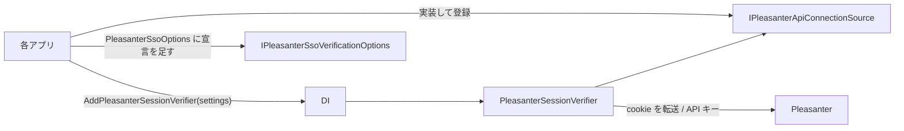

# Core.Web 共通化の方針

AtomFeed・CalendarFeed・Questionnaire の Web 層に複製されているコードのうち、
**何を Core.Web（`VehicleVision.PleasanterTools.Core.Web`）へ移し、何を移さないか**。
アプリ固有の値の受け口と、各アプリが置き換えるときの手順を決める（Issue #74 の第 1 段階）。

一般の方針は [`コア化の方針.md`](コア化の方針.md)。**迷ったら移さない**（後から上げるのは簡単、下ろすのは全アプリに影響する）。

## 基準と調べ方

| アプリ | 比べた版（`origin/develop`） |
|---|---|
| AtomFeed | `6160774`（2026-10-21） |
| CalendarFeed | `8aa1741`（2026-10-21） |
| Questionnaire | `c774e4b`（2026-10-21） |

- **基準は Questionnaire（Q）。** ほかのアプリの差は「引数・オプションで吸収できるか」を見て、吸収できなければ移さない
- 各ファイルのアプリ名（`AtomFeed` / `ATOMFEED` / `atomfeed` など）を同じ記号に置き換えてから `diff` を取り、
  **残った差が「アプリ名・名前空間・環境変数の接頭辞」だけか、振る舞いの違いか**を 1 つずつ確かめた
- AtomFeed と CalendarFeed（A/C）は、どのファイルも**コメントの Issue 番号を除いて同じ**だった
  （例外は `MigrationCommand` の `lockTimeout` 引数。下表）

## 対象ファイルごとの差と判断

| ファイル | A/C と Q の差（アプリ名を除く） | 判断 |
|---|---|---|
| `PleasanterSessionVerifier.cs` | ① 接続設定（API キー）の取り方: A/C は `RuntimeSettings.Current`（同期）、Q は `IPleasanterOptionsProvider`（非同期。読めない例外を警告して「キー無し」扱い） ② ログで案内する設定名: A/C は `AppSettingDefinitions.*`、Q は `AppSettingsProvider.*Key` ③ ログの均し: A/C は `AuditText.Safe(値, 100)`、Q は `LogSafe.Text(値)` ④ `SessionProbeKey` の値（アプリ名だけ違う） | **移した。** ①は `IPleasanterApiConnectionSource`、②④は `PleasanterSessionVerifierSettings` で受ける。③は Q に合わせた（下記「A/C で変わること」） |
| `PleasanterSessionVerifier.Membership.cs` | 無し（3 アプリで同一） | **移した** |
| `PleasanterSsoOptions.cs` | ① 設定の鍵（`<APP>_PLEASANTERSSO_*`）が `const` で、Q では約 150 か所から参照 ② 本アプリの cookie の接頭辞（`q.` / `atomfeed_` / `calendarfeed_`） ③ **誤りの伝え方**: A/C は `SettingException`（文言の鍵と引数を持ち、管理 API が要求の言語で返す）、Q は日本語の `InvalidOperationException` ④ **`RegisterRole` の型**: A/C は文字列（`AdminRoles`）、Q は列挙（`AdminRole`）。読み方も別（`ParseRole` と `ParseEnum`） | **移さない。** ③④は振る舞いと型の違い。吸収はできる（下記「次の段階の案」）が、公開 API の形の判断が要る |
| `SamlOptions.cs` | `PleasanterSsoOptions` の①③④と同じ。Q だけ `FromConfiguration(IConfiguration)` を持つ | **移さない**（同上） |
| `MigrationCommand.cs` | ① Q だけ `--migrate-status`（当てずに状態を見る。未適用があれば終了コード 1） ② `--migrate` の出力: Q は未適用の一覧と `Applied N migration(s).`、A/C は `All migrations are applied (…).` だけ ③ ロックの待ち時間: Q は固定 300 秒、A は `AppDatabase.DefaultMigrationLockTimeout`、C は引数（`Rds.json` の設定） | **移さない。** ①②は A/C の振る舞い（コンソール出力・受け付ける引数）が変わる。統一するかはアプリ側の判断。**Web 層の部品でもない**（DB だけを使う）ので、移すなら Core.Data が置き場 |

「やや似ている」ファイル（`PasswordHasher`・`AdminPasswordPolicy`・`SecretProtector`・`ParameterFiles`。正規化した類似度 0.3〜0.45）は、
この段階の対象外。[`コア化の方針.md`](コア化の方針.md) の「セキュリティ」の行のとおり、配置も内容も別物で、機械的にはまとめられない。

## Core.Web の公開 API

| 型 | 役割 |
|---|---|
| `IPleasanterSessionVerifier` / `PleasanterSessionVerifier` | cookie を転送して本人を聞く。403 なら API キーの経路、所属の制限があればグループまでたどる（Q と同じ） |
| `PleasanterSessionStatus` / `PleasanterIdentity` / `PleasanterSessionResult` | 結果（Q と同じ形） |
| `IPleasanterSsoVerificationOptions` | 検証器が読む設定（`Enabled`・`InternalBaseUrl`・`Timeout`・`AllowedDeptIds`・`AllowedGroupIds`・`ShouldForwardCookie`）。**各アプリの `PleasanterSsoOptions` は同じ名前と型をすでに持つ** |
| `IPleasanterApiConnectionSource` / `PleasanterApiConnectionSettings` | 本アプリの Pleasanter 接続設定（URL と API キー）。設定の置き場はアプリごとに違うので、アプリが実装する |
| `PleasanterSessionVerifierSettings` | アプリごとに違う値（下表） |
| `PleasanterSessionVerifierServiceCollectionExtensions.AddPleasanterSessionVerifier` | HttpClient（**cookie を覚えない・転送を追わない・時間切れは無限**）と検証器を登録する。**3 アプリの `Program.cs` に書き写されていた設定をここへ集めた** |

- **設定の読み取り（`PleasanterSsoOptions`）はアプリに残す。** 検証器は、それを `IPleasanterSsoVerificationOptions` として受ける
- 所属の制限があるか（`HasMembershipRestriction`）は Core が `AllowedDeptIds` と `AllowedGroupIds` から決める
  （3 アプリとも同じ式。アプリの実装の誤りで所属の確認が抜けないように）
- 公開しないもの: ログの均し（`LogSafe`）は `internal`

## アプリ固有の値の受け口

| 値 | 受け口 | 例（Questionnaire） |
|---|---|---|
| `/api/sessions/set` に書く鍵 | `PleasanterSessionVerifierSettings.SessionProbeKey` | `VehicleVision.Questionnaire.SsoProbe` |
| ログで案内する設定名（URL・API キー） | `BaseUrlSettingName` / `ApiKeySettingName` | `QUESTIONNAIRE_PLEASANTER_BASEURL` / `QUESTIONNAIRE_PLEASANTER_APIKEY` |
| ログのカテゴリ | `LoggerCategory`（空なら `VehicleVision.PleasanterTools.Core.Web.PleasanterSessionVerifier`） | `VehicleVision.PleasanterTools.Questionnaire.Web.Services.PleasanterSessionVerifier` |
| 本アプリの Pleasanter 接続設定 | `IPleasanterApiConnectionSource` の実装 | `IPleasanterOptionsProvider` から `BaseUrl` と `ApiKey` を渡す |
| 本アプリの cookie の接頭辞 | アプリの `PleasanterSsoOptions.ShouldForwardCookie`（今までどおり） | `q.` |

## 各アプリが置き換える手順（Core.Web の公開後、各アプリの PR で）

1. **`PackageReference`** で `VehicleVision.PleasanterTools.Core.Web` を参照する（Core.Data・Core.Mail と同じ版）
2. **`PleasanterSsoOptions` の宣言に `IPleasanterSsoVerificationOptions` を足す。** 中身は変えない
3. **`IPleasanterApiConnectionSource` を実装して登録する**
    - Q: `IPleasanterOptionsProvider.GetAsync` の `BaseUrl` と `ApiKey` を返す
    - A/C: `RuntimeSettings.Current.Pleasanter` の `BaseUrl` と `ApiKey` を返す
4. **`Program.cs` の登録を置き換える。** `AddSingleton<IPleasanterSessionVerifier, PleasanterSessionVerifier>()` と
   `AddHttpClient(PleasanterSessionVerifier.HttpClientName, …)` を消し、`AddPleasanterSessionVerifier(new() { … })` にする。
   **`SessionProbeKey` は今の値（`VehicleVision.<アプリ>.SsoProbe`）をそのまま渡す**
5. **アプリの `PleasanterSessionVerifier.cs` / `.Membership.cs` を消し**、名前空間を `VehicleVision.PleasanterTools.Core.Web` へ切り替える。
   `IPleasanterSessionVerifier` を実装する試験の偽物は、引数の型を `IPleasanterSsoVerificationOptions` にする
6. **Q の単体試験（`PleasanterSessionVerifierTests` / `PleasanterSsoMembershipTests`）は Core へ移した。** アプリ側から消してよい。
   A/C の `PleasanterSsoTests`（アプリ全体を通す結合試験）は残す
7. ビルドと試験を通し、[`コア化の方針.md`](コア化の方針.md) の「移行の状況」を更新する

### 置き換えで変わること（注意）

- **ログのカテゴリ。** 何も渡さなければ Core の型名になる。ログの量をカテゴリで絞っているなら、`LoggerCategory` に今の名前を渡す
- **A/C: JSON でない応答のログに出す MediaType の均し方**が Q に揃う（`AuditText.Safe(値, 100)` → `LogSafe.Text(値)`。
  空なら `(なし)`、128 文字で切って `…(切り詰め)` を添える）。**ログの文言だけで、判定は変わらない**
- **A/C: 接続設定の読み出しが例外を投げたとき。** 今は呼び出し元へそのまま伝わる。置き換え後は
  `FormatException`・`OverflowException`・`InvalidOperationException` なら警告して「キー無し」扱いになる（Q と同じ）。
  `RuntimeSettings.Current` は例外を投げない作りなので、**実際の振る舞いは変わらない見込み**（A/C の実装で確かめること）
- 接続設定の読み出しが `null` を返したときは「キー無し」として扱う（以前は Q でも例外。Core で足した防御）

## 次の段階の案（判断が要る）

### PleasanterSsoOptions・SamlOptions

吸収はできる。ただし公開 API が増えるので、形を決めてから移す。

| 差 | 案 |
|---|---|
| 設定の鍵（`const`） | 接頭辞から鍵の名前を導く型（例: `PleasanterSsoSettingKeys.For("QUESTIONNAIRE_")`）。アプリの `const` は残してもよい |
| 誤りの伝え方 | Core は誤りの種類（列挙）と引数を持つ例外（`InvalidOperationException` の派生、文言は Q の日本語）を投げる。A/C は捕まえて自分の `SettingException`（文言の鍵）へ写す |
| `RegisterRole` の型 | Core は役割の名前の一覧と既定を受け、正規化した文字列を返す。Q は列挙へ変換する |
| 本アプリの cookie の接頭辞 | 引数で受ける |

**先に決めること:** 多言語の誤り（A/C の `SettingException` と `ServerMessages`）を Core で持つかどうか
（[`コア化の方針.md`](コア化の方針.md) の「多言語メッセージ」の行）。持つなら、例外の写し替えは要らなくなる。

### MigrationCommand

Q の振る舞い（`--migrate-status` と出力）に A/C も揃えてよいなら、Core.Data へ
`MigrationCommand.RunAsync(DatabaseMigrator, provider, connectionString, args, lockTimeout)` として移せる。
**A/C の出力と受け付ける引数が変わる**ので、A/C の運用（Helm フックのログの読み方など）を確かめてから決める。

## 確かめたこと・確かめていないこと

- **確かめた:** Q の単体試験（本人確認・代わりの経路・所属・時間切れ）を Core へ移して通した。DI の登録（cookie を覚えない・
  転送を追わない・時間切れ無限）とアプリごとの値の受け口も試験した（`tests/VehicleVision.PleasanterTools.Core.Web.Tests`）
- **確かめていない:** 実機の Pleasanter・IdP には当てていない。各アプリでの置き換え（ビルド・結合試験）は、公開後の各アプリの PR で行う
