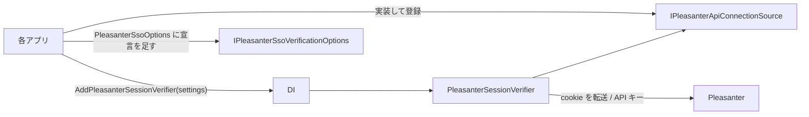

# Core.Web 共通化の方針

AtomFeed・CalendarFeed・Questionnaire の Web 層に複製されているコードのうち、
**何を Core.Web（`VehicleVision.PleasanterTools.Core.Web`）へ移し、何を移さないか**。
アプリ固有の値の受け口と、各アプリが置き換えるときの手順を決める。
Issue #74 が本人確認の第 1 段階、Issue #83 が設定とマイグレーションコマンドの第 2 段階。
**第 2 段階では Core だけを変更した（preview.12 で公開、0.1.0 に含まれる）。各アプリは、別の作業で置き換える。**

一般の方針は [`コア化の方針.md`](コア化の方針.md)。**迷ったら移さない**（後から上げるのは簡単、下ろすのは全アプリに影響する）。

## 基準と調べ方

| アプリ | 比べた版（`origin/develop`） |
|---|---|
| AtomFeed | `b9eaf0c61ab0365941e435667015c689198d0b5a`（2026-10-22） |
| CalendarFeed | `fcda6929f41d88c7c68164ba33c8da723bdba16f`（2026-10-22） |
| Questionnaire | `ca58e2986958dd085bda40527a625cdb9f0e35aa`（2026-10-22） |

- **基準は Questionnaire（Q）。** ほかのアプリの差は「引数・オプションで吸収できるか」を見て、吸収できなければ移さない
- 各ファイルのアプリ名（`AtomFeed` / `ATOMFEED` / `atomfeed` など）を同じ記号に置き換えてから `diff` を取り、
  **残った差が「アプリ名・名前空間・環境変数の接頭辞」だけか、振る舞いの違いか**を 1 つずつ確かめた
- AtomFeed と CalendarFeed（A/C）は、どのファイルも**コメントの Issue 番号を除いて同じ**だった
  （例外は `MigrationCommand` の `lockTimeout` 引数。下表）

## 対象ファイルごとの差と判断

| ファイル | A/C と Q の差（アプリ名を除く） | 判断 |
|---|---|---|
| `PleasanterSessionVerifier.cs` | ① 接続設定（API キー）の取り方: A/C は `RuntimeSettings.Current`（同期）、Q は `IPleasanterOptionsProvider`（非同期。読めない例外を警告して「キー無し」扱い）<br>② ログで案内する設定名: A/C は `AppSettingDefinitions.*`、Q は `AppSettingsProvider.*Key`<br>③ ログの均し: A/C は `AuditText.Safe(値, 100)`、Q は `LogSafe.Text(値)`<br>④ `SessionProbeKey` の値（アプリ名だけ違う） | **移した。** ①は `IPleasanterApiConnectionSource`、②④は `PleasanterSessionVerifierSettings` で受ける。③は Q に合わせた（下記「A/C で変わること」） |
| `PleasanterSessionVerifier.Membership.cs` | 無し（3 アプリで同一） | **移した** |
| `PleasanterSsoOptions.cs` | ① 設定の鍵が `const`（Q の両 Options の型名付き `*Key` 参照は src 118・tests 66 か所）<br>② cookie 接頭辞（`q.` / `atomfeed_` / `calendarfeed_`）<br>③ A/C は多言語の `SettingException`、Q は日本語の `InvalidOperationException`<br>④ A/C の役割は文字列、Q は列挙。Q の列挙は複合表記も受け付ける | **第 2 段階で Core.Web へ。** 役割の列挙の解釈・例外の翻訳・既存 `const` はアプリの薄いアダプターに残す |
| `SamlOptions.cs` | ①③④は SSO と同じ<br>Q の役割は定義された数値も受け付ける（SSO では数値を拒否）<br>Q だけ `FromConfiguration(IConfiguration)` を持つ | **第 2 段階で読み取りと検証を Core.Web へ。** ITfoxtec の設定生成はアプリに残す |
| `MigrationCommand.cs` | ① Q だけ `--migrate-status`（未適用ありは終了コード 1）<br>② Q は未適用一覧と適用件数、A/C は適用済みの表示だけ<br>③ Q は固定 300 秒、A は `AppDatabase` の既定、C は引数 | **第 2 段階で Core.Data へ。** Q の出力・引数へ統一する判断は 2026-10-22 に承認済み。ロック待機は引数で受ける |

「やや似ている」ファイル（`PasswordHasher`・`AdminPasswordPolicy`・`SecretProtector`・`ParameterFiles`。正規化した類似度 0.3〜0.45）は、
第 2 段階の対象外。後述の Issue #92 で再比較して実装し、Issue #99 で保存値の読み取りを統合した。

## Core.Web の公開 API



| 型 | 役割 |
|---|---|
| `IPleasanterSessionVerifier` / `PleasanterSessionVerifier` | cookie を転送して本人を聞く。403 なら API キーの経路、所属の制限があればグループまでたどる（Q と同じ） |
| `PleasanterSessionStatus` / `PleasanterIdentity` / `PleasanterSessionResult` | 結果（Q と同じ形） |
| `IPleasanterSsoVerificationOptions` | 検証器が読む設定（`Enabled`・`InternalBaseUrl`・`Timeout`・`AllowedDeptIds`・`AllowedGroupIds`・`ShouldForwardCookie`）。**各アプリの `PleasanterSsoOptions` は同じ名前と型をすでに持つ** |
| `IPleasanterApiConnectionSource` / `PleasanterApiConnectionSettings` | 本アプリの Pleasanter 接続設定（URL と API キー）。設定の置き場はアプリごとに違うので、アプリが実装する |
| `PleasanterSessionVerifierSettings` | アプリごとに違う値（下表） |
| `PleasanterSessionVerifierServiceCollectionExtensions.AddPleasanterSessionVerifier` | HttpClient（**cookie を覚えない・転送を追わない・時間切れは無限**）と検証器を登録する。**3 アプリの `Program.cs` に書き写されていた設定をここへ集めた** |

- 第 1 段階では設定の読み取りをアプリに残した。第 2 段階で共通化する。
  検証器の `IPleasanterSsoVerificationOptions` は変えず、既存アプリとの互換を保つ
- 所属の制限があるか（`HasMembershipRestriction`）は Core が `AllowedDeptIds` と `AllowedGroupIds` から決める
  （3 アプリとも同じ式。アプリの実装の誤りで所属の確認が抜けないように）
- 公開しないもの: ログの均し（`LogSafe`）は `internal`

## アプリ固有の値の受け口

| 値 | 受け口 | 例（Questionnaire） |
|---|---|---|
| `/api/sessions/set` に書く鍵 | `PleasanterSessionVerifierSettings.SessionProbeKey` | `VehicleVision.Questionnaire.SsoProbe` |
| ログで案内する設定名（URL・API キー） | `BaseUrlSettingName` / `ApiKeySettingName` | `QUESTIONNAIRE_PLEASANTER_BASEURL` / `QUESTIONNAIRE_PLEASANTER_APIKEY` |
| ログのカテゴリ | `LoggerCategory`（空なら `VehicleVision.PleasanterTools.Core.Web.PleasanterSessionVerifier`） | `VehicleVision.PleasanterTools.Questionnaire.Web.Services.PleasanterSessionVerifier` |
| 本アプリの Pleasanter 接続設定 | `IPleasanterApiConnectionSource` の実装 | `IPleasanterOptionsProvider` から `BaseUrl` と `ApiKey` を渡す |
| 本アプリの cookie の接頭辞 | 第 2 段階の `PleasanterSsoOptions` の引数 `ownCookiePrefix` | `q.` |

## 各アプリが置き換える手順（Core.Web の公開後、各アプリの PR で）

1. **`PackageReference`** で `VehicleVision.PleasanterTools.Core.Web` を参照する（Core.Data・Core.Mail と同じ版）
2. **`PleasanterSsoOptions` の宣言に `IPleasanterSsoVerificationOptions` を足す。** 中身は変えない
3. **`IPleasanterApiConnectionSource` を実装して登録する**
    - Q: `IPleasanterOptionsProvider.GetAsync` の `BaseUrl` と `ApiKey` を返す
    - A/C: `RuntimeSettings.Current.Pleasanter` の `BaseUrl` と `ApiKey` を返す
4. **`Program.cs` の登録を置き換える。** `AddSingleton<IPleasanterSessionVerifier, PleasanterSessionVerifier>()` と
   `AddHttpClient(PleasanterSessionVerifier.HttpClientName, …)` を消し、`AddPleasanterSessionVerifier(new() { … })` にする。
   **`SessionProbeKey` は今の値（`VehicleVision.<アプリ>.SsoProbe`）をそのまま渡す**
5. **アプリの `PleasanterSessionVerifier.cs` / `.Membership.cs` を消し**、名前空間を `VehicleVision.PleasanterTools.Core.Web` へ切り替える。
   `IPleasanterSessionVerifier` を実装する試験の偽物は、引数の型を `IPleasanterSsoVerificationOptions` にする
6. **Q の単体試験（`PleasanterSessionVerifierTests` / `PleasanterSsoMembershipTests`）は Core へ移した。** アプリ側から消してよい。
   A/C の `PleasanterSsoTests`（アプリ全体を通す結合試験）は残す
7. ビルドと試験を通し、[`コア化の方針.md`](コア化の方針.md) の「移行の状況」を更新する

### 置き換えで変わること（注意）

- **ログのカテゴリ。** 何も渡さなければ Core の型名になる。ログの量をカテゴリで絞っているなら、`LoggerCategory` に今の名前を渡す
- **A/C: JSON でない応答のログに出す MediaType の均し方**が Q に揃う（`AuditText.Safe(値, 100)` → `LogSafe.Text(値)`。
  空なら `(なし)`、128 文字で切って `…(切り詰め)` を添える）。**ログの文言だけで、判定は変わらない**
- **A/C: 接続設定の読み出しが例外を投げたとき。** 今は呼び出し元へそのまま伝わる。置き換え後は
  `FormatException`・`OverflowException`・`InvalidOperationException` なら警告して「キー無し」扱いになる（Q と同じ）。
  `RuntimeSettings.Current` は例外を投げない作りなので、**実際の振る舞いは変わらない見込み**（A/C の実装で確かめること）
- 接続設定の読み出しが `null` を返したときは「キー無し」として扱う（以前は Q でも例外。Core で足した防御）

## 第 2 段階の設計（Issue #83）

2026-10-22 のユーザー決定で、前段階の提案を採用した。
Core は多言語メッセージを持たず、誤りの種類・引数・日本語文言を持つ例外を投げる。
**認証設定の受け付ける／拒む条件は変更しない。**

### 再比較で確かめた差と共通の検証

最新の `origin/develop` は `ls-remote` と一致することを確認した。
アプリ名の大小文字を同じ記号へ置き換えた diff では、A/C の Options はコメントだけが違う。
Q との差には、先の表に加えて次の注意がある。

- Q の `RegisterRole` の `Enum.TryParse` は、SSO でも `Editor, Administrator` のような複合表記を
  受け付ける。SAML では定義された数値（`0`〜`4`、符号付き表記を含む）も受け付ける。
  A/C の役割名の一覧との照合とは**同じ式ではない**ので、その解釈は Q に残す
- `UnknownUser` は、3 アプリとも SSO で数値を拒否し、SAML で定義された数値を受け付ける。
  `SamlLoginIdSource` も数値と複合表記を受け付ける。この非対称を Core でも変えない
- SSO は無効でも誤記を検査する。SAML は `true` 以外（`yes` なども含む）を無効として、
  他の値を読まない。既定値もそのまま
- SSO の内部 URL は http(s) の絶対 URL で、資格情報・query・fragment は拒否し末尾を `/` にする。
  ブラウザ URL は同じホストの `/` 始まりか http(s)。`//`・`/\`・相対パス内の制御文字は拒否する
- cookie は token 文字・空指定・本アプリの接頭辞との両方向の重なりを検査する。
  自アプリ除外は大文字小文字を無視、転送先の前方一致と重複除去は大小を区別する
- 所属は正の ID、64 件以内・1024 文字以内（重複除去前）。再確認は 1〜60 分、待機は 1〜30 秒。
  SAML の署名証明書は PEM／base64 DER の複数枚、SSO と任意の SLO の URL は http(s) の絶対 URL

根拠（2026-10-22 参照）:
[A の Options][a-options]・[C の Options][c-options]・[Q の Options][q-options]。
各ディレクトリの `PleasanterSsoOptions.cs` / `SamlOptions.cs` の
`FromValues`・`ParseEnum`・`ParseRole`・`ParseCookieNames` を比較した。
役割の定義は A/C の `Core/Admin/AdminModels.cs`、Q の `Data/AdminRole.cs`。

[a-options]: https://github.com/vehiclevisionjp/VehicleVision.PleasanterTools.AtomFeed/tree/b9eaf0c61ab0365941e435667015c689198d0b5a/src/VehicleVision.PleasanterTools.AtomFeed.Web/Services
[c-options]: https://github.com/vehiclevisionjp/VehicleVision.PleasanterTools.CalendarFeed/tree/fcda6929f41d88c7c68164ba33c8da723bdba16f/src/VehicleVision.PleasanterTools.CalendarFeed.Web/Services
[q-options]: https://github.com/vehiclevisionjp/VehicleVision.PleasanterTools.Questionnaire/tree/ca58e2986958dd085bda40527a625cdb9f0e35aa/src/VehicleVision.PleasanterTools.Questionnaire.Web/Services

### 公開 API と残すもの

| 型／入口 | 引数と役割 |
|---|---|
| `PleasanterSsoSettingKeys` / `SamlSettingKeys` | コンストラクターへアプリの接頭辞（末尾の `_` を含む）を渡す。各 `*Key` を導く |
| `PleasanterSsoOptions` | `IPleasanterSsoVerificationOptions` を実装。直接作るときも `ownCookiePrefix` と `defaultRegisterRole` が必須 |
| `SamlOptions` | 直接作るときも `defaultRegisterRole` が必須。証明書・SLO・未登録利用者・ログイン ID の設定を保持 |
| 両型の `FromValues` | `valueOf`・各設定キー型・`registerRoles`・`defaultRegisterRole`。SSO だけ `ownCookiePrefix` も渡す |
| 両型の `FromConfiguration` | `IConfiguration`・アプリの `prefix`・役割の一覧と既定。SSO だけ cookie 接頭辞も渡す。内部は `FromValues` と同じ |
| SSO の `ParseCookieNames` | 生値・`PleasanterSsoSettingKeys`・cookie 接頭辞を受ける |
| `AuthenticationSettingException` | `InvalidOperationException` の派生。`Error`（列挙）・不変の `Arguments`・日本語 `Message`・元の `InnerException` |
| `PleasanterSsoUnknownUserPolicy` / `SamlUnknownUserPolicy` / `SamlLoginIdSource` | アプリ間で同じ列挙を共有する |

役割の一覧に既定が無いなど、呼び出しコードの誤りは `ArgumentException`。
Core はアプリの役割名を知らず、渡された一覧に大小を無視して照合し、一覧の正規名を返す。

**移さないもの:**

- Q の `AdminRole` とその読み取り。共通でない許可条件を Core の汎用オプションへ増やさないため
- 既存の設定名の `const`。Q の `switch`・属性の定数参照を壊さないため
- 多言語の `SettingException` / `ServerMessages` と設定プロバイダー（外部設定・DB の優先順位・保存・キャッシュ）
- `ToSaml2Configuration`。ITfoxtec への変換は設定値の読み取りでなく、SAML 実装との境界。
  公開 API と依存を増やさず、アプリに同じ実装と試験を残す。
  **発行者・宛先・署名証明書の固定、SHA-1 の拒否、無効時の例外を変えないこと**
- アプリ固有のマイグレーション、接続先の解決、自動適用の設定・Web 起動処理

### 例外の写し替え（A/C）

`AuthenticationSettingException` を捕まえ、次の文言の鍵と `Arguments`（同じ順序）を渡して
`SettingException` にする。証明書の元の例外も渡す。日本語文言そのものを解析しない。
引数の順序と意味は `src/VehicleVision.PleasanterTools.Core.Web/AuthenticationSettingException.cs` の列挙の宣言。

| Core の `Error` | A/C の `ServerMessageKeys` |
|---|---|
| `RequiredWhenEnabled` | `SettingRequiredWhenEnabled` |
| `BooleanValueInvalid` | `SettingBooleanValueInvalid` |
| `IntegerRangeInvalid` | `SettingIntegerRangeInvalid` |
| `UnknownValue` | `SettingUnknownValue` |
| `CookieNameInvalidChars` / `CookieNameOverlapsOwn` / `CookieNamesEmpty` | `SsoCookieNameInvalidChars` / `SsoCookieNameOverlapsOwn` / `SsoCookieNamesEmpty` |
| `InternalUrlInvalid` / `BrowserUrlInvalid` | `SsoInternalUrlInvalid` / `SsoBrowserUrlInvalid` |
| `IdListTooLong` / `IdListInvalid` | `SsoIdListTooLong` / `SsoIdListInvalid` |
| `AbsoluteUrlInvalid` | `SettingAbsoluteUrlInvalid` |
| `CertificateRequired` / `LoginIdClaimRequired` | `SamlCertificateRequired` / `SamlLoginIdClaimRequired` |
| `CertificatePemIncomplete` / `CertificatePemUnreadable` | `SamlCertificatePemIncomplete` / `SamlCertificatePemUnreadable` |
| `CertificateNotFound` / `CertificateUnreadable` | `SamlCertificateNotFound` / `SamlCertificateUnreadable` |

### MigrationCommand（Core.Data）

```csharp
await MigrationCommand.RunAsync(
    database.Migrator, provider, connectionString, args,
    lockTimeout: configuredLockTimeout,
    cancellationToken: cancellationToken);
```

`database` はアプリの `AppDatabase`。`lockTimeout` は省略でき、
省略時は `AppDatabase.DefaultMigrationLockTimeout`（現在 5 分）を使う。
Q は従来の固定 300 秒を渡し、A は省略、C は従来の設定値を渡す。
`CancellationToken` と DB の待機失敗の伝え方も維持する。

**A/C の置き換えで変わる点（ユーザー承認済み）:**

1. `IsRequested` が `--migrate-status` も完全一致で受け付ける。未適用ありは終了コード 1、適用済みは 0
2. `--migrate` は未適用があれば `Pending migrations ({provider}):` と、字下げした `- 番号 型名` を表示し、
   ロックを取って適用後に `Applied N migration(s).` を表示する。
   以前は一覧も件数もなく `All migrations are applied ({provider}).` だけだった
3. 適用済みなら、従来どおり `All migrations are applied ({provider}).` で終了コード 0。
   この場合は先に状態を見て戻るので、A/C と違って適用用ロックを取得しない
4. 両方の合図があれば `--migrate` を優先する。`--wait-for-db=N` は変更なし
   （最初の指定だけ、正の整数でなければ待たない）。DB を待ちきれなければ標準エラーと終了コード 2

出力は英語。待機中は `Waiting for the database (up to Ns)...`、
期限切れは `Database not reachable after Ns: …`。
適用や状態取得そのものの例外・中止は握りつぶさず呼び出し元へ伝える。
状態の確認はマイグレーションを適用しないが、**完全な読み取り専用ではない**。
現行 `DatabaseMigrator.PendingMigrations` は FluentMigrator の版ローダーを通し、
SQLite の新規 DB に空の `VersionInfo` 表を作ることを試験で確認した。
既存の「版の表も作らない」というコメントとは違うため、実際の挙動を記載している。
マイグレーターの振る舞いは変えず、誤ったコメントだけを修正する。

根拠（2026-10-22 参照）:
[A のコマンド][a-migration]・[C のコマンド][c-migration]・[Q のコマンド][q-migration]。
Core 側の出力・終了コード・状態確認の副作用は
`tests/VehicleVision.PleasanterTools.Core.Data.Tests/MigrationCommandTests.cs` で検査する。

[a-migration]: https://github.com/vehiclevisionjp/VehicleVision.PleasanterTools.AtomFeed/blob/b9eaf0c61ab0365941e435667015c689198d0b5a/src/VehicleVision.PleasanterTools.AtomFeed.Web/MigrationCommand.cs
[c-migration]: https://github.com/vehiclevisionjp/VehicleVision.PleasanterTools.CalendarFeed/blob/fcda6929f41d88c7c68164ba33c8da723bdba16f/src/VehicleVision.PleasanterTools.CalendarFeed.Web/MigrationCommand.cs
[q-migration]: https://github.com/vehiclevisionjp/VehicleVision.PleasanterTools.Questionnaire/blob/ca58e2986958dd085bda40527a625cdb9f0e35aa/src/VehicleVision.PleasanterTools.Questionnaire.Web/MigrationCommand.cs

### 各アプリの置き換え（preview.12 公開後）

1. **Core の作業では置き換えない。** Core.Data / Core.Web を 0.1.0 以降に揃える作業を、各アプリで行う（preview.12 は公開済み）
2. 設定キー型へ既存のアプリ接頭辞を渡す。アプリの `const` は残し、Core が導いたキーと一致することを試験する
3. A/C は `AdminRoles.All` と `AdminRoles.Editor`、既存の cookie 接頭辞を渡す。
   前節の例外の写し替えを挟む。多言語の管理 API の結合試験を残す
4. Q は `Enum.GetNames<AdminRole>()` と `Editor`、`q.` を渡す。
   **`REGISTERROLE` の値を要求されたときだけ、既存の `ParseEnum<AdminRole>` で読み、正規名にして返す。**
   SSO の数値拒否と SAML の数値許可、両方の複合表記の許可をそのまま残す。
   SAML 無効時には役割を先読みしない。戻った正規名をアプリの `AdminRole` に変換する
5. Q の既存の `InvalidOperationException` を捕まえる処理は派生例外も受けられる。
   `Assert.Throws<InvalidOperationException>` の厳密な型検査は見直す。
   ITfoxtec の変換とその署名・宛先固定の試験は残す
6. `MigrationCommand` は Core.Data の型へ置き換え、マイグレーターと前節のロック待機時間を渡す。
   A/C の Helm フックやログ解析が旧出力に依存していないか確認する
7. Core に移した単体試験は重複を削除してよい。アプリの設定保存・多言語・認証・固有スキーマの結合試験は残し、
   各アプリでビルドと試験を実行する。追随完了を Issue #83 と移行状況の表に残す

## 確かめたこと・確かめていないこと

- **確かめた:** Q の単体試験（本人確認・代わりの経路・所属・時間切れ）を Core へ移して通した。DI の登録（cookie を覚えない・
  転送を追わない・時間切れ無限）とアプリごとの値の受け口も試験した（`tests/VehicleVision.PleasanterTools.Core.Web.Tests`）
- **第 2 段階で移した試験:** Q の `PleasanterSsoOptionsTests`（プロバイダー部分を除く）と `SamlOptionsTests`
  （ITfoxtec 変換を除く）。A/C の `DynamicMessagesTests` の必須・証明書・cookie 重複・ID・URL の条件を
  Core の種類と引数の検査にした。A/C の `HealthAndMigrateTests` の合図・再適用・待機失敗と、
  Q の `DatabaseMigrationTests` の合図を統合した。固有の表と Web の試験はアプリに残した
- **追加の試験:** 設定キーと引数、所属の件数・文字数、数値の上下限、SLO、SAML の数値・複合表記、
  出力全文、終了コード、状態確認がスキーマを適用しないこと、ロック待機時間の受け渡し、中止の伝播
- **元ソースとの直接比較:** 上記の 3 コミットの Options を一時的な比較用プログラムへ読み込み、
  名前空間とアプリ型への依存だけを置き換えて実行した。Q は前節の役割アダプターを挟んだ。
  各設定・有効／無効・正常値／境界／誤記を含む 9,246 ケースで、受理・拒否と読み取り結果が一致した。
  ITfoxtec 変換とアプリの設定保存・Web の処理は、この比較の対象外
- **ローカル検証:** Release ビルドは警告 0、全 372 テスト成功（Mail 45・Data 103・Web 224）。
  テストの DB は一時 SQLite のみ。外部 DB の環境変数は未設定で、4 RDBMS を検証したという意味ではない。
  Code Integrity によるブロックは発生しなかったため、短いパスへの複製は不要だった
- **確かめていない:** 実機の Pleasanter・IdP には当てていない。各アプリでの置き換え（ビルド・結合試験）は、公開後の各アプリの PR で行う

## 認証の基盤の共通化（Issue #92）

**この段階は Core だけを変更した（0.1.0 に含まれる）。アプリの置き換えは別作業。**
Issue #95 で導入した互換方式の enum は、2026-10-26 のユーザー決定（Issue #99）により廃止する。
**読むのは既存の保存値すべて、書くのは新しい 1 方式**へ統合する。
preview.14 の API を使うアプリはなく、preview.15 向けの破壊的変更として扱った（0.1.0 に含まれる）。
保存値の長さ・版で読み取り方を決め、復号に失敗しても別書式として試し直さない。

### 比較の根拠と意味のある差

2026-10-22 に、各ローカル `origin/develop` がリモートの `refs/heads/develop` と一致することを確認した。
ソースを読み取り専用で取得し、アプリ名の大小文字を `APP` に置換して行単位の unified diff を取った。
以下の比率は正規化した行列の `difflib.SequenceMatcher.ratio()`。**意味が同じことの証明ではない。**

| 略記 | コミット（各アプリの `origin/develop`） |
|---|---|
| A | `236af9341ce9755e5773403db04469fa2804455c` |
| C | `b3b265297bbd09a3d60cc7c08bd7e8de99882bed` |
| Q | `33d77eb7247340fd682c08c78845e0e29b94df74` |

出典は [A の Core][auth-a-core]・[A の Web][auth-a-web]・[C の Core][auth-c-core]・
[C の Web][auth-c-web]・[Q の Web][auth-q-web]。参照日はすべて 2026-10-22。
表のファイル名は各リンク先の `Security/`・`Admin/`・`Localization/`・`Services/` 配下を指す。

主要な参照箇所（行番号は上記コミット）:

| 部品 | A/C（Core、設定ファイルだけ Web） | Q（Web） |
|---|---|---|
| ハッシュ | `Security/PasswordHasher.cs:27-89` | `Services/PasswordHasher.cs:28-77` |
| パスワード条件 | `Security/AdminPasswordPolicy.cs:40-128` | `Services/AdminPasswordPolicy.cs:89-192` |
| TOTP／復旧コード | `Security/Totp.cs:26-86` | `Services/TotpService.cs:30-124` |
| 暗号 | `Security/SecretProtector.cs:62-143` | `Services/SecretProtector.cs:40-167` |
| 招待 | `Security/InviteTokens.cs:14-23` | `Services/InvitationToken.cs:26-40` |
| 設定ファイル | `Services/ParameterFiles.cs`（A:220-286、C:244-289） | `Services/SecretFileConfigurationProvider.cs:25-109` |
| 権限 | `Admin/AdminPermissions.cs:59-87` | `Services/AdminPermissions.cs:113-177` |
| メッセージ | `Localization/ServerMessages.cs:26-76` | `Localization/ServerMessages.cs:139-174` |

| 候補 | A/C の差 | A/Q の比率 | 意味のある差と判断 |
|---|---|---|---|
| `PasswordHasher` | なし（1.000） | 0.422 | **移した。** 旧 A/C は 64 バイト、Q は 32 バイト。PBKDF2-SHA512 の 32 バイトは 64 バイトの先頭と一致する。Issue #99 で保存値の長さによる照合に統合し、新規は 64 バイト。空パスワードを拒否、回数は符号・空白なしの正数、塩は非空へ統一 |
| `AdminPasswordPolicy` | なし（1.000） | 0.331 | **保留。** A/C は上限 256、Q は上限なし。空の扱い・ログイン ID が空の条件も異なる。A/C は文言がなければ先頭も使い、Q は言語正規化後に一致／指定なしを選ぶ。正規表現の方式は共通でも、今回未決の上限・文言を揃えない |
| `Totp` / `TotpService` | なし（1.000） | 0.246 | **移した。** 計算は同じ Otp.NET、20 バイト・6 桁・30 秒・SHA-1・前後 1 枠。旧 A/C は数字以外を全除去、Q は前後空白だけを除去。Issue #99 で空白と ASCII ハイフンだけを除き ASCII 数字 6 桁を照合する。不正な Base32 は不一致、登録 URI は要素別エスケープへ統一。時刻は引数 |
| 復旧コード（上記ファイル内） | なし | 上記に含む | **U12 で移した。** A/C は L を含む 32 文字種・SHA-256、Q は L も除く 31 文字種・32 バイトの PBKDF2。新規は同じ文字種・正規化のまま統合後の 64 バイト PBKDF2。既存の 32 バイトも照合する。旧 SHA-256 は受理しない |
| `SecretProtector` | なし（1.000） | 0.394 | **移した。** AES-256-GCM、nonce 12・tag 16 は共通。旧 A/C の `v1:` は結合 Base64・文脈必須、Q の `v1$` は AAD なし、`v2$` は文脈を AAD にする。Issue #99 で 3 書式の読み取りを統合。新規は文脈必須の `v2$` のみ、失敗は旧 A/C も含め null |
| `InviteTokens` / `InvitationToken` | なし（1.000） | 0.308 | **U5 で移した。** 32 バイトの base64url は同じ。Q は前後空白除去後に SHA-256 を Base64、A/C は空白を除去せず小文字 16 進。保存は小文字 16 進に統一し、空白除去は必須の `trim` 引数で分ける。A/C の 20〜100 文字の事前検査は任意の別メソッドとして残す |
| `ParameterFiles` | 多数（0.388） | 0.443 | **保留。** 接頭辞と一覧だけでは吸収できない。秘密ファイルの対象・相対パス・空の直接指定・末尾改行の数・空白のパス・別名の衝突規則も違う（次節） |
| `AdminPermissions` | なし（1.000） | 0.340 | **表の仕組みだけ移した。** A/C は大小を区別する文字列、Q は列挙。Q の文字列解釈は定義された数値や一部の複合表記も通し得るため、解釈はアプリに残す。権限名は Ordinal、未知の役割は空という共通の表引きだけを汎用化した |
| `ServerMessages` | 文言とキーに差（0.934） | 0.017 | **移さない。** A は 287 行、C は 289 行、Q は 1230 行（以前の記録の 1220 行から増加）。コード量の大半は文言。枠組みだけを分離する案は次節。Accept-Language の要求処理も今回は変更しない |

### 保留したものと次の案

`AdminPasswordPolicy` は、上限を nullable の引数、結果を「短い／長い／ID と同じ／規則番号」にし、
文言の選択をアプリに残す分離なら可能。ただし現行の空入力や言語の解釈まで確認する契約が要る。
今回は検証結果を変えないため、型も文言もアプリに残す。

`ParameterFiles` は `_FILE` だけでも次の差がある。

| 条件 | A | C | Q |
|---|---|---|---|
| 対象 | 接頭辞に一致する任意の名前（空の設定名は除外） | 既知の一覧だけ | 接頭辞に一致する任意の名前 |
| 相対パス | 拒否 | 受理 | 拒否 |
| 直接の値が空文字 | 同時指定として拒否 | 同時指定としない | 同時指定として拒否 |
| ファイル指定が空白 | 無視 | 無視 | 読み取りを試み、絶対パスでないため拒否 |
| 末尾の改行 | LF または CRLF を 1 個だけ除去 | CR と LF をすべて除去 | LF または CRLF を 1 個だけ除去 |
| JSON の別名 | ファイル単位 | 複数ファイルを合成後に解釈、節単位の読み取りもある | ファイル単位、用途別ファイルもある |

64 KiB の上限と、読めない・空のファイルを起動時に拒否する方針は共通。
一覧・別名表だけを引数にした移植では既存の鍵のバイト列や衝突の結果まで変わり得る。
将来は JSON と秘密ファイルを分離し、上表の検査と改行処理を独立した契約として先に固定する。
互換方式を増やして丸ごと移すより、設定の責務を整理してからの分離を優先する。

`ServerMessages` は文言を移さず、将来 `catalog`・言語正規化関数・fallback の順序を
受け取る小さな解決器にする案。書式展開の `InvariantCulture`、未知のキーをキー自身で返す動作、
未翻訳時の `en` → `ja` を契約にする。Q の `LocalizedText` と A/C の表引きとの境界、
`Accept-Language` の品質値の扱いを比較してから採否を決める。**今回は API も依存も追加しない。**

### 公開 API と統合後の受け渡し

以下は `VehicleVision.PleasanterTools.Core.Web` 名前空間。Core.Web と Core.Data は互いに参照しない。

| 型／入口 | 渡すものと用途 |
|---|---|
| `new PasswordHasher()` | `Hash(password, iterations = 210000)`・`Verify(password, stored)`（成功と再ハッシュの tuple）・`NeedsRehash(stored)`。32・64 バイトを照合、新規は 64 バイト。捨てハッシュはアプリが起動時に 1 回生成する |
| `new TotpService()` | `GenerateSecret()`・`BuildUri(issuer, loginId, secret)`・`Verify(secret, code, utcNow)`（成功と時間枠の tuple）。空白・ASCII ハイフンだけを除去。URI は `Uri.EscapeDataString` で要素別に符号化 |
| `new SecretProtector(base64Key)` | `Protect(plain, context)`・`Unprotect(cipher, context)`。新規は文脈必須の `v2$`。3 書式を読み、復号失敗は null。文脈なしの overload は廃止。`DecodeKey`・明示的な `GenerateKey` は維持。設定名はアプリで例外へ添える |
| `RecoveryCode` | `Count`・`Generate`・`Normalize`・`Hash`・`Verify(code, stored)`。新規は PBKDF2-SHA512・210000 回・塩 16・導出 64 バイト、既存 32 バイトも検証。使い切りの DB 更新やレート制限はアプリに残す |
| `InvitationToken` | `Create`・`Hash(token, trim)`・任意の `LooksValid`。ハッシュは小文字 16 進のみ。DB の検索や招待の寿命はアプリが担う |
| `AdminPermissions<TRole>` | コンストラクターに役割から権限列への表と任意の役割比較器を渡す。表を不変に写し、`Of`・`Has`・静的な `PolicyOf` を提供。役割・権限名・既定の表は持たない |

**パスワードの受理条件は厳しい側に統一する。**
空・null は `Hash` で例外、`Verify` で `(false, false)`。
保存値は `v1$反復$塩(Base64)$ハッシュ(Base64)` の 4 要素、
反復は `NumberStyles.None` による 1 以上の整数（符号・空白なし）、塩は 1 バイト以上、
ハッシュは 32 または 64 バイトに限る。不正な保存値は例外を出さず不一致にする。
保存長で導出し定数時間比較する。照合成功、かつ「反復が 210000 未満またはハッシュが 32 バイト」なら
`NeedsRehash = true`。失敗時は必ず false。
`NeedsRehash(stored)` は同じ更新条件で、不正な保存値なら true。
新規は PBKDF2-HMAC-SHA512・既定 210000 回・塩 16 バイト・ハッシュ 64 バイト。
反復回数の新しい上限は設けず、既存の回数を一括変更しない。
U10 の暗号方式に結び付く回数の設定対象は、11.9 にある追加判断のままとする。

**TOTP** は空白（`char.IsWhiteSpace`）と ASCII の `-` を除去後、ちょうど 6 桁の ASCII 数字だけを照合する。
空・不正な Base32 共有鍵や不一致は例外を出さず `(false, 0)`。
前後 1 ステップ、成功時の `TimeStep` と再使用防止の責務は変えない。
URI は `otpauth://totp/{issuer}:{loginId}?secret=…&issuer=…&algorithm=SHA1&digits=6&period=30`。
発行者とログイン ID はそれぞれ `Uri.EscapeDataString` で符号化する。

**暗号の読み取りと書き込み:**

| 書式 | 読み取り時の AAD | 新規書き込み |
|---|---|---|
| `v1:` + Base64(nonce12 \| tag16 \| cipher)（旧 A/C） | context 必須 | しない |
| `v1$nonce$tag$cipher`（旧 Q） | なし。context は空・null でも読める | しない |
| `v2$nonce$tag$cipher` | context 必須 | これだけ。各要素は Base64 |

鍵は引数の Base64・32 バイトを維持する。context は既存の同じ値を渡す。
`Unprotect` は null・空・不明な書式・壊れた暗号文・復号失敗・文脈不一致をすべて null にする。
`v1:` と `v2$` は context が空・null でも null。呼び出し側は必ず null を失敗として扱う。
`Protect` は空・null の context を例外で拒否し、文脈なしの入口を提供しない。
Core.Data の `ISecretCipher` とのアダプター、鍵未設定時の実装、
設定の例外の翻訳・鍵の保存先・生成コマンドはアプリに残す。
**U11 に従い、Core はコンストラクターでも起動時でも鍵を作らない。**
一括変換はせず、既存の 3 書式はそのまま読み、アプリが再保存するときに `v2$` を書く。

根拠（2026-10-26 参照）: `src/VehicleVision.PleasanterTools.Core.Web/` の
`PasswordHasher.cs:7-78`・`TotpService.cs:6-56`・`SecretProtector.cs:7-107`・`RecoveryCode.cs:6-36`。
固定値と境界の検査は `tests/VehicleVision.PleasanterTools.Core.Web.Tests/` の
`AuthenticationCompatibilityValues.cs` と各部品の `*Tests.cs`。
Base32 の受理条件は [Otp.NET 1.4.1 の実装][otp-base32]（2026-10-26 参照）も確認した。
同ライブラリが切り捨てる不完全な末尾・余分なパディングは、再符号化の一致検査で拒否する。

Otp.NET は各アプリと同じ 1.4.1 を採用した。MIT は [上流の許諾][otp-license]で確認し、
`NOTICE` と中央の依存一覧へ記載した。PBKDF2 と AES-GCM に追加パッケージは使わない。

### 公開後の各アプリの追随と U5・U12

**Core を実装しただけでは、各アプリの差は解消していない。** 追随の記録先は Issue #92。
preview.15 と 0.1.0 は公開済み。各アプリは別作業で追随する。

1. A/C/Q は公開後に Core.Web を他の Core パッケージと同じ版へ上げる。
   ハッシュと TOTP は引数なし、暗号は鍵だけで登録し、方式の enum は渡さない。
   tuple と bool／`out` の写し替え、ログカテゴリの維持はアプリの薄いアダプターに残す。
   A/C は復号例外の catch だけに頼らず、null を明示的な失敗として判定する。
2. パスワードの既存値は一括変換しない。照合成功時の `NeedsRehash` で現行回数・64 バイトへ更新する。
   32 バイトは回数が現行以上でも更新対象。A/C の捨てハッシュは空でない合成値で起動時に作る。
   空パスワード・反復の符号や空白は受理しないことをアプリの契約試験でも固定する。
3. 暗号鍵と、`<appId>:totp:<管理者 ID>` などの文脈をそのまま渡す。
   `ISecretCipher` のアダプターはアプリに残す。A/C の `IsConfigured` はアプリ側で保つ。
   Q の文脈なし v1・文脈つき v2、A/C の v1: は既存鍵で読める。鍵を新規生成して移行しない。
   文脈なしの呼び出しを廃止し、以後の保存はすべて文脈必須の `v2$` にする。
   旧 `v1$` は読めても AAD がない点は変わらない。再保存時から文脈の保護が有効になる。
4. **U5:** A/C は `trim: false`、Q は `trim: true`。小文字 16 進だけで検索する。
   Q の旧 Base64 招待の読み取り・フォールバックは残さない。
   旧未使用招待を取り消し、必要な相手へ再招待する。A/C の既存の小文字 16 進招待は維持する。
5. **U12:** Q の既存 32 バイト PBKDF2 復旧コードはそのまま検証でき、新規は 64 バイトになる。
   A/C の旧 SHA-256 は検証しない。本人確認済みの再発行で新しい 10 本へ置き換える。
   L を除く新しい文字種へ揃える点も変更点。旧ハッシュを PBKDF2 に変換したことにして残さない。
   U7・U13 の再確認と管理者の救済経路を確保してから、旧コードを破棄する。
6. 復旧コードは未使用候補を `RecoveryCode.Verify` で順に照合し、
   一致した**保存ハッシュそのもの**を使って `TryUseRecoveryCodeAsync` を原子的に実行する。
   入力のハッシュを毎回作って直接検索する A/C の旧経路は置換が必要。
   TOTP の時間枠の再使用防止も引き続きストアが担う。
   入力は空白・ASCII ハイフンだけを除去し、英字混入・非 ASCII 数字を拒否する。
   Q の登録 URI は要素別エスケープへ変わることも試験する。
7. 権限は A/C で Ordinal の文字列表、Q で列挙の表を渡す。
   Q の `Enum.TryParse` と `Enum.IsDefined` はそのままアダプターに残す。
   表の内容・認可フィルター・claim の構築は移さず、アプリの固有権限テストを残す。
8. 各アプリで既存 DB の読み取りと契約・結合試験を行い、#92 と移行状況へ結果を記録する。
   旧版と新版を混在配備せず、旧形式の招待・復旧コードを書き戻すインスタンスを残さない。
   IdP はローカル管理者・復旧コード・招待を持たないため、今回の置換対象に含めない。

### 移植した試験と互換値の由来

- A/C の `Core.Tests/AdminSecurityTests.cs` と `SecretProtectorTests.cs`、
  Q の `Web.Tests/{PasswordHasher,SecretProtector,TotpService,InvitationToken,AdminPermissions}Tests.cs` を読んだ。
  A/C の複製は 1 本に統合した。パスワード条件・設定ファイル・文言の試験は保留した実装とともにアプリへ残す。
  権限表の固有の行や列挙値の試験もアプリへ残し、表の仕組みだけを移した。
- 固定値は `AuthenticationCompatibilityValues.cs`。
  上記コミットの既存ソースを Core の無視対象の一時ディレクトリに取り出し、
  名前空間と文書コメントだけを比較用に変えて実行した。アプリの本体コードは変更していない。
  記録したパスワード・鍵・文脈はすべて合成した試験値で、実機の秘密ではない。
- A の `PasswordHasher.Hash(password, 1000)`、Q の `PasswordHasher.Hash(password)`、
  Q の `Hash(RecoveryCode.Normalize("ABCDE-FGHJK"))` を実行して保存値を採取した。
  AES は 0〜31 の 32 バイトを Base64 にした鍵、固定の文脈と Base32 平文で、
  A の `Protect(plain, context)` と Q の `Protect(plain)`／`Protect(plain, context)` を実行した。
- A/C/Q で同じ計算になる TOTP は、A の UTC `2026-10-22 09:00:00` の `Compute` 出力 `221236` を固定した。
  時刻とコードは同じ固定値ファイルに置き、時間枠・前後 1 枠・範囲外・統合後の入力整形を確認する。
  招待と旧 SHA-256 復旧コードも、元の `Hash`／`HashOf` の出力を固定した。
- 固定値は Issue #99 でも再生成せず維持し、32・64 バイトと暗号 3 書式を同じ入口で検証する。
  復旧コードの既存 32 バイトの検証も固定する。
- 固定値で成功することだけでなく、誤入力・別の鍵・別の文脈・改ざんを拒否すること、
  U5 の旧 Base64 と U12 の旧 SHA-256 を受け入れないことを検査する。
  Issue #95 時点では、新生成値を元実装が読み取れることも一時的な新旧直接比較で確認した。
  Issue #99 以後は書き込み形式が変わるため、旧版へのロールバックや混在配備を前提にしない。

### 初回共通化の検証結果（2026-10-22、Issue #95 時点）

- 新旧直接比較は 376 ケースで一致。ハッシュの照合結果と例外、暗号の文脈・書式・失敗、
  TOTP の整形と時間枠、新生成値を旧実装で読む方向を検査した。
  Q の TOTP の直接比較だけは元実装が現在時刻を使うため実行時刻を合わせ、
  固定時刻の数字の検証は永続化した単体試験で別途行った。
- `dotnet build -c Release` は警告 0・エラー 0。
  `dotnet test -c Release --no-build` は全 436 件成功、スキップ 0
  （Mail 45・Data 103・Web 288。うち今回追加の部品の試験 64 件）。
  DB は一時 SQLite。外部 RDBMS の実行を意味しない。
- `dotnet pack -c Release --no-build` は 4 パッケージと各シンボルパッケージの生成に成功。
  Core.Web の nupkg 内の DLL・README・ライセンスと nuspec を確認した。
  追加の依存は Otp.NET 1.4.1、フレームワークは Microsoft.AspNetCore.App。
  アプリの実装・試験ソース・固定値は nupkg に含まれない。
- `npm run lint:md`・`bash scripts/sync-agents.sh --check`・
  `bash scripts/notice-check.sh`・`git diff --check` は成功。
  Markdown の依存が未復元だったため `npm ci --ignore-scripts` 後に検査した。
- Code Integrity の実行拒否は発生せず、短いパスへの複製は不要だった。

### 1 方式への統合の検証結果（2026-10-26、Issue #99）

- `dotnet build -c Release` は警告 0・エラー 0。
  `dotnet test -c Release` は全 702 件成功、失敗・スキップ 0（Mail 45・Data 103・Web 554）。
  変更したハッシュ・TOTP・暗号・復旧コードの試験は 125 件成功。
- 固定値による 32・64 バイトのパスワード、既存 32 バイトの復旧コード、
  `v1:`・`v1$`・`v2$` の復号と TOTP を確認した。
  新規出力の長さ・書式、更新条件、入力の境界、文脈不一致、鍵違い、各構成要素の改ざんも検査した。
- `npm run lint:md` は 23 ファイル・エラー 0。
  未復元の依存があったため、`npm ci --ignore-scripts --no-audit --no-fund` 後に成功した。
  `bash scripts/sync-agents.sh --check`・`bash scripts/notice-check.sh`・`git diff --check` も成功。
  依存の追加・更新はなく、NOTICE の変更は不要。
- DB の検証は一時 SQLite のみ。外部 RDBMS の接続設定はなく、各アプリの結合試験や実機検証は行っていない。
  他リポジトリの変更、タグ付け、公開、マージは行わない。

### 残りの課題と未確認

パスワード条件・秘密ファイルの互換契約、メッセージの仕組みの採否は保留。
U10 の反復回数の範囲、U5/U12 の通知・救済・混在しない配備の実地確認も残る。
認証の入口・再認証・レート制限・使い切りの DB 更新はこの部品の責務ではなく、今回は変更しない。
各アプリを置換したビルド・結合試験、Redis、外部 RDBMS、実機の Pleasanter／IdP は**未確認**。
この実装は認証と暗号に関わるため、マージ・公開はユーザーのレビュー後とする。

[auth-a-core]: https://github.com/vehiclevisionjp/VehicleVision.PleasanterTools.AtomFeed/tree/236af9341ce9755e5773403db04469fa2804455c/src/VehicleVision.PleasanterTools.AtomFeed.Core
[auth-a-web]: https://github.com/vehiclevisionjp/VehicleVision.PleasanterTools.AtomFeed/tree/236af9341ce9755e5773403db04469fa2804455c/src/VehicleVision.PleasanterTools.AtomFeed.Web
[auth-c-core]: https://github.com/vehiclevisionjp/VehicleVision.PleasanterTools.CalendarFeed/tree/b3b265297bbd09a3d60cc7c08bd7e8de99882bed/src/VehicleVision.PleasanterTools.CalendarFeed.Core
[auth-c-web]: https://github.com/vehiclevisionjp/VehicleVision.PleasanterTools.CalendarFeed/tree/b3b265297bbd09a3d60cc7c08bd7e8de99882bed/src/VehicleVision.PleasanterTools.CalendarFeed.Web
[auth-q-web]: https://github.com/vehiclevisionjp/VehicleVision.PleasanterTools.Questionnaire/tree/33d77eb7247340fd682c08c78845e0e29b94df74/src/VehicleVision.PleasanterTools.Questionnaire.Web
[otp-license]: https://github.com/kspearrin/Otp.NET/blob/master/LICENSE.txt
[otp-base32]: https://github.com/kspearrin/Otp.NET/blob/v1.4.1/src/Otp.NET/Base32Encoding.cs
