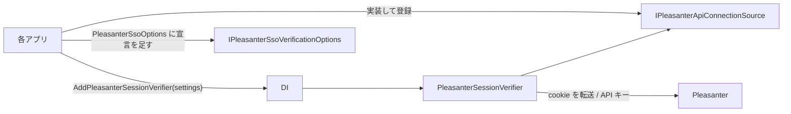

# Core.Web 共通化の方針

AtomFeed・CalendarFeed・Questionnaire の Web 層に複製されているコードのうち、
**何を Core.Web（`VehicleVision.PleasanterTools.Core.Web`）へ移し、何を移さないか**。
アプリ固有の値の受け口と、各アプリが置き換えるときの手順を決める。
Issue #74 が本人確認の第 1 段階、Issue #83 が設定とマイグレーションコマンドの第 2 段階。
**第 2 段階では Core だけを変更する。各アプリは preview.12 の公開後、別の作業で置き換える。**

一般の方針は [`コア化の方針.md`](コア化の方針.md)。**迷ったら移さない**（後から上げるのは簡単、下ろすのは全アプリに影響する）。

## 基準と調べ方

| アプリ | 比べた版（`origin/develop`） |
|---|---|
| AtomFeed | `b9eaf0c61ab0365941e435667015c689198d0b5a`（2026-10-22） |
| CalendarFeed | `fcda6929f41d88c7c68164ba33c8da723bdba16f`（2026-10-22） |
| Questionnaire | `ca58e2986958dd085bda40527a625cdb9f0e35aa`（2026-10-22） |

- **基準は Questionnaire（Q）。** ほかのアプリの差は「引数・オプションで吸収できるか」を見て、吸収できなければ移さない
- 各ファイルのアプリ名（`AtomFeed` / `ATOMFEED` / `atomfeed` など）を同じ記号に置き換えてから `diff` を取り、
  **残った差が「アプリ名・名前空間・環境変数の接頭辞」だけか、振る舞いの違いか**を 1 つずつ確かめた
- AtomFeed と CalendarFeed（A/C）は、どのファイルも**コメントの Issue 番号を除いて同じ**だった
  （例外は `MigrationCommand` の `lockTimeout` 引数。下表）

## 対象ファイルごとの差と判断

| ファイル | A/C と Q の差（アプリ名を除く） | 判断 |
|---|---|---|
| `PleasanterSessionVerifier.cs` | ① 接続設定（API キー）の取り方: A/C は `RuntimeSettings.Current`（同期）、Q は `IPleasanterOptionsProvider`（非同期。読めない例外を警告して「キー無し」扱い）<br>② ログで案内する設定名: A/C は `AppSettingDefinitions.*`、Q は `AppSettingsProvider.*Key`<br>③ ログの均し: A/C は `AuditText.Safe(値, 100)`、Q は `LogSafe.Text(値)`<br>④ `SessionProbeKey` の値（アプリ名だけ違う） | **移した。** ①は `IPleasanterApiConnectionSource`、②④は `PleasanterSessionVerifierSettings` で受ける。③は Q に合わせた（下記「A/C で変わること」） |
| `PleasanterSessionVerifier.Membership.cs` | 無し（3 アプリで同一） | **移した** |
| `PleasanterSsoOptions.cs` | ① 設定の鍵が `const`（Q の両 Options の型名付き `*Key` 参照は src 118・tests 66 か所）<br>② cookie 接頭辞（`q.` / `atomfeed_` / `calendarfeed_`）<br>③ A/C は多言語の `SettingException`、Q は日本語の `InvalidOperationException`<br>④ A/C の役割は文字列、Q は列挙。Q の列挙は複合表記も受け付ける | **第 2 段階で Core.Web へ。** 役割の列挙の解釈・例外の翻訳・既存 `const` はアプリの薄いアダプターに残す |
| `SamlOptions.cs` | ①③④は SSO と同じ<br>Q の役割は定義された数値も受け付ける（SSO では数値を拒否）<br>Q だけ `FromConfiguration(IConfiguration)` を持つ | **第 2 段階で読み取りと検証を Core.Web へ。** ITfoxtec の設定生成はアプリに残す |
| `MigrationCommand.cs` | ① Q だけ `--migrate-status`（未適用ありは終了コード 1）<br>② Q は未適用一覧と適用件数、A/C は適用済みの表示だけ<br>③ Q は固定 300 秒、A は `AppDatabase` の既定、C は引数 | **第 2 段階で Core.Data へ。** Q の出力・引数へ統一する判断は 2026-10-22 に承認済み。ロック待機は引数で受ける |

「やや似ている」ファイル（`PasswordHasher`・`AdminPasswordPolicy`・`SecretProtector`・`ParameterFiles`。正規化した類似度 0.3〜0.45）は、
この段階の対象外。[`コア化の方針.md`](コア化の方針.md) の「セキュリティ」の行のとおり、配置も内容も別物で、機械的にはまとめられない。

## Core.Web の公開 API



| 型 | 役割 |
|---|---|
| `IPleasanterSessionVerifier` / `PleasanterSessionVerifier` | cookie を転送して本人を聞く。403 なら API キーの経路、所属の制限があればグループまでたどる（Q と同じ） |
| `PleasanterSessionStatus` / `PleasanterIdentity` / `PleasanterSessionResult` | 結果（Q と同じ形） |
| `IPleasanterSsoVerificationOptions` | 検証器が読む設定（`Enabled`・`InternalBaseUrl`・`Timeout`・`AllowedDeptIds`・`AllowedGroupIds`・`ShouldForwardCookie`）。**各アプリの `PleasanterSsoOptions` は同じ名前と型をすでに持つ** |
| `IPleasanterApiConnectionSource` / `PleasanterApiConnectionSettings` | 本アプリの Pleasanter 接続設定（URL と API キー）。設定の置き場はアプリごとに違うので、アプリが実装する |
| `PleasanterSessionVerifierSettings` | アプリごとに違う値（下表） |
| `PleasanterSessionVerifierServiceCollectionExtensions.AddPleasanterSessionVerifier` | HttpClient（**cookie を覚えない・転送を追わない・時間切れは無限**）と検証器を登録する。**3 アプリの `Program.cs` に書き写されていた設定をここへ集めた** |

- 第 1 段階では設定の読み取りをアプリに残した。第 2 段階で共通化する。
  検証器の `IPleasanterSsoVerificationOptions` は変えず、既存アプリとの互換を保つ
- 所属の制限があるか（`HasMembershipRestriction`）は Core が `AllowedDeptIds` と `AllowedGroupIds` から決める
  （3 アプリとも同じ式。アプリの実装の誤りで所属の確認が抜けないように）
- 公開しないもの: ログの均し（`LogSafe`）は `internal`

## アプリ固有の値の受け口

| 値 | 受け口 | 例（Questionnaire） |
|---|---|---|
| `/api/sessions/set` に書く鍵 | `PleasanterSessionVerifierSettings.SessionProbeKey` | `VehicleVision.Questionnaire.SsoProbe` |
| ログで案内する設定名（URL・API キー） | `BaseUrlSettingName` / `ApiKeySettingName` | `QUESTIONNAIRE_PLEASANTER_BASEURL` / `QUESTIONNAIRE_PLEASANTER_APIKEY` |
| ログのカテゴリ | `LoggerCategory`（空なら `VehicleVision.PleasanterTools.Core.Web.PleasanterSessionVerifier`） | `VehicleVision.PleasanterTools.Questionnaire.Web.Services.PleasanterSessionVerifier` |
| 本アプリの Pleasanter 接続設定 | `IPleasanterApiConnectionSource` の実装 | `IPleasanterOptionsProvider` から `BaseUrl` と `ApiKey` を渡す |
| 本アプリの cookie の接頭辞 | 第 2 段階の `PleasanterSsoOptions` の引数 `ownCookiePrefix` | `q.` |

## 各アプリが置き換える手順（Core.Web の公開後、各アプリの PR で）

1. **`PackageReference`** で `VehicleVision.PleasanterTools.Core.Web` を参照する（Core.Data・Core.Mail と同じ版）
2. **`PleasanterSsoOptions` の宣言に `IPleasanterSsoVerificationOptions` を足す。** 中身は変えない
3. **`IPleasanterApiConnectionSource` を実装して登録する**
    - Q: `IPleasanterOptionsProvider.GetAsync` の `BaseUrl` と `ApiKey` を返す
    - A/C: `RuntimeSettings.Current.Pleasanter` の `BaseUrl` と `ApiKey` を返す
4. **`Program.cs` の登録を置き換える。** `AddSingleton<IPleasanterSessionVerifier, PleasanterSessionVerifier>()` と
   `AddHttpClient(PleasanterSessionVerifier.HttpClientName, …)` を消し、`AddPleasanterSessionVerifier(new() { … })` にする。
   **`SessionProbeKey` は今の値（`VehicleVision.<アプリ>.SsoProbe`）をそのまま渡す**
5. **アプリの `PleasanterSessionVerifier.cs` / `.Membership.cs` を消し**、名前空間を `VehicleVision.PleasanterTools.Core.Web` へ切り替える。
   `IPleasanterSessionVerifier` を実装する試験の偽物は、引数の型を `IPleasanterSsoVerificationOptions` にする
6. **Q の単体試験（`PleasanterSessionVerifierTests` / `PleasanterSsoMembershipTests`）は Core へ移した。** アプリ側から消してよい。
   A/C の `PleasanterSsoTests`（アプリ全体を通す結合試験）は残す
7. ビルドと試験を通し、[`コア化の方針.md`](コア化の方針.md) の「移行の状況」を更新する

### 置き換えで変わること（注意）

- **ログのカテゴリ。** 何も渡さなければ Core の型名になる。ログの量をカテゴリで絞っているなら、`LoggerCategory` に今の名前を渡す
- **A/C: JSON でない応答のログに出す MediaType の均し方**が Q に揃う（`AuditText.Safe(値, 100)` → `LogSafe.Text(値)`。
  空なら `(なし)`、128 文字で切って `…(切り詰め)` を添える）。**ログの文言だけで、判定は変わらない**
- **A/C: 接続設定の読み出しが例外を投げたとき。** 今は呼び出し元へそのまま伝わる。置き換え後は
  `FormatException`・`OverflowException`・`InvalidOperationException` なら警告して「キー無し」扱いになる（Q と同じ）。
  `RuntimeSettings.Current` は例外を投げない作りなので、**実際の振る舞いは変わらない見込み**（A/C の実装で確かめること）
- 接続設定の読み出しが `null` を返したときは「キー無し」として扱う（以前は Q でも例外。Core で足した防御）

## 第 2 段階の設計（Issue #83）

2026-10-22 のユーザー決定で、前段階の提案を採用した。
Core は多言語メッセージを持たず、誤りの種類・引数・日本語文言を持つ例外を投げる。
**認証設定の受け付ける／拒む条件は変更しない。**

### 再比較で確かめた差と共通の検証

最新の `origin/develop` は `ls-remote` と一致することを確認した。
アプリ名の大小文字を同じ記号へ置き換えた diff では、A/C の Options はコメントだけが違う。
Q との差には、先の表に加えて次の注意がある。

- Q の `RegisterRole` の `Enum.TryParse` は、SSO でも `Editor, Administrator` のような複合表記を
  受け付ける。SAML では定義された数値（`0`〜`4`、符号付き表記を含む）も受け付ける。
  A/C の役割名の一覧との照合とは**同じ式ではない**ので、その解釈は Q に残す
- `UnknownUser` は、3 アプリとも SSO で数値を拒否し、SAML で定義された数値を受け付ける。
  `SamlLoginIdSource` も数値と複合表記を受け付ける。この非対称を Core でも変えない
- SSO は無効でも誤記を検査する。SAML は `true` 以外（`yes` なども含む）を無効として、
  他の値を読まない。既定値もそのまま
- SSO の内部 URL は http(s) の絶対 URL で、資格情報・query・fragment は拒否し末尾を `/` にする。
  ブラウザ URL は同じホストの `/` 始まりか http(s)。`//`・`/\`・相対パス内の制御文字は拒否する
- cookie は token 文字・空指定・本アプリの接頭辞との両方向の重なりを検査する。
  自アプリ除外は大文字小文字を無視、転送先の前方一致と重複除去は大小を区別する
- 所属は正の ID、64 件以内・1024 文字以内（重複除去前）。再確認は 1〜60 分、待機は 1〜30 秒。
  SAML の署名証明書は PEM／base64 DER の複数枚、SSO と任意の SLO の URL は http(s) の絶対 URL

根拠（2026-10-22 参照）:
[A の Options][a-options]・[C の Options][c-options]・[Q の Options][q-options]。
各ディレクトリの `PleasanterSsoOptions.cs` / `SamlOptions.cs` の
`FromValues`・`ParseEnum`・`ParseRole`・`ParseCookieNames` を比較した。
役割の定義は A/C の `Core/Admin/AdminModels.cs`、Q の `Data/AdminRole.cs`。

[a-options]: https://github.com/vehiclevisionjp/VehicleVision.PleasanterTools.AtomFeed/tree/b9eaf0c61ab0365941e435667015c689198d0b5a/src/VehicleVision.PleasanterTools.AtomFeed.Web/Services
[c-options]: https://github.com/vehiclevisionjp/VehicleVision.PleasanterTools.CalendarFeed/tree/fcda6929f41d88c7c68164ba33c8da723bdba16f/src/VehicleVision.PleasanterTools.CalendarFeed.Web/Services
[q-options]: https://github.com/vehiclevisionjp/VehicleVision.PleasanterTools.Questionnaire/tree/ca58e2986958dd085bda40527a625cdb9f0e35aa/src/VehicleVision.PleasanterTools.Questionnaire.Web/Services

### 公開 API と残すもの

| 型／入口 | 引数と役割 |
|---|---|
| `PleasanterSsoSettingKeys` / `SamlSettingKeys` | コンストラクターへアプリの接頭辞（末尾の `_` を含む）を渡す。各 `*Key` を導く |
| `PleasanterSsoOptions` | `IPleasanterSsoVerificationOptions` を実装。直接作るときも `ownCookiePrefix` と `defaultRegisterRole` が必須 |
| `SamlOptions` | 直接作るときも `defaultRegisterRole` が必須。証明書・SLO・未登録利用者・ログイン ID の設定を保持 |
| 両型の `FromValues` | `valueOf`・各設定キー型・`registerRoles`・`defaultRegisterRole`。SSO だけ `ownCookiePrefix` も渡す |
| 両型の `FromConfiguration` | `IConfiguration`・アプリの `prefix`・役割の一覧と既定。SSO だけ cookie 接頭辞も渡す。内部は `FromValues` と同じ |
| SSO の `ParseCookieNames` | 生値・`PleasanterSsoSettingKeys`・cookie 接頭辞を受ける |
| `AuthenticationSettingException` | `InvalidOperationException` の派生。`Error`（列挙）・不変の `Arguments`・日本語 `Message`・元の `InnerException` |
| `PleasanterSsoUnknownUserPolicy` / `SamlUnknownUserPolicy` / `SamlLoginIdSource` | アプリ間で同じ列挙を共有する |

役割の一覧に既定が無いなど、呼び出しコードの誤りは `ArgumentException`。
Core はアプリの役割名を知らず、渡された一覧に大小を無視して照合し、一覧の正規名を返す。

**移さないもの:**

- Q の `AdminRole` とその読み取り。共通でない許可条件を Core の汎用オプションへ増やさないため
- 既存の設定名の `const`。Q の `switch`・属性の定数参照を壊さないため
- 多言語の `SettingException` / `ServerMessages` と設定プロバイダー（外部設定・DB の優先順位・保存・キャッシュ）
- `ToSaml2Configuration`。ITfoxtec への変換は設定値の読み取りでなく、SAML 実装との境界。
  公開 API と依存を増やさず、アプリに同じ実装と試験を残す。
  **発行者・宛先・署名証明書の固定、SHA-1 の拒否、無効時の例外を変えないこと**
- アプリ固有のマイグレーション、接続先の解決、自動適用の設定・Web 起動処理

### 例外の写し替え（A/C）

`AuthenticationSettingException` を捕まえ、次の文言の鍵と `Arguments`（同じ順序）を渡して
`SettingException` にする。証明書の元の例外も渡す。日本語文言そのものを解析しない。
引数の順序と意味は `src/VehicleVision.PleasanterTools.Core.Web/AuthenticationSettingException.cs` の列挙の宣言。

| Core の `Error` | A/C の `ServerMessageKeys` |
|---|---|
| `RequiredWhenEnabled` | `SettingRequiredWhenEnabled` |
| `BooleanValueInvalid` | `SettingBooleanValueInvalid` |
| `IntegerRangeInvalid` | `SettingIntegerRangeInvalid` |
| `UnknownValue` | `SettingUnknownValue` |
| `CookieNameInvalidChars` / `CookieNameOverlapsOwn` / `CookieNamesEmpty` | `SsoCookieNameInvalidChars` / `SsoCookieNameOverlapsOwn` / `SsoCookieNamesEmpty` |
| `InternalUrlInvalid` / `BrowserUrlInvalid` | `SsoInternalUrlInvalid` / `SsoBrowserUrlInvalid` |
| `IdListTooLong` / `IdListInvalid` | `SsoIdListTooLong` / `SsoIdListInvalid` |
| `AbsoluteUrlInvalid` | `SettingAbsoluteUrlInvalid` |
| `CertificateRequired` / `LoginIdClaimRequired` | `SamlCertificateRequired` / `SamlLoginIdClaimRequired` |
| `CertificatePemIncomplete` / `CertificatePemUnreadable` | `SamlCertificatePemIncomplete` / `SamlCertificatePemUnreadable` |
| `CertificateNotFound` / `CertificateUnreadable` | `SamlCertificateNotFound` / `SamlCertificateUnreadable` |

### MigrationCommand（Core.Data）

```csharp
await MigrationCommand.RunAsync(
    database.Migrator, provider, connectionString, args,
    lockTimeout: configuredLockTimeout,
    cancellationToken: cancellationToken);
```

`database` はアプリの `AppDatabase`。`lockTimeout` は省略でき、
省略時は `AppDatabase.DefaultMigrationLockTimeout`（現在 5 分）を使う。
Q は従来の固定 300 秒を渡し、A は省略、C は従来の設定値を渡す。
`CancellationToken` と DB の待機失敗の伝え方も維持する。

**A/C の置き換えで変わる点（ユーザー承認済み）:**

1. `IsRequested` が `--migrate-status` も完全一致で受け付ける。未適用ありは終了コード 1、適用済みは 0
2. `--migrate` は未適用があれば `Pending migrations ({provider}):` と、字下げした `- 番号 型名` を表示し、
   ロックを取って適用後に `Applied N migration(s).` を表示する。
   以前は一覧も件数もなく `All migrations are applied ({provider}).` だけだった
3. 適用済みなら、従来どおり `All migrations are applied ({provider}).` で終了コード 0。
   この場合は先に状態を見て戻るので、A/C と違って適用用ロックを取得しない
4. 両方の合図があれば `--migrate` を優先する。`--wait-for-db=N` は変更なし
   （最初の指定だけ、正の整数でなければ待たない）。DB を待ちきれなければ標準エラーと終了コード 2

出力は英語。待機中は `Waiting for the database (up to Ns)...`、
期限切れは `Database not reachable after Ns: …`。
適用や状態取得そのものの例外・中止は握りつぶさず呼び出し元へ伝える。
状態の確認はマイグレーションを適用しないが、**完全な読み取り専用ではない**。
現行 `DatabaseMigrator.PendingMigrations` は FluentMigrator の版ローダーを通し、
SQLite の新規 DB に空の `VersionInfo` 表を作ることを試験で確認した。
既存の「版の表も作らない」というコメントとは違うため、実際の挙動を記載している。
マイグレーターの振る舞いは変えず、誤ったコメントだけを修正する。

根拠（2026-10-22 参照）:
[A のコマンド][a-migration]・[C のコマンド][c-migration]・[Q のコマンド][q-migration]。
Core 側の出力・終了コード・状態確認の副作用は
`tests/VehicleVision.PleasanterTools.Core.Data.Tests/MigrationCommandTests.cs` で検査する。

[a-migration]: https://github.com/vehiclevisionjp/VehicleVision.PleasanterTools.AtomFeed/blob/b9eaf0c61ab0365941e435667015c689198d0b5a/src/VehicleVision.PleasanterTools.AtomFeed.Web/MigrationCommand.cs
[c-migration]: https://github.com/vehiclevisionjp/VehicleVision.PleasanterTools.CalendarFeed/blob/fcda6929f41d88c7c68164ba33c8da723bdba16f/src/VehicleVision.PleasanterTools.CalendarFeed.Web/MigrationCommand.cs
[q-migration]: https://github.com/vehiclevisionjp/VehicleVision.PleasanterTools.Questionnaire/blob/ca58e2986958dd085bda40527a625cdb9f0e35aa/src/VehicleVision.PleasanterTools.Questionnaire.Web/MigrationCommand.cs

### 各アプリの置き換え（preview.12 公開後）

1. **今回は置き換えない。** Core.Data / Core.Web を preview.12 に揃える作業を、公開後に各アプリで行う
2. 設定キー型へ既存のアプリ接頭辞を渡す。アプリの `const` は残し、Core が導いたキーと一致することを試験する
3. A/C は `AdminRoles.All` と `AdminRoles.Editor`、既存の cookie 接頭辞を渡す。
   前節の例外の写し替えを挟む。多言語の管理 API の結合試験を残す
4. Q は `Enum.GetNames<AdminRole>()` と `Editor`、`q.` を渡す。
   **`REGISTERROLE` の値を要求されたときだけ、既存の `ParseEnum<AdminRole>` で読み、正規名にして返す。**
   SSO の数値拒否と SAML の数値許可、両方の複合表記の許可をそのまま残す。
   SAML 無効時には役割を先読みしない。戻った正規名をアプリの `AdminRole` に変換する
5. Q の既存の `InvalidOperationException` を捕まえる処理は派生例外も受けられる。
   `Assert.Throws<InvalidOperationException>` の厳密な型検査は見直す。
   ITfoxtec の変換とその署名・宛先固定の試験は残す
6. `MigrationCommand` は Core.Data の型へ置き換え、マイグレーターと前節のロック待機時間を渡す。
   A/C の Helm フックやログ解析が旧出力に依存していないか確認する
7. Core に移した単体試験は重複を削除してよい。アプリの設定保存・多言語・認証・固有スキーマの結合試験は残し、
   各アプリでビルドと試験を実行する。追随完了を Issue #83 と移行状況の表に残す

## 確かめたこと・確かめていないこと

- **確かめた:** Q の単体試験（本人確認・代わりの経路・所属・時間切れ）を Core へ移して通した。DI の登録（cookie を覚えない・
  転送を追わない・時間切れ無限）とアプリごとの値の受け口も試験した（`tests/VehicleVision.PleasanterTools.Core.Web.Tests`）
- **第 2 段階で移した試験:** Q の `PleasanterSsoOptionsTests`（プロバイダー部分を除く）と `SamlOptionsTests`
  （ITfoxtec 変換を除く）。A/C の `DynamicMessagesTests` の必須・証明書・cookie 重複・ID・URL の条件を
  Core の種類と引数の検査にした。A/C の `HealthAndMigrateTests` の合図・再適用・待機失敗と、
  Q の `DatabaseMigrationTests` の合図を統合した。固有の表と Web の試験はアプリに残した
- **追加の試験:** 設定キーと引数、所属の件数・文字数、数値の上下限、SLO、SAML の数値・複合表記、
  出力全文、終了コード、状態確認がスキーマを適用しないこと、ロック待機時間の受け渡し、中止の伝播
- **元ソースとの直接比較:** 上記の 3 コミットの Options を一時的な比較用プログラムへ読み込み、
  名前空間とアプリ型への依存だけを置き換えて実行した。Q は前節の役割アダプターを挟んだ。
  各設定・有効／無効・正常値／境界／誤記を含む 9,246 ケースで、受理・拒否と読み取り結果が一致した。
  ITfoxtec 変換とアプリの設定保存・Web の処理は、この比較の対象外
- **ローカル検証:** Release ビルドは警告 0、全 372 テスト成功（Mail 45・Data 103・Web 224）。
  テストの DB は一時 SQLite のみ。外部 DB の環境変数は未設定で、4 RDBMS を検証したという意味ではない。
  Code Integrity によるブロックは発生しなかったため、短いパスへの複製は不要だった
- **確かめていない:** 実機の Pleasanter・IdP には当てていない。各アプリでの置き換え（ビルド・結合試験）は、公開後の各アプリの PR で行う
