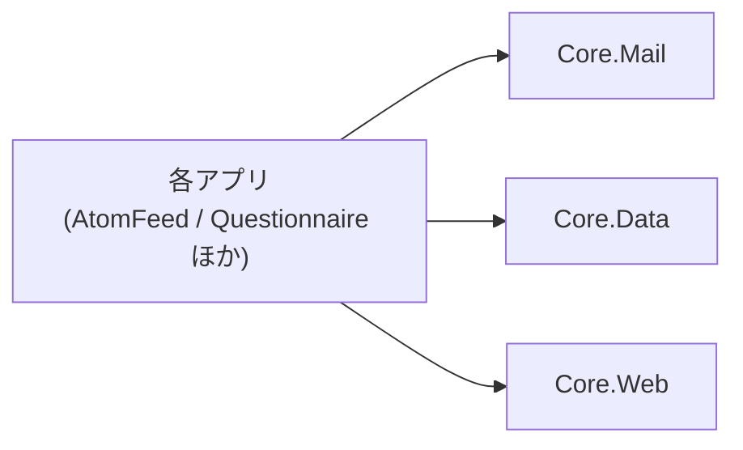

# コア化の方針

VehicleVision.PleasanterTools の各アプリで**別々に育っていた共通部分を、1 か所へ集める**ための方針。
何を Core に置き、何を置かないか。アプリ固有の値をどう渡すか。互換をどう保つか。

## 背景

AtomFeed・CalendarFeed・IdentityProvider・Questionnaire は、メール送信・DB 基盤・管理者の認証などを
**それぞれのリポジトリへコピーして持っていた。** 2026-10-18 に Questionnaire の `develop` を基準に
比べたところ、次の状態だった（対象は Core / Data / Mail 層）。

- 同じパスのファイルは 69 個。名前空間のアプリ名を揃えても、**42 個は内容が違った**
- 差には 2 種類あった。**片方だけに入った修正**（Mail 層の Issue コメントの有無など）と、
  **設計そのものの違い**（下記）
- **設計の違いの例: 日時の持ち方。** `DbTime` は同じ名前だが別物で、
  AtomFeed は**固定幅の UTC 文字列**（`Format` / `Parse`）、
  Questionnaire と IdentityProvider は**ネイティブの日時型**（`ForDb` / `AsUtc`）で DB に持つ。
  **Questionnaire を基準にした Core の `DbTime` は、AtomFeed の置き換えにそのままは使えない**
- SDK の指定も 2 種類（10.0.100 と 10.0.401）に割れていた

**コピーは、直した側と直していない側を必ず生む。** 1 か所へ集めれば、直すのは 1 回で済む。

## Core に置くもの・置かないもの

| 置く | 置かない |
|---|---|
| 2 つ以上のアプリが**同じ目的で**使うもの | 1 つのアプリだけが使うもの |
| アプリの業務を知らずに書けるもの | アプリの業務（アンケートの回答、フィードの定義など）を知っているもの |
| 値を引数で受けられるもの | アプリ名・環境変数名を前提にするもの |

迷ったら**置かない。** 後から Core へ上げるのは簡単だが、Core から下ろすのは全アプリを巻き込む。

## アプリ固有の値は引数で受ける

**Core にアプリ名を書かない。** 次の値はアプリごとに違うので、呼び出し側が渡す。

| 値 | 受け口 | 例（Questionnaire） |
|---|---|---|
| メールの環境変数の接頭辞 | `MailOptions.FromConfiguration(configuration, prefix)` | `QUESTIONNAIRE_MAIL_` |
| SQLite の既定ファイル名・接続文字列の設定名 | `DatabaseConnectionString.Resolve(…, sqliteFileName, settingName)` | `questionnaire.db` / `QUESTIONNAIRE_DB_CONNECTIONSTRING` |
| 暗号化を緩める設定名 | `ConnectionSecurity.EnsureSecure(…, allowSetting)` | `QUESTIONNAIRE_DB_ALLOW_INSECURE` |
| マイグレーションの置き場とロック名 | `new DatabaseMigrator(assembly, lockName)` | `questionnaire-startup-migrations` |

**ロック名はアプリごとに別にする。** 同じ DB サーバを複数のアプリが使うとき、
名前が同じだと別のアプリのマイグレーションを待たせてしまう。

## パッケージと依存の向き

- **Core はアプリを参照しない。** 向きは常にアプリ → Core
- Core.Mail・Core.Data・Core.Web は互いに参照しない
- Core.Web は ASP.NET Core の共有フレームワーク（`FrameworkReference`）だけに頼る。何を移したかは
  [`Core.Web-共通化の方針.md`](Core.Web-共通化の方針.md)
- パッケージはすべて**同じ版**で出す（`Directory.Build.props` の `VersionPrefix`）

## 互換性とバージョン

- セマンティックバージョニング。**1.0.0 未満は互換を保証しない**が、**壊す変更は PR に明記し、
  各アプリの追随を Issue に残す**（規約 9）
- **Core を直しても、アプリが古い版を参照している限りばらつきは直っていない。**
  公開のたびに、各アプリが追随できているかを見ること
- 依存パッケージの版は `Directory.Packages.props` が単一情報源。各アプリも**同じ版へ揃える**
  （揃えないと、アプリと Core で同じ依存が別の版になり、実行時に食い違う）
- `global.json` は各アプリと Core で同じ値にする。`ci.yml` が Core 側の一致を検査する

## アプリが Core を採用する手順

1. （**`nuget.config` もトークンも要らない。** nuget.org から取得する。[`README.md`](../README.md)）
2. **`PackageReference`** で `VehicleVision.PleasanterTools.Core.Mail` / `.Data` / `.Web` を参照する（使うものだけ）
3. **アプリ側の重複コードを消す。** 名前空間を `VehicleVision.PleasanterTools.Core.*` へ切り替える
4. **アプリ固有の値を、上の表の引数で渡す**
5. ビルドとテストを通す。**DB に触れる所は 4 RDBMS の結合テストまで**回す
6. この文書の「移行の状況」を更新する

## DB とマイグレーションの規約（アプリが 20〜30 個に増えても困らないように）

DB を使うアプリが増えても、**アプリごとの調整や手書きが増えない**ことを基準にする。前提は
**アプリ同士は DB を共有しない**（アプリごとに別の DB。同じ DB に同居するのは、Core の共有分と、そのアプリ 1 つだけ）。

### マイグレーションの番号

- **各アプリは、自分の番号（1〜9999）を、ほかのアプリと調整せずに使う。** DB を共有しないので、番号は衝突しない
- **番号は桁で範囲を分ける。** 桁で分かれるので、同じ DB に同居しても衝突しない。実行は番号順

  | 桁 | 範囲 | 持ち主 |
  |---|---|---|
  | 4 桁 | `M0001`〜`M9999` | アプリ（Core の共有表を前提にしないもの） |
  | 5 桁 | `M10001`〜`M99999` | **Core の共有マイグレーション**（Core.Data が持つ） |
  | 6 桁 | `M100000`〜 | アプリ（**Core の共有表の後**に動かしたいもの。例: 旧い表の行を Core の共有表へ写す） |

- Core の共有マイグレーションは、`DatabaseMigrator` が**アプリの分と一緒に**当てる（アプリは何もしなくてよい）。
  アプリ固有のマイグレーション（4 桁）は、Core の共有表を前提にしない。前提にしたい移行だけを 6 桁にする
- **既存の番号は変えない。** Questionnaire の M0001〜M0037 は、そのまま使い続ける。公開したマイグレーションの変更も、番号の振り直しもしない。
  直すときは、新しいマイグレーションを足す

### Core の共有マイグレーションの作法

Core の共有分は、**全アプリの DB に当たる**。アプリごとに Core の版を上げる時期が違うので、次を守る。

- **追加だけにする**（テーブルの追加・列の追加・索引の追加）。列の削除・型の変更・名前の変更のような、壊す変更は入れない
- **古い版のアプリが動いている DB に当たっても、そのアプリが壊れないこと。** 先に足してから、使う側を切り替える（expand → contract）
- **Core の共有テーブルは `Core_` の接頭辞を付ける。** アプリのテーブルと同じ名前になる事故を防ぐ（アプリが増えるほど、名前がぶつかる確率が上がる）

### アプリ固有の値は、アプリ ID から規約で導く（`AppDatabase`）

アプリごとに `XxxDatabase` のようなクラスを手書きすると、30 個分の書き写しと、命名のばらつきが生まれる。
**アプリ ID（例: `questionnaire`）とマイグレーションのアセンブリを `AppDatabase` へ渡せば、次の名前を規約で導く。**

| 値 | 規約 |
|---|---|
| SQLite の既定ファイル名 | `<id>.db` |
| RDBMS を選ぶ設定名 | `<ID>_DB_PROVIDER` |
| 接続文字列の設定名 | `<ID>_DB_CONNECTIONSTRING` |
| 暗号化を緩める設定名 | `<ID>_DB_ALLOW_INSECURE` |
| マイグレーションの排他のロック名 | `<id>-startup-migrations`（**ID が一意なら衝突しない**） |

- `<ID>` は ID の大文字で、ハイフンは下線にする。ID は小文字の英字で始まり、英数字とハイフンだけ（形が違えば作る時に止める）
- `AppDatabase` は、マイグレーションの適用（`Migrator`）・RDBMS の読み取り・接続文字列の解決・暗号化の検査・
  SQLite のモデル型の登録も持つ。アプリは、`public static AppDatabase Instance` を 1 つ持てばよい
- メールの環境変数の接頭辞（`<ID>_MAIL_`）は、Core.Mail と Core.Data が互いを参照しないため、ここには含めない

### 依存と配布

- **アプリは、Core が持つ依存（Dapper・FluentMigrator・DB ドライバなど）を、自分で宣言し直さない。** 版のずれの原因になる。
  セキュリティの修正版へ固定する必要があるものだけを例外にして、理由をコメントに書く
- **Core の更新は、各アプリへ自動で配る。** nuget.org への公開後に、Dependabot が各アプリへ PR を出す。
  パッチ・マイナーは、CI が通れば取り込む運用にする（30 個の PR を手作業でマージしない）
- **テストの重さを分ける。** DB の基盤は、Core が 4 RDBMS（SQL Server / PostgreSQL / MySQL / SQLite）で試す。
  各アプリは、自分が使う RDBMS だけで、自分の SQL を試す（アプリ数 × 4 RDBMS の CI は重すぎる）

## 移行の状況

基準は 2026-10-22 時点の各アプリの GitHub 上の `develop` と、Core の公開済みタグ。
確認したコミットとソースの参照箇所は表の後に記載する。

| 領域 | Core | 状況 |
|---|---|---|
| メール送信（`Core.Mail`） | 移行済み（0.1.0-preview.1） | AtomFeed・CalendarFeed・Questionnaire が参照（preview.4）。IdentityProvider は参照なし |
| DB の基盤（接続・暗号化検査・`DbTime`・マイグレーションと排他） | 移行済み（0.1.0-preview.1） | AtomFeed・CalendarFeed（preview.6）・Questionnaire（preview.9）・IdentityProvider（preview.7）が参照。**AtomFeed・CalendarFeed も Core の `DbTime.ForDb` / `AsUtc` へ切替済み** |
| `SqlDialect` の汎用部分 | 移行済み | アプリ固有の SQL は各アプリに残す |
| ストア群（`AuditLogStore` / `MailOutbox` / `AdminInvitationStore` / `AdminUserStore` / `AdminSessionStore` / `AppSettingStore` / `RateLimitStore`） | 移行済み（preview.6 で全7ストアを実装済み） | AtomFeed・CalendarFeed は全7ストア。Questionnaire は管理者・復旧コード・セッション（DB を選択した場合。Redis 版はアプリ側）・監査・メール・招待・設定を採用。`RateLimitStore` は未採用。IdentityProvider は監査のみ採用 |
| セキュリティ（`PasswordHasher` / `Totp` / `SecretProtector` / `AdminPasswordPolicy`） | 未 | 配置も内容も別物（AtomFeed・CalendarFeed は Core 層、Questionnaire・IdentityProvider は Web 層）。**機械的にはマージできない** |
| 多言語メッセージ（`ServerMessages`） | 未 | 規模が違う（287 行と 1220 行）。**Core に入れるかを別途判断する** |
| Data 層のテスト | Core の共有ストアのテストを実装済み | `tests/VehicleVision.PleasanterTools.Core.Data.Tests/`。アプリ固有のテストは各アプリに残す |
| Pleasanter のログインの本人確認（`PleasanterSessionVerifier`。`Core.Web`） | 移行済み（v0.1.0-preview.10 で初公開） | AtomFeed・CalendarFeed・Questionnaire は preview.10 を参照し切替済み。IdentityProvider は参照なし。手順は [`Core.Web-共通化の方針.md`](Core.Web-共通化の方針.md) |
| Pleasanter SSO・SAML の設定（`PleasanterSsoOptions` / `SamlOptions`） | 未 | 誤りの伝え方（A/C は多言語の `SettingException`、Q は `InvalidOperationException`）と `RegisterRole` の型が違う。**形を決めてから**（同上） |
| コマンドラインのマイグレーション（`MigrationCommand`） | 未 | Q だけ `--migrate-status` を持ち、出力も違う。A/C を Q に揃えるかを決めてから（移すなら Core.Data） |

管理画面の認証・セッション・権限・設定などの共通仕様と、アプリ間の差・未決事項は
[`管理画面の共通仕様書.md`](管理画面の共通仕様書.md) を参照する。

### 移行状況の根拠（2026-10-22 参照）

以下のアプリのパスは `src/VehicleVision.PleasanterTools.<アプリ名>.` からの続き。
`Data/*.csproj` / `Web/*.csproj` / `Mail/*.csproj` は、その層の同名のプロジェクトファイルを指す。
コミットは GitHub 上の `develop` のもの。

| リポジトリ | コミット | 参照したパスと行 |
|---|---|---|
| `vehiclevisionjp/VehicleVision.PleasanterTools.AtomFeed` | `b9eaf0c61ab0365941e435667015c689198d0b5a` | `Data/*.csproj:10,19`、`Web/*.csproj:18-26`、`Data/FeedStore.cs:70,176,196,274-279`、`Web/Program.cs:40,75-87,106` |
| `vehiclevisionjp/VehicleVision.PleasanterTools.CalendarFeed` | `fcda6929f41d88c7c68164ba33c8da723bdba16f` | `Data/*.csproj:10,19`、`Web/*.csproj:18-26`、`Data/FeedStore.cs:70,185,205,285-290`、`Web/Program.cs:42,77-89,110` |
| `vehiclevisionjp/VehicleVision.PleasanterTools.Questionnaire` | `004766d4ea53de8ecc8f7dcde64cc45c8192739d` | `Data/*.csproj:10,26`、`Mail/*.csproj:7`、`Web/*.csproj:20,50,55`、`Web/Program.cs:177-183,351-377,464,556`、`Web/Services/PleasanterSessionVerification.cs:26-31` |
| `vehiclevisionjp/VehicleVision.PleasanterTools.IdentityProvider` | `c7e94925f53da449c6fde17d4ff09b430836edf9` | `Data/*.csproj:10,25`、`Web/*.csproj:41`、`Web/Program.cs:91-100`、`Data/SecurityStores.cs:53,109,230`。全 `src` の csproj に Mail・Web の参照なし |

Core 側は、タグ `v0.1.0-preview.6` の `src/VehicleVision.PleasanterTools.Core.Data/Stores/` の7ファイルと
`DbTime.cs:14-63`、タグ `v0.1.0-preview.10` の `src/VehicleVision.PleasanterTools.Core.Web/` を確認した。
共有ストアのテストは `tests/VehicleVision.PleasanterTools.Core.Data.Tests/*StoreTests.cs` と `MailOutboxTests.cs`、
RDBMS の選択は同ディレクトリの `TestDatabases.cs:6-31` にある。
Core.Web の公開済みの版は [nuget.org の版一覧][web-versions]で確認した。

[web-versions]: https://api.nuget.org/v3-flatcontainer/vehiclevision.pleasantertools.core.web/index.json
