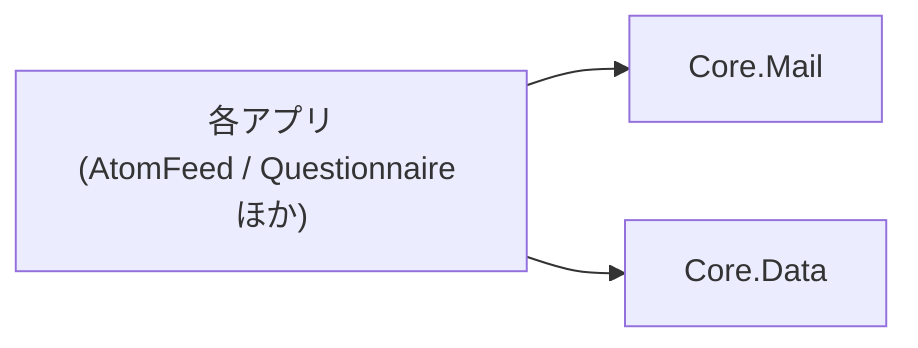

# コア化の方針

VehicleVision.PleasanterTools の各アプリで**別々に育っていた共通部分を、1 か所へ集める**ための方針。
何を Core に置き、何を置かないか。アプリ固有の値をどう渡すか。互換をどう保つか。

## 背景

AtomFeed・CalendarFeed・IdentityProvider・Questionnaire は、メール送信・DB 基盤・管理者の認証などを
**それぞれのリポジトリへコピーして持っていた。** 2026-10-18 に Questionnaire の `develop` を基準に
比べたところ、次の状態だった（対象は Core / Data / Mail 層）。

- 同じパスのファイルは 69 個。名前空間のアプリ名を揃えても、**42 個は内容が違った**
- 差には 2 種類あった。**片方だけに入った修正**（Mail 層の Issue コメントの有無など）と、
  **設計そのものの違い**（下記）
- **設計の違いの例: 日時の持ち方。** `DbTime` は同じ名前だが別物で、
  AtomFeed は**固定幅の UTC 文字列**（`Format` / `Parse`）、
  Questionnaire と IdentityProvider は**ネイティブの日時型**（`ForDb` / `AsUtc`）で DB に持つ。
  **Questionnaire を基準にした Core の `DbTime` は、AtomFeed の置き換えにそのままは使えない**
- SDK の指定も 2 種類（10.0.100 と 10.0.401）に割れていた

**コピーは、直した側と直していない側を必ず生む。** 1 か所へ集めれば、直すのは 1 回で済む。

## Core に置くもの・置かないもの

| 置く | 置かない |
|---|---|
| 2 つ以上のアプリが**同じ目的で**使うもの | 1 つのアプリだけが使うもの |
| アプリの業務を知らずに書けるもの | アプリの業務（アンケートの回答、フィードの定義など）を知っているもの |
| 値を引数で受けられるもの | アプリ名・環境変数名を前提にするもの |

迷ったら**置かない。** 後から Core へ上げるのは簡単だが、Core から下ろすのは全アプリを巻き込む。

## アプリ固有の値は引数で受ける

**Core にアプリ名を書かない。** 次の値はアプリごとに違うので、呼び出し側が渡す。

| 値 | 受け口 | 例（Questionnaire） |
|---|---|---|
| メールの環境変数の接頭辞 | `MailOptions.FromConfiguration(configuration, prefix)` | `QUESTIONNAIRE_MAIL_` |
| SQLite の既定ファイル名・接続文字列の設定名 | `DatabaseConnectionString.Resolve(…, sqliteFileName, settingName)` | `questionnaire.db` / `QUESTIONNAIRE_DB_CONNECTIONSTRING` |
| 暗号化を緩める設定名 | `ConnectionSecurity.EnsureSecure(…, allowSetting)` | `QUESTIONNAIRE_DB_ALLOW_INSECURE` |
| マイグレーションの置き場とロック名 | `new DatabaseMigrator(assembly, lockName)` | `questionnaire-startup-migrations` |

**ロック名はアプリごとに別にする。** 同じ DB サーバを複数のアプリが使うとき、
名前が同じだと別のアプリのマイグレーションを待たせてしまう。

## パッケージと依存の向き

- **Core はアプリを参照しない。** 向きは常にアプリ → Core
- Core.Mail と Core.Data は互いに参照しない
- パッケージはすべて**同じ版**で出す（`Directory.Build.props` の `VersionPrefix`）

## 互換性とバージョン

- セマンティックバージョニング。**1.0.0 未満は互換を保証しない**が、**壊す変更は PR に明記し、
  各アプリの追随を Issue に残す**（規約 9）
- **Core を直しても、アプリが古い版を参照している限りばらつきは直っていない。**
  公開のたびに、各アプリが追随できているかを見ること
- 依存パッケージの版は `Directory.Packages.props` が単一情報源。各アプリも**同じ版へ揃える**
  （揃えないと、アプリと Core で同じ依存が別の版になり、実行時に食い違う）
- `global.json` は各アプリと Core で同じ値にする。`ci.yml` が Core 側の一致を検査する

## アプリが Core を採用する手順

1. **`nuget.config`** にソース `https://nuget.pkg.github.com/vehiclevisionjp/index.json` を足す
   （[`README.md`](../README.md)）。取得には `read:packages` 権限のトークンが要る
2. **`PackageReference`** で `VehicleVision.PleasanterTools.Core.Mail` / `.Data` を参照する
3. **アプリ側の重複コードを消す。** 名前空間を `VehicleVision.PleasanterTools.Core.*` へ切り替える
4. **アプリ固有の値を、上の表の引数で渡す**
5. ビルドとテストを通す。**DB に触れる所は 4 RDBMS の結合テストまで**回す
6. この文書の「移行の状況」を更新する

## 移行の状況

基準は 2026-10-18 時点の Questionnaire `develop`。

| 領域 | Core | 状況 |
|---|---|---|
| メール送信（`Core.Mail`） | 移行済み（0.1.0-preview.1） | 各アプリは未切替 |
| DB の基盤（接続・暗号化検査・`DbTime`・マイグレーションと排他） | 移行済み（0.1.0-preview.1） | 各アプリは未切替。**`DbTime` は Questionnaire 版（日時型）。AtomFeed・CalendarFeed（文字列）は日時の持ち方の統一方針が決まるまで切り替えられない** |
| `SqlDialect` の汎用部分 | 移行済み | アプリ固有の SQL は各アプリに残す |
| ストア群（`AuditLogStore` / `MailOutbox` / `AdminInvitationStore` など） | 未 | アプリごとに別物に育っている。**実装を比べて正を決めてから** |
| セキュリティ（`PasswordHasher` / `Totp` / `SecretProtector` / `AdminPasswordPolicy`） | 未 | 配置も内容も別物（AtomFeed・CalendarFeed は Core 層、Questionnaire・IdentityProvider は Web 層）。**機械的にはマージできない** |
| 多言語メッセージ（`ServerMessages`） | 未 | 規模が違う（287 行と 1220 行）。**Core に入れるかを別途判断する** |
| Data 層のテスト | 未 | Questionnaire の `Integration.Tests` にある |
