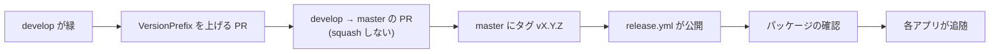

# リリース手順書

Core を nuget.org へ公開する手順。**公開した版は、利用者が参照した時点で取り消せない。**
壊したまま出すより、出さない方が安い。

## 版の付け方

- **セマンティックバージョニング（`vX.Y.Z`）。** 1.0.0 未満は互換を保証しない
- 版の単一情報源は `Directory.Build.props` の `VersionPrefix`。**各 `.csproj` へ個別に書かない**
- **2 つのパッケージ（`Core.Mail` / `Core.Data`）は同じ版で出す**
- 動作確認のための公開は `vX.Y.Z-preview.N`

## 手順



1. **`develop` の CI が緑であること。** `build-test` / `sdk-consistency` / `instructions-sync`
2. **`VersionPrefix` を上げる PR** を `develop` へ出して取り込む（プレビュー版なら不要）
3. **`develop` → `master` の PR** を出して取り込む。**squash しない。**
   squash すると `master` の履歴が `develop` と別物になり、次のリリースの PR が過去の変更まで抱える
4. **`master` の HEAD にタグを打って push する**

    ```bash
    git switch master && git pull
    git tag -a v0.1.0 -m "v0.1.0 ..."
    git push origin v0.1.0
    ```

5. **`release.yml` が公開する。** 次を機械が確かめてから push する
    - タグが `VersionPrefix` と合っていること（`v0.1.0` と `v0.1.0-preview.N` は通る）
    - **タグのコミットが `master` に含まれていること**
    - ビルドとテストが通ること
6. **パッケージを確認する。** `https://www.nuget.org/packages/VehicleVision.PleasanterTools.Core.Mail`
   （公開直後は、検証と索引づけで反映まで数分かかる）
7. **各アプリへ追随を知らせる。** 公開のたびに、破壊的変更があれば各アプリの Issue へ残す
   （規約 9）。移行の状況は [`コア化の方針.md`](コア化の方針.md) を更新する

## nuget.org の準備（初回だけ。管理者の作業）

認証は **Trusted Publishing**（GitHub Actions の OIDC）。長期の API キーを作らず、公開のたびに 1 時間有効のキーを受け取る
（[一次情報](https://learn.microsoft.com/nuget/nuget-org/trusted-publishing)。2026-10-20 参照）。

1. **公開用の共用アカウントを用意する。** 個人のアカウントにすると、その人が組織を抜けたときにポリシーが無効になり、
   リポジトリへ入れる設定にも個人名が残る。**複数人が回復できる共用のメールアドレス**（組織アカウントの連絡先とは別のもの）で
   Microsoft アカウントを作り、nuget.org にサインインして、**用途の分かるプロフィール名**
   （メールアドレスではない。例: `vehiclevision-publisher`）を決める
2. **nuget.org の組織（`vehiclevisionjp`）へ、共用アカウントを招待して承認する。** 組織の管理者が
   Manage Organizations → Members から招待し、共用アカウント側で承認する。公開できる権限にする
3. **共用アカウントで、Trusted Publishing のポリシーを追加する。**
   ユーザー名 → Trusted Publishing → 新しいポリシー。**ポリシーを作る人は共用アカウントにする**（個人で作ると、その人に依存する）。
   入力は次のとおり（大文字小文字は区別しない）
    - **Package Owner:** `vehiclevisionjp`（組織）
    - **CI/CD Provider:** GitHub Actions
    - **Repository Owner:** `vehiclevisionjp`
    - **Repository:** `VehicleVision.PleasanterTools.Core`
    - **Workflow File:** `release.yml`（**ファイル名だけ**。`.github/workflows/` は付けない）
    - **Environment:** 空のまま（このワークフローは environment を使わない）
    - **Scopes:** Push → **Push new packages and package versions**（Unlist / relist は不要）。
      パターンは `VehicleVision.PleasanterTools.Core.*`
4. **GitHub の組織の変数 `NUGET_ORG_USER` を登録し、Core へ共有する。** 組織の Settings → Secrets and variables →
   Actions → Variables → New organization variable。値は 1 の**プロフィール名**（秘密ではない）。
   Repository access は、公開するリポジトリだけを選ぶ
5. 準備ができたら、**プレビュー版（`vX.Y.Z-preview.N`）で試しに公開する**

- ⚠️ **ポリシーを作った人が組織を抜けると、ポリシーは無効になる**（戻れば有効に戻る）。共用アカウントで作るのは、このため。
  共用アカウントの回復手段（2 段階認証・メール）は、複数人が持てるようにしておく
- ID プレフィックス `VehicleVision` は**承認済み**（2026-10-20。nuget.org のサポートから、アカウント `vehiclevisionjp` へ予約したと連絡があった）。
  公開済みの `Core.Mail` / `Core.Data` は予約の対象に含まれる。ほかの人は、同じ接頭辞の ID を取れない。
  **予約はアカウント `vehiclevisionjp`（組織）に付く。** 新しいパッケージを足すときは `VehicleVision.` で始まる ID にし、
  所有者に `vehiclevisionjp` を含めること（共用アカウントだけが所有者だと、予約の対象にならない）
- GitHub Packages の 0.1.0-preview.1 は、そのまま残す（nuget.org へは preview.2 以降を出す）

## 公開に失敗したとき

- `--skip-duplicate` を付けているので、**同じ版の再実行は害がない**
- **公開済みの版を差し替えない。** 直すなら次の版を出す
- 取り消したいときは、GitHub のパッケージの版を削除できる（参照中のアプリが壊れるので、先に確認する）
