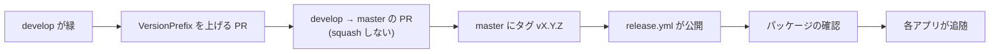

# リリース手順書

Core を nuget.org へ公開する手順。**公開した版は、利用者が参照した時点で取り消せない。**
壊したまま出すより、出さない方が安い。

## 版の付け方

- **セマンティックバージョニング（`vX.Y.Z`）。** 1.0.0 未満は互換を保証しない
- 版の単一情報源は `Directory.Build.props` の `VersionPrefix`。**各 `.csproj` へ個別に書かない**
- **2 つのパッケージ（`Core.Mail` / `Core.Data`）は同じ版で出す**
- 動作確認のための公開は `vX.Y.Z-preview.N`

## 手順



1. **`develop` の CI が緑であること。** `ビルドと単体テスト` / `SDK 指定の一致検査` / `規約の同期検査`
2. **`VersionPrefix` を上げる PR** を `develop` へ出して取り込む（プレビュー版なら不要）
3. **`develop` → `master` の PR** を出して取り込む。**squash しない。**
   squash すると `master` の履歴が `develop` と別物になり、次のリリースの PR が過去の変更まで抱える
4. **`master` の HEAD にタグを打って push する**

    ```bash
    git switch master && git pull
    git tag -a v0.1.0 -m "v0.1.0 ..."
    git push origin v0.1.0
    ```

5. **`release.yml` が公開する。** 次を機械が確かめてから push する
    - タグが `VersionPrefix` と合っていること（`v0.1.0` と `v0.1.0-preview.N` は通る）
    - **タグのコミットが `master` に含まれていること**
    - ビルドとテストが通ること
6. **パッケージを確認する。** `https://www.nuget.org/packages/VehicleVision.PleasanterTools.Core.Mail`
   （公開直後は、検証と索引づけで反映まで数分かかる）
7. **各アプリへ追随を知らせる。** 公開のたびに、破壊的変更があれば各アプリの Issue へ残す
   （規約 9）。移行の状況は [`コア化の方針.md`](コア化の方針.md) を更新する

## nuget.org の準備（初回だけ。管理者の作業）

認証は **Trusted Publishing**（GitHub Actions の OIDC）。長期の API キーを作らず、公開のたびに 1 時間有効のキーを受け取る
（[一次情報](https://learn.microsoft.com/nuget/nuget-org/trusted-publishing)。2026-10-20 参照）。

1. **nuget.org にサインインする。** 右上のユーザー名（**プロフィール名**。メールアドレスではない）を控える
2. **ユーザー名 → Trusted Publishing → 新しいポリシーを追加する。** 入力は次のとおり（大文字小文字は区別しない）
    - **Policy Owner:** 自分、または所属する nuget.org の組織（パッケージの所有者にする側）
    - **Repository Owner:** `vehiclevisionjp`
    - **Repository:** `VehicleVision.PleasanterTools.Core`
    - **Workflow File:** `release.yml`（**ファイル名だけ**。`.github/workflows/` は付けない）
    - **Environment:** 空のまま（このワークフローは environment を使わない）
    - **Scopes:** 新しいパッケージの公開と、既存の版の公開を許可する。対象のパターンは
      `VehicleVision.PleasanterTools.Core.*`
3. **リポジトリの変数 `NUGET_USER` を登録する。** Settings → Secrets and variables → Actions →
   Variables → New repository variable。値は 1 で控えた**プロフィール名**
4. 準備ができたら、**プレビュー版（`vX.Y.Z-preview.N`）で試しに公開する**

- ⚠️ **ポリシーの所有者が組織で、作った人が組織を抜けると、ポリシーは無効になる**（戻れば有効に戻る）
- ID プレフィックス `VehicleVision.*` の予約は、nuget.org へ申請済み（2026-10-18）。**承認前でも公開はできる**
  （承認されると、ほかの人が同じ接頭辞の ID を取れなくなる）
- GitHub Packages の 0.1.0-preview.1 は、そのまま残す（nuget.org へは preview.2 以降を出す）

## 公開に失敗したとき

- `--skip-duplicate` を付けているので、**同じ版の再実行は害がない**
- **公開済みの版を差し替えない。** 直すなら次の版を出す
- 取り消したいときは、GitHub のパッケージの版を削除できる（参照中のアプリが壊れるので、先に確認する）
