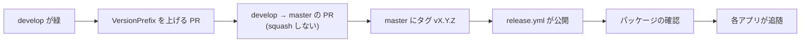

# リリース手順書

Core を nuget.org へ公開する手順。**公開した版は、利用者が参照した時点で取り消せない。**
壊したまま出すより、出さない方が安い。

## 版の付け方

- **セマンティックバージョニング（`vX.Y.Z`）。** 1.0.0 未満は互換を保証しない
- 版の単一情報源は `Directory.Build.props` の `VersionPrefix`。**各 `.csproj` へ個別に書かない**
- **パッケージ（`Core.Mail` / `Core.Data` / `Core.Web` / `Core.Web.Testing`）はすべて同じ版で出す**
- 動作確認のための公開は `vX.Y.Z-preview.N`

**安定版 `0.1.0` を 2026-10-30 に公開した**（タグ `v0.1.0`、4 パッケージとも同じ版）。
2026-10-30 時点で、nuget.org の公開済みの版は次のとおり。

- Mail・Data: `0.1.0-preview.2`〜`preview.15` と `0.1.0`
- Web: `0.1.0-preview.10`〜`preview.15` と `0.1.0`
- Web.Testing: `0.1.0-preview.11`〜`preview.15` と `0.1.0`

根拠は [Mail の版一覧][mail-versions]・[Data の版一覧][data-versions]・[Web の版一覧][web-versions]・
[Web.Testing の版一覧][testing-versions]（2026-10-30 参照）。GitHub Packages への `preview.1` の公開は
[リリースの実行結果][preview1-release]で確認できる。

[mail-versions]: https://api.nuget.org/v3-flatcontainer/vehiclevision.pleasantertools.core.mail/index.json
[data-versions]: https://api.nuget.org/v3-flatcontainer/vehiclevision.pleasantertools.core.data/index.json
[web-versions]: https://api.nuget.org/v3-flatcontainer/vehiclevision.pleasantertools.core.web/index.json
[testing-versions]: https://api.nuget.org/v3-flatcontainer/vehiclevision.pleasantertools.core.web.testing/index.json
[preview1-release]: https://github.com/vehiclevisionjp/VehicleVision.PleasanterTools.Core/actions/runs/39134901635

## preview.12 の公開前と公開後（履歴。Issue #83）

**preview.12 は公開済み（0.1.0 にも含まれる）。** 以下は公開準備の時点の記録で、
各アプリの追随の確認項目として残している。preview.12 に含めた差分は次のとおり。

- Core.Web に `PleasanterSsoOptions`・`SamlOptions`、接頭辞から設定名を導く型、
  種類と引数を持つ `AuthenticationSettingException` を追加した
- Core.Data に `MigrationCommand` を追加した。`--migrate-status` と出力は Questionnaire に揃える。
  ロック待機時間は引数、既定は `AppDatabase.DefaultMigrationLockTimeout`
- 既存の本人確認 API・依存パッケージ・設定の検証条件は変えない。
  役割の列挙の読み取り・多言語例外・ITfoxtec 変換はアプリのアダプターに残す

公開前に Release の警告 0 のビルドとテスト、`dotnet pack -c Release --version-suffix preview.12`、
nupkg の内容（3 本体パッケージと試験用パッケージの DLL・README・許諾・依存）、
Markdown・指示の同期・NOTICE の検査を確認した。実機の Pleasanter・IdP・外部 DB は未確認のまま公開した。

**公開後に別作業で** AtomFeed・CalendarFeed・Questionnaire の Core.Data / Core.Web の参照を揃え、
重複コードを置き換える（Core の作業では各アプリを編集していない）。
IdentityProvider は対象の Options を参照しておらず、この置き換えの対象外。
各アプリの追随は Issue #83 に残す。
特に A/C は次を運用手順・Helm フック・ログ解析と照合する。

1. `--migrate-status` を新たに受け付け、未適用ありは終了コード 1、適用済みは 0
2. `--migrate` の未適用時に一覧と `Applied N migration(s).` を表示する。
   旧来の `All migrations are applied (…).` だけの出力から変わる
3. 適用済みなら従来の文言で終了し、適用用ロックは取らない。
   両方の合図があれば適用を優先する。DB の待機の引数・期限切れの終了コード 2 は維持

署名・設定の検証条件を保つためのアダプターと差の根拠は
[`Core.Web-共通化の方針.md`](Core.Web-共通化の方針.md) を参照する。

## 手順



1. **`develop` の CI が緑であること。** `build-test` / `sdk-consistency` / `instructions-sync`。
   **公開前の確認**（次節）も済ませる
2. **`VersionPrefix` を上げる PR** を `develop` へ出して取り込む（プレビュー版なら不要）
3. **`develop` → `master` の PR** を出して取り込む。**squash しない。**
   squash すると `master` の履歴が `develop` と別物になり、次のリリースの PR が過去の変更まで抱える
4. **`master` の HEAD にタグを打って push する**

    ```bash
    git switch master && git pull
    git tag -a v0.1.0 -m "v0.1.0 ..."
    git push origin v0.1.0
    ```

5. **`release.yml` が公開する。** 次を機械が確かめてから push する
    - タグが `VersionPrefix` と合っていること（`v0.1.0` と `v0.1.0-preview.N` は通る）
    - **タグのコミットが `master` に含まれていること**
    - ビルドとテストが通ること
6. **パッケージを確認する。**
   `https://www.nuget.org/packages/VehicleVision.PleasanterTools.Core.Mail`（`.Data` / `.Web` / `.Web.Testing` も）
   （公開直後は、検証と索引づけで反映まで数分かかる）
    - **新しいパッケージを初めて公開するときは**、所有者に `vehiclevisionjp`（組織）が入っていることと、
      ID プレフィックスの予約の印（確認済みの印）が付いていることを確かめる（下記「nuget.org の準備」）。
      `Core.Web` の初回公開は `v0.1.0-preview.10`
7. **各アプリへ追随を知らせる。** 公開のたびに、破壊的変更があれば各アプリの Issue へ残す
   （規約 9）。移行の状況は [`コア化の方針.md`](コア化の方針.md) を更新する

## 公開前の確認

**Core の `release.yml` には dry-run が無い**（タグを push すると、そのまま nuget.org へ公開する）。
その代わりに、タグを打つ前に手元で次を確認する。`v0.1.0` の公開前にも同じ確認をした。

1. `dotnet pack -c Release -p:Version=X.Y.Z` で梱包する（警告 0。出力は `temp/` 配下へ）
2. nupkg の中身を確認する。DLL・README・許諾・依存が意図どおりで、
   4 パッケージとも同じ版であること

## nuget.org の準備（初回だけ。管理者の作業）

認証は **Trusted Publishing**（GitHub Actions の OIDC）。長期の API キーを作らず、公開のたびに 1 時間有効のキーを受け取る
（[一次情報](https://learn.microsoft.com/nuget/nuget-org/trusted-publishing)。2026-10-20 参照）。

1. **公開用の共用アカウントを用意する。** 個人のアカウントにすると、その人が組織を抜けたときにポリシーが無効になり、
   リポジトリへ入れる設定にも個人名が残る。**複数人が回復できる共用のメールアドレス**（組織アカウントの連絡先とは別のもの）で
   Microsoft アカウントを作り、nuget.org にサインインして、**用途の分かるプロフィール名**
   （メールアドレスではない。例: `vehiclevision-publisher`）を決める
2. **nuget.org の組織（`vehiclevisionjp`）へ、共用アカウントを招待して承認する。** 組織の管理者が
   Manage Organizations → Members から招待し、共用アカウント側で承認する。公開できる権限にする
3. **共用アカウントで、Trusted Publishing のポリシーを追加する。**
   ユーザー名 → Trusted Publishing → 新しいポリシー。**ポリシーを作る人は共用アカウントにする**（個人で作ると、その人に依存する）。
   入力は次のとおり（大文字小文字は区別しない）
    - **Package Owner:** `vehiclevisionjp`（組織）
    - **CI/CD Provider:** GitHub Actions
    - **Repository Owner:** `vehiclevisionjp`
    - **Repository:** `VehicleVision.PleasanterTools.Core`
    - **Workflow File:** `release.yml`（**ファイル名だけ**。`.github/workflows/` は付けない）
    - **Environment:** 空のまま（このワークフローは environment を使わない）
    - **Scopes:** Push → **Push new packages and package versions**（Unlist / relist は不要）。
      パターンは `VehicleVision.PleasanterTools.Core.*`
4. **GitHub の組織の変数 `NUGET_ORG_USER` を登録し、Core へ共有する。** 組織の Settings → Secrets and variables →
   Actions → Variables → New organization variable。値は 1 の**プロフィール名**（秘密ではない）。
   Repository access は、公開するリポジトリだけを選ぶ
5. 準備ができたら、**プレビュー版（`vX.Y.Z-preview.N`）で試しに公開する**

- ⚠️ **ポリシーを作った人が組織を抜けると、ポリシーは無効になる**（戻れば有効に戻る）。共用アカウントで作るのは、このため。
  共用アカウントの回復手段（2 段階認証・メール）は、複数人が持てるようにしておく
- ID プレフィックス `VehicleVision` は**承認済み**（2026-10-20。nuget.org のサポートから、アカウント `vehiclevisionjp` へ予約したと連絡があった）。
  公開済みの `Core.Mail` / `Core.Data` は予約の対象に含まれる。ほかの人は、同じ接頭辞の ID を取れない。
  **予約はアカウント `vehiclevisionjp`（組織）に付く。** 新しいパッケージを足すときは `VehicleVision.` で始まる ID にし、
  所有者に `vehiclevisionjp` を含めること（共用アカウントだけが所有者だと、予約の対象にならない）
- GitHub Packages の 0.1.0-preview.1 は、そのまま残す（nuget.org へは preview.2 以降を出した）

## 公開に失敗したとき

- `--skip-duplicate` を付けているので、**同じ版の再実行は害がない**
- **公開済みの版を差し替えない。** 直すなら次の版を出す
- GitHub Packages の `0.1.0-preview.1` を削除するときは、参照中のアプリが壊れないか先に確認する。
  **nuget.org の公開済みの版は削除できない**
