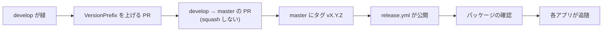

# リリース手順書

Core を GitHub Packages へ公開する手順。**公開した版は、利用者が参照した時点で取り消せない。**
壊したまま出すより、出さない方が安い。

## 版の付け方

- **セマンティックバージョニング（`vX.Y.Z`）。** 1.0.0 未満は互換を保証しない
- 版の単一情報源は `Directory.Build.props` の `VersionPrefix`。**各 `.csproj` へ個別に書かない**
- **2 つのパッケージ（`Core.Mail` / `Core.Data`）は同じ版で出す**
- 動作確認のための公開は `vX.Y.Z-preview.N`

## 手順



1. **`develop` の CI が緑であること。** `ビルドと単体テスト` / `SDK 指定の一致検査` / `規約の同期検査`
2. **`VersionPrefix` を上げる PR** を `develop` へ出して取り込む（プレビュー版なら不要）
3. **`develop` → `master` の PR** を出して取り込む。**squash しない。**
   squash すると `master` の履歴が `develop` と別物になり、次のリリースの PR が過去の変更まで抱える
4. **`master` の HEAD にタグを打って push する**

    ```bash
    git switch master && git pull
    git tag -a v0.1.0 -m "v0.1.0 ..."
    git push origin v0.1.0
    ```

5. **`release.yml` が公開する。** 次を機械が確かめてから push する
    - タグが `VersionPrefix` と合っていること（`v0.1.0` と `v0.1.0-preview.N` は通る）
    - **タグのコミットが `master` に含まれていること**
    - ビルドとテストが通ること
6. **パッケージを確認する。** `https://github.com/orgs/vehiclevisionjp/packages`
7. **各アプリへ追随を知らせる。** 公開のたびに、破壊的変更があれば各アプリの Issue へ残す
   （規約 9）。移行の状況は [`コア化の方針.md`](コア化の方針.md) を更新する

## 公開先（GitHub Packages）

- ソースは `https://nuget.pkg.github.com/vehiclevisionjp/index.json`。認証は `GITHUB_TOKEN`
  （`packages: write`）。**長期の API キーは持たない**
- ⚠️ **Public のリポジトリでも、GitHub Packages の NuGet は取得に認証が要る。**
  参照する側へ `read:packages` 権限のトークンが要る（[`README.md`](../README.md)）
- ⚠️ **初回の公開後、各パッケージの設定（Manage Actions access）で、参照するアプリを許可すること。**
  許可がないと、アプリの CI が `GITHUB_TOKEN` で取得できない

### nuget.org へ移す場合

`release.yml` の公開先を差し替えるだけで済む（パッケージ ID は変えないこと）。
**nuget.org に出した版は削除できない**（非推奨にできるだけ）。

- 認証は Trusted Publishing（GitHub Actions の OIDC）を使うと、API キーを持たずに済む
- ID プレフィックス `VehicleVision.*` の予約は、nuget.org へ申請済み（2026-10-18）

## 公開に失敗したとき

- `--skip-duplicate` を付けているので、**同じ版の再実行は害がない**
- **公開済みの版を差し替えない。** 直すなら次の版を出す
- 取り消したいときは、GitHub のパッケージの版を削除できる（参照中のアプリが壊れるので、先に確認する）
