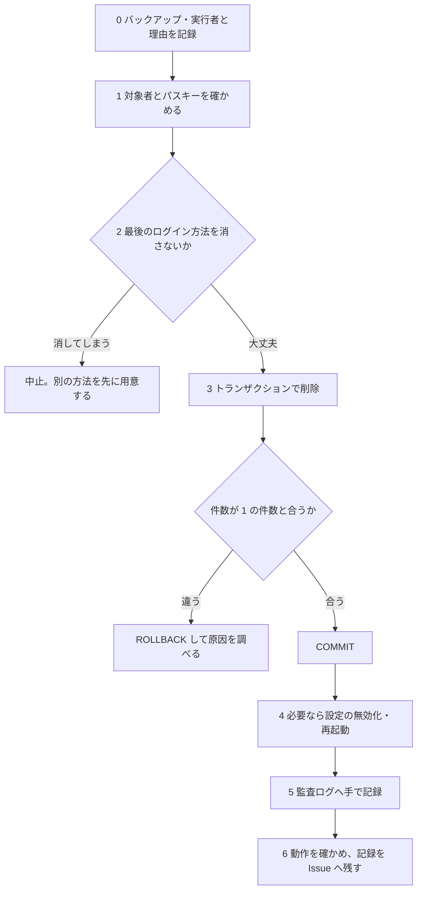

# パスキーの運用手順書

[認証とセッションの仕様書](認証とセッションの仕様書.md)の 3.10（パスキー）を運用する人向けの手順。
設計の決定は #213 の決定 1/9〜9/9（2026-11-25）。**表（`Core_AdminPasskeys`）は実装済み**（#215）だが、
パスキーの API と認証の流れは #216 で実装した（Core.Web）。画面と各アプリへの組み込み、実機の試験は #217 と各アプリの作業。設定名は #216 で確定した。

**この文書の SQL は、手順 1〜3 と 5 を、Core の移行（M10008）で作った実際の表に対して、SQL Server 2025・PostgreSQL 18・
MySQL 26 の実機（Docker）で実行して確かめた（2026-11-25）。** 手順 2 の件数の SQL・手順 3 のトランザクション・
手順 5 の監査ログの INSERT が、エラーなく通り、削除件数が合うことを見た。
SQLite は、仕様の案の表で確かめた（2026-11-25）。実際の表の列名（`Id`・`UserId`・`Name`・`CredentialId` ほか）は同じ。
**本番へ流す前に、検証用の DB で必ず試すこと。**

アプリの接頭辞は `<APP>_` と書く。設定名は確定済み（3.10.7）。

## 1. 使い分け

| 状況 | 使うもの |
|---|---|
| 本人がパスキーを失くした・端末を替えた | 2 章（本人はパスワード・SAML・Pleasanter で入って、登録し直す） |
| 本人が入れず、管理者は管理画面に入れる | 4 章（管理者による削除） |
| 管理画面に入れる管理者が**1 人も居ない** | まず**救済トークン**（[認証とセッションの仕様書](認証とセッションの仕様書.md)の 3.2）。使えなければ 5 章（DB の直接操作） |
| RP ID・ドメインを変える予定がある | 3 章（先に読む） |

**DB の直接操作（5 章）は、最終手段**。監査ログの自動の記録も、アプリの規則（最後のログイン方法を消さない）も通らない。
画面で済むなら、画面で行うこと。

## 2. 設定

| 設定 | 意味 | 既定 |
|---|---|---|
| `<APP>_ADMIN_PASSKEY` | パスキーを有効にする | `false`（無効） |
| `<APP>_ADMIN_PASSKEY_RPID` | RP ID（ホスト名のみ。スキーム・ポート・パスは付けない） | 未指定 |
| `<APP>_ADMIN_PASSKEY_ORIGINS` | 許可する Origin（`https://ホスト名`。複数はカンマ区切り） | 未指定 |

- 有効にするのは**環境変数だけ**（画面から変えられない）。変えたら、アプリを再起動する
    - Azure App Service は「アプリケーション設定」、コンテナは環境変数、Kubernetes は Secret・ConfigMap
- **RP ID・Origin は、通常は書かなくてよい。** 未指定ならリクエストのホストから決める
  （プロキシ経由のときは、設定済みの転送ホスト）
- **書くのは次のとき**: 管理画面を複数のホスト名で開く（Origin をカンマ区切りで足す）、
  プロキシの転送ホストが信用できない、RP ID を固定したい
- **サブパス配置（`<APP>_PATH_BASE`）でも RP ID はホスト名だけ**。サブパスは RP ID に影響しない
- **無効へ戻しても、登録済みの行は消えない。** 再び有効にすれば、そのまま使える
- 無効の間は、ログイン画面の「パスキーでログイン」が出ず、パスキーの口はすべて 404 になる。
  パスキーで 2 要素を満たしていた人は、`Required` の方針なら、次のログインで TOTP の登録を求められる
- 設定を間違えると**起動時に止まる**（知らない値・書き間違い）。ログの理由を読んで直す

## 3. RP ID を変えるときの警告

**⚠️ RP ID を変えると、登録済みのパスキーはすべて使えなくなる。**

- パスキーは、作ったときの RP ID（ホスト名）に結び付く。別の RP ID のサイトへは、ブラウザが出さない
  （W3C Web Authentication の §4・§6.3.3。出典は仕様書 3.10.10）。**サーバ側の行を直しても戻らない**
- RP ID が変わるのは、次のようなとき
    - `<APP>_ADMIN_PASSKEY_RPID` を変える・外す
    - 未指定のまま、**公開のホスト名を変える**（ドメインの変更、`staging` → 本番、Azure の既定ホストからの独自ドメイン）
    - 未指定のまま、プロキシの転送ホストを変える
- **Origin だけを足す・変えるのは、RP ID が同じなら影響しない**（Origin の検証に通らなくなる点は別。
  許可の一覧に無い Origin からは、そのホストでは使えない）

変える前に:

1. **全員が、パスキー以外のログイン方法（パスワード・SAML・Pleasanter）で入れることを確かめる。**
   パスキーだけの人は居ない決まり（仕様書 3.10.5 の P5）だが、実際の運用で確かめる
2. 利用者へ、**変更日と、変更後に新しいパスキーを登録し直す**ことを知らせる
3. 変更後、各人が古いパスキーを**画面から削除**し、新しいパスキーを登録する。
   古い行は使えないまま残るので、**誰かが消すまで一覧に出続ける**（自動では消えない）
4. 変更前に、`Core_AdminPasskeys` の件数を控える（変更後に、消し残しを数える）
5. 上記ができなければ、**変更を延期する**

## 4. 復旧（管理者による削除）

本人がパスキーを使えなくなったとき（端末の紛失・認証器の故障・RP ID の変更）の標準の手順。
**復旧コードは発行しない**。管理者が、紐付くパスキーを削除する。

1. 管理者が、管理画面の管理者の一覧から対象者を開き、**パスキーを削除する**（権限・自分は対象にできない規則は仕様書 3.10.6）。
   対象者の**全パスキーが消え、全セッションが失効する**
2. 監査ログに `Passkey.Removed`（`by=admin`）が残ることを確かめる
3. 本人が、**パスワード・SAML・Pleasanter のどれかでログインする**
4. 本人が、新しいパスキーを登録する（再認証を求められる）
5. 本人が入れない（パスワードも忘れた）ときは、別の手順（パスワードの再招待。管理者の追加と同じ招待の出し直し）を使う。
   パスキーの復旧では扱わない

**してはいけないこと**: 本人の代わりに管理者が登録すること（できない作りにしてある）。
本人確認を、電話・メールなどの**別の経路で確かめてから**削除すること。

## 5. DB の直接操作（最終手段）

**管理画面に入れる管理者が 1 人も居ない**ときの手順。画面・救済トークンで済むなら使わない。
**アプリの規則と自動の監査ログを通らない**ので、手順を守り、**終わったら監査ログへ手で記録する**。

### 5.1 前提

- **DB の更新ができる人が行う**（Azure なら DB の管理者）。実行する人・日時・理由を、先に Issue か記録に残す
- **バックアップを取る**（少なくとも `Core_AdminPasskeys`・`Core_AdminSessions`・`Core_AuditLogs`）。
  Azure SQL・マネージドの PostgreSQL・MySQL は、直前の時点へ戻せる設定か確かめる
- **SQLite は簡易の構成だけ**（本番では使わない）。**アプリを止めてから**行う（`PRAGMA busy_timeout` を長めに設定してもよい）
- 時刻は **UTC**（アプリは UTC を秒で切り捨てて保存する）。ID（GUID）は**小文字**で書く。
  SQLite は GUID を**大文字の文字列**で持つ場合があるので、比較は `upper()` を通す（下記の SQLite の例）
- `<LOGIN_ID>`・`<USER_ID>`・`<OPERATOR>`・`<REASON>` は、実際の値へ置き換える。
  **値に `'` を含めない**（含めるなら 2 つにする）。パスワードや公開鍵は、どこにも書かない

### 5.2 手順の流れ



### 5.3 手順 1: 対象者とパスキーを確かめる

出力は保存しておく（手順 5 の記録に使う）。**`CredentialId` は残してよい値**（公開鍵は出さない・書かない）。

**SQL Server**

```sql
SELECT [Id], [LoginId], [Role], [IsDisabled], [LockedUntil], [LastLoginAt]
FROM [Core_AdminUsers] WHERE [LoginIdKey] = LOWER(N'<LOGIN_ID>');

SELECT [Id], [Name], [CredentialId], [CreatedAt], [LastUsedAt]
FROM [Core_AdminPasskeys] WHERE [UserId] = '<USER_ID>';
```

**PostgreSQL**

```sql
SELECT "Id", "LoginId", "Role", "IsDisabled", "LockedUntil", "LastLoginAt"
FROM "Core_AdminUsers" WHERE "LoginIdKey" = lower('<LOGIN_ID>');

SELECT "Id", "Name", "CredentialId", "CreatedAt", "LastUsedAt"
FROM "Core_AdminPasskeys" WHERE "UserId" = '<USER_ID>';
```

**MySQL**

```sql
SELECT `Id`, `LoginId`, `Role`, `IsDisabled`, `LockedUntil`, `LastLoginAt`
FROM `Core_AdminUsers` WHERE `LoginIdKey` = LOWER('<LOGIN_ID>');

SELECT `Id`, `Name`, `CredentialId`, `CreatedAt`, `LastUsedAt`
FROM `Core_AdminPasskeys` WHERE `UserId` = '<USER_ID>';
```

**SQLite**

```sql
SELECT "Id", "LoginId", "Role", "IsDisabled", "LockedUntil", "LastLoginAt"
FROM "Core_AdminUsers" WHERE "LoginIdKey" = lower('<LOGIN_ID>');

SELECT "Id", "Name", "CredentialId", "CreatedAt", "LastUsedAt"
FROM "Core_AdminPasskeys" WHERE upper("UserId") = upper('<USER_ID>');
```

- 1 つ目が **1 行**であること（0 行・複数行なら中止）。`Id` を `<USER_ID>` として使う
- 2 つ目の件数と `CredentialId` を控える

### 5.4 手順 2: 最後のログイン方法を消さないか確かめる

パスキーだけの人は居ない決まりだが、**DB を直接触ると、アプリの確認（仕様書 3.10.5 の P5）を通らない**。
**次の 3 つをすべて確かめてから**、手順 3 へ進む。

1. **対象者に、パスキー以外のログイン方法が 1 つ以上ある。**
    - パスワード: 手順 1 の `LastLoginAt` が**空でない**（招待を受け取って一度でも入った人）。
      かつ、合言葉のログインが塞がれていない（`<APP>_ADMIN_PASSWORD_SIGNIN` が `false` でない。
      塞いでいるなら救済トークンの設定を確かめる）
    - SAML または Pleasanter のログインが**有効**で、本人がそれで入れる（JIT の人は、こちらだけのことがある）
2. **ほかに、有効な Administrator が居るか**（管理者を締め出さない確認）。次の件数が **1 以上**。
   0 のときは、この操作の後に**対象者が唯一の入れる管理者**になるので、対象者が上の 1 で入れることを、特に慎重に確かめる

    ```sql
    -- 全 DB 共通（識別子の囲みだけ DB に合わせる。SQL Server は [ ]、PostgreSQL・SQLite は " "、MySQL は ` `）
    SELECT COUNT(*) FROM [Core_AdminUsers]
    WHERE [Role] = 'Administrator' AND [IsDisabled] = 0 AND [LastLoginAt] IS NOT NULL
      AND [Id] <> '<USER_ID>';
    ```

3. **削除の理由が、本人の復旧・RP ID の変更・故障のどれかである**（パスキーを消して締め出しを起こす目的ではない）

**1 を確かめられないときは、削除しない。** 先に、パスワードの再招待など、入れる方法を用意する。

### 5.5 手順 3: パスキーを削除する

**1 つのトランザクションで行い、削除件数が手順 1 の件数と合うことを確かめてから確定する。**
あわせて、**対象者のセッションも消す**（古い cookie を残さない。管理者による削除と同じ扱い）。

**SQL Server**

```sql
BEGIN TRANSACTION;

DELETE FROM [Core_AdminPasskeys] WHERE [UserId] = '<USER_ID>';
-- 「N rows affected」が手順 1 の件数と同じか確かめる

DELETE FROM [Core_AdminSessions] WHERE [UserId] = '<USER_ID>';

-- 合っていれば
COMMIT TRANSACTION;
-- 違えば
-- ROLLBACK TRANSACTION;
```

**PostgreSQL**

```sql
BEGIN;

DELETE FROM "Core_AdminPasskeys" WHERE "UserId" = '<USER_ID>';
-- 「DELETE N」が手順 1 の件数と同じか確かめる

DELETE FROM "Core_AdminSessions" WHERE "UserId" = '<USER_ID>';

-- 合っていれば
COMMIT;
-- 違えば
-- ROLLBACK;
```

**MySQL**

```sql
START TRANSACTION;

DELETE FROM `Core_AdminPasskeys` WHERE `UserId` = '<USER_ID>';
-- 「N row(s) affected」が手順 1 の件数と同じか確かめる

DELETE FROM `Core_AdminSessions` WHERE `UserId` = '<USER_ID>';

-- 合っていれば
COMMIT;
-- 違えば
-- ROLLBACK;
```

**SQLite**（アプリを止めてから）

```sql
BEGIN IMMEDIATE;

DELETE FROM "Core_AdminPasskeys" WHERE upper("UserId") = upper('<USER_ID>');
SELECT changes();  -- 手順 1 の件数と同じか確かめる

DELETE FROM "Core_AdminSessions" WHERE upper("UserId") = upper('<USER_ID>');

-- 合っていれば
COMMIT;
-- 違えば
-- ROLLBACK;
```

特定の 1 つだけを消すときは、`WHERE` に `AND "Id" = '<PASSKEY_ID>'`（SQLite は `upper("Id") = upper('<PASSKEY_ID>')`）を足す。
その場合は、セッションの削除を行わなくてよい。

### 5.6 手順 4: 設定の無効化（必要なときだけ）

パスキーの機能そのものが原因（設定の誤り・RP ID の変更で全員が使えない・ライブラリの不具合）のときは、
**SQL ではなく環境変数で無効にする**。

1. `<APP>_ADMIN_PASSKEY` を `false` にする（アプリケーション設定・環境変数）
2. アプリを再起動する
3. ログイン画面から「パスキーでログイン」が消えたことを確かめる

- 行は消えない。直したら、`true` へ戻して再起動すれば使える
- `Required` の方針で、パスキーだけで 2 要素を満たしていた人は、次のログインで TOTP の登録を求められる
- **`Core_AdminPasskeys` の表そのものを削除（DROP）しない。** 表が無いと、有効に戻したとき・移行のときに失敗する

### 5.7 手順 5: 監査ログへ手で記録する

**DB の直接操作は、アプリが記録しない。コミットの後に、必ず手で 1 行残す**
（`Core_AuditLogs`、仕様書 7 章。決定 5/9）。**公開鍵・チャレンジは書かない。資格情報の ID は書く**（決定 7/9）。

- `Action` は `Passkey.Removed`。`ActorKey` は空（アプリの管理者ではない）、
  `ActorLoginId` は `direct-db:<OPERATOR>`（実行した人の名前。パスワードやトークンは入れない）
- `TargetType` は `AdminUser`、`TargetId` は `<USER_ID>`（小文字）
- `DetailJson` の `by` は `direct-db`。`credentialIds` は、手順 1 で控えた `CredentialId`（なければ空の配列）。
  `reason` に理由、`ticket` に Issue 番号など
- `Succeeded` は 1、`StatusCode` と `IpAddress` は空

```text
{"by":"direct-db","operator":"<OPERATOR>","reason":"<REASON>","ticket":"<ISSUE>","credentialIds":["<ID1>","<ID2>"],"sessionsRevoked":true}
```

**SQL Server**

```sql
INSERT INTO [Core_AuditLogs]
    ([AuditLogId], [OccurredAt], [ActorKey], [ActorLoginId], [Action], [Succeeded], [StatusCode], [TargetType], [TargetId], [DetailJson], [IpAddress])
VALUES
    (NEWID(), CONVERT(datetime2(0), SYSUTCDATETIME()), NULL, N'direct-db:<OPERATOR>', N'Passkey.Removed', 1, NULL,
     N'AdminUser', N'<USER_ID>',
     N'{"by":"direct-db","operator":"<OPERATOR>","reason":"<REASON>","ticket":"<ISSUE>","credentialIds":["<ID1>","<ID2>"],"sessionsRevoked":true}',
     NULL);
```

**PostgreSQL**（`gen_random_uuid()` は PostgreSQL 13 以降。それ未満は `pgcrypto` を入れるか、手で UUID を作る）

```sql
INSERT INTO "Core_AuditLogs"
    ("AuditLogId", "OccurredAt", "ActorKey", "ActorLoginId", "Action", "Succeeded", "StatusCode", "TargetType", "TargetId", "DetailJson", "IpAddress")
VALUES
    (gen_random_uuid(), date_trunc('second', now() AT TIME ZONE 'UTC'), NULL, 'direct-db:<OPERATOR>', 'Passkey.Removed', 1, NULL,
     'AdminUser', '<USER_ID>',
     '{"by":"direct-db","operator":"<OPERATOR>","reason":"<REASON>","ticket":"<ISSUE>","credentialIds":["<ID1>","<ID2>"],"sessionsRevoked":true}',
     NULL);
```

**MySQL**

```sql
INSERT INTO `Core_AuditLogs`
    (`AuditLogId`, `OccurredAt`, `ActorKey`, `ActorLoginId`, `Action`, `Succeeded`, `StatusCode`, `TargetType`, `TargetId`, `DetailJson`, `IpAddress`)
VALUES
    (UUID(), UTC_TIMESTAMP(), NULL, 'direct-db:<OPERATOR>', 'Passkey.Removed', 1, NULL,
     'AdminUser', '<USER_ID>',
     '{"by":"direct-db","operator":"<OPERATOR>","reason":"<REASON>","ticket":"<ISSUE>","credentialIds":["<ID1>","<ID2>"],"sessionsRevoked":true}',
     NULL);
```

**SQLite**（GUID は大文字の文字列で持つ。簡易の構成だけ）

```sql
INSERT INTO "Core_AuditLogs"
    ("AuditLogId", "OccurredAt", "ActorKey", "ActorLoginId", "Action", "Succeeded", "StatusCode", "TargetType", "TargetId", "DetailJson", "IpAddress")
VALUES
    (upper(hex(randomblob(4)) || '-' || hex(randomblob(2)) || '-' || hex(randomblob(2)) || '-' || hex(randomblob(2)) || '-' || hex(randomblob(6))),
     strftime('%Y-%m-%d %H:%M:%S', 'now'), NULL, 'direct-db:<OPERATOR>', 'Passkey.Removed', 1, NULL,
     'AdminUser', '<USER_ID>',
     '{"by":"direct-db","operator":"<OPERATOR>","reason":"<REASON>","ticket":"<ISSUE>","credentialIds":["<ID1>","<ID2>"],"sessionsRevoked":true}',
     NULL);
```

- 手順 4 で機能を無効にしたときは、`Action` を `Passkey.Removed` にせず、**運用の記録（Issue）へ残す**。
  監査ログの `Action` を、決められた名前以外で作らない
- 管理画面の監査ログの画面（`audit.read`）に、この行が出ることを確かめる

### 5.8 手順 6: 動作の確認と記録

1. 対象者が、**パスワード・SAML・Pleasanter のどれか**でログインできる
2. ログインできたら、**新しいパスキーを登録する**（4 章の手順 4）
3. 管理者が複数居る構成なら、ほかの管理者の `Core_AdminUsers`・`Core_AdminSessions` が**変わっていない**ことを確かめる
   （`WHERE` を付け忘れていないか。件数が合っていれば問題ない）
4. 実施日時・実施者・理由・対象・削除した `CredentialId`・バックアップの場所を、Issue へ残す

## 6. 出典と確認状況

- パスキーの設計: #213 の決定 1/9〜9/9（2026-11-25）。仕様は[認証とセッションの仕様書](認証とセッションの仕様書.md)の 3.10。
  WebAuthn の仕様（W3C）と Fido2NetLib の出典 URL・参照日は、同 3.10.10
- 既存の表の列（`Core_AdminUsers`・`Core_AdminSessions`・`Core_AuditLogs`）は、`Core.Data/Migrations/M10005`・`M10006`・`M10007`
  （`develop` の `b826bb1`、2026-11-25）から取った
- **確認済み（2026-11-25）**: `Core_AdminPasskeys` の列・索引は `Core.Data/Migrations/M10008_CoreAdminPasskeys.cs`。
  SQL Server・PostgreSQL・MySQL の実機で、本文の SQL を実行した
- **未確認**: SQLite の実際の表（M10008 で作ったもの）での実行。SQLite の GUID の持ち方は、Microsoft.Data.Sqlite の既定（大文字の文字列）を前提にしており、
  実機で確かめていない。比較に `upper()` を通すので、どちらでも合う
