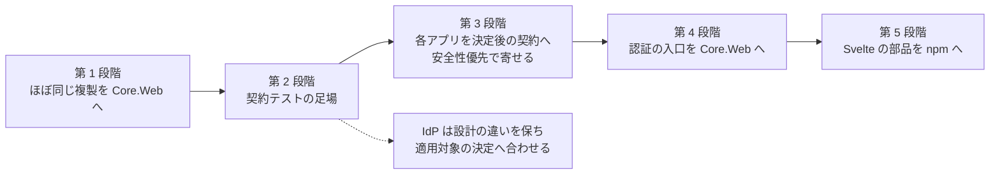

# 管理画面の共通化の進め方の方針

[管理画面の共通仕様書](../管理画面の共通仕様書.md)の 11 章。順序・危険・各段階の完了条件を決める。
区分は [共有の区分の一覧](共有の区分の一覧.md)、差は [各アプリの差異の一覧](各アプリの差異の一覧.md)。

## 11.1 順序

| 段階 | 内容 | 主な危険 | 完了条件 |
|---|---|---|---|
| 1 | AtomFeed と CalendarFeed で**ほぼ同じ複製**（名前空間とアプリ名だけが違うもの）を Core.Web へ移す。**別の作業として並行して進めている**（この仕様書を待たない） | 複製どうしの小さな差（片方だけの修正）を、どちらかへ黙って倒す | 移したファイルごとに、2 つの複製の差を Issue か PR に記録している。両アプリが Core.Web を参照してビルド・試験が通る。アプリ名・接頭辞を Core に書いていない |
| 2 | 契約テストの足場（[契約テストの方針](契約テストの方針.md)）。C1〜C5 を Q で通す | 試験が Q の実装に寄り、ほかのアプリで「無い」を表せない | Q で C1〜C5 が通る。能力の宣言で「流れが無い」アプリでは 404 の確認になる |
| 3 | 11.4〜11.8 のアプリ別タスクを安全性優先で進め、**決定後の契約へ**寄せる。AF・CF は既に Core のストアを使うため、参照版と既存の移行の整合も確かめる | 既存 DB・日時形式の差、ログイン中の管理者の締め出し、復旧コード・招待・外部設定の移行 | 対象アプリで適用される C1〜C23 が通り、非適用の根拠と移行手順がある。決定済みの差を未決扱いで残さない |
| 4 | 認証の入口（`/session`・`/login`・`/enroll/*`・`/me/totp/*`・`/me/sessions/*`・`/users/**`・`/invitations/accept`・監査の絞り込み）を Core.Web の部品にし、アプリは権限の表と業務の入口だけを持つ | 公開 API の変更が全アプリへ効く。権限の表をアプリから受ける形の設計 | Q・AtomFeed・CalendarFeed が Core.Web の入口を使い、アプリ側の同じ入口を消している。契約テストが Core の版で回る |
| 5 | Svelte の部品（ログイン・2 要素・端末の一覧・確認の窓・監査ログの一覧）を npm で配る | 画面の文言カタログ（言語数が違う）の持ち方 | 2 アプリ以上が同じ部品を参照している |

## 11.2 原則

### 第 2 段階の状態（2026-10-22）

**C1〜C5 の足場・公開・Q への正式導入は完了**（Issue #80）。
`VehicleVision.PleasanterTools.Core.Web.Testing` に C1〜C5 を置き、
変更前は Q のホストで 16 件を実行して 15 成功・1 失敗（SQLite、スキップなし）。
能力が「無い」の場合は 404 を検証し、経路・本文・cookie 名はアプリから受ける。

C2 はユーザー判断により「5 回目も 401、その次の要求から 423」へ仕様と期待を変更した（U15 決定済み）。
公開前には Windows Code Integrity の DLL 読み込み拒否があったが、
その後の Q `ca58e29` は preview.11 を正式参照し、通常 CI で 16 件成功・スキップ 0 を確認した。
Q の導入 PR はマージ済み。**C6 以降と他アプリへの適用は未実装**であり、段階 3 以降の課題とする。
結果・使い方・未確認範囲は [契約テストの方針](契約テストの方針.md)の 10.2 と 10.5.1。

### 全段階に適用する原則

- **契約テストを先に入れてから寄せる**（段階 2 → 3）。寄せた結果が同じ契約を満たすことを試験で示す
- **Core にアプリ名を書かない**。cookie の名前・設定の接頭辞・権限の表・監査ログの対象の型は、アプリから受ける
  （[コア化の方針](../コア化の方針.md)「アプリ固有の値は引数で受ける」）
- **迷ったら置かない**。IdP の管理者（Pleasanter の利用者そのもの）は、Core の管理者のストアへは寄せない。
  設計の違いを保ちつつ、適用対象の決定は実装と試験で合わせる（11.7）
- 公開 API を変える PR は、各アプリの追随を Issue に残す（規約 9）

## 11.3 段階 1 との関係

段階 1 は別の作業として並行して進めている。この仕様書は段階 1 の**移す先の形を縛らない**。
段階 1 で移したものが、この仕様書の不変条件（3.5・6.3）と食い違う場合は、段階 3 で直す Issue にする。

## 11.4 決定の実装順序と依存関係

**この一覧は後続実装のタスクであり、Issue #84 では文書だけを変更する。**
根拠の略記は 1.2、以下の行番号は同節の「決定の反映と実装タスクの照合」のコミットのもの。
各タスクの着手時には移動・共通化済みでないかを再確認し、各アプリの Issue と PR に追跡先を残す。

| 優先順位 | 対象 | 進め方 |
|---|---|---|
| 先行（安全性） | U7 → U8 → U1 → U13 → U14 → U12 | U7・U8 は安全性の穴として最優先。独立するものは並行可能。契約候補 C2・C21、C13・C14、C10、C20、C7、C19 を先に足す |
| 後続（契約・運用の統一） | U3 → U2 → U10 → U11 → U5 → U6 → U4 | 形の統一とデータ・設定の移行を、対応する契約候補と一緒に進める。安全性の修正を大規模な共通化待ちにしない |

**依存関係**:

- 各スライスは「契約の期待を追加 → 現状の違反を検出 → アプリを修正 → 対象契約を通す」の順。
  C6 以降に必要なホスト拡張も先に入れる。テストの設定で決定済みの差を隠さない
- U7 と U13 は再確認の共通部分を使う。まずパスワード経路の再確認・レート制限を塞ぎ、
  U13 の時間窓と証跡を具体化してから JIT 向けの外部再確認を加える。C2 の保護は弱めない
- U8 はサーバの外部認証・JIT と、設定検証・画面の役割選択が同じスライス。
  U10 の設定整理を待たず、Administrator の登録禁止と締め出し判定を先に入れる
- U1 は U14 の他人の 2 要素解除と同じ入口に効くが、認可の修正を全失効の完成待ちにしない。
  U14 はセッションの全段階・全保管先の失効を試す
- U12 は本人確認済みの再発行が前提。U7・U13 の再登録経路と、管理者による救済手順を確保してから旧コードを捨てる。
  複数インスタンスの旧版が SHA-256 のコードを書き戻さない切り替え手順を用意する
- U3 は C15 の**形を固定する試験を先に拡張**してから、サーバと Svelte・API クライアントを一緒に変更する。
  C1〜C5 のホスト変換だけでは統一を保証できない。U7 の再確認 UI も新契約へ追随させる
- U2 は操作名の対応表を先に作り、書き込みと一覧・絞り込みを一緒に変更する。旧監査ログを移行し直さない
- U10 は外部設定と既存 DB 設定の対応を先に確定し、現在の Required を保って切り替える。
  U11 は既存鍵を保持し、U5 は旧招待の失効・再招待の手順を用意する。どちらも起動で勝手に作り直さない
- U6 はサーバ側の SAML キー保管と DB・Redis の検索失効を先に確認する。
  U4 は設定が変わる途中を再現できる試験ホストを用意する

## 11.5 AtomFeed の実装タスク

**先行（安全性）**:

| 決定 | 変更・確認する内容と経路の見当 | ソースの根拠 | 契約候補 |
|---|---|---|---|
| U7 | `/me/totp/begin` にパスワード再確認とログイン用レート制限を加える。登録途中と再登録を分離し、Reenroll を Session と併存させる。API 本文・登録 UI に再確認を追加する | `AF.Web/Endpoints/AdminAuthEndpoints.cs:70-82,401-422,563-589`、`AF.Frontend/src/lib/api.ts:81-83`、`src/components/EnrollPanel.svelte:24-38`・`AccountPanel.svelte:129-146`（同 Frontend） | C1〜C3・C21 |
| U8 | SAML・Pleasanter SSO の解決後、Pending/Session 発行前に締め出しを拒否する。SAML の管理者 0 人も拒否。JIT の Administrator を設定・画面・実行時から除く | `AF.Web/Services/SamlAuthenticator.cs:42-81`、`PleasanterSsoAuthenticator.cs:47-87`（同 Services）、`AF.Web/Endpoints/AdminAuthEndpoints.cs:187-210`、`AdminPleasanterSsoEndpoints.cs:64-67`（同 Endpoints）、`AF.Web/Services/AppSettingDefinitions.cs:244,257` | C13・C14 |
| U1 | 他人の TOTP reset のサーバ認可は既存を維持し、画面を経由しない権限分離の検査を足す | `AF.Web/Endpoints/AdminUserEndpoints.cs:55` | C10 |
| U13 | JIT の再登録・自己解除に、パスワード以外の直近外部ログインによる再確認を追加する。U7 の再確認サービスと画面を共用する | `AF.Web/Services/SamlAuthenticator.cs:61-62`、`PleasanterSsoAuthenticator.cs:66-67`（同 Services）、`AF.Web/Endpoints/AdminAuthEndpoints.cs:401-422,481-520`、`AF.Frontend/src/components/AccountPanel.svelte:58,129-146` | C2・C20・C21 |
| U14 | reset・利用者無効化の全失効は既存を維持し、通常・途中状態を複数端末で検査する | `AF.Web/Endpoints/AdminUserEndpoints.cs:238-242,289-292` | C7 |
| U12 | `RecoveryCodes.Hash` の SHA-256 と直接ハッシュ検索を、Q 方式の塩つき PBKDF2 と未使用候補の照合へ変更する。旧コードは再発行で置き換える | `AF.Core/Security/Totp.cs:56-86`、`AF.Web/Endpoints/AdminAuthEndpoints.cs:298,456-461` | C19 |

**後続（契約・運用の統一）**:

| 決定 | 変更・確認する内容と経路の見当 | ソースの根拠 | 契約候補 |
|---|---|---|---|
| U3 | 5 章の全共通口を Q の形へ変更する。`/admin/api`・step・201/204・役割 PUT・端末 DELETE・招待失敗 404 を置き換える。監査の offset と応答包み、設定の共通口も合わせる。Svelte と表示用 ACS URL、cookie Path も追随する | `AF.Web/Endpoints/AdminAuthEndpoints.cs:40,70-82`、`AdminUserEndpoints.cs:44-75,340-369`・`AdminAuditEndpoints.cs:21-44`（同 Endpoints）、`AF.Web/Localization/RequestLanguage.cs:56-65`、`AF.Frontend/src/lib/api.ts:25-117`、`src/components/SettingsPanel.svelte:172-176`（同 Frontend）、A.3 | C15、C1〜C5・C9 |
| U2 | 既存の Action 名を基点に共通操作の対応表を作り、足りない新規操作も名前で記録する。旧経路形式も読める一覧・絞り込みにする | `AF.Core/Admin/AuditLog.cs:7-46`、`AF.Web/Services/AuditLogService.cs:18-48`、`AF.Frontend/src/components/AuditLogList.svelte:81-82` | C11・C16 |
| U10 | 時間・回数の定数を CF 方式の範囲つき設定へ。2 要素方針を設定画面・更新 API から外し、DB の値を外部設定へ移す | `AF.Web/Services/AdminAuthOptions.cs:26-44`、`AppSettingDefinitions.cs:217`（同 Services）、`AF.Frontend/src/components/SettingsPanel.svelte:45,90` | C17 |
| U11 | `SecretKeyBootstrap` の自動生成を廃止する。明示生成の入口と既存鍵を保持する手順を整える | `AF.Web/Services/SecretKeyBootstrap.cs:29-78`、A.4 | C18 |
| U5 | 小文字 16 進のハッシュは既存を維持し、発行・照合で同じ形式になる検査を足す | `AF.Core/Security/InviteTokens.cs:17-19`、`AF.Web/Endpoints/AdminUserEndpoints.cs:204,341` | C22・C9 |
| U6 | 署名検証後のキー検索失効は既存を維持し、cookie 無し・複数該当・別索引・偽署名を試す | `AF.Web/Endpoints/AdminSamlEndpoints.cs:294-315` | C23 |
| U4 | `/me/totp/complete` の方針 Disabled の拒否を 403 から 400 `{message}` へ変更する。begin 後の方針変更でも確定しない | `AF.Web/Endpoints/AdminAuthEndpoints.cs:434-448` | C12・C15 |

## 11.6 CalendarFeed の実装タスク

AF と似ていても、次の基点の CF ソースで経路と処理を個別に確認した。
**先行（安全性）**の順序は AF と同じ。

| 決定 | 変更・確認する内容と経路の見当 | ソースの根拠 | 契約候補 |
|---|---|---|---|
| U7 | 再登録 begin のパスワード再確認・レート制限、Pending と Reenroll の分離を追加する。API と Svelte の再確認入力を同時に変更する | `CF.Web/Endpoints/AdminAuthEndpoints.cs:70-82,401-422,563-589`、`CF.Frontend/src/lib/api.ts:81-83`、`src/components/EnrollPanel.svelte:24-38`・`AccountPanel.svelte:129-146`（同 Frontend） | C1〜C3・C21 |
| U8 | 外部認証後に締め出しを見てから Pending/Session を発行する。SAML の管理者 0 人も拒否し、JIT の Administrator を設定・画面・実行時で禁止する | `CF.Web/Services/SamlAuthenticator.cs:42-81`、`PleasanterSsoAuthenticator.cs:47-87`（同 Services）、`CF.Web/Endpoints/AdminAuthEndpoints.cs:187-210`、`AdminPleasanterSsoEndpoints.cs:61-64`（同 Endpoints）、`CF.Web/Services/AppSettingDefinitions.cs:244,257` | C13・C14 |
| U1 | 既存の reset 権限要求を保ち、独立したサーバ認可の検査を足す | `CF.Web/Endpoints/AdminUserEndpoints.cs:55` | C10 |
| U13 | JIT の再登録・自己解除に直近外部ログインによる再確認を追加する。U7 の再確認経路と画面へ統合する | `CF.Web/Services/SamlAuthenticator.cs:61-62`、`PleasanterSsoAuthenticator.cs:66-67`（同 Services）、`CF.Web/Endpoints/AdminAuthEndpoints.cs:401-422,481-520`、`CF.Frontend/src/components/AccountPanel.svelte:58,129-146` | C2・C20・C21 |
| U14 | 既存の reset・無効化の全失効を維持し、通常・途中状態の全端末の失効を試す | `CF.Web/Endpoints/AdminUserEndpoints.cs:238-242,289-292` | C7 |
| U12 | 復旧コードの SHA-256 と直接検索を、塩つき PBKDF2 と候補照合へ変更する。本人確認済みの再発行と移行手順を整える | `CF.Core/Security/Totp.cs:56-86`、`CF.Web/Endpoints/AdminAuthEndpoints.cs:298,456-461` | C19 |

**後続（契約・運用の統一）**:

| 決定 | 変更・確認する内容と経路の見当 | ソースの根拠 | 契約候補 |
|---|---|---|---|
| U3 | 5 章の全共通口と Svelte を Q の形へ寄せる。AF と同じ接頭辞・本文・方法・状態・ページングの差を解消する。CalDAV など業務の固有性は維持する | `CF.Web/Endpoints/AdminAuthEndpoints.cs:40,70-82`、`AdminUserEndpoints.cs:44-75,340-369`・`AdminAuditEndpoints.cs:21-44`（同 Endpoints）、`CF.Web/Localization/RequestLanguage.cs:56-65`、`CF.Frontend/src/lib/api.ts:25-117`・`src/components/SettingsPanel.svelte:172-176`、A.3 | C15、C1〜C5・C9 |
| U2 | 名前の一覧を維持し、共通操作の対応を検査する。`feed.caldav_changed` など固有名と過去の記録も残す | `CF.Core/Admin/AuditLog.cs:7-48`、`CF.Web/Services/AuditLogService.cs:18-48`、`CF.Frontend/src/components/AuditLogList.svelte:81-82` | C11・C16 |
| U10 | 既存の範囲つき設定を基点として保ち、追加する Reenroll にも適用する。2 要素方針の画面・API 更新は廃止し、既存 DB 設定を外部へ移す | `CF.Web/Services/FixedParameters.cs:40-44,137-141,154-165`、`AppSettingDefinitions.cs:217`（同 Services）、`CF.Frontend/src/components/SettingsPanel.svelte:45,90` | C17 |
| U11 | 自動生成しない現状を維持し、明示生成コマンド・鍵なし起動拒否・既存鍵の保持を検査する | `CF.Web/SecretKeyCommand.cs:28-74`、A.4 | C18 |
| U5 | 小文字 16 進ハッシュの発行・照合を維持して試験にする | `CF.Core/Security/InviteTokens.cs:17-19`、`CF.Web/Endpoints/AdminUserEndpoints.cs:204,341` | C22・C9 |
| U6 | 検証済みの NameID・SessionIndex による検索失効を維持し、cookie 非依存の試験を足す | `CF.Web/Endpoints/AdminSamlEndpoints.cs:294-315` | C23 |
| U4 | complete の Disabled 拒否を 403 から 400 `{message}` へ合わせる。途中の方針変更も検査する | `CF.Web/Endpoints/AdminAuthEndpoints.cs:434-448` | C12・C15 |

## 11.7 IdentityProvider の実装タスクと適用外

**管理者は Pleasanter の利用者そのもの**。Core の管理者表や JIT 管理者を新設するタスクにしない
（`IdP.Web/Endpoints/AdminEndpoints.cs:668-679`）。
U7・U8・U1・U13・U14・U12 のうち、この仕様のローカル管理者向け安全性修正を持ち込む対象は無い。
以下の適用部分を後続順で進め、外部の Pleasanter の認証実装は変更しない。

| 決定 | 変更・確認する内容と経路の見当 | ソースの根拠 | 契約候補 |
|---|---|---|---|
| U3・U15 | 共通 API のエラー `{error,message}` を Q の形へ、logout の 204 を `{signedOut:true}` へ合わせる。共通監査一覧の要求・包みも合わせる。サーバ描画 login は維持し、通常失敗の 200 と上限到達の 429 を 401、締め出し中の 429 を 423 へ変更する。画面のエラー処理も追随 | `IdP.Web/Endpoints/AdminEndpoints.cs:53-56,75-76,479-516`、`LoginEndpoints.cs:123-133,197-202,252-253`（同 Endpoints）、`IdP.Web/Services/AuthenticationService.cs:71-84,119-134`、`IdP.Frontend/src/admin/lib/http.ts:61-64`・`api.ts:78-80` | C15（専用アダプタ）、C5 相当 |
| U2 | 管理 API の経路形式と認証の `auth.*` 名を、新規記録では名前の一覧へ対応させる。旧記録は変換せず、画面・絞り込みで読めるようにする | `IdP.Web/Endpoints/AdminEndpoints.cs:651-663,695-696`、`LoginEndpoints.cs:88-235`（同 Endpoints）、`IdP.Frontend/src/admin/components/AuditLogList.svelte:15-25` | C11・C16 |
| U10 | 既存の範囲つき設定を共通仕様に対応付ける。単位・既存名・既定値を黙って壊さない。TOTP 方針の外部設定は維持する | `IdP.Web/IdpOptions.cs:101-114`（Session 5〜43200 分、失敗上限 1〜100、締め出し 1〜1440 分）、A.6 | C17（適用範囲） |
| U11 | `SecretKeyProvisioner.Resolve` の起動時自動生成を廃止する。明示生成の入口を保ち、既存の署名鍵を読み続けられる手順を用意する | `IdP.Web/Services/SecretKeyProvisioner.cs:35-75`、`IdP.Web/Program.cs:11-13,40-43,273-276` | C18 |

**適用外の範囲**:

| 決定 | 理由・境界 |
|---|---|
| U1 | 他人のローカル管理者の 2 要素を reset する API が無い。Pleasanter の管理者権限を `users.resetTwoFactor` へ置換しない |
| U4・U7・U12・U13 | `/me/totp/*`・再登録・復旧コードを持たず、TOTP の登録と秘密は Pleasanter 側。PBKDF2 復旧コードや JIT 再確認の API を新設しない |
| U5 | ローカル管理者の招待トークンが無い |
| U6・U8 | 管理画面へ入る SAML SP・Pleasanter SSO・JIT の入口が無い。IdP 自身の SAML 提供機能を SP の SLO に置き換えない。自前 login の締め出し応答は U3・U15 の対象 |
| U14 | ローカル管理者の reset・無効化 API が無い。Pleasanter で無効化された利用者と IdP の SSO セッションの扱いは固有の認証仕様であり、この決定の API を追加しない |
| U10 の一部 | 管理者招待・Reenroll の寿命を持たない。共通名へ揃えるためだけに未使用の設定を増やさない |

根拠は A.1〜A.3、`IdP.Web/Endpoints/AdminEndpoints.cs:33-73,668-679`、
`IdP.Web/Endpoints/LoginEndpoints.cs:32-37`、`IdP.Web/IdpOptions.cs:101-114`。
IdP の CSRF ヘッダと Origin 検査は U3 の本文統一で落とさない。

## 11.8 Questionnaire の実装タスク

Q は比較の基点だが、**Q の現状をそのまま契約とするわけではない**。
**先行（安全性）**:

| 決定 | 変更・確認する内容と経路の見当 | ソースの根拠 | 契約候補 |
|---|---|---|---|
| U7 | 既存の再登録のパスワード再確認・ログイン用レート制限を維持し、制限超過も試験にする | `Q.Web/Endpoints/AdminUserEndpoints.cs:392-434` | C2・C21 |
| U8 | SAML・Pleasanter SSO の締め出し判定をセッション発行前に追加する。SAML の管理者 0 人も拒否する。JIT の Administrator を設定・API・実行時と選択 UI から除く | `Q.Web/Services/SamlAuthenticator.cs:73-125`、`PleasanterSsoAuthenticator.cs:64-112`・`SamlOptions.cs:98-108`・`PleasanterSsoOptions.cs:104-111`（同 Services）、`Q.Web/Endpoints/AdminSamlEndpoints.cs:146-263`、`Q.Frontend/src/admin/components/SamlSettingsPanel.svelte:154-159`・`PleasanterSsoSettingsPanel.svelte:176-181` | C13・C14 |
| U1 | `POST /users/{id}/totp/reset` にサーバの `users.resetTwoFactor` 認可を追加する。群の `users.read` だけで通さない | `Q.Web/Endpoints/AdminUserEndpoints.cs:50-51,179-222` | C10 |
| U13 | 再登録・自己解除のパスワード専用再確認を、直近外部ログインも受ける形に拡張する。本人・時刻のサーバ側証跡と再認証 UI を設ける | `Q.Web/Endpoints/AdminUserEndpoints.cs:346-434`、`Q.Web/Services/SamlAuthenticator.cs:128-145`、`Q.Web/Services/AdminSessionManager.cs:47-72`、`Q.Frontend/src/admin/components/MyAccountPanel.svelte:107,156` | C2・C20・C21 |
| U14 | 他人の TOTP reset と利用者無効化に、対象の全セッションを即時に削除する処理を足す。DB・Redis と全段階を試す | `Q.Web/Endpoints/AdminUserEndpoints.cs:218-222`、`Q.Web/Services/AdminUserService.cs:332-347`、`AdminSessionGuard.cs:250-257`（同 Services）、`Q.Data/RedisAdminSessionStore.cs` | C7 |
| U12 | 既存の塩つき PBKDF2 を維持し、保存形式・使い切り・再発行時の旧コード失効を試験にする | `Q.Web/Services/AdminAuthenticator.cs:284-310,371-379` | C19 |

**後続（契約・運用の統一）**:

| 決定 | 変更・確認する内容と経路の見当 | ソースの根拠 | 契約候補 |
|---|---|---|---|
| U3 | 5 章の基準となる既存の API 形を C15 で固定する。U1・U4・U13・U14 の変更分は新規範を優先し、既存の成功本文とエラー形を不必要に変えない | `Q.Web/Endpoints/AdminAuthEndpoints.cs:34,206-487`、`AdminUserEndpoints.cs:53-555`（同 Endpoints）、`Q.Frontend/src/admin/lib/api.ts`（実在確認） | C15、C1〜C5・C9 |
| U2 | `AuditLogFilter.ActionOf` の経路からの生成を名前の対応表へ置き換える。フィルタの取りこぼし防止は維持する。過去ログは変換せず、一覧・絞り込み・表示を対応させる | `Q.Web/Services/AuditLogFilter.cs:117-139,174-181`、`Q.Web/Endpoints/AdminAuditLogEndpoints.cs:25-85`、`Q.Frontend/src/admin/components/AuditLogList.svelte` | C11・C16 |
| U10 | Session・Pending・Reenroll・締め出し・招待の定数を範囲つき設定へ変更する。2 要素方針が外部設定だけの現状は維持する | `Q.Web/Services/AdminAuthenticator.cs:36-55`、`Q.Web/Endpoints/AdminAuthEndpoints.cs:668-685`、`Q.Web/Program.cs:412-427` | C17 |
| U11 | 鍵を必須とし自動生成しない現状を維持して試験にする | `Q.Web/Program.cs:25-30,344-349`、`Q.Web/Services/SecretKeyCommand.cs` | C18 |
| U5 | `InvitationToken.HashOf` の Base64 を SHA-256 の小文字 16 進へ変更する。旧招待は失効してよく、再招待の手順を用意する | `Q.Web/Services/InvitationToken.cs:37-40`、`Q.Web/Services/AdminUserService.cs:196-243` | C22・C9 |
| U6 | IdP 起点 SLO の署名・発行者検証後に NameID・SessionIndex で全該当セッションを消す。要求の cookie への依存を外す。DB・Redis を両方確認する | `Q.Web/Endpoints/AdminSamlEndpoints.cs:329-346,380-399`、`Q.Data/RedisAdminSessionStore.cs`、`Core.Data/Stores/AdminSessionStore.cs` の `DeleteBySamlKeysAsync` | C23 |
| U4 | `/me/totp/complete` の入口で Disabled を検査して 400 を返す。`EnsureEnrollmentAllowed` の例外へ進めない | `Q.Web/Endpoints/AdminUserEndpoints.cs:436-485`、`Q.Web/Services/AdminAuthenticator.cs:399-410` | C12 |

## 11.9 追加判断・未確認と完了の扱い

**U1〜U14 の採否は決定済み**。次は方針を実装可能な契約へ落とすために残る具体化であり、
この文書作業では推測で値や API を作らない。

| 項目 | 実装前に確定する内容 |
|---|---|
| U13 | 「直近」の時間窓、再認証の要求・応答と証跡の保存先・有効期限、SAML の再認証要求と Pleasanter SSO での鮮度の確かめ方。既存 cookie や定期再検証だけを本人の再確認にしない |
| U8 | SAML の締め出し・setup-required の転送理由、Pleasanter SSO の締め出しの JSON 理由と状態。既存の転送/JSON の区分を保ち、拒否とセッション未発行を先に固定する |
| U10 | Reenroll の寿命の設定名・単位・上下限、IdP の既存名と範囲の対応、暗号方式に結び付く回数の設定対象。既定値とセキュリティ特性を黙って変えない |
| U14 | 決定の基点は「他人の 2 要素解除・利用者無効化」。自分の 2 要素解除後にも現在端末を含め全失効するかは別途明示する。相手の全失効という決定は保留に戻さない |
| U2・U3 | 全操作の Action 対応表、旧経路の互換期間・切り替え時期と配備先設定の移行。業務固有の操作名・API を共通操作へ誤って潰さない |
| U5・U12 | 再招待・復旧コード再発行の通知と救済手順、旧版と新版を混在させない配備手順。失効を許す決定と、安全に再発行する手順の検証を分ける |

参照ソースと経路の実在は確認したが、**アプリの変更・新候補の試験実装はまだ行っていない**。
Q の現行 complete の例外時の HTTP 状態、実機の cookie 挙動、Redis を含む全保管先の動作、
既存試験の各決定への網羅性も未確認。
各アプリで対象契約と移行の試験が通り、追随 Issue に結果が残るまでは実装完了としない。
