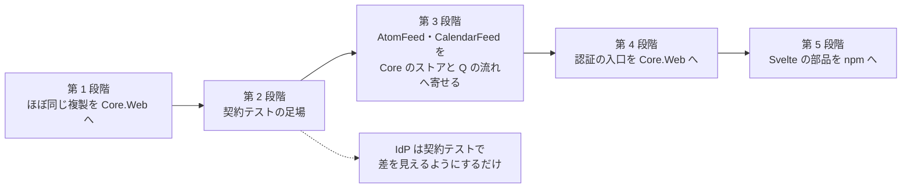

# 管理画面の共通化の進め方の方針

[管理画面の共通仕様書](../管理画面の共通仕様書.md)の 11 章。順序・危険・各段階の完了条件を決める。
区分は [共有の区分の一覧](共有の区分の一覧.md)、差は [各アプリの差異の一覧](各アプリの差異の一覧.md)。

## 11.1 順序

| 段階 | 内容 | 主な危険 | 完了条件 |
|---|---|---|---|
| 1 | AtomFeed と CalendarFeed で**ほぼ同じ複製**（名前空間とアプリ名だけが違うもの）を Core.Web へ移す。**別の作業として並行して進めている**（この仕様書を待たない） | 複製どうしの小さな差（片方だけの修正）を、どちらかへ黙って倒す | 移したファイルごとに、2 つの複製の差を Issue か PR に記録している。両アプリが Core.Web を参照してビルド・試験が通る。アプリ名・接頭辞を Core に書いていない |
| 2 | 契約テストの足場（[契約テストの方針](契約テストの方針.md)）。C1〜C5 を Q で通す | 試験が Q の実装に寄り、ほかのアプリで「無い」を表せない | Q で C1〜C5 が通る。能力の宣言で「流れが無い」アプリでは 404 の確認になる |
| 3 | AtomFeed・CalendarFeed の管理者・セッション・招待・監査を **Core のストア**へ寄せ、流れ（2 要素・復旧コード・登録し直し・端末）を Q に揃える | 既存の DB の移行（旧表 → `Core_*`）。**ログイン中の管理者の締め出し**。AtomFeed・CalendarFeed の日時の持ち方（文字列）が Core と違う（コア化の方針「背景」） | 両アプリで契約テストの C1〜C12 が通る（または差が未決事項として残っている）。移行の手順書がある |
| 4 | 認証の入口（`/session`・`/login`・`/enroll/*`・`/me/totp/*`・`/me/sessions/*`・`/users/**`・`/invitations/accept`・監査の絞り込み）を Core.Web の部品にし、アプリは権限の表と業務の入口だけを持つ | 公開 API の変更が全アプリへ効く。権限の表をアプリから受ける形の設計 | Q・AtomFeed・CalendarFeed が Core.Web の入口を使い、アプリ側の同じ入口を消している。契約テストが Core の版で回る |
| 5 | Svelte の部品（ログイン・2 要素・端末の一覧・確認の窓・監査ログの一覧）を npm で配る | 画面の文言カタログ（言語数が違う）の持ち方 | 2 アプリ以上が同じ部品を参照している |

## 11.2 原則

- **契約テストを先に入れてから寄せる**（段階 2 → 3）。寄せた結果が同じ契約を満たすことを試験で示す
- **Core にアプリ名を書かない**。cookie の名前・設定の接頭辞・権限の表・監査ログの対象の型は、アプリから受ける
  （[コア化の方針](../コア化の方針.md)「アプリ固有の値は引数で受ける」）
- **迷ったら置かない**。IdP の管理者（Pleasanter の利用者そのもの）は、Core の管理者のストアへは寄せない。
  契約テストで、入口と cookie の属性の差を見えるようにするだけにする
- 公開 API を変える PR は、各アプリの追随を Issue に残す（規約 9）

## 11.3 段階 1 との関係

段階 1 は別の作業として並行して進めている。この仕様書は段階 1 の**移す先の形を縛らない**。
段階 1 で移したものが、この仕様書の不変条件（3.5・6.3）と食い違う場合は、段階 3 で直す Issue にする。
