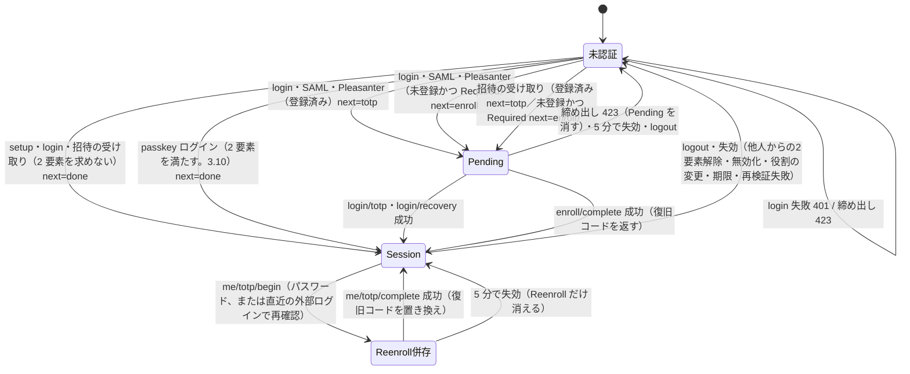
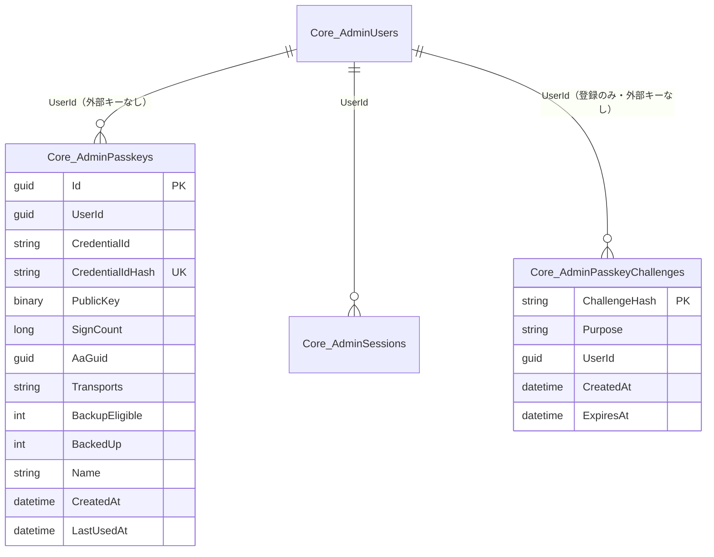
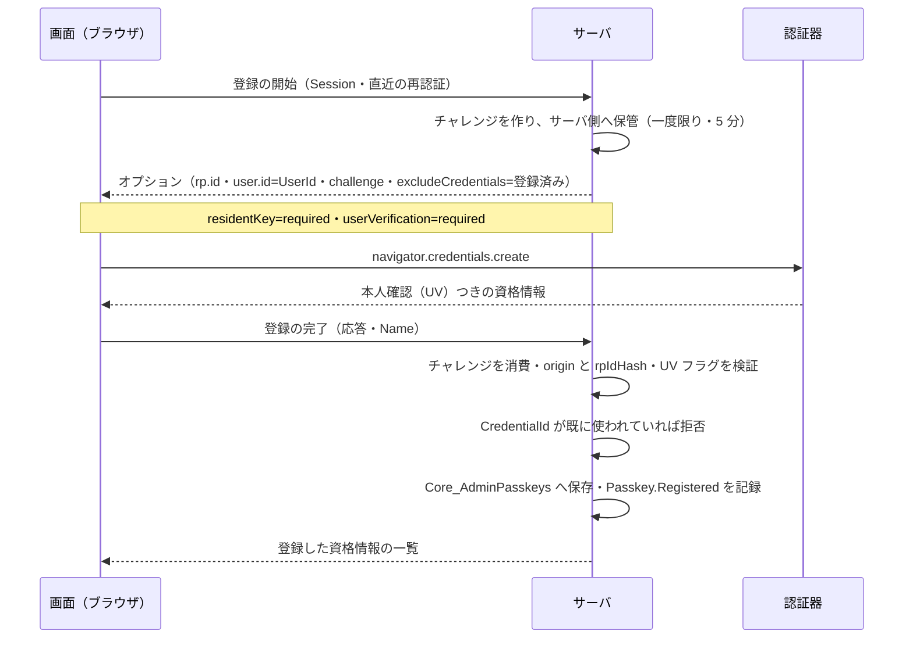
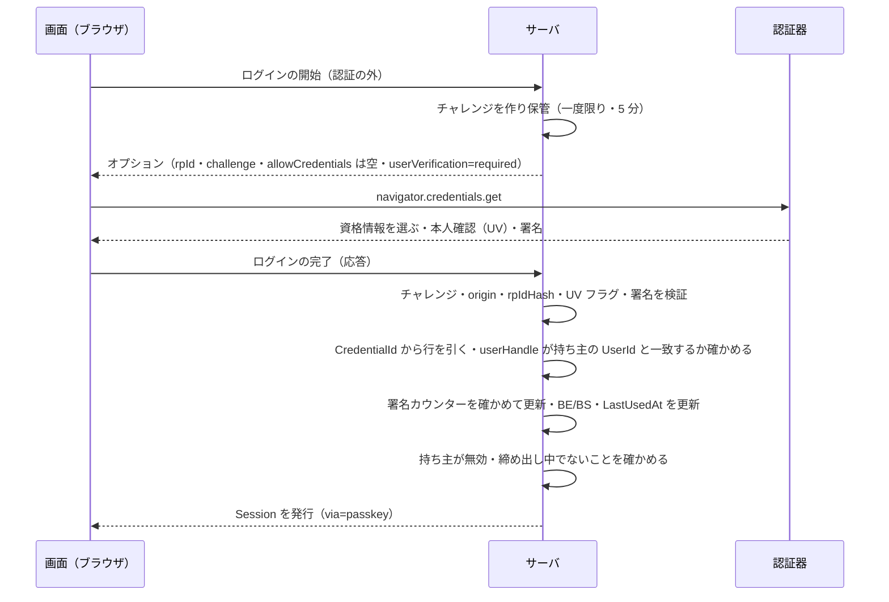
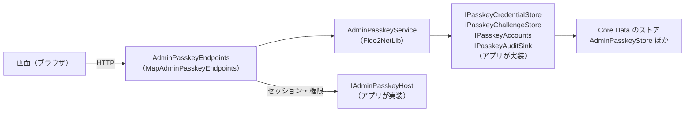

# 管理画面の認証とセッションの仕様書

[管理画面の共通仕様書](../管理画面の共通仕様書.md)の 2〜4 章。**規範は 1.3 の決定、比較の基点は Questionnaire（Q）**。
根拠の書き方と略記（`Q.Web/` など）は目次の「根拠の書き方」に従う。

## 2. 範囲と用語

| 用語 | 意味 | 根拠 |
|---|---|---|
| 管理者 | 管理画面に入れる利用者。Q・AtomFeed・CalendarFeed は**アプリが自分で持つ**（Core の `Core_AdminUsers`）。IdentityProvider（IdP）は **Pleasanter の `Users` の行そのもの**で、専用の表を持たない | `Core.Data/Stores/AdminUserStore.cs:13-45`、IdP `IdP.Web/Endpoints/AdminEndpoints.cs:668-679` |
| 役割（role） | 管理者に 1 つ付く名前。Core が意味を知っているのは `Administrator` だけで、ほかはアプリが決める | `Core.Data/Stores/AdminUserStore.cs:6-11` |
| 権限（permission） | 操作の単位（`対象.操作`）。役割から表で引く（6 章） | `Q.Web/Services/AdminPermissions.cs:7-17` |
| 段階（session kind） | サーバ側セッションの種類。Core は `Pending` と `Session` を定め、アプリが足せる（Q は `Reenroll`） | `Core.Data/Stores/AdminSessionStore.cs:7-15`、`Q.Data/QuestionnaireSessionKinds.cs` |
| Pending | パスワード（または SAML・Pleasanter のログイン）までは通り、2 要素がまだの状態。**何も操作させない**。寿命は既定 5 分 | `Q.Web/Endpoints/AdminAuthEndpoints.cs:626-627, 668-669`、U10 |
| Session | ログイン済み。寿命は既定 8 時間（延長しない） | 同 `:623-624, 684-685, 705-706`、U10 |
| Reenroll | ログイン済みのまま 2 要素を登録し直している途中。Pending とは別の段階にして、**登録し直しの cookie をログインの途中として使えないようにする**。寿命は既定 5 分 | 同 `:629-637, 671-672`、U10 |
| 端末 | サーバ側セッション 1 つ分。一覧・失効には**セッション ID の SHA-256（handle）**を使い、cookie の現物は出さない | `Core.Data/Stores/AdminSessionStore.cs:25-39, 85-92` |
| 入った方式（via） | `password` / `saml` / `pleasanter` / `passkey`（3.10）。表示用で、**この値だけを再確認の証拠にしない**（U13） | 同 `:17-23`、3.5 |
| 2 要素の方針 | `Required` / `Optional`（既定）/ `Disabled`。アプリ全体で 1 つ | `Q.Web/Services/AdminAuthenticator.cs:6-27, 36` |

対象外: アプリ固有の業務の画面と API（Q のアンケート、AtomFeed・CalendarFeed のフィード、IdP の OIDC クライアント・SAML SP・
署名鍵など）。これらは [API 契約の仕様書](API契約の仕様書.md)の「アプリ固有」に一覧だけを置く。

## 3. 認証の流れ

### 3.1 状態遷移

決定後の規範。Q の流れを基点に U8・U13・U14 を反映した。`next` は画面が次に出すもの。
寿命の 5 分・8 時間は既定値であり、範囲つきの設定で変えられるようにする（U10、8.2）。

- 「Reenroll併存」は、`Session` の cookie を持ったまま `Reenroll` の cookie も持つ状態
  （`Q.Web/Endpoints/AdminUserEndpoints.cs:392-485`）。
- `SignInSessionAsync` は**必ず Pending を消してから** Session を張る（`Q.Web/Endpoints/AdminAuthEndpoints.cs:594-608`）。
- 同じ方式の古いセッションは、新しいものを張る前に消す（`Q.Web/Services/AdminSessionManager.cs:47-74`）。

### 3.2 パスワード

- `POST /api/admin/login` は**どの段階で外れたかを区別しない**。利用者が居ない・パスワードが違う・無効は、
  同じ文言の 401（`auth.invalidCredentials`）。**上限に達した失敗の要求も同じ 401、その次の要求から 423**。
  締め出しの期間は範囲つきの設定による（既定 15 分。U10、6.4）。
  根拠: `Q.Web/Services/AdminAuthenticator.cs:154-165,452-465`、
  `Q.Web/Endpoints/AdminAuthEndpoints.cs:301-333`。
  **現状との差**: Q は期間を外部設定できない。AF・CF は締め出し中も 401、
  IdP は上限に達した要求から 429（A.2）。U3・U10 に従って変更する
- 利用者が居なくても捨てハッシュで照合し、応答時間で実在を漏らさない（`Q.Web/Services/AdminAuthenticator.cs:128-147`）
- パスワードが通っただけでは「ログインした」と記録しない。記録はセッションを張る側で行う
  （同 `:174-190, 389-397`）。**この照合はパスワードの再確認にも使うため**（同 `:180-183`）
- ハッシュは PBKDF2-HMAC-SHA512・210,000 回・塩 16 バイト・書式に版（`v1`）。古い書式は成功時に作り直す
  （`Q.Web/Services/PasswordHasher.cs:19-35, 72`、`Q.Web/Services/AdminAuthenticator.cs:167-172`）
- パスワードの条件は `PasswordMinimumLength`（既定 12）・`PasswordAllowSameAsLoginId`（既定 false）・
  `PasswordPolicies`（正規表現。既定はすべて無効）（`Q:App_Data/Parameters/Security.json`、`Q.Web/Program.cs:389-401`）
- **合言葉のログインを塞げる**（`<APP>_ADMIN_PASSWORD_SIGNIN=false`）。塞げるのは SAML か Pleasanter のログインが有効な間だけ。
  塞いだ状態で `/login` を叩くと 404（`Q.Web/Services/AdminPasswordSignInFilter.cs:10-30`、
  `Q.Web/Endpoints/AdminAuthEndpoints.cs:72-74, 335-336`）
    - 救済トークン（`<APP>_ADMIN_RESCUE_TOKEN`、32 文字以上）を `GET {管理画面}?rescue=…` で照合すると、
      10 分だけ合言葉の入口を開く（cookie `q.admin.rescue`）
      （`Q.Web/Services/AdminPasswordSignInOptions.cs:4-36`、`Q.Web/Services/AdminPasswordSignInPolicy.cs:15-80`、
      `Q.Web/Program.cs:1032-1062`）

### 3.3 TOTP と復旧コード

- RFC 6238。共有鍵 20 バイト（Base32）、6 桁・30 秒・SHA-1、前後 1 枠（Otp.NET）
  （`Q.Web/Services/TotpService.cs:19-71`）
- **同じ時間枠は一度しか通さない**。登録に使った枠もログインへ流用させない
  （`Q.Web/Services/AdminAuthenticator.cs:245-250, 371-379`、`Core.Data/Stores/AdminUserStore.cs:152-156`）
- 共有鍵は `ISecretCipher` で暗号化し、`<appId>:totp:<管理者 ID>` の文脈に束縛して保管する
  （`Core.Data/Stores/AdminUserStore.cs:64-76, 175-188`、`Q.Web/Program.cs:351-359`）
- **登録は 2 回に分ける**（begin で鍵を作り「登録の途中の鍵」としてサーバに預け、complete で数字を確かめて確定）。
  鍵を画面から送り返させない（`Q.Web/Services/AdminAuthenticator.cs:316-387`）
- 復旧コードは 10 本、`XXXXX-XXXXX`（紛らわしい文字を除く 31 文字種）。
  **保存は Q 方式の塩つき PBKDF2 ハッシュだけ**（U12）で、
  **返せるのは登録の完了時だけ**。登録し直すと前の復旧コードは使えなくなる
  （`Q.Web/Services/TotpService.cs:75-124`、`Q.Web/Endpoints/AdminAuthEndpoints.cs:447-448`、
  `Q.Web/Endpoints/AdminUserEndpoints.cs:483-484`）
- **現状との差（U12）**: AF・CF は SHA-256（`AF.Core/Security/Totp.cs:85-86`）。
  旧ハッシュを変換せず、本人確認を伴う再発行で置き換える。旧コードと新コードの併用を移行完了としない
- 復旧コードは使い切り。照合は未使用のハッシュを 1 件ずつ確かめ、使用済みの印を条件に含めた更新で 1 回に限る
  （`Q.Web/Services/AdminAuthenticator.cs:256-314`）
- 共有鍵を復号できない（鍵を失った）ときは 2 要素を `Invalid` とし、復旧コードで入り直してもらう（同 `:220-231`）

### 3.4 2 要素の方針

| 方針 | 未登録の人のログイン | 登録済みの人のログイン | 新しい登録（`/enroll/*`・`/me/totp/begin`） | 自分で解除（`/me/totp/disable`） |
|---|---|---|---|---|
| `Required` | Pending → 登録へ（`next=enroll`） | 2 要素を求める | 受け付ける | 400 `auth.twoFactorRequired` |
| `Optional`（既定） | そのまま Session | 2 要素を求める | 受け付ける | 本人の再確認つきで受け付ける（U13） |
| `Disabled` | そのまま Session | **2 要素を求める**（設定 1 つで既存の保護を外さない） | 400 `auth.twoFactorDisabled` | 本人の再確認つきで受け付ける（U13） |

根拠: `Q.Web/Services/AdminAuthenticator.cs:6-27, 184-190, 399-410`、`Q.Web/Endpoints/AdminAuthEndpoints.cs:355-363, 421-428`、
`Q.Web/Endpoints/AdminUserEndpoints.cs:346-389, 414-422`。
**知らない値は起動時に止める**（`Q.Web/Program.cs:412-427`）。
SAML・Pleasanter のログインで来た人にも同じ判断を当てる（`Q.Web/Services/SamlAuthenticator.cs:111-123`）。
方針は**外部設定だけ**で決め、画面から変えさせない（U10）。
登録開始後に `Disabled` へ変わった場合も、`/me/totp/complete` の入口で 400 を返し、確定しない（U4）。
**現状との差**: Q は complete で例外、AF・CF は 403。AF・CF は方針を画面からも変えられる。

### 3.5 TOTP の登録と登録し直し（不変条件）

Q の登録差し替え防止の修正後（`c774e4b`）を基点に、U1・U4・U7・U13 を規範として加える。

| 番号 | 不変条件 | 破ったときの応答 | 根拠 |
|---|---|---|---|
| T1 | `/enroll/begin`・`/enroll/complete` は **Pending の cookie を持つ人だけ**が使える | 401 | `Q.Web/Endpoints/AdminAuthEndpoints.cs:347-353, 394-398` |
| T2 | **TOTP を登録済みの人は `/enroll/*` を使えない**（パスワードだけで、自分の鍵へ差し替えて入れてしまうため） | 403 `auth.totpAlreadyEnrolled` | 同 `:365-371, 402-406, 538-549` |
| T3 | 登録し直しは**ログイン後**に `/me/totp/begin` で行い、パスワード、または直近の外部ログインによる本人の再確認を要する。ログイン用のレート制限を掛ける（U7・U13） | パスワード拒否は 401（`users.currentPasswordRejected`）・締め出し中は 423。外部再確認の要求形は 11.9 | `Q.Web/Endpoints/AdminUserEndpoints.cs:391-434`、U7・U13 |
| T4 | `/me/totp/complete` は、**同じ人の Reenroll の cookie** と、サーバに預けた途中の鍵があるときだけ通す | 400 `auth.enrollmentRestartRequired` | 同 `:443-462` |
| T5 | Reenroll の cookie では Pending の操作（`/enroll/*`・`/login/totp`）ができない（別の方式・別の段階） | 401 | `Q.Web/Endpoints/AdminAuthEndpoints.cs:629-637`、`Q.Web/Services/AdminSessionGuard.cs:196-203` |
| T6 | 共有鍵は**サーバが作って預ける**。complete は画面から鍵を受け取らない | （要求に鍵の項目が無い） | `Q.Web/Endpoints/AdminAuthEndpoints.cs:373-377, 408-419` |
| T7 | `Disabled` の間は新しい登録の口を閉じる。開始後に方針が変わった `/me/totp/complete` も入口で拒否する（U4） | 400 `auth.twoFactorDisabled` | 同 `:355-363`、`Q.Web/Endpoints/AdminUserEndpoints.cs:414-422`、U4 |
| T8 | 登録の完了・登録し直しの完了で、前の復旧コードを捨てて新しい 10 本を返す。返すのはこの時だけ | — | `Q.Web/Services/AdminAuthenticator.cs:371-379` |
| T9 | 他人の 2 要素の解除はサーバで `users.resetTwoFactor` を要求し、自分自身を対象にできない（自分の分は本人の再確認つきの `/me/totp/disable`） | 権限なし 403・自分は 400 `users.selfNotAllowed` | `Q.Web/Endpoints/AdminUserEndpoints.cs:179-197`、U1・U13 |

**現状との差**: AF・CF は Session だけで再登録でき、begin にレート制限が無い（U7）。
Q は再登録・自己解除の再確認をパスワードだけで行い、JIT 管理者が使える外部再確認の道が無い（U13）。
再確認は単なる既存 cookie や `via` の表示値で代用しない。
直近性の時間窓とサーバ側の証跡の具体化は 11.9 で追跡する。

### 3.6 SAML（SP 起動のみ）

- 流れ: `GET /api/admin/saml/login` → IdP → `POST /api/admin/saml/acs`。**IdP 起動の応答は受けない**
  （`Q.Web/Endpoints/AdminSamlEndpoints.cs:17-38`）
- 署名の検証は `Unbind` が行い、通す・通さないはその後の値だけで決める。`InResponseTo` を預けた要求 ID と突き合わせる
  （同 `:26-29, 190, 206`）
- 途中は cookie `q.admin.saml`（`SameSite=None`・`Secure`、15 分）に預ける（同 `:41-50`）
- 利用者の決め方: NameID か属性の値を**ログイン ID** として突き合わせる。居なければ `Reject`（既定）か `Register`（JIT。
  役割は `RegisterRole`、既定 `Editor`。**Administrator は指定できない**（U8）。
  パスワードは誰も知らない値）（`Q.Web/Services/SamlAuthenticator.cs:73-100`、
  `Q.Web/Services/SamlOptions.cs:98-108`）
- **締め出し中は Pending・Session の発行前に拒む。管理者 0 人でも拒む**（U8）。
  **現状との差**: Q・AF・CF はこの 2 つの判定が無く、JIT に Administrator を選べる（A.2）。
  SAML の失敗は既存の転送形式を維持し、監査には拒否を記録する。追加する理由の値は 11.9 で具体化する
- **本アプリで 2 要素を登録済みなら、SAML で来ても 2 要素を通す**。`Required` なら未登録の人に登録させる
  （`Q.Web/Services/SamlAuthenticator.cs:111-123`）
- 失敗は `{管理画面}?samlError=invalid|unknown-user|disabled` へ戻す（302）。監査ログには 401/403 として残す
  （`Q.Web/Endpoints/AdminSamlEndpoints.cs:684-720`）
- 無効の間、認証の入口は 404。経路は常に登録する（画面から再起動なしで有効にするため）（`Q.Web/Program.cs:989-994`）
- 単一ログアウト（SLO）は 4.4。

### 3.7 Pleasanter のログイン（Pleasanter SSO）

- 画面は Pleasanter でのログインを待つ間、`POST /api/admin/pleasanter-sso/check` を約 2 秒おきに呼ぶ。
  本文は JSON（空でよい）にして、他サイトの form から送れないようにする
  （`Q.Web/Endpoints/AdminPleasanterSsoEndpoints.cs:26-36, 50-52`）
- 本アプリの cookie（`q.` で始まるもの）を除いた、指定の名前の cookie だけを Pleasanter へ転送して本人を確かめる
  （`Q.Web/Services/PleasanterSsoOptions.cs:56, 72, 88-92`）
- **最初の管理者を Pleasanter から作らせない**（管理者が 0 人なら 409 `setup-required`）（同 `:70-76`）
- **締め出し中は Pending・Session を発行せず拒む。JIT の役割に Administrator を含めない**（U8）。
  **現状との差**: Q・AF・CF は締め出しを見ず、Administrator を選べる（A.2）。
  JIT の許可役割は設定入力・画面・実行時のすべてで制約する
- 部署・グループで絞れる（`ALLOWEDDEPTIDS`・`ALLOWEDGROUPIDS`）。居ない人は `Reject`（既定）か `Register`（JIT）
  （`Q.Web/Services/PleasanterSsoOptions.cs:9-15, 38-49, 104-111`）
- 応答: `{status:"unauthenticated"}`（まだ）・`{status:"signedIn", next:"done"|"totp"|"enroll"}`・
  403 `{code:"not-allowed"|"disabled"|"unknown-user"}`・503 `{code:…}`（Pleasanter に届かない）・404（無効）
  （`Q.Web/Endpoints/AdminPleasanterSsoEndpoints.cs:60-160`）
- 入った後も、`REVALIDATEMINUTES`（既定 5、1〜60）ごとに Pleasanter へ確かめ直す（4.3）

### 3.8 招待の受け取り

- 管理者の追加は**パスワードを受け取らず**招待を出す。招待トークンは 32 バイトの乱数（base64url）。
  **保存は SHA-256 の 16 進の小文字 64 文字**（U5）。
  **現状との差**: Q は Base64 で保存する。Core の記述と AF・CF の形へ変更し、既存の招待は失効してよい
  （`Q.Web/Services/InvitationToken.cs:20-41`、`Core.Data/Stores/AdminInvitationStore.cs:6-21`）
- 期限は 48 時間（`InvitationLifetime`）、1 回限り。出し直すと前の招待は死ぬ
  （`Q.Web/Services/AdminAuthenticator.cs:50-55`、`Core.Data/Stores/AdminInvitationStore.cs:25-26`）
- `POST /api/admin/invitations/accept` は認証の外。**無い・期限切れ・使用済みを区別しない**（401 `users.invitationInvalid`）。
  パスワードの条件に合わないときだけ理由を返し、**招待を使い切る前に断る**
  （`Q.Web/Services/AdminUserService.cs:196-243`、`Q.Web/Endpoints/AdminUserEndpoints.cs:574-619`）
- 受け取ると、その人の既存のセッション（通常・途中）をすべて失効させる（同 `:526-531`）
- その後は、登録済みなら Pending（`next=totp`）、未登録かつ `Required` なら Pending（`next=enroll`）、
  それ以外はそのまま Session（`next=done`）（同 `:533-554`）
- 無効にした人宛ての未使用の招待は取り消す（`Q.Web/Services/AdminUserService.cs:343`）

### 3.9 最初の管理者

- `POST /api/admin/setup` は**管理者が 0 人のときだけ**通る。2 人目以降は 409 `auth.administratorAlreadyExists`。
  排他は Core の `CreateFirstAsync`（原子的に 1 回だけ）（`Q.Web/Endpoints/AdminAuthEndpoints.cs:206-263`、
  `Q.Web/Services/AdminAuthenticator.cs:421-450`、`Core.Data/Stores/AdminUserStore.cs:84-89`）
- 役割は `Administrator`。`Required` なら Pending（`next=enroll`）、それ以外はそのまま Session（`next=done`）

### 3.10 パスキー（WebAuthn）

2026-11-25 の #213 の決定 1/9〜9/9 を仕様へ落としたもの。**表と移行・ストア（3.10.2）は #215、
API と認証の流れ（`Core.Web`）は #216 で実装した**（実装の構成は 3.10.12）。画面は各アプリで作る。
Azure の実機・実ブラウザ／仮想認証器での試験は #217 で行う（未実施）。
決定に無い値（経路・設定名・上限）は #216 で確定した（3.10.11）。**表中の「案」は、確定したものを除く**。
運用（設定の変更・RP ID の変更・復旧・DB の直接操作）は[パスキーの運用手順書](パスキーの運用手順書.md)。

#### 3.10.1 位置づけ

- **パスキーは、パスワードの代わりに 1 回で入る方式**（`via=passkey`）。パスワードの後の 2 要素目としては使わない
  （解釈。3.10.11 に確認事項として残す）。パスワード・SAML・Pleasanter のログインを置き換えず、**足す**
- **2 要素（TOTP）は満たす扱い**にする。ログインの結果は Pending を経ず、直接 Session になる。
  `Required` でも、`via=passkey` の人には登録を求めない。**登録・認証とも `userVerification=required` を強制**し、
  本人確認なしの成功（UV フラグが立っていない応答）は拒否する（決定 2/9・3/9）
- **SAML が 2 要素を満たさない方針とは整合する**。SAML は IdP 側の認証強度をこちらで保証できないが、
  パスキーは UV の有無をこちらで検証できる（決定 3/9）
- **有効化は環境変数で、既定は無効**（3.10.7）。無効の間、パスキーの口は 404、ログイン画面に出さない
- ライブラリは Fido2NetLib（NuGet `Fido2`）4.3.3（MIT）。Pleasanter 本体の実装は挙動の確認だけに使い、
  **コードを取り込まない**（決定 1/9。出典は 3.10.10）
- 実装は Core.Web の `AdminPasskeyService`（流れ）と `AdminPasskeyEndpoints`（HTTP の口）。
- 用語: **ディスコバラブル資格情報**＝端末に残り、ユーザー名なしで選べる資格情報（`residentKey=required` で作る）。
  **RP ID**＝資格情報が結び付くドメイン（ホスト名）。**ユーザーハンドル**＝資格情報に持たせる利用者の識別子

#### 3.10.2 データモデル（`Core_AdminPasskeys`）

1 人の管理者に**複数**持てる。**既存の表（`Core_AdminUsers` など）は変えない**（決定 2/9）。
列は決定 2/9 のとおり。**型・桁は #215 で確定した**（`Core.Data/Migrations/M10008_CoreAdminPasskeys.cs`。
既存の表に倣い、時刻は UTC・`DbTime` を通す。MySQL は表ごと `utf8mb4_0900_as_cs` へ直す。
根拠: `M10006_CoreAdminUsers.cs`・`M10007_CoreAdminSessions.cs`、`Core.Data/DbTime.cs`）。
SQL Server・PostgreSQL・MySQL・SQLite の 4 つで、移行とストアの試験を通した（`tests/…Data.Tests/AdminPasskeyStoreTests.cs`）。

| 列 | 型（確定。FluentMigrator） | 意味 | 備考 |
|---|---|---|---|
| `Id` | GUID・主キー | 行の識別子 | 画面・API で指す値。資格情報の ID とは別 |
| `UserId` | GUID・非 NULL | 持ち主（`Core_AdminUsers.Id`） | 索引あり。**外部キーは張らない**（セッションの表と同じ） |
| `CredentialId` | 文字列 1400・非 NULL（base64url） | 資格情報の ID（原文） | **索引は張らない。**引くのは `CredentialIdHash`。1023 バイト（WebAuthn の上限）は base64url で 1364 文字 |
| `CredentialIdHash` | 文字列 64・非 NULL・**一意索引** | 資格情報の ID（生のバイト列）の SHA-256（小文字 16 進） | 1 つの資格情報を 2 人に結び付けない（W3C §7.1 手順 26）。ID が長く、索引のキー長に収まらない恐れがあるため、ハッシュを一意にする |
| `PublicKey` | バイナリ 2048・非 NULL | 公開鍵（COSE） | 監査ログへは出さない |
| `SignCount` | 64 bit 整数・非 NULL・既定 0 | 署名カウンター | 0 から始まる。32 bit の値が入るので、符号付きでも足りる |
| `AaGuid` | GUID・非 NULL | 認証器の種類の識別子 | 不明なら全 0 |
| `Transports` | 文字列 256・NULL 可 | 登録時に得た転送手段（`internal`・`hybrid` など。カンマ区切り） | ディスコバラブルのため、認証時の `allowCredentials` には使わない |
| `BackupEligible` | 整数（0/1）・非 NULL・既定 0 | 同期できる資格情報か（BE） | 登録時に決まり、変わらない |
| `BackedUp` | 整数（0/1）・非 NULL・既定 0 | いま同期されているか（BS） | 認証のたびに最新へ更新 |
| `Name` | 文字列 100・非 NULL | **本人が付ける名前**（例「仕事用 PC」） | 前後の空白は落とす。一覧に出す |
| `CreatedAt` | 日時・非 NULL | 登録した時刻 | |
| `LastUsedAt` | 日時・NULL 可 | 最後に認証に使った時刻 | |

**索引**: `UX_Core_AdminPasskeys_CredentialIdHash`（一意）・`IX_Core_AdminPasskeys_UserId`。
資格情報の ID そのもの（最大 1400 文字 = SQL Server で 2800 バイト）は、SQL Server の非クラスタ化索引のキー
（1700 バイト）に載らないので、載せない。ハッシュ（64 文字）は、4 つの DB のどれでも載る。

- **ユーザーハンドルは列に持たず、`UserId`（GUID の 16 バイト。RFC 4122 の並び＝`Guid.ToByteArray(bigEndian: true)`）をそのまま使う**
  （確定。個人を特定する情報を含めない。W3C §5.4.3 は最大 64 バイト・個人を特定する情報を含めないと定める）
- **持ち主が無効でも行は残す**（無効の間はログインに使えない。3.10.4）
- 公開鍵・チャレンジは**監査ログへ残さない**（3.10.8）。ログへも出さない
- **チャレンジの保管先は、新しい表 `Core_AdminPasskeyChallenges`**（#215 で決めた）。
  列は `ChallengeHash`（チャレンジの SHA-256・小文字 16 進 64 文字・主キー）・`Purpose`（`register` / `signin`）・
  `UserId`（登録なら本人、ログインなら NULL）・`CreatedAt`・`ExpiresAt`（索引あり）。
  **DB には SHA-256 だけ**置く（セッション ID と同じ。DB が漏れても有効なチャレンジは作れない）。
  **一度限り**は、1 文の `DELETE ... WHERE ハッシュ・用途・持ち主・期限内` の件数が 1 のときだけ通す形で守る
  （同時に 2 回通らない）。有効期間の既定は 5 分（決定 7/9）で、期限切れは `DeleteExpiredAsync` で掃除する
  （呼び出し側が、セッションの掃除と同じ周期で呼ぶ）。
    - **Redis にしなかった理由**: `Core.Data` は RDBMS だけを扱い、Redis への依存を持ち込まない。
      複数台が共有する保管先として、既に全アプリが持つ DB で足りる。Redis を使うアプリは、
      `IAdminPasskeyChallengeStore` を実装して差し替えられる
    - **オプションの本体は保管しない**: 検証に要る値（チャレンジ・RP・持ち主）は、呼び出し側が組み立て直す

#### 3.10.3 登録の流れ

**ログイン中の本人だけ**が、自分の分を登録する。代行はできない（決定 4/9）。
登録の開始には、**直近の再認証（パスキーかパスワード）**を要する（3.10.5 の P4）。

- オプションは `authenticatorSelection.residentKey=required`・`userVerification=required`・`attestation=none`
  （確定。認証器の証明書の検証は求めない）。`excludeCredentials` に、その人の登録済みを入れ、同じ認証器の二重登録を防ぐ
- 完了では、**UV フラグが立っていない応答を拒否**する。BE・BS の値を保存する
- 登録の途中で何かが失敗したら、**行は作らない**（途中の行を残さない）

#### 3.10.4 認証（ログイン）の流れ

**ディスコバラブル資格情報を優先する**。ログイン画面の「パスキーでログイン」を **1 クリック**で行い、
**ユーザー名は入力しない**（決定 8/9）。端末が資格情報を選ぶので、サーバは問い合わせ時点で利用者を知らず、
**ユーザーを列挙できない**。

- **失敗の応答は、理由を区別しない**（未登録の資格情報・署名の不一致・チャレンジの期限切れ・持ち主が無効、
  いずれも同じ 401。`/login` と同じ考え方、3.2）。理由は監査ログの `DetailJson` にだけ残す
- 持ち主が**無効**または**締め出し中**なら、Session を発行せず拒む（U8 と同じ。パスキーを迂回の道にしない。
  アカウント側の失敗回数に数えるかは 3.10.11）
- **署名カウンター**（W3C §6.1.1）: 保存値が 0 でなく、受け取った値が保存値より大きくないときは、
  複製された認証器の疑いとして**拒否して、警告の監査を残す**（決定 7/9）。
  カウンターを持たない認証器（常に 0）は、0 のままなら通す。通ったら保存値を更新する
- 認証のたびに **BackedUp（BS）を最新へ更新**する。BE が登録時と違えば拒否する（BE は変わらない値のため。確定。理由 `backup-eligibility-changed`）

#### 3.10.5 不変条件

| 番号 | 不変条件 | 破ったときの応答 |
|---|---|---|
| P1 | 登録・認証とも **`userVerification=required`**。UV フラグが立っていない応答は拒否する | 登録は 400、認証は 401 |
| P2 | **パスキーで入ったセッションだけが、2 要素を満たす**。SAML・Pleasanter のログインは満たさない（従来どおり、3.4・3.6） | — |
| P3 | 一覧・登録・名前の変更・削除は、**ログイン中の本人の分だけ**。登録の代行はできない | 他人の分は 404（存在を知らせない） |
| P4 | 登録・削除は、**直近の再認証（パスキーかパスワード）**を要する。時間窓は U13 の具体化（11.9）と同じ値を使う | 401（再認証の要求形は 11.9） |
| P5 | **パスキーだけの人を作らない**。削除の結果、その人が使えるログイン方法が 1 つも無くなる削除は断る | 409 `passkeys.lastSignInMethod` |
| P6 | チャレンジは**一度限り**で、短い有効期限（5 分）でサーバ側に保管する。使った・期限切れのものは通さない | 401（認証）・400（登録）。有効期間は 5 分 |
| P7 | 署名カウンターが逆行したら拒否し、警告の監査を残す | 401 |
| P8 | **`CredentialId` は全体で一意**。登録済みの ID は、別の人にも結び付けない | 409 `passkeys.duplicateCredential` |
| P9 | 管理者の復旧削除は、対象者の全セッションを失効させる（U14 と同じ考え方。確定）。無効な持ち主のログインでは Session を張らない | — |
| P10 | 機能が無効の間は、すべての口が 404。**既存の行は消さない**（再び有効にすれば使える） | 404 |

- 「使えるログイン方法」は、(a) **パスワード**（合言葉のログインが塞がれておらず、招待を受け取り済みで、
  本人がパスワードを知る人）、(b) **SAML が有効**、(c) **Pleasanter のログインが有効**、のうち 1 つ以上。
  **ほかのパスキーは数えない**（パスキーだけの人を作らないため）
- 復旧（管理者による削除）は、P5 を**満たしたまま**行えるようにする。管理者が消すのは「紐付くパスキー」であり、
  本人はパスワード・SAML・Pleasanter のどれかで入って、新しいパスキーを登録し直す（決定 5/9）。
  **復旧コードは発行しない**

#### 3.10.6 API と権限

**確定（#216）**。経路は `/api/admin` の下（API 契約の仕様書 5.3.1 にも置いた）。
応答は 5.1 の約束に従い、エラーは `{ code }`（鍵は 9.2。Core は文言を持たず、画面が作る）。`Cache-Control: no-store` を付ける。

| 操作 | 経路 | 認可 | 再認証 | 応答 |
|---|---|---|---|---|
| 一覧 | GET `/me/passkeys` | Session（本人） | 不要 | `{passkeys:[{id, name, createdAt, lastUsedAt, backedUp, transports}]}`。公開鍵・CredentialId は返さない |
| 登録の開始 | POST `/me/passkeys/begin` | Session（本人） | **要**（`{password}` か `{assertion}`） | オプション（`rp.id`・`user.id`・`challenge`・`excludeCredentials`・`authenticatorSelection`） |
| 登録の完了 | POST `/me/passkeys/complete` | Session（本人） | 開始で確認済み | `{passkey:{…一覧の 1 件…}}`。要求は `{credential, name?}`（名前が空なら `Passkey`） |
| 名前の変更 | PUT `/me/passkeys/{id}` | Session（本人） | 不要 | `{name}` |
| 削除 | POST `/me/passkeys/{id}/remove` | Session（本人） | **要** | `{removed:true}`。P5 に反すれば 409 |
| ログインの開始 | POST `/login/passkey/begin` | 公開 | — | オプション（`allowCredentials` は空・`userVerification=required`） |
| ログインの完了 | POST `/login/passkey/complete` | 公開 | — | `{next:"done"}`。Session（`via=passkey`）。要求は `{credential}` |
| **復旧: 他人の分の削除** | POST `/users/{id}/passkeys/reset` | `users.resetPasskeys` | — | `{reset:true, removed:n}`。相手の全セッションを失効。自分は 400 `users.selfNotAllowed` |

- 削除を DELETE ではなく POST `…/remove` にしたのは、API 契約の仕様書 5.6.1（端末の失効は POST・PUT/DELETE の現状は変更する・
  成功は本文つき）に合わせるため。名前の変更は `/me/language` と同じ PUT
- 登録・削除・名前の変更は、**本人以外には存在も知らせない**（他人の分・存在しない分・GUID でない値は、いずれも 404）。
  管理者が他人の分を見る・登録する口は作らない
- ログインの 2 つの口と、パスワードを受ける再認証の口（登録の開始・削除）は、**パスワードのログインと同じ方針名のレート制限を掛ける**（3.10.8）
- **再認証の証拠は要求ごとに添える**（時間窓は 0）。`{password}` はログインと同じ道（失敗の記録・締め出し。T3）を通り、
  違えば 401 `users.currentPasswordRejected`、締め出し中は 423 `users.operationTemporarilyLocked`。
  `{assertion}` は、`/login/passkey/begin` のオプションへ本人のパスキーで応答したもの（他人のパスキーは 401 `passkeys.reauthRequired`）。
  外部ログイン（SAML・Pleasanter）の直近の再確認は、アプリが `IAdminPasskeyHost.IsExternallyReconfirmedAsync` で伝える（U13・11.9 の具体化まで、既定は偽）。
  どれも無ければ 401 `passkeys.reauthRequired`
- 復旧の口は、`users.resetPasskeys`（6.2。サーバで要求する）と、自分を対象にできない規則（T9 と同じ）を持つ

#### 3.10.7 設定

**名前・既定値は確定（#216）**。**`<APP>_` の接頭辞は、呼び出し側が引数で渡す**（`AdminPasskeySettingKeys`）（Core はアプリ名を持たない。
[コア化の方針](../コア化の方針.md)）。読み込みの順・起動時の検査は 8.1 に従い、**知らない値・書き間違いは起動時に止める**。
画面からは変えさせない。

| 設定 | 意味 | 既定 | 備考 |
|---|---|---|---|
| `<APP>_ADMIN_PASSKEY` | パスキーを有効にするか | `false` | 無効の間は P10 |
| `<APP>_ADMIN_PASSKEY_RPID` | RP ID（ホスト名のみ） | 未指定 | 未指定ならリクエストのホストから導く |
| `<APP>_ADMIN_PASSKEY_ORIGINS` | 許可する Origin（カンマ区切り） | 未指定 | 未指定ならリクエストの Origin から導く |

- **未指定の RP ID・Origin は、リクエストのホストから導く。プロキシ経由は、設定済みの転送ホストを使う**
  （未設定のまま `X-Forwarded-Host` を信用しない）。**明示すればそれを優先**し、
  複数のホストは Origin をカンマ区切りで許可する（決定 6/9）
- **サブパス配置（`<APP>_PATH_BASE`）でも RP ID はホスト名だけ**なので影響しない
- **RP ID を変えると、登録済みのパスキーはすべて使えなくなる**（資格情報は RP ID に結び付く。W3C §4・§6.3.3）。
  警告と手順は運用手順書
- Origin は**スキーム・ホスト・ポートの完全一致**で検証する。**`https` のみ。開発のため、`localhost`（と `*.localhost`）だけ `http` も許す**
  （ブラウザが安全なコンテキストとして扱うため。`<APP>_ALLOW_INSECURE` とは無関係で、`true` でも `localhost` 以外の `http` は許さない）。
  書き間違い（真偽値・IP リテラルやポート・パスつきの RP ID・パスつきの Origin・RP ID に従属しない Origin）は**起動時に止める**
  （`AuthenticationSettingException`。`PasskeyRpIdInvalid`・`PasskeyOriginInvalid`・`PasskeyOriginRpIdMismatch`）
- 導出は `PasskeyRelyingParty.Resolve`。RP ID を明示して Origin を導くとき、リクエストのホストが RP ID に従属しなければ 400 `passkeys.originNotAllowed`
- Fido2NetLib の `Fido2Configuration`（`RPID`・`RPName`・`Origins`・`Timeout`）へ
  **要求ごとに**渡す（`ServerDomain`・`ServerName` は 4.3.3 で旧形式）。
  RP の名前はアプリが渡す（設定ではない）。ほかの項目は 3.10.10 の確認結果のとおり

#### 3.10.8 監査イベントとレート制限

`Core_AuditLogs`（7 章）へ、次の `Action` を記録する（決定 7/9）。**表記は決定の名前のまま**（`Passkey.Registered` の形）。
U2 の一覧（`login.succeeded` の形）へは写さず、**パスキーの 5 つは例外としてこの名前を正とする**（3.10.11）。

| `Action` | いつ | `TargetType` / `TargetId` | 補足（`DetailJson`） |
|---|---|---|---|
| `Passkey.Registered` | 登録の完了 | `AdminUser` / 持ち主の ID | 資格情報の ID・`name`・`aaGuid`・`backupEligible` |
| `Passkey.Removed` | 削除（本人・管理者・DB の手作業） | 同上 | 資格情報の ID・`by`（`self` / `admin` / `direct-db`） |
| `Passkey.Renamed` | 名前の変更 | 同上 | 資格情報の ID |
| `Passkey.SignIn.Succeeded` | ログインの成功 | 同上 | 資格情報の ID |
| `Passkey.SignIn.Failed` | ログインの失敗（理由を区別して残す） | 特定できたときだけ | 理由の印（`PasskeyFailureReasons`: `malformed`・`challenge`・`unknown-credential`・`bad-signature`・`uv-missing`・`counter-regression`・`backup-eligibility-changed`・`user-handle-mismatch`・`origin`・`disabled`・`locked`・`concurrent`・`other-user`・`invalid`）。再認証の失敗は `purpose=reauth` を付ける |

- **資格情報の ID は残し、公開鍵・チャレンジ・署名・応答の本体は残さない**
- 署名カウンターの逆行は、`Passkey.SignIn.Failed` に理由 `counter-regression` を付け、**警告として見分けられる**ようにする
- **レート制限**: ログインの開始・完了と、パスワードを受ける再認証の口は、パスワードのログインと**同じ方針名**（`MapAdminPasskeyEndpoints` の引数。
  Q なら `admin-login`）で、**同じ IP ごとの枠**（`<APP>_LOGIN_ATTEMPTS_PER_5MIN`、5.1）を共有する。別枠にして、パスワードの 10 回とパスキーの 10 回の合計を許さない。
  上限到達時の応答は、アプリの既存の方針どおり（Q は 429）
- **監査の書き方**: 5 つはサービスが `IPasskeyAuditSink` へ**明示して**書く。入口の集まりに掛ける監査フィルタ（7.1）は、これらの経路を**二重に残さない**よう除外する
- **チャレンジの掃除**: 期限切れのチャレンジは、期限切れセッションの掃除（4.3）と同じ場所で消す

#### 3.10.9 失効と復旧

| 契機 | 起きること |
|---|---|
| 本人がパスキーを削除 | その行だけ消える。**ほかのセッションは失効させない**（確定。再認証済みの本人の操作のため） |
| 管理者が復旧で削除 | 対象者の**全パスキー**を消し、全セッションを失効（確定）。監査 `Passkey.Removed`（`by=admin`。資格情報 1 件 1 行。0 件なら操作の事実を 1 行） |
| DB の直接操作 | 運用手順書。実行後に監査ログへ**手で記録**する |
| 利用者の無効化 | 行は残す。ログインは拒む（3.10.4） |
| RP ID・Origin の変更 | 既存のパスキーは使えなくなる。運用手順書の警告 |

#### 3.10.10 出典（一次情報）

参照日はすべて 2026-11-25。**確認できた範囲だけを書いた**。

| 情報 | 出典 | 確認した内容 |
|---|---|---|
| WebAuthn の仕様 | [W3C Web Authentication Level 3](https://www.w3.org/TR/webauthn-3/)（版の表示は Recommendation・2026-08-25） | §5.1.3（`residentKey`・`userVerification` の値と実効値の決まり方）、§6.1.1（署名カウンターの比較と複製の疑い）、§6.1.3（BE・BS）、§7.1 の手順 14・26・27（rpIdHash の確認・資格情報 ID の重複の拒否・RP ID と signCount の保存）、§6.3.3 手順 5（RP ID が合う資格情報だけを使う）、§4（ディスコバラブル資格情報ではユーザーハンドルが必須・ユーザー名なしのログインは `allowCredentials` が空） |
| Fido2NetLib の配布 | [NuGet Fido2 4.3.3](https://www.nuget.org/packages/Fido2/4.3.3) | MIT・net8.0 と net10.0・依存は `Fido2.Models` / `Microsoft.Extensions.Http` / `Microsoft.IdentityModel.JsonWebTokens` / `NSec.Cryptography`（25.4.0 以上）/ `System.Formats.Cbor`。ページの更新日は 2026-11-11 |
| Fido2NetLib の使い方 | [GitHub の README](https://github.com/passwordless-lib/fido2-net-lib) | `AddFido2`（`ServerDomain`・`ServerName`・`Origins`）、認証で保存済みの署名カウンターを渡し、成功後に返された値を保存する、途中のオプションはセッション・キャッシュ・Redis・DB のどれかに置く |

#### 3.10.10.1 #216 で確かめた事実（参照日 2026-11-25。#217 の一部）

| 項目 | 確かめたこと | 出典・方法 |
|---|---|---|
| TFM | Fido2 4.3.3 は net8.0 と net10.0。本リポジトリ（net10.0）で使える。依存は上の表のとおり | [NuGet Fido2 4.3.3](https://www.nuget.org/packages/Fido2/4.3.3)、パッケージの nuspec |
| ライセンス | Fido2・Fido2.Models・NSec.Cryptography・System.Formats.Cbor は MIT、libsodium は ISC（寛容）。Fido2 の LICENSE は MIT License | [LICENSE.txt](https://github.com/passwordless-lib/fido2-net-lib/blob/master/LICENSE.txt)、各 nuspec の licenseExpression |
| ネイティブ依存 | `NSec.Cryptography` 25.4.0 は net8.0 向けで、`libsodium` 1.0.20.1（[1.0.20.1, 1.0.21)）に依存する。libsodium のパッケージは `runtimes/` に win-x64・win-x86・win-arm64・linux-x64・linux-arm・linux-arm64・linux-musl-x64・linux-musl-arm・linux-musl-arm64・osx・ios 向けのネイティブを含む。**Windows x64（開発機）で、検証が実際に動くことを確かめた**（本リポジトリの契約テスト） | パッケージの nuspec と `runtimes/` の中身、`dotnet test` の結果 |
| `Fido2Configuration` | 項目は `Timeout`（既定 60000）・`TimestampDriftTolerance`（0）・`ChallengeSize`（16）・`RPID`・`RPName`・`ServerDomain`/`ServerName`（旧形式）・`ServerIcon`・`Origins`・`FullyQualifiedOrigins`・`AllowCrossOriginRequests`（既定 false）・`MDSCacheDirPath`・`AppleWebAuthnRootCertificate`・`AndroidSafetyNetRootCertificate`・`UndesiredAuthenticatorMetadataStatuses`・`BackupEligibleCredentialPolicy`・`BackedUpCredentialPolicy`（既定は両方 `Allowed`）。Origin と RP ID の関係が合わないと `Fido2ConfigurationException`。`Fido2.MinimumChallengeSize` は 16 | パッケージの XML ドキュメントと公開 API の列挙、実行して既定値を確認 |
| 署名カウンター | `MakeAssertionAsync` は、**署名の検証のあとに**、保存値が 0 でなく受け取った値が保存値以下なら `InvalidSignCount` を投げる。保存 0・受け取り 0 は通る。本実装はこれとは別に、署名が通った後で同じ規則を確かめる（多重に守る） | 仮想認証器で実行して確認（保存 5 に対し 3・5 は拒否、6 は成功、0/0 は成功、署名不正は `InvalidSignature`） |
| UV | `userVerification=required` のオプションで、UV フラグの無い登録・認証の応答は `UserVerificationRequirementNotMet`。本実装は authData のフラグも自前で確かめる | 同上 |
| ディスコバラブル | `allowCredentials` を空にして `GetAssertionOptions` できる。応答の `userHandle` を `IsUserHandleOwnerOfCredentialIdCallback` で持ち主と照合する。本実装は資格情報の ID から行を引き、`userHandle` が持ち主の UserId と一致するかも確かめる | 公開 API と実行結果 |
| W3C | 資格情報 ID は最大 1023 バイト（用語）。ユーザーハンドルは最大 64 バイト・空不可・個人を特定する情報を含めない（§5.4.3）。`user.id` は 1〜64 バイト（§5.1.3）。署名カウンターは実装が望ましく、無い認証器は常に 0（§6.1.1） | [W3C Web Authentication Level 3](https://www.w3.org/TR/webauthn-3/) |

**未確認・未実施**（#217 に残す）:

- W3C §13.4.3（チャレンジの最小の長さ）と §7.2（認証の検証の手順の全文）は、取得できた範囲に含まれず、**一次情報で確かめられていない**
  （Fido2NetLib は 16 バイト未満を拒否すると自身のドキュメントで述べている。二次的な確認）
- **Azure App Service の Windows・Linux の実機**、Linux・musl・ARM での libsodium の読み込み、**実ブラウザ・仮想認証器（CDP）での登録・ログイン**は未実施
- RP ID の変更の影響を**直接述べた W3C の箇所**（「RP ID に結び付く」からの帰結として書いた）

#### 3.10.11 追加判断・確認事項（#216 で確定）

決定に書かれていなかった項目を、既存の命名と整合する案で確定した。**覆す場合は、この表と対応する仕様書・実装を直す**。

| 項目 | 確定 | 理由 |
|---|---|---|
| パスワードの後の 2 要素目に使うか | **使わない**（パスキーは単独で入る） | 決定 2/9・3/9 は「パスキーで入ったセッションが 2 要素を満たす」。2 段にする要望は別途 |
| 他人の分を削除する権限の名前 | **`users.resetPasskeys` を新設**する（6.2。Administrator・UserAdministrator が持つ） | `users.resetTwoFactor` の流用だと、2 要素の解除権限を持つ人が自動でパスキーも消せてしまう。独立させて、割り当てを分けられるようにする |
| 経路 | 3.10.6 のとおり（`/me/passkeys`・`/login/passkey/*`・`/users/{id}/passkeys/reset`） | 既存の `/me/totp/*`・`/login/totp`・`/users/{id}/totp/reset` と並べた。ログインは `/login*` の一部なので、認証の外の口の一覧（5.1）に足さずに済む |
| 設定名 | `<APP>_ADMIN_PASSKEY`・`…_RPID`・`…_ORIGINS` | `<APP>_ADMIN_TWOFACTOR`・`<APP>_ADMIN_PASSWORD_SIGNIN` の並び（`ADMIN_` ＋機能名の真偽値）。IdP の既存名との衝突は無い（IdP は管理者の表を持たず対象外） |
| 監査の `Action` の表記 | **決定の名前のまま**（`Passkey.Registered` ほか 5 つ） | 決定 7/9 の名前を正とする。U2 の一覧（`login.succeeded`）へ寄せると、運用手順書・DB 直接操作の記録（`Passkey.Removed`）と食い違う。U2 の対応表には「パスキーの 5 つは例外」と足す |
| 締め出しの数え方 | **パスキーの失敗は、アカウント側の失敗回数（`FailedLoginCount`）へ数えない**。IP ごとのレート制限だけで受ける。**成功は回数を戻す**。締め出し中・無効の持ち主は、署名が通っても Session を張らない | 資格情報の ID は秘密ではない（認証器から読める・ログに出る）。数えると、ID を知る第三者が持ち主を締め出せる。ログインの問い合わせ時点では持ち主も分からない（ディスコバラブル）。パスワードの再認証の失敗は、これまでどおり数える（6.4） |
| 1 人あたりの上限 | **10 件**（`AdminPasskeyOptions.MaxPasskeysPerUser`。超えると 409 `passkeys.limitReached`） | `excludeCredentials` の長さを抑える。設定ではなくアプリがコードで変えられる |
| `CredentialId` の桁と一意索引 | 確定（#215）: 原文は 1400 文字の列に持ち、SHA-256 の `CredentialIdHash` 列を一意索引にする（3.10.2） | 4 つの DB の実機で、最大長（1023 バイト）の ID の登録と重複の拒否を確かめた |
| 本人が削除したときの他セッション | **失効させない** | 再認証済みの本人の操作のため。管理者の復旧は全失効 |
| 再認証の時間窓 | **要求ごとに証拠を添える（時間窓は 0）** | サーバ側に「直近の再認証」の証跡を持つ必要が無く、cookie・`via` の表示値を証拠にしない（U13）。外部ログインの直近性（11.9）は `IsExternallyReconfirmedAsync` で後から足す |
| `localhost`・HTTP の許可 | **`localhost`（と `*.localhost`）だけ http を許す**。`<APP>_ALLOW_INSECURE` とは無関係 | 3.10.7 |
| セッションの `via` | `Core_AdminSessions` に `Via` 列（NULL 可。M10009）を足し、`IAdminSessionStore.CreateWithViaAsync` で残す。NULL は従来どおり列から推し量る | パスキーは鍵を持たず、列から推し量れない。一覧（`loginMethod`）に `Passkey` と出すため。表示用で、認可・再認証の証拠にしない |
| Core.Web と Core.Data の依存 | **互いに参照しないまま**にする。流れは Core.Web 側の受け口（`IPasskey*`）に対して書き、アプリが Core.Data のストアを包むアダプターを実装する（3.10.12） | コア化の方針の「Core.Mail・Core.Data・Core.Web は互いに参照しない」を守る |

#### 3.10.12 実装の構成（`Core.Web`）

| 型 | 役割 |
|---|---|
| `AdminPasskeyOptions` / `AdminPasskeySettingKeys` | 設定（3.10.7）。`FromValues`・`FromConfiguration` |
| `PasskeyRelyingParty` | RP ID と Origin の決定（明示を優先・導出） |
| `AdminPasskeyService` | 登録・ログイン・一覧・名前の変更・削除・復旧削除。HTTP に依存しない。P1〜P9 の規則はここに置く |
| `AdminPasskeyEndpoints` | HTTP の口（P10 の 404・状態コードの対応）。`MapAdminPasskeyEndpoints(prefix, loginRateLimitPolicy)` |
| `IAdminPasskeyHost` | ログイン中の本人と権限の取り出し、`via=passkey` の Session の発行（Pending を消してから張る）、外部ログインの再確認 |
| `IPasskeyCredentialStore`・`IPasskeyChallengeStore` | Core.Data の `IAdminPasskeyStore`・`IAdminPasskeyChallengeStore` と同じ形の受け口 |
| `IPasskeyAccounts` | 管理者の状態・**パスワードの再確認（ログインと同じ道）**・全セッションの失効・使えるログイン方法（P5） |
| `IPasskeyAuditSink` | 監査ログの書き口（Core.Data の `AuditEntry` へ写す） |

アプリがやること: ①受け口を実装して登録し、`AddAdminPasskeys(options)` と `MapAdminPasskeyEndpoints` を呼ぶ ②`/session` の応答に `passkeyEnabled` を足し、
ログイン画面に「パスキーでログイン」（`navigator.credentials.get`）、設定画面に登録・一覧・名前の変更・削除を作る ③権限表に `users.resetPasskeys` を足す
④監査フィルタからパスキーの経路を除く ⑤端末の一覧の `loginMethod` に `Passkey` を足す ⑥チャレンジの掃除（`DeleteExpiredAsync`）を、セッションの掃除と同じ周期で呼ぶ
⑦契約テスト（`Core.Web.Testing` の `AdminPasskeyContractTests`）を継承して通す。
手本は `tests/…Core.Web.Tests/PasskeyReferenceHost.cs`（Kestrel の実サーバ＋Core.Data）。

## 4. セッション

### 4.1 cookie とサーバ側の保管

| 項目 | 値 | 根拠 |
|---|---|---|
| cookie の名前 | `q.admin`（Session）・`q.admin.pending`・`q.admin.reenroll`。**既定の名前を使わない** | `Q.Web/Program.cs:503-516` |
| 属性 | `HttpOnly`・`SameSite=Strict`・`Secure` は要求に合わせる（`SameAsRequest`）・永続しない・**延長しない** | `Q.Web/Endpoints/AdminAuthEndpoints.cs:698-706`、`Q.Web/Services/AdminSessionManager.cs:69-72` |
| cookie の中身 | **セッション ID だけ**（ASP.NET Core の暗号化チケットに載せる） | `Q.Web/Services/AdminSessionManager.cs:21-27, 66-68` |
| セッション ID | 推測できない 256 bit。DB には **SHA-256 だけ** | `Core.Data/Stores/AdminSessionStore.cs:60, 109-116` |
| 保管先 | `Core_AdminSessions`（既定）か Redis（`<APP>_ADMIN_SESSION_STORE=Database\|Redis`） | `Q.Web/Program.cs:363-383` |
| 持つ値 | 持ち主・段階・期限・送信元 IP・User-Agent（512 文字まで）・SAML の NameID と SessionIndex・Pleasanter のテナントと利用者と最後に確かめた時刻 | `Core.Data/Stores/AdminSessionStore.cs:145-165` |
| 未認証時の応答 | 画面へ転送せず、401（Pleasanter に確かめられなかったときは 503）・403 | `Q.Web/Endpoints/AdminAuthEndpoints.cs:708-723` |
| キャッシュ | 管理 API の応答に `Cache-Control: no-store, no-cache, must-revalidate` | 同 `:674-682` |

### 4.2 要求ごとの復元（役割は DB から読む）

- 要求のたびに cookie の ID からセッションを引き、**持ち主・ログイン ID・役割を利用者の表から組み立て直す**。
  権限は役割の claim から**その都度**表を引く（cookie へ焼かない）
  （`Q.Web/Services/AdminSessionManager.cs:76-153`、`Q.Web/Program.cs:539-550`）
- 段階が違えば無いものとして扱う（Pending の ID を Session として使えない）（`Q.Web/Services/AdminSessionManager.cs:91-95`）
- 持ち主が居ない・無効なら、その場でセッションを消して拒む（`Q.Web/Services/AdminSessionGuard.cs:250-257`）
- 保管先が読めない（Redis の障害）ときは**cookie だけで通さない**（同 `:231-239`）
- 要求が打ち切られただけのときは拒まない（cookie を捨てない）（同 `:217-230`）

### 4.3 失効の条件

| 契機 | 失効させるもの | 根拠 |
|---|---|---|
| ログアウト | いまの Session・Pending・Reenroll | `Q.Web/Endpoints/AdminAuthEndpoints.cs:475-487` |
| 期限 | 既定は Session 8 時間・Pending 5 分・Reenroll 5 分（延長なし）。範囲つき設定に従う | 同 `:668-672, 684-685`、U10 |
| 2 要素の締め出し | いまの Pending | 同 `:513-522` |
| 自分のパスワードの変更 | **いまの端末以外**の全セッション（途中状態も） | `Q.Web/Endpoints/AdminUserEndpoints.cs:282-291` |
| 招待の受け取り | その人の全セッション | 同 `:526-531` |
| 役割の変更 | 相手の全セッション | `Q.Web/Services/AdminUserService.cs:384-386` |
| 他人の 2 要素の解除 | 対象者の全セッション（Session・Pending・Reenroll）。cookie の有無に依存しない | U14、`AF.Web/Endpoints/AdminUserEndpoints.cs:289-292` |
| 利用者の無効化 | 対象者の全セッション（途中状態も）。次の要求での拒否だけで済ませない | U14、`AF.Web/Endpoints/AdminUserEndpoints.cs:238-242` |
| 端末の一覧からの失効 | 指定の 1 端末（**持ち主の組で消す**。他人の handle は 404） | `Q.Web/Endpoints/AdminSessionEndpoints.cs:123-143` |
| ほかの端末をすべて失効 | いまの端末以外 | 同 `:41-52` |
| Pleasanter の再検証の失敗 | そのセッション（届かないときは 503） | `Q.Web/Services/AdminSessionGuard.cs:261-289` |
| 期限切れの掃除 | 期限切れの行（DB のとき。Redis は TTL） | `Q.Worker/AuditLogRetention.cs:242`、`Q.Data/RedisAdminSessionStore.cs:22` |

**現状との差（U14）**: Q の他人の 2 要素解除ではセッションを消さず、
無効化は `AdminSessionGuard` が次の要求で拒むだけ（`Q.Web/Endpoints/AdminUserEndpoints.cs:218-222`、
`Q.Web/Services/AdminSessionGuard.cs:250-257`）。DB・Redis の両方で全失効を実装する。
この決定の「無効化」は利用者の無効化を指す。自分の 2 要素解除後の現在端末の扱いは 11.9 に分ける。

### 4.4 SAML の単一ログアウト（SLO）

- SP 起点: `GET /api/admin/saml/logout`。**先に本アプリのセッションを落としてから** IdP へ頼む。
  SAML で入った人でなければ管理画面へ戻すだけ（`Q.Web/Endpoints/AdminSamlEndpoints.cs:270-327`）
- IdP 起点と応答: `GET|POST /api/admin/saml/slo`。SLO の URL が未設定なら 404。
  **IdP 起点の要求は署名・発行者を検証してから、NameID とセッション索引で該当セッションをすべて消す**（U6）。
  cookie が届かなくても失効させる。偽の要求で検索失効しない
  （`AF.Web/Endpoints/AdminSamlEndpoints.cs:294-315`、`Core.Data/Stores/AdminSessionStore.cs` の
  `IAdminSessionStore.DeleteBySamlKeysAsync`）
- **現状との差**: Q は署名の検証前に要求の cookie の Session・Pending を落とし、
  キーでの検索失効を行っていない（`Q.Web/Endpoints/AdminSamlEndpoints.cs:329-346,380-399`）。
  IdP からの他サイト要求で cookie が届くかは実機未確認だが、決定後の処理はそれに依存しない
