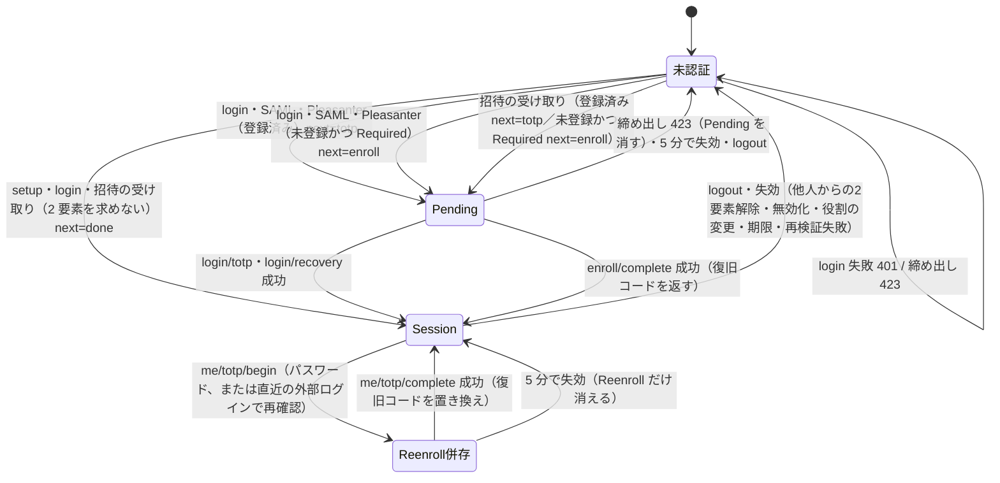

# 管理画面の認証とセッションの仕様書

[管理画面の共通仕様書](../管理画面の共通仕様書.md)の 2〜4 章。**規範は 1.3 の決定、比較の基点は Questionnaire（Q）**。
根拠の書き方と略記（`Q.Web/` など）は目次の「根拠の書き方」に従う。

## 2. 範囲と用語

| 用語 | 意味 | 根拠 |
|---|---|---|
| 管理者 | 管理画面に入れる利用者。Q・AtomFeed・CalendarFeed は**アプリが自分で持つ**（Core の `Core_AdminUsers`）。IdentityProvider（IdP）は **Pleasanter の `Users` の行そのもの**で、専用の表を持たない | `Core.Data/Stores/AdminUserStore.cs:13-45`、IdP `IdP.Web/Endpoints/AdminEndpoints.cs:668-679` |
| 役割（role） | 管理者に 1 つ付く名前。Core が意味を知っているのは `Administrator` だけで、ほかはアプリが決める | `Core.Data/Stores/AdminUserStore.cs:6-11` |
| 権限（permission） | 操作の単位（`対象.操作`）。役割から表で引く（6 章） | `Q.Web/Services/AdminPermissions.cs:7-17` |
| 段階（session kind） | サーバ側セッションの種類。Core は `Pending` と `Session` を定め、アプリが足せる（Q は `Reenroll`） | `Core.Data/Stores/AdminSessionStore.cs:7-15`、`Q.Data/QuestionnaireSessionKinds.cs` |
| Pending | パスワード（または SAML・Pleasanter のログイン）までは通り、2 要素がまだの状態。**何も操作させない**。寿命 5 分 | `Q.Web/Endpoints/AdminAuthEndpoints.cs:626-627, 668-669` |
| Session | ログイン済み。寿命 8 時間（延長しない） | 同 `:623-624, 684-685, 705-706` |
| Reenroll | ログイン済みのまま 2 要素を登録し直している途中。Pending とは別の段階にして、**登録し直しの cookie をログインの途中として使えないようにする**。寿命 5 分 | 同 `:629-637, 671-672` |
| 端末 | サーバ側セッション 1 つ分。一覧・失効には**セッション ID の SHA-256（handle）**を使い、cookie の現物は出さない | `Core.Data/Stores/AdminSessionStore.cs:25-39, 85-92` |
| 入った方式（via） | `password` / `saml` / `pleasanter`。表示用で、**この値だけを再確認の証拠にしない**（U13） | 同 `:17-23`、3.5 |
| 2 要素の方針 | `Required` / `Optional`（既定）/ `Disabled`。アプリ全体で 1 つ | `Q.Web/Services/AdminAuthenticator.cs:6-27, 36` |

対象外: アプリ固有の業務の画面と API（Q のアンケート、AtomFeed・CalendarFeed のフィード、IdP の OIDC クライアント・SAML SP・
署名鍵など）。これらは [API 契約の仕様書](API契約の仕様書.md)の「アプリ固有」に一覧だけを置く。

## 3. 認証の流れ

### 3.1 状態遷移

決定後の規範。Q の流れを基点に U8・U13・U14 を反映した。`next` は画面が次に出すもの。
寿命の 5 分・8 時間は既定値であり、範囲つきの設定で変えられるようにする（U10、8.2）。

- 「Reenroll併存」は、`Session` の cookie を持ったまま `Reenroll` の cookie も持つ状態
  （`Q.Web/Endpoints/AdminUserEndpoints.cs:392-485`）。
- `SignInSessionAsync` は**必ず Pending を消してから** Session を張る（`Q.Web/Endpoints/AdminAuthEndpoints.cs:594-608`）。
- 同じ方式の古いセッションは、新しいものを張る前に消す（`Q.Web/Services/AdminSessionManager.cs:47-74`）。

### 3.2 パスワード

- `POST /api/admin/login` は**どの段階で外れたかを区別しない**。利用者が居ない・パスワードが違う・無効は、
  同じ文言の 401（`auth.invalidCredentials`）。**上限に達した失敗の要求も同じ 401、その次の要求から 423**。
  締め出しの期間は範囲つきの設定による（既定 15 分。U10、6.4）。
  根拠: `Q.Web/Services/AdminAuthenticator.cs:154-165,452-465`、
  `Q.Web/Endpoints/AdminAuthEndpoints.cs:301-333`。
  **現状との差**: Q は期間を外部設定できない。AF・CF は締め出し中も 401、
  IdP は上限に達した要求から 429（A.2）。U3・U10 に従って変更する
- 利用者が居なくても捨てハッシュで照合し、応答時間で実在を漏らさない（`Q.Web/Services/AdminAuthenticator.cs:128-147`）
- パスワードが通っただけでは「ログインした」と記録しない。記録はセッションを張る側で行う
  （同 `:174-190, 389-397`）。**この照合はパスワードの再確認にも使うため**（同 `:180-183`）
- ハッシュは PBKDF2-HMAC-SHA512・210,000 回・塩 16 バイト・書式に版（`v1`）。古い書式は成功時に作り直す
  （`Q.Web/Services/PasswordHasher.cs:19-35, 72`、`Q.Web/Services/AdminAuthenticator.cs:167-172`）
- パスワードの条件は `PasswordMinimumLength`（既定 12）・`PasswordAllowSameAsLoginId`（既定 false）・
  `PasswordPolicies`（正規表現。既定はすべて無効）（`Q:App_Data/Parameters/Security.json`、`Q.Web/Program.cs:389-401`）
- **合言葉のログインを塞げる**（`<APP>_ADMIN_PASSWORD_SIGNIN=false`）。塞げるのは SAML か Pleasanter のログインが有効な間だけ。
  塞いだ状態で `/login` を叩くと 404（`Q.Web/Services/AdminPasswordSignInFilter.cs:10-30`、
  `Q.Web/Endpoints/AdminAuthEndpoints.cs:72-74, 335-336`）
    - 救済トークン（`<APP>_ADMIN_RESCUE_TOKEN`、32 文字以上）を `GET {管理画面}?rescue=…` で照合すると、
      10 分だけ合言葉の入口を開く（cookie `q.admin.rescue`）
      （`Q.Web/Services/AdminPasswordSignInOptions.cs:4-36`、`Q.Web/Services/AdminPasswordSignInPolicy.cs:15-80`、
      `Q.Web/Program.cs:1032-1062`）

### 3.3 TOTP と復旧コード

- RFC 6238。共有鍵 20 バイト（Base32）、6 桁・30 秒・SHA-1、前後 1 枠（Otp.NET）
  （`Q.Web/Services/TotpService.cs:19-71`）
- **同じ時間枠は一度しか通さない**。登録に使った枠もログインへ流用させない
  （`Q.Web/Services/AdminAuthenticator.cs:245-250, 371-379`、`Core.Data/Stores/AdminUserStore.cs:152-156`）
- 共有鍵は `ISecretCipher` で暗号化し、`<appId>:totp:<管理者 ID>` の文脈に束縛して保管する
  （`Core.Data/Stores/AdminUserStore.cs:64-76, 175-188`、`Q.Web/Program.cs:351-359`）
- **登録は 2 回に分ける**（begin で鍵を作り「登録の途中の鍵」としてサーバに預け、complete で数字を確かめて確定）。
  鍵を画面から送り返させない（`Q.Web/Services/AdminAuthenticator.cs:316-387`）
- 復旧コードは 10 本、`XXXXX-XXXXX`（紛らわしい文字を除く 31 文字種）。
  **保存は Q 方式の塩つき PBKDF2 ハッシュだけ**（U12）で、
  **返せるのは登録の完了時だけ**。登録し直すと前の復旧コードは使えなくなる
  （`Q.Web/Services/TotpService.cs:75-124`、`Q.Web/Endpoints/AdminAuthEndpoints.cs:447-448`、
  `Q.Web/Endpoints/AdminUserEndpoints.cs:483-484`）
- **現状との差（U12）**: AF・CF は SHA-256（`AF.Core/Security/Totp.cs:85-86`）。
  旧ハッシュを変換せず、本人確認を伴う再発行で置き換える。旧コードと新コードの併用を移行完了としない
- 復旧コードは使い切り。照合は未使用のハッシュを 1 件ずつ確かめ、使用済みの印を条件に含めた更新で 1 回に限る
  （`Q.Web/Services/AdminAuthenticator.cs:256-314`）
- 共有鍵を復号できない（鍵を失った）ときは 2 要素を `Invalid` とし、復旧コードで入り直してもらう（同 `:220-231`）

### 3.4 2 要素の方針

| 方針 | 未登録の人のログイン | 登録済みの人のログイン | 新しい登録（`/enroll/*`・`/me/totp/begin`） | 自分で解除（`/me/totp/disable`） |
|---|---|---|---|---|
| `Required` | Pending → 登録へ（`next=enroll`） | 2 要素を求める | 受け付ける | 400 `auth.twoFactorRequired` |
| `Optional`（既定） | そのまま Session | 2 要素を求める | 受け付ける | 本人の再確認つきで受け付ける（U13） |
| `Disabled` | そのまま Session | **2 要素を求める**（設定 1 つで既存の保護を外さない） | 400 `auth.twoFactorDisabled` | 本人の再確認つきで受け付ける（U13） |

根拠: `Q.Web/Services/AdminAuthenticator.cs:6-27, 184-190, 399-410`、`Q.Web/Endpoints/AdminAuthEndpoints.cs:355-363, 421-428`、
`Q.Web/Endpoints/AdminUserEndpoints.cs:346-389, 414-422`。
**知らない値は起動時に止める**（`Q.Web/Program.cs:412-427`）。
SAML・Pleasanter のログインで来た人にも同じ判断を当てる（`Q.Web/Services/SamlAuthenticator.cs:111-123`）。
方針は**外部設定だけ**で決め、画面から変えさせない（U10）。
登録開始後に `Disabled` へ変わった場合も、`/me/totp/complete` の入口で 400 を返し、確定しない（U4）。
**現状との差**: Q は complete で例外、AF・CF は 403。AF・CF は方針を画面からも変えられる。

### 3.5 TOTP の登録と登録し直し（不変条件）

Q の登録差し替え防止の修正後（`c774e4b`）を基点に、U1・U4・U7・U13 を規範として加える。

| 番号 | 不変条件 | 破ったときの応答 | 根拠 |
|---|---|---|---|
| T1 | `/enroll/begin`・`/enroll/complete` は **Pending の cookie を持つ人だけ**が使える | 401 | `Q.Web/Endpoints/AdminAuthEndpoints.cs:347-353, 394-398` |
| T2 | **TOTP を登録済みの人は `/enroll/*` を使えない**（パスワードだけで、自分の鍵へ差し替えて入れてしまうため） | 403 `auth.totpAlreadyEnrolled` | 同 `:365-371, 402-406, 538-549` |
| T3 | 登録し直しは**ログイン後**に `/me/totp/begin` で行い、パスワード、または直近の外部ログインによる本人の再確認を要する。ログイン用のレート制限を掛ける（U7・U13） | パスワード拒否は 401（`users.currentPasswordRejected`）・締め出し中は 423。外部再確認の要求形は 11.9 | `Q.Web/Endpoints/AdminUserEndpoints.cs:391-434`、U7・U13 |
| T4 | `/me/totp/complete` は、**同じ人の Reenroll の cookie** と、サーバに預けた途中の鍵があるときだけ通す | 400 `auth.enrollmentRestartRequired` | 同 `:443-462` |
| T5 | Reenroll の cookie では Pending の操作（`/enroll/*`・`/login/totp`）ができない（別の方式・別の段階） | 401 | `Q.Web/Endpoints/AdminAuthEndpoints.cs:629-637`、`Q.Web/Services/AdminSessionGuard.cs:196-203` |
| T6 | 共有鍵は**サーバが作って預ける**。complete は画面から鍵を受け取らない | （要求に鍵の項目が無い） | `Q.Web/Endpoints/AdminAuthEndpoints.cs:373-377, 408-419` |
| T7 | `Disabled` の間は新しい登録の口を閉じる。開始後に方針が変わった `/me/totp/complete` も入口で拒否する（U4） | 400 `auth.twoFactorDisabled` | 同 `:355-363`、`Q.Web/Endpoints/AdminUserEndpoints.cs:414-422`、U4 |
| T8 | 登録の完了・登録し直しの完了で、前の復旧コードを捨てて新しい 10 本を返す。返すのはこの時だけ | — | `Q.Web/Services/AdminAuthenticator.cs:371-379` |
| T9 | 他人の 2 要素の解除はサーバで `users.resetTwoFactor` を要求し、自分自身を対象にできない（自分の分は本人の再確認つきの `/me/totp/disable`） | 権限なし 403・自分は 400 `users.selfNotAllowed` | `Q.Web/Endpoints/AdminUserEndpoints.cs:179-197`、U1・U13 |

**現状との差**: AF・CF は Session だけで再登録でき、begin にレート制限が無い（U7）。
Q は再登録・自己解除の再確認をパスワードだけで行い、JIT 管理者が使える外部再確認の道が無い（U13）。
再確認は単なる既存 cookie や `via` の表示値で代用しない。
直近性の時間窓とサーバ側の証跡の具体化は 11.9 で追跡する。

### 3.6 SAML（SP 起動のみ）

- 流れ: `GET /api/admin/saml/login` → IdP → `POST /api/admin/saml/acs`。**IdP 起動の応答は受けない**
  （`Q.Web/Endpoints/AdminSamlEndpoints.cs:17-38`）
- 署名の検証は `Unbind` が行い、通す・通さないはその後の値だけで決める。`InResponseTo` を預けた要求 ID と突き合わせる
  （同 `:26-29, 190, 206`）
- 途中は cookie `q.admin.saml`（`SameSite=None`・`Secure`、15 分）に預ける（同 `:41-50`）
- 利用者の決め方: NameID か属性の値を**ログイン ID** として突き合わせる。居なければ `Reject`（既定）か `Register`（JIT。
  役割は `RegisterRole`、既定 `Editor`。**Administrator は指定できない**（U8）。
  パスワードは誰も知らない値）（`Q.Web/Services/SamlAuthenticator.cs:73-100`、
  `Q.Web/Services/SamlOptions.cs:98-108`）
- **締め出し中は Pending・Session の発行前に拒む。管理者 0 人でも拒む**（U8）。
  **現状との差**: Q・AF・CF はこの 2 つの判定が無く、JIT に Administrator を選べる（A.2）。
  SAML の失敗は既存の転送形式を維持し、監査には拒否を記録する。追加する理由の値は 11.9 で具体化する
- **本アプリで 2 要素を登録済みなら、SAML で来ても 2 要素を通す**。`Required` なら未登録の人に登録させる
  （`Q.Web/Services/SamlAuthenticator.cs:111-123`）
- 失敗は `{管理画面}?samlError=invalid|unknown-user|disabled` へ戻す（302）。監査ログには 401/403 として残す
  （`Q.Web/Endpoints/AdminSamlEndpoints.cs:684-720`）
- 無効の間、認証の入口は 404。経路は常に登録する（画面から再起動なしで有効にするため）（`Q.Web/Program.cs:989-994`）
- 単一ログアウト（SLO）は 4.4。

### 3.7 Pleasanter のログイン（Pleasanter SSO）

- 画面は Pleasanter でのログインを待つ間、`POST /api/admin/pleasanter-sso/check` を約 2 秒おきに呼ぶ。
  本文は JSON（空でよい）にして、他サイトの form から送れないようにする
  （`Q.Web/Endpoints/AdminPleasanterSsoEndpoints.cs:26-36, 50-52`）
- 本アプリの cookie（`q.` で始まるもの）を除いた、指定の名前の cookie だけを Pleasanter へ転送して本人を確かめる
  （`Q.Web/Services/PleasanterSsoOptions.cs:56, 72, 88-92`）
- **最初の管理者を Pleasanter から作らせない**（管理者が 0 人なら 409 `setup-required`）（同 `:70-76`）
- **締め出し中は Pending・Session を発行せず拒む。JIT の役割に Administrator を含めない**（U8）。
  **現状との差**: Q・AF・CF は締め出しを見ず、Administrator を選べる（A.2）。
  JIT の許可役割は設定入力・画面・実行時のすべてで制約する
- 部署・グループで絞れる（`ALLOWEDDEPTIDS`・`ALLOWEDGROUPIDS`）。居ない人は `Reject`（既定）か `Register`（JIT）
  （`Q.Web/Services/PleasanterSsoOptions.cs:9-15, 38-49, 104-111`）
- 応答: `{status:"unauthenticated"}`（まだ）・`{status:"signedIn", next:"done"|"totp"|"enroll"}`・
  403 `{code:"not-allowed"|"disabled"|"unknown-user"}`・503 `{code:…}`（Pleasanter に届かない）・404（無効）
  （`Q.Web/Endpoints/AdminPleasanterSsoEndpoints.cs:60-160`）
- 入った後も、`REVALIDATEMINUTES`（既定 5、1〜60）ごとに Pleasanter へ確かめ直す（4.3）

### 3.8 招待の受け取り

- 管理者の追加は**パスワードを受け取らず**招待を出す。招待トークンは 32 バイトの乱数（base64url）。
  **保存は SHA-256 の 16 進の小文字 64 文字**（U5）。
  **現状との差**: Q は Base64 で保存する。Core の記述と AF・CF の形へ変更し、既存の招待は失効してよい
  （`Q.Web/Services/InvitationToken.cs:20-41`、`Core.Data/Stores/AdminInvitationStore.cs:6-21`）
- 期限は 48 時間（`InvitationLifetime`）、1 回限り。出し直すと前の招待は死ぬ
  （`Q.Web/Services/AdminAuthenticator.cs:50-55`、`Core.Data/Stores/AdminInvitationStore.cs:25-26`）
- `POST /api/admin/invitations/accept` は認証の外。**無い・期限切れ・使用済みを区別しない**（401 `users.invitationInvalid`）。
  パスワードの条件に合わないときだけ理由を返し、**招待を使い切る前に断る**
  （`Q.Web/Services/AdminUserService.cs:196-243`、`Q.Web/Endpoints/AdminUserEndpoints.cs:574-619`）
- 受け取ると、その人の既存のセッション（通常・途中）をすべて失効させる（同 `:526-531`）
- その後は、登録済みなら Pending（`next=totp`）、未登録かつ `Required` なら Pending（`next=enroll`）、
  それ以外はそのまま Session（`next=done`）（同 `:533-554`）
- 無効にした人宛ての未使用の招待は取り消す（`Q.Web/Services/AdminUserService.cs:343`）

### 3.9 最初の管理者

- `POST /api/admin/setup` は**管理者が 0 人のときだけ**通る。2 人目以降は 409 `auth.administratorAlreadyExists`。
  排他は Core の `CreateFirstAsync`（原子的に 1 回だけ）（`Q.Web/Endpoints/AdminAuthEndpoints.cs:206-263`、
  `Q.Web/Services/AdminAuthenticator.cs:421-450`、`Core.Data/Stores/AdminUserStore.cs:84-89`）
- 役割は `Administrator`。`Required` なら Pending（`next=enroll`）、それ以外はそのまま Session（`next=done`）

## 4. セッション

### 4.1 cookie とサーバ側の保管

| 項目 | 値 | 根拠 |
|---|---|---|
| cookie の名前 | `q.admin`（Session）・`q.admin.pending`・`q.admin.reenroll`。**既定の名前を使わない** | `Q.Web/Program.cs:503-516` |
| 属性 | `HttpOnly`・`SameSite=Strict`・`Secure` は要求に合わせる（`SameAsRequest`）・永続しない・**延長しない** | `Q.Web/Endpoints/AdminAuthEndpoints.cs:698-706`、`Q.Web/Services/AdminSessionManager.cs:69-72` |
| cookie の中身 | **セッション ID だけ**（ASP.NET Core の暗号化チケットに載せる） | `Q.Web/Services/AdminSessionManager.cs:21-27, 66-68` |
| セッション ID | 推測できない 256 bit。DB には **SHA-256 だけ** | `Core.Data/Stores/AdminSessionStore.cs:60, 109-116` |
| 保管先 | `Core_AdminSessions`（既定）か Redis（`<APP>_ADMIN_SESSION_STORE=Database\|Redis`） | `Q.Web/Program.cs:363-383` |
| 持つ値 | 持ち主・段階・期限・送信元 IP・User-Agent（512 文字まで）・SAML の NameID と SessionIndex・Pleasanter のテナントと利用者と最後に確かめた時刻 | `Core.Data/Stores/AdminSessionStore.cs:145-165` |
| 未認証時の応答 | 画面へ転送せず、401（Pleasanter に確かめられなかったときは 503）・403 | `Q.Web/Endpoints/AdminAuthEndpoints.cs:708-723` |
| キャッシュ | 管理 API の応答に `Cache-Control: no-store, no-cache, must-revalidate` | 同 `:674-682` |

### 4.2 要求ごとの復元（役割は DB から読む）

- 要求のたびに cookie の ID からセッションを引き、**持ち主・ログイン ID・役割を利用者の表から組み立て直す**。
  権限は役割の claim から**その都度**表を引く（cookie へ焼かない）
  （`Q.Web/Services/AdminSessionManager.cs:76-153`、`Q.Web/Program.cs:539-550`）
- 段階が違えば無いものとして扱う（Pending の ID を Session として使えない）（`Q.Web/Services/AdminSessionManager.cs:91-95`）
- 持ち主が居ない・無効なら、その場でセッションを消して拒む（`Q.Web/Services/AdminSessionGuard.cs:250-257`）
- 保管先が読めない（Redis の障害）ときは**cookie だけで通さない**（同 `:231-239`）
- 要求が打ち切られただけのときは拒まない（cookie を捨てない）（同 `:217-230`）

### 4.3 失効の条件

| 契機 | 失効させるもの | 根拠 |
|---|---|---|
| ログアウト | いまの Session・Pending・Reenroll | `Q.Web/Endpoints/AdminAuthEndpoints.cs:475-487` |
| 期限 | Session 8 時間・Pending 5 分・Reenroll 5 分（延長なし） | 同 `:668-672, 684-685` |
| 2 要素の締め出し | いまの Pending | 同 `:513-522` |
| 自分のパスワードの変更 | **いまの端末以外**の全セッション（途中状態も） | `Q.Web/Endpoints/AdminUserEndpoints.cs:282-291` |
| 招待の受け取り | その人の全セッション | 同 `:526-531` |
| 役割の変更 | 相手の全セッション | `Q.Web/Services/AdminUserService.cs:384-386` |
| 他人の 2 要素の解除 | 対象者の全セッション（Session・Pending・Reenroll）。cookie の有無に依存しない | U14、`AF.Web/Endpoints/AdminUserEndpoints.cs:289-292` |
| 利用者の無効化 | 対象者の全セッション（途中状態も）。次の要求での拒否だけで済ませない | U14、`AF.Web/Endpoints/AdminUserEndpoints.cs:238-242` |
| 端末の一覧からの失効 | 指定の 1 端末（**持ち主の組で消す**。他人の handle は 404） | `Q.Web/Endpoints/AdminSessionEndpoints.cs:123-143` |
| ほかの端末をすべて失効 | いまの端末以外 | 同 `:41-52` |
| Pleasanter の再検証の失敗 | そのセッション（届かないときは 503） | `Q.Web/Services/AdminSessionGuard.cs:261-289` |
| 期限切れの掃除 | 期限切れの行（DB のとき。Redis は TTL） | `Q.Worker/AuditLogRetention.cs:242`、`Q.Data/RedisAdminSessionStore.cs:22` |

**現状との差（U14）**: Q の他人の 2 要素解除ではセッションを消さず、
無効化は `AdminSessionGuard` が次の要求で拒むだけ（`Q.Web/Endpoints/AdminUserEndpoints.cs:218-222`、
`Q.Web/Services/AdminSessionGuard.cs:250-257`）。DB・Redis の両方で全失効を実装する。
この決定の「無効化」は利用者の無効化を指す。自分の 2 要素解除後の現在端末の扱いは 11.9 に分ける。

### 4.4 SAML の単一ログアウト（SLO）

- SP 起点: `GET /api/admin/saml/logout`。**先に本アプリのセッションを落としてから** IdP へ頼む。
  SAML で入った人でなければ管理画面へ戻すだけ（`Q.Web/Endpoints/AdminSamlEndpoints.cs:270-327`）
- IdP 起点と応答: `GET|POST /api/admin/saml/slo`。SLO の URL が未設定なら 404。
  **IdP 起点の要求は署名・発行者を検証してから、NameID とセッション索引で該当セッションをすべて消す**（U6）。
  cookie が届かなくても失効させる。偽の要求で検索失効しない
  （`AF.Web/Endpoints/AdminSamlEndpoints.cs:294-315`、`Core.Data/Stores/AdminSessionStore.cs` の
  `IAdminSessionStore.DeleteBySamlKeysAsync`）
- **現状との差**: Q は署名の検証前に要求の cookie の Session・Pending を落とし、
  キーでの検索失効を行っていない（`Q.Web/Endpoints/AdminSamlEndpoints.cs:329-346,380-399`）。
  IdP からの他サイト要求で cookie が届くかは実機未確認だが、決定後の処理はそれに依存しない
